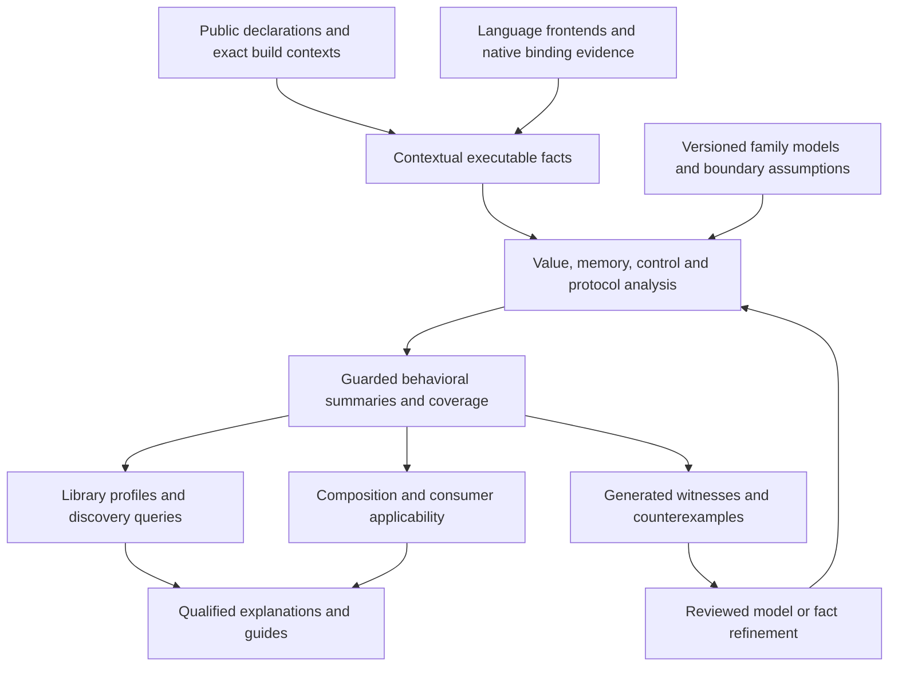

> **Migrated 2026-09-13** from `smartref/tooling/library_guides/docs/foundational_behavior_characterization_design_assessment_2026-09-13.md`. Frozen provenance: paths inside refer to the pre-migration layout (`library_guides/` is now `src/library_deep_enrichment/`, `native/` and `rustdoc-helper/` are now `crates/`).

# Foundational library behavior characterization: design assessment

Date: 2026-09-13. Status: proposed design, based on inspected implementation and pinned provider sources. This assessment does not implement the proposal or change the pilot's support judgments. Author and reviewer are the same agent; no independent review is claimed.

## 1. Recommendation and scope

Build a reusable engine for **guarded, interprocedural behavioral summaries**: descriptions of how an operation transforms values, memory, resources and execution state, under explicit input and environment conditions. Derive these summaries from language-aware code facts, then compose them into capability explanations and consumer decisions.

This is the main missing connection between the substantial fact inventory and the semantic obligations in [TASK_ASSESSMENT.md](../pilot/intelligence/TASK_ASSESSMENT.md). The present assessment has 16 gaps, four partial results and four supported results. These are judgments about generated decision support, not evidence that the underlying libraries lack the capabilities. Several generated gaps retain historically supported manual baselines.

The broadest improvement will come from three connected investments:

1. **Retain executable semantics across boundaries.** Preserve evaluated operations, guards, field and buffer identity, concrete call targets where available, cleanup paths, and deferred execution. Join declarations, build contexts and executable bodies without conflating their different evidence.
2. **Infer conditional transformations systematically.** Analyze values, heap locations, control flow, calls and lifecycle transitions for the declared operation population. A function summary must describe relationships between inputs and outputs, not just tags such as “streaming,” “mutation” or “conversion.”
3. **Add reusable semantic families and falsification.** Collection cardinality, schema evolution, serialization, reductions and concurrency require vocabulary beyond machine operations. Bind reviewed family models to verified implementations, expose their assumptions, and use generated counterexamples to challenge them. Tasks become consumers of these results.

The recommendation is not to generate a bespoke rule for each missing task. Nor is it realistic to expect arbitrary library behavior to follow automatically from syntax and type signatures. The useful boundary is: language semantics and generic analyses supply reusable machinery; semantic family models supply explicit meanings and laws; library adapters establish where those models apply; consumer queries supply requirements.

### Evidence basis and limits

The [code-facts-lib-ref skill](../../../.codex/skills/code-facts-lib-ref/SKILL.md) and [rust-api-extraction-ref skill](../../../.codex/skills/rust-api-extraction-ref/SKILL.md) were used as navigators. The former routes several provider libraries; it is not evidence of an installed, unified `code-facts-lib` runtime. Relevant reference sections were checked against owned producers and, for critical capabilities, the pinned upstream source. The prescribed `just lib-outline` helper was unavailable in this checkout; section indexes and exact source reads supplied the fallback.

Code-intelligence MCP tools were unavailable, so inspection used the [search-tools-ref fallback](../../../.codex/skills/search-tools-ref/SKILL.md). Statements about missing behavior below concern the inspected producers and analysis passes; they are not transitive-closure or repository-wide absence proofs.

The pilot's core freeze is `89cb8d1665f7d4e06a2cc48b80a19a936679aa1617500a4c36d8ad3444343b3e`. Its 270 file hashes were checked against the working tree. Historical execution results remain in [COMPLETION.md](../pilot/intelligence/COMPLETION.md); no extraction, qualification, compiler run or test suite was rerun for this documentation assessment. The companion [evidence record](foundational_behavior_characterization_evidence_2026-09-13.json) records inspected file hashes, provider selections and the assessment denominator.

## 2. What the current system already provides, and where meaning is lost

The foundation is worth extending. The inspected pipeline already has contextual declarations, native artifacts, source alignment, explicit unresolved boundaries, finite analyses, approved transfer models, composition machinery and evidence admission. Replacing those with a second fact store or a free-form semantic generator would discard useful discipline.

| Evidence layer | Observed implementation | General shortfall | Appropriate response |
| --- | --- | --- | --- |
| Rust declarations and context | Typed rustdoc decoders, parent/public-route indexes, generics, constraints and Cargo messages are retained. | Declaration availability, executable dispatch and behavioral applicability are not one question. | Join their contextual identities and constraints; do not repeat basic declaration extraction. |
| Rust executable facts | MIR retains operations, constructor variants, scalar literals, projected places, call arguments, branch values, successors and unwind targets. | Some semantic details remain debug strings or explicit omissions; definition bodies do not enumerate every executable instance. | Normalize missing typed details and executable-use relationships; consume existing detail before expanding collection indiscriminately. |
| Rust local flow | A finite fixed point propagates sets of possible origins through the CFG. | Branches receive merged state; projected memory becomes an unknown; call results combine argument origins and a call frontier. | Add guarded value and field-sensitive memory transfer, then parameterized callee summaries. |
| Rust transitive effects | Selected local definitions participate in a finite may-effect fixed point. | Effect propagation does not substitute callee return, heap or resource transformations across compilation units. | Extend the summary algebra and contextual call joins. |
| Python lexical and type facts | A populated Ruff semantic model supplies bindings/references; Pyrefly supplies types, located callees, subtype/member queries and targeted type graphs. | These do not constitute an execution CFG, heap model, exception model or proof of native dispatch. | Build an evaluated Python execution projection and resolve specific boundaries with independent evidence. |
| Semantic interpretation | Controlled source grammars and approved transfer mappings produce qualified facts. | These mappings are mostly supplied interpretations; the inspected analyses do not derive a general guarded state transformer from a body. | Make derived summaries a reusable input to qualification. |
| Composition | Typed applicability and generated ordinary-consumer programs exist. | Composing signatures cannot supply absent cardinality, ownership, phase or failure contracts. | Enrich the same composition mechanism with derived conditional summaries and explicit obligations. |

Implementation anchors: [MIR projection](../native/mir-facts/src/projection.rs), [literal/constructor retention](../native/mir-facts/src/values.rs), [local flow](../library_guides/analyses/flow.py), [effects](../library_guides/analyses/effects.py), [Rust analysis service](../library_guides/analyses/fabric.py), [Python analysis service](../library_guides/analyses/python_fabric.py), [transfer models](../library_guides/semantics/transfers.py), [applicability](../library_guides/semantics/applicability.py), and [composition programs](../library_guides/semantics/composition_programs.py).

Four different problems must stay distinguishable in the work backlog:

- **Missing observation:** a callee's concrete generic substitution or a native registration mapping was not collected.
- **Lossy normalization:** the artifact retains information, but the owned projection or identity join loses what an analysis needs.
- **Missing derivation:** branch targets and field paths are present, but no analysis computes their conditional effect on outputs.
- **External obligation:** local code cannot establish an unobserved server's atomicity or a consumer dataset's uniqueness.

Adding more raw facts addresses only the first category. Adding another capability label addresses none of them by itself.

## 3. Provider capabilities: what to reuse, deepen or qualify

### 3.1 Rust executable semantics

The current [MIR worker](../native/mir-facts/src/main.rs) uses `rustc_public` with a narrow `rustc_private` boundary, pinned to [nightly-2026-08-18](../native/mir-facts/rust-toolchain.toml). It enumerates local item bodies. Its receipt explicitly does not claim a complete monomorphized universe.

**Already collected, but underused:** `Place` projections distinguish fields, dereferences, indices, slices and downcasts. Rvalues include arithmetic, casts, aggregates, references, discriminants and lengths. Terminators retain branch conditions, value-to-target mappings, arguments, destinations and unwind edges. Scalar literals and constructor variants are already normalized. The immediate opportunity is to interpret these facts rather than nominate their collection as new work.

**Collection/normalization to deepen:** replace behavior-relevant debug strings with owned typed operators and payloads; retain const-generic values and relevant region relationships where the pinned API can supply them; distinguish unsupported type binders and aliases explicitly. Retain callsite substitutions, compiler-backed callee identities across units, closure captures and executable uses such as drop glue, shims and virtual dispatch candidates. Keep generic definition bodies separate from observed concrete instances. A successfully resolved instance at one callsite does not close every use of that definition.

**Optional compiler enrichment:** MIR place contexts, move/initialization information, borrow facts and concrete-instance information can improve access and lifetime reasoning. Extend the existing isolated compiler boundary only for a measured analysis need. The [MIR reference](../../../docs/library_ref/rust_mir_cpg_continuous_reference_2026-08-18.md), especially §§20–32 and Appendix P, distinguishes public MIR facts from private borrow-checker and compiler-instance facts. Borrow checking itself involves move/initialization and region analyses; reference creation alone is not a borrow-checker result. [Rust compiler borrow-checking guide](https://rustc-dev-guide.rust-lang.org/borrow-check.html).

The compiler's dataflow framework provides a useful implementation model: abstract states, joins, statement/terminator effects, edge-specific effects and fixed-point iteration. Use it inside a pinned compiler worker only if that is the best ownership boundary; otherwise implement equivalent owned transfers over retained MIR facts. Its existence does not make this pipeline's transfers sound automatically. [Rust MIR dataflow guide](https://rustc-dev-guide.rust-lang.org/mir/dataflow.html).

### 3.2 Python execution and typing

The [source-facts manifest](../native/source-facts/Cargo.toml) uses Tree-sitter 0.26.12 and Ruff path crates. [Bootstrap](../native/source-facts/bootstrap.sh) selects Ruff 0.16.1 at `80790b348b5188e7fc253665540f442c6ec7dd05`. The [lexical projection](../native/source-facts/src/lexical.rs) already obtains a populated semantic model through the owned Checker patch; simply constructing `SemanticModel` would not replace that traversal.

Use Ruff's evaluated AST traversal, source ranges, scope/binding identities, resolved imports, branch relationships and execution-context information as inputs to a Python execution normalizer. Capture traversal-local exception and context state when visiting the relevant operation; the final semantic model is not a historical trace of that state. Tree-sitter remains useful for lossless syntax, source mapping and recoverable structure, not runtime dispatch or execution order.

The Python projection must also represent implicit calls: attribute access can invoke a descriptor, arithmetic can dispatch to special methods, and iteration or context entry can execute user code. Class bodies and imports have execution effects; defining a generator is different from advancing it. Typed candidates can refine these events, but unsupported dynamic behavior needs a call/effect frontier rather than a built-in-only interpretation.

**Critical qualification finding:** the pinned Ruff source exposes `build_cfg`, but [its CFG builder](../native/source-facts/upstream/crates/ruff_python_semantic/src/cfg/graph.rs) leaves the `While`, `For`, `If`, `Match`, `Try`, `With`, `Break` and `Continue` arms empty in `process_stmts`. It must not be adopted as a complete Python control-flow implementation. Reuse the AST and semantic services, then implement or qualify an owned CFG that handles short-circuiting, loops, exception routing, `finally`, context-manager cleanup, comprehensions, generators and suspension. Mark unsupported constructs rather than silently flattening them. The [Ruff reference](../../../docs/library_ref/ruff_python_crates_advanced_reference_2026-08-18.md), §§5.5 and 8.14–8.19, is a guide to the surfaces, not evidence that this pinned CFG is complete.

The [Python semantic worker](../native/python-semantics/src/main.rs) already calls `get_type_table_in_file`, `get_callees_with_location`, `is_subtype`, `get_attributes` and a targeted TSP facade. [Bootstrap](../native/python-semantics/bootstrap.sh) selects Pyrefly 1.2.0 at `1933169ad8ee9e4d4114112eb56ef0811fb0a094`. Both provider checkout heads were verified against these selections.

The useful expansion is to carry declared, computed and expected types separately into execution analysis; preserve union/overload alternatives, generic substitutions and narrowed predicates; and resolve declaration locations currently left unresolved in the [targeted projection](../native/python-semantics/src/targeted.rs). Raw TSP retention already exists. Subtyping and member queries should discharge specific compatibility obligations rather than generate an expensive all-pairs type relation. `Any`, opaque stubs and unresolved dynamic attributes must remain limits on behavioral certainty.

One available but uncalled owned-worker surface is `resolve_target_from_qualified_name` in the [pinned Pyrefly query implementation](../native/python-semantics/upstream/pyrefly/lib/query.rs). It type-checks a synthetic expression and contains unchecked unwraps; an adapter needs validated inputs, a supervised failure boundary and source/context reconciliation. It can help resolve a nominated target, but it is not by itself a stable cross-language identity proof. Similarly, `get_attributes` is scoped to its selected class query, not a universal runtime object inventory. See the [Pyrefly reference](../../../docs/library_ref/pyrefly_rust_cpg_advanced_reference_1.2.0_2026-08-19.md), §§8–15.

### 3.3 Public API, configuration and extension contracts

Keep the three planes from the Rust extraction skill: Cargo resolution context, the generated rustdoc artifact, and its typed schema. Add an explicit join to actual compiler-unit and body evidence. A Cargo resolved package graph does not uniquely identify every compilation unit; a rustdoc artifact does not contain function bodies.

The [helper manifest](../rustdoc-helper/Cargo.toml) already selects `cargo_metadata` 0.23.1 and typed rustdoc formats 57, 59, 60 and 61. [Declaration normalization](../rustdoc-helper/src/declarations.rs) and [Cargo-message capture](../rustdoc-helper/src/cargo_messages.rs) already provide substantial retained structure. The latter includes build-script outputs; recapturing them under a new name would not address the missing semantic joins. Cargo's structured message enum explicitly separates compiler artifacts, diagnostics, build-script results and build completion. [Cargo Message API](https://docs.rs/cargo_metadata/0.23.1/cargo_metadata/enum.Message.html).

Exploit the retained structure more deeply:

- Resolve public reachability through modules and re-exports, with an explicit inventory denominator. Never make a scoped “no built-in satisfies this requirement” claim by filtering only public visibility or searching names.
- Treat trait implementations, associated items, bounds, defaults and blanket implementations as conditional capability constraints. A blanket impl is not a finite list of all implementing types.
- Join defined, requested and resolved features to observed compiler units, target cfg and build-script outputs. Analyze a declared finite configuration catalog, retaining unsupported and failed configurations.
- Use structured API differences to identify changed constraints and invalidate behavioral summaries. A structural difference is not automatically a compatibility judgment.

References: [Cargo chapters 7, 9, 13–17](../../../docs/library_ref/cargo_metadata_comprehensive_advanced_reference_2026-09-11.md), [rustdoc-types chapters 25–31](../../../docs/library_ref/rustdoc_types_comprehensive_advanced_reference_2026-09-11.md), and [rustdoc JSON chapters 15–16, 26](../../../docs/library_ref/rustdoc_json_comprehensive_advanced_reference_2026-09-11.md).

### 3.4 Cross-language and external boundaries

Native Python interfaces make a third language a practical concern. Python and Rust facts alone cannot characterize a Cython-to-C++ body. Introduce a general `BoundaryBinding` relation that identifies the exposed symbol, generated wrapper, native target, argument/result conversions, exception translation, ownership handoff and build context. Populate it from exact registration/build artifacts and source mappings. Name similarity is candidate evidence only.

For PyO3, macro attributes and generated wrapper/registration artifacts can expose the binding route, but the generated descriptor is not the native operation's behavioral summary. [PyO3 class documentation](https://pyo3.rs/main/class.html). For Cython, preserve `.pyx`/`.pxd` sources, directives, generated C/C++ and compiler commands; translation to C/C++ and then an extension module makes both stages relevant. [Cython compilation documentation](https://cython.readthedocs.io/en/latest/src/userguide/source_files_and_compilation.html).

A targeted C/C++ frontend is therefore a justified later extension when measured unresolved-boundary fanout warrants it. A compilation database supplies exact translation-unit commands; LibTooling can run AST-based analysis in those contexts. Neither a command database nor libclang symbol extraction supplies a complete memory/effect model. Qualify the specific AST/CFG extraction separately. [Clang compilation databases](https://clang.llvm.org/docs/JSONCompilationDatabase.html), [LibTooling](https://clang.llvm.org/docs/LibTooling.html).

For a boundary with unavailable source, retain a versioned explicit contract and conformance evidence. An assumed contract may enable conditional composition; it must remain distinguishable from a body-derived result.

### 3.5 Analysis infrastructure and optional additions

The current [dependencies](../pyproject.toml) already include NetworkX, igraph, Z3 and Hypothesis. [Relational derivation](../library_guides/semantics/relational.py) already runs bounded, allowlisted Soufflé programs. Reuse these capabilities before adding another analysis platform.

Use positive relational rules for contextual joins, reachability and explainable candidate relationships; use an abstract interpreter for state transfer and convergence; use a constraint solver for bounded feasibility/implication questions. Do not express an entire heap interpreter as unbounded Datalog, or treat a solver's `unknown` as a false predicate.

Soufflé provenance can help explain a derivation using rule/subproof information. Its minimal-height explanation is not an independent semantic certificate and need not enumerate every alternative dependency; corpus invalidation still needs its own complete read set. [Soufflé provenance documentation](https://souffle-lang.github.io/provenance).

If summary execution moves into Rust, petgraph supplies SCC and dominator building blocks. The pipeline already has control dependence and graph algorithms; selecting petgraph is an implementation placement choice, not a new semantic capability. See [petgraph reference](../../../docs/library_ref/petgraph.md) and [dominator API, observed version 0.8.3](https://docs.rs/petgraph/latest/petgraph/algo/dominators/index.html).

## 4. Proposed fact contract: retain semantics below capabilities

The following are conceptual relation families, not new implemented APIs. They should extend the current owned contracts and admission path. Frontends preserve language-specific extensions rather than forcing Python exceptions and Rust unwinding, or Python object identity and Rust places, into falsely equivalent records.

| Family | Minimum information | What it enables |
| --- | --- | --- |
| `AnalysisContext` | Source/artifact digests, compiler/interpreter and frontend identity, package/distribution, target, features/cfg, imports, actual compilation unit, body phase | Contextual joins and reproducible invalidation |
| `ProgramPoint` / `ControlEdge` | Owner, block and operation, source and expansion mapping, normal/error/unwind/suspend/resume edges, guard expression, deferred body identity | Feasible-path, cleanup and execution-phase reasoning |
| `ValueExpression` | Typed operator, operands, literal/variant payload, generic substitution, result identities and parameter/config origins | Guarded symbolic relationships instead of origin tags alone |
| `Access` / `Region` | Read/write/move/borrow/release, projected location, allocation site, alias candidates, extent/layout, escape and owner relationships | Field lineage, mutation, copy/view and lifetime conditions |
| `CallBinding` | Callsite, argument-to-formal mapping, dispatch kind, candidate identities, substitutions, return/error edges, target-set completeness | Parameterized interprocedural summaries and honest indirect dispatch |
| `DeferredExecution` | Closure captures, generator/future construction, activation, suspension, resume and destruction relationships | Distinguishing constructing a plan/stream from executing it |
| `BoundaryBinding` | Wrapper and native identities, ABI/layout, conversion steps, exception mapping, resource transfer and provenance | Cross-language composition without name-based equivalence |
| `AvailabilityConstraint` | Public routes, trait/member obligations, registry membership, configuration guards, closed inventory scope | Built-in eligibility and extension requirements |
| `CoverageFrontier` | Selected denominator, unresolved entity/construct, reason, affected dimensions, budget/worker outcome and exact dependencies | Honest uncertainty and reusable refinement scheduling |

The raw artifact remains available for interpretation upgrades. Every normalized fact needs a source/producer mapping and a declared completeness boundary. “Not emitted” must be distinguishable from “not present,” “outside the selected universe,” “unsupported by the frontend” and “producer interrupted.”

A source range, rustdoc local ID, display name and concrete executable instance are different identities. Cross-artifact joins should use context plus compiler/declaration evidence; keep candidate joins explicit when exact identity cannot be established. Original source and expanded/generated source need a mapping, not a shared fictional byte range.

Collect broad, inexpensive declaration and structural facts for the admitted population. Collect bodies, instances and native boundaries in measured stages, driven by public reachability and unresolved-summary fanout. This supports library-wide characterization without attempting every possible monomorphization or runtime Python object configuration.

## 5. Generalized behavioral analysis

### 5.1 Summary contract and precision

A useful operation summary describes:

> In context C, under precondition P, with input values/regions/resources X, each modeled normal, error or suspended outcome has guard G, output relation R, memory transformation H, protocol transition T and possible effects E, subject to assumptions A and unresolved frontier U.

Store clauses, their derivation dependencies and the abstract domains used. Do not collapse them into a single confidence score. A consumer must be able to inspect “copies when layout is incompatible” separately from “native release behavior unresolved.”

Use two distinct axes:

- **Semantic approximation:** possible values/aliases/effects and relationships, with a defined abstraction and transfer semantics.
- **Evidence status:** body-derived under a model, declared by documentation, observed in a witness, assumed at a boundary, or unresolved.

An empty set representing unreachable state is not unknown state. Unknown external behavior is not an empty effect set. “May write” means a conservative possibility within the stated model; “must release” needs all feasible relevant outcomes covered under its precondition. A universal absence claim requires a closed, sound scope, including relevant callbacks and cleanup. A code-level guarantee is still conditional on the frontend and transfer model being correct.

Use finite-height domains where practical, widening for unbounded domains, and check that admitted conservative results satisfy the required post-fixed-point condition. Budget exhaustion cannot masquerade as convergence. Widening can preserve a valid but less precise bound; a truncated search alone cannot. Solver infeasibility establishes impossibility only within the encoded semantics and assumptions. Nontermination, abort and suspension must be accounted for separately when interpreting “all exits.”

### 5.2 Values, guards and configuration

Start with constants, booleans, enum variants, null/optional state, intervals or symbolic lengths, and provenance from arguments and configuration fields. Interpret edge guards to refine these domains. Preserve equalities and selected relational predicates where they materially improve summaries; avoid unrestricted path enumeration.

Represent outcomes as bounded guarded clauses, merging or widening them explicitly when necessary. Track why a precision loss occurred. This should uncover behavior that changes with input representation, nullability, checked arithmetic, feature flags, execution options or buffer layout using the same mechanism.

Documentation defaults and annotation `Literal` domains are useful declared constraints, but they are not proof that a body enforces them. The current [document semantics](../library_guides/semantics/documents.py) can feed candidate domains; executable guards establish enforcement. A solver should receive typed semantics: integer overflow modes, bit widths and floating-point behavior cannot be approximated as unbounded mathematical integers without stating the change.

### 5.3 Memory, lineage and representation

Extend the current local-origin analysis with abstract locations: local/field paths, allocation sites, bounded index partitions, and explicit unknown regions. Preserve aggregate fields separately. Strong updates require a proven unique target; otherwise use weak updates. Unknown calls conservatively affect reachable regions according to the available boundary model. Proved separation can keep unrelated regions precise.

Derive relationships such as output field forwarded from input field, output buffer aliases an input allocation, fresh allocation receives copied elements, length changes, metadata field omitted during reconstruction, and an owner escapes through a returned wrapper. Distinguish moving a handle, reference-counting a buffer, allocating a descriptor, and copying payload bytes. An allocation alone does not imply a payload copy; a shared address at one observation does not establish lifetime correctness.

This is the common foundation for schema/metadata preservation, zero-copy conditions, null representation and conversion direction. Domain interpretation remains separate: forwarding a metadata map preserves its bytes but does not validate the meaning of a unit annotation or reconcile conflicting field semantics.

### 5.4 Interprocedural and higher-order summaries

Analyze call-graph strongly connected components with parameterized summaries. Substitute actual arguments, regions, predicates and callback contracts into callee summaries; propagate return, error, heap and resource transformations. Cache by contextual body identity, abstract input specialization and dependency/model versions. Recursion requires a convergent summary computation, not circular evidence that assumes the conclusion.

Resolve direct calls, observed generic instances, function-pointer flows, closures and virtual candidates separately. Retain open target sets. A callback-taking API can have a useful conditional summary—“preserves element count if its callback produces one result and does not abort”—without pretending the callback is known. Public wrappers should inherit verified behavior through actual call/binding relationships, including conversions and error translation.

The current local-effect fixed point and explicit call frontiers are a suitable starting structure for this work. Merely increasing its 200-owner selection limit would increase reach without supplying the missing transfer semantics.

### 5.5 Protocols, phases and failure

Infer candidate state machines from state fields, guarded transitions, resource accesses and event order. Model creation, configuration, activation, iteration/polling, completion, error, cancellation and release. Keep “wrapper constructed,” “work scheduled,” “external effect performed” and “result consumed” distinct.

Analyze ordinary return and error paths together with Rust drop/unwind and Python exception/finally/context-manager paths. Record retries and repeated effects, EOF requirements, partial reads/writes, cleanup obligations and ownership handoff. Dominance and control dependence help identify ordering; postdominance over only terminating normal paths cannot prove cleanup under cancellation or nontermination.

Protocol inference should emit guarded transition candidates before claiming an API contract. Similar state-machine structure can characterize parsers, streams, transactions, sessions, buffers and iterators across libraries. It can reveal unexpected lazy effects, consumable handles, cleanup-dependent cancellation and errors swallowed during iteration.

### 5.6 Collection, schema and algebraic families

Some high-value semantics require reusable abstractions above machine operations. Introduce versioned family models with explicit carrier types, primitive operations, laws, assumptions and a source-backed binding procedure.

| Family | Reusable relationships to derive or verify | Assumptions that must remain visible |
| --- | --- | --- |
| Collections and relations | Length bounds, filtering, expansion, key multiplicity, unmatched values, ordering, one-to-many transfer | Key uniqueness, functional dependencies, join kind, callback behavior |
| Records and schemas | Field lineage, reconstruction, recursive merge, nullability, metadata precedence and conflicts | Compatibility policy and interpretation of metadata |
| Reductions and accumulators | State initialization/update/merge/finalize, empty input, null treatment, partitioned execution equivalence | Identity and associativity laws, ordering, overflow and floating-point semantics |
| Serialization and framing | Encode/decode domain, framing boundaries, buffering, finite input and partial-progress relationships | Representation validity, EOF/framing policy, transport behavior |
| Buffers and interchange | Layout/extent/validity relationships, device transitions, alias/copy conditions, owner lifetime | ABI, synchronization, consumer support and release protocol |
| Requests and transactions | Preconditions, request construction, retries, failure classes, local effect ordering | Remote atomicity, isolation, idempotency and consistency contract |

For example, a generic join transfer can express multiplicity in terms of matching-key counts; it must not assume uniqueness because the user calls an input a “reference table.” A reduction's signature does not prove that arbitrary partition/merge orders preserve results. For floating-point aggregation, even a mathematical associativity argument may not establish bitwise equivalence.

The current [transfer contracts](../library_guides/semantics/enrichment_contracts.py) and [approved mappings](../library_guides/semantics/transfers.py) provide a place to integrate such models. Separate a model's declared law, a body-derived implementation relation, a discharged proof obligation and a finite behavioral observation. Inference of “this implementation belongs to this family” is itself a checked claim.

### 5.7 Availability, execution placement and extension obligations

Compose type/representation constraints with phase, cardinality, effect and lifecycle summaries. This allows a general compatibility solver to distinguish operations that construct deferred expressions from operations that consume materialized values. Library-specific registries and planner/provider interfaces supply bindings into this vocabulary; their names alone do not define the semantics.

Generate extension obligations from trait/protocol requirements and the semantic family of the extension point: required/default members, associated types, state transitions, error/null behavior, registration and execution context. Compile an ordinary consumer to check a concrete instantiation, then exercise its behavioral obligations separately.

The [existing contract helper](../library_guides/analyses/contracts.py) contains reusable declaration/extension logic, but legacy helpers must be integrated through the active analysis service rather than becoming another admission authority. A claim that customization is necessary needs a closed candidate inventory and explicit elimination reasons; unresolved candidates prevent the stronger “no suitable built-in” conclusion.

### 5.8 Cost, ambient dependence and interference

Extend the same summary vocabulary beyond the current task categories. Treat reads of clocks, randomness, environment variables, mutable globals, caches and external resources as dependencies. Track whether they reach outputs, guards or effects. This can expose context-sensitive behavior and candidates for nondeterminism or order dependence; proving determinism still requires a closed model of the relevant state and scheduling.

Attach symbolic resource counters to allocations, retained regions, loop iterations, calls and buffered elements. Derive bounds only when loop/callee invariants support them. Distinguish output incrementality, peak retained payload, internal operator buffering and externally observed latency. A stream can be incremental while an upstream operation retains its entire input.

For concurrent operations, retain task creation, await/join, lock/atomic operations and shared-region access as events with explicit ordering relationships. Use these to nominate interference and synchronization obligations. Do not infer a happens-before guarantee from lexical statement order across tasks or a race-free guarantee from the absence of modeled conflicting edges. These domains can reveal cache-dependent effects, unexpectedly retained memory, repeated expensive work and shared-state interactions without inventing new task-specific capability rules.

## 6. How this discovers behavior that nobody requested

Run characterization against the declared public operation population and reachable implementation regions, not only the 24 task candidates. Publish a behavioral profile for each operation, including unknown dimensions. Use task-independent searches over those profiles:

- **Guard partitions:** identify operations whose ownership, allocation, error, cardinality or phase behavior changes with an input/configuration predicate.
- **Lineage discontinuities:** find fields or resources that are forwarded through most of a composition but reconstructed, discarded or reinterpreted at one boundary.
- **Deferred effects:** find objects whose construction is inert but whose first iteration, poll, finalization or drop performs work.
- **Protocol asymmetries:** find success/error paths with different consumption, release, retry or state-reset behavior.
- **Implementation families and exceptions:** cluster normalized summary structure, then identify members with additional guards, effects or failure paths. Cluster membership nominates a relationship; it does not prove behavioral equivalence.
- **Cross-version/configuration differences:** compare contextual summaries to find newly introduced effects or changed preconditions even when public signatures are unchanged.
- **Documentation disagreements:** compare declared contracts with derived relationships and minimized witnesses. Retain disagreement as an investigation result rather than silently picking the preferred account.

These searches should be extensible in terms of primitive relationships—guard, input dependence, allocation, state transition, effect order and field lineage. A permanently closed list of “interesting capability tags” would reproduce the anticipation problem at another layer. Preserve the underlying relational/symbolic summaries so a new query can investigate existing data without collecting the entire library again.

Discovery still has a model horizon: an analysis cannot identify an unrepresented phenomenon. Report which domains were analyzed, which events remained opaque, and which source regions were not selected. The differentiated value is evidence-backed discovery within an expanding semantic vocabulary, not a claim of unrestricted semantic understanding.

### Illustrative derivation: conditional buffer reuse

The following is a hypothetical example of the proposed analysis, not a claim about an inspected library function.

An operation accepts a payload, attributes and an `allow_view` option. A branch checks layout and validity compatibility. One branch returns a wrapper containing the input buffer and an owner reference. Another allocates a buffer, copies elements and constructs a new attribute record. A helper performs the construction.

The proposed engine would:

1. Retain the branch predicates and projected reads/writes, resolving the helper's contextual body.
2. Substitute the helper's field/region summary at the callsite.
3. Derive a guarded alias relationship in the first branch and a fresh-payload/copy relationship in the second.
4. Identify which attribute fields are forwarded or absent from reconstruction, while keeping opaque fields unresolved.
5. Express the owner-lifetime requirement as a relationship in the returned object, then analyze release/consumption separately.

From that same summary, different consumers can ask whether a conversion copies, preserves attributes, accepts nullable inputs or requires the source owner to outlive a view. The operation did not need an API-name-specific “zero-copy” rule. Binding raw fields to a domain concept such as validity or semantic metadata still needs source-backed interpretation.

### Illustrative limit: conditional writes

A body that reads a version, checks it, constructs a request, awaits a response and retries can reveal local ordering, predicate propagation, retry multiplicity and error translation. It cannot establish that a remote service atomically applies a condition with the write. That requires a backend contract and suitable conformance evidence. The same analysis should expose this missing assumption for every such client implementation, rather than fabricate a guarantee from the presence of a version parameter.

## 7. Generated witnesses and refinement

Use static summaries to generate test hypotheses: alternate sides of guards, null/empty boundaries, duplicate keys, incompatible schemas, multiple consumption, injected failures, early abandonment and changed feature configurations. The witness generator should consume types, constructors, state transitions and summary predicates, not contain a script per task ID.

Hypothesis already provides stateful action generation, reusable value bundles, preconditions and sequence shrinking. This fits lifecycle and composition exploration if the project supplies sound state models and independent oracles. It does not infer the correct contract automatically. [Hypothesis stateful testing](https://hypothesis.readthedocs.io/en/latest/stateful.html).

Maintain a clear refinement loop:

1. Derive a summary or a labeled hypothesis with its assumptions and open frontier.
2. Generate a bounded witness designed to challenge a specific relation or cover a guard/state transition.
3. Record the exact program, inputs, context, observed events and outcome; minimize counterexamples.
4. Classify disagreement as a frontend omission, transfer-model error, invalid family binding, violated environment assumption or an insufficient oracle.
5. Repair the reusable producer/model where justified, invalidate dependents and reanalyze the affected population.

An oracle must not simply repeat the same transfer implementation being tested. Useful independent checks include instrumented allocation/release traces, observable state transitions, input/output relationships, independently specified algebraic properties, and comparison with a small executable reference model. A passing finite witness supports that observation; it does not upgrade every matching operation to universal support.

A compiler witness checks that a selected composition is expressible in one actual context. It does not prove null semantics, cancellation, atomicity or a reduction law. Mutation controls should deliberately break behavior while preserving compilation and often the signature.

Optional proof tools should be added only for a measured closed problem. Kani can strengthen selected Rust harnesses, but its results require checking reachability and vacuity as well as verification status. [Kani result interpretation](https://model-checking.github.io/kani/verification-results.html). Loom can explore interleavings of operations represented through its model; it is not evidence about arbitrary unmodeled synchronization or a remote backend. [Loom documentation](https://docs.rs/loom/latest/loom/?search=model). Neither is a prerequisite for the first foundation increment.

Dynamic invariant discovery is another optional source of hypotheses. Daikon explicitly describes *likely* invariants from executions; such observations must stay hypotheses until independently supported. Its conceptual approach can inform profile comparison without introducing Daikon as a mandatory dependency. [Daikon project](https://plse.cs.washington.edu/daikon/).

## 8. Integrating the design into the current architecture

Preserve one corpus, one admission path and checked derivation ownership. Add typed fact/summary families to the existing contracts; retain native worker receipts and raw artifacts; run pure analyses through the current services; admit derived summaries with exact dependencies. Graphs and solver contexts are disposable analysis views over admitted evidence, not additional durable authorities.

Keep the distinction between a producer receipt, a checked summary derivation, an approved semantic family binding and a consumer recommendation. They answer different questions. Existing source-field grammars can supply declared contracts or bindings; they should not be silently relabeled as inferred execution semantics.

### Incrementality and cost

The corpus is already large enough that query design matters. Retain full-scope inexpensive discovery, then stage semantic depth:

- Summarize a body once per relevant contextual/abstract specialization and reuse it across tasks and callers.
- Batch reads by artifact and relation; avoid one membership lookup or full-table scan per fact.
- Materialize the selected finite dependency neighborhood once, with a recorded denominator and unresolved boundary.
- Analyze independent SCCs and configurations within explicit CPU, memory, process and wall-time limits. Do not expand all monomorphizations, all Python types or all feature combinations by default.
- Prioritize refinement by unresolved-frontier fanout, public reachability, affected semantic dimensions and measured cost. A task may create demand, but the resulting transfer implementation and summary remain reusable.

Cache keys must include frontend/model versions, source and compilation context, abstract input specialization and summary dependencies. Invalidation must account for negative dependencies: a newly discovered call target, public candidate, registry member or configuration can invalidate a previously closed judgment even if the selected function's bytes are unchanged.

When work stops, retain the selected universe, admitted predecessor, producer exit, completed count, unresolved items and exact resume point. A producer that never admitted output is not an empty successful stage. This preserves the existing admission discipline while allowing deeper analyses to be expensive.

Measure cost per body, callsite, SCC and admitted summary, plus cold/warm reuse and the number of previously blocked consumers helped by a refinement. More extracted rows and longer runs are not evidence of more useful characterization. No GPU-dependent component is required by this design; optimization placement should follow measurements.

## 9. Recommended delivery sequence

These are dependency-ordered design increments; none is implemented by this assessment. Each increment must publish reusable results before task-specific qualification consumes them.

| Increment | Concrete work and existing integration points | Exit evidence |
| --- | --- | --- |
| F0 — Denominators and semantic contracts | Define contextual fact/summary schemas, per-dimension coverage and unknown semantics. Inventory actual emitter/consumer support for retained operations in the current native and analysis services. | Every selected owner has an explicit disposition; unsupported constructs and interrupted work cannot appear as successful absence. Freeze a held-out evaluation set before tuning. |
| F1 — Executable values and paths | Normalize typed MIR operator/guard details; build the Python evaluated CFG using qualified Ruff/Pyrefly inputs. Add scalar, optional/variant and input/configuration domains. | Branch-conditioned summaries on unseen owners in both languages; adversarial loops, short-circuiting and exception/finally cases preserve uncertainty correctly. |
| F2 — Memory and callee transformations | Field/region lineage, alias-sensitive updates and parameterized summaries across direct calls/SCCs; retain concrete instance/callback constraints and cross-unit identity. | An unseen wrapper/helper composition yields correct guarded alias/copy/field-transfer behavior; an opaque callee prevents an unjustified negative result. |
| F3 — Protocol and boundary composition | Deferred execution, cleanup/error transitions, generated registration/binding evidence, ownership and conversion steps. Add a C/C++ frontend only for demonstrated high-fanout boundaries. | A previously unmodeled lifecycle is characterized from the shared vocabulary; alternate failure/abandonment paths and one real native binding are exercised with exact context. |
| F4 — Semantic families and discovery | Bind collection, schema, reduction, serialization and request families; join availability/extension constraints; generate witnesses and profile/disagreement queries. | Held-out library behavior is characterized without task-ID/function-name rules; counterexamples invalidate shared faulty assumptions; remaining external obligations stay explicit. |
| F5 — Consumer reassessment | Feed summaries into existing applicability/composition/release machinery, rerun the retained tasks and reversal cases, and publish coverage plus cost. | All 24 tasks receive evidence-attributed reassessment; support changes follow their original obligations rather than weakened requirements. Generalization results accompany task results. |

Configuration and identity work starts in F0 and continues through all increments; F4 adds semantic constraint composition rather than postponing basic build provenance until then. Witness infrastructure also starts with the first executable domain. These are not isolated waterfall departments.

### First useful vertical slice

Combine the smallest parts of F0–F2 into a complete result: guarded scalar/variant flow, projected aggregate fields, and substitution through ordinary direct calls, implemented in Rust and Python frontends. Characterize constructors, wrappers and conditional transforms across at least three libraries from at least two semantic families, with a held-out library selected before rule development. Report the full selected denominator, including unknown results.

This slice tests the central hypothesis: one improvement to a primitive transfer or callee join improves multiple public operations and unrelated consumers. It also reveals whether missing identity, Python control flow or heap precision is the real next bottleneck. Starting by writing a complete provider-limit rule or a Flight-versus-IPC decision tree would not test that hypothesis.

### Architectural choices to defer

Do not begin with exhaustive concrete Rust instantiation, whole-world Python dispatch, a comprehensive C++ analyzer, a new graph database, or unrestricted symbolic execution. Do not make a language model the semantic judge. These would add cost or a new authority before establishing that the reusable summary representation improves decisions.

Use optional compiler internals, additional native frontends and proof tools when a measured, explicitly scoped frontier justifies them. This is compatible with ambitious full-library characterization: broad discovery and deep analysis are separate coverage dimensions.

## 10. How to demonstrate generality rather than task overfitting

The current task list is a regression suite and acceptance consumer, not the sole research benchmark. Predeclare held-out libraries, operations and semantic families. Record adapters and family bindings separately from generic engine changes.

| Evaluation | What it detects |
| --- | --- |
| Held-out library using an existing semantic family | Whether the analysis transfers beyond the library used to design it |
| Held-out operation and public wrapper | Whether summaries follow body/call structure rather than an API allowlist |
| Rust/Python analogous implementations | Whether the shared abstraction works without erasing language-specific semantics |
| Identifier/docstring changes and helper extraction | Dependence on names/prose instead of executable facts; contextual identity is rederived normally |
| Added allocation, metadata omission, aliasing or callback effect | False preservation/copy/purity claims despite unchanged signatures |
| Added error, unwind, `finally`, retry or early-abandonment path | Unsound normal-path lifecycle claims |
| Missing body, dynamic target, failed producer and exceeded budget | Whether unknown and incomplete results remain visible |
| New registry member or feature profile | Whether closed candidate judgments invalidate correctly |
| Guard-boundary and stateful witnesses | Whether inferred conditions predict observed behavior beyond happy-path examples |
| Cold/warm runs and dependency-local changes | Whether reusable analysis is operationally cheaper than repeated targeted work |

Report at least:

1. Coverage by public owner, executable body, callsite, boundary and semantic dimension, against explicit denominators.
2. Candidate accuracy and false universal/negative claims against independently reviewed fixtures; do not blend these with raw coverage into one score.
3. Counterexamples found, minimized and classified, including previously undocumented phenomena confirmed within their observed scope.
4. New-library onboarding work: which new facts, family bindings and generic engine changes were required. A growing per-function rule catalog is a warning even if task support rises.
5. Reuse: how many operations/libraries/consumer obligations share each model and how much additional coverage one refinement unlocks.
6. Cost: extraction, normalization, analysis, solver and witness time; memory; cache reuse; unresolved fanout and budget failures.

No numerical closure rate can be defended from the present read-only assessment. Set performance and accuracy thresholds after the first measured vertical slice, and preserve an uncompromising rule that unknown evidence cannot justify universal absence or unconditional guarantees.

## 11. Expected effect on the retained gaps

The following matrix is a traceability check, not the architecture's decomposition. “Potential closure” means the proposed machinery could supply the missing code-level contracts after implementation and qualification. It does not mark a task supported now.

| Task and current state | Shared foundation that addresses the shortfall | Expected closure boundary |
| --- | --- | --- |
| `rust-placement` — gap | Phase/representation summaries; registry/trait availability; composed capability constraints | Potentially derive query/kernel eligibility and extension obligations. Consumer execution requirements and a closed candidate scope remain necessary. |
| `python-placement` — partial | The same placement constraints, plus Python/native binding and nullable arithmetic summaries | Extend beyond the materialized-array branch. Python wrapper typing alone cannot establish native behavior. |
| `python-representation` — gap | Field/region lineage, deferred materialization, allocation/copy guards and owner escape | Potentially derive Table/reader conversion conditions; arbitrary native/device consumers remain conditional. |
| `serde-input` — partial | Framing/EOF state machines, buffering and callee composition | Potentially derive finite-input versus prefix-decoding obligations; persistent transport timing remains environmental. |
| `c-stream` — gap | Boundary bindings, consumable-resource protocols, null/layout and metadata lineage | Potentially compose producer/consumer contracts for exact bindings. ABI, lifetime, release and consumer conformance still need qualification. |
| `rust-enrichment` — gap | Acquisition/effect summaries, relational cardinality and freshness requirements | Can derive conditional compositions. Actual key properties and service freshness guarantees need separate evidence. |
| `rust-rows` — gap | Collection/reduction families, registry bindings and empty/null outcome clauses | Potentially characterize per-operation cardinality and reduction semantics; semantic family laws require checked bindings. |
| `python-dataset` — gap | Deferred scan/plan lineage, predicate/projection placement and backend summaries | Can distinguish requested filtering from implemented pruning. Actual physical pruning also depends on metadata, selected backend and execution evidence. |
| `reverse-rust-placement` — gap | Counterfactual evaluation of the same guarded placement constraints | Should follow from changing the consumer representation, without a separate reversal rule. |
| `duplicate-reference` — gap | Key multiplicity, join transfer and unmatched-null relationships | Potentially derive output cardinality conditionally. Uniqueness is an input fact or proven invariant, not an API-name inference. |
| `provider-limit` — gap | Control/data dependence through planner/provider calls; relational ordering laws and exact/inexact predicates | Potentially establish scoped pushdown/order contracts; declarations alone and unmodeled providers cannot close the obligation. |
| `rust-schema` — partial | Recursive field lineage, merge guards, metadata precedence and nullability constraints | Deepens the existing grammar into composed conditional behavior. Semantic compatibility of metadata/units is an additional interpretation. |
| `python-schema` — gap | The same schema family plus dataset/fragment and native-boundary joins | Potentially derive evolution conditions for exact implementations; dataset population and policy remain explicit. |
| `custom-scalar` — gap | Closed availability search, trait/protocol constraints, expression/kernel summaries and generated obligations | Can derive an extension checklist and concrete callable candidate. Missing-built-in proof and behavioral acceptance remain distinct gates. |
| `custom-aggregate` — gap | Stateful reduction summaries, merge laws, empty/null clauses and typed extension obligations | Can generate and test an accumulator against stated laws; arbitrary associativity or partition equivalence cannot be assumed. |
| `conditional-store` — gap | Preconditions, request lineage, retries, failure outcomes and backend contract binding | Can establish client-side behavior. Remote conditional-write atomicity/concurrency remains a backend guarantee. |
| `flight-ipc` — gap | Serialization/transport phases, resource ownership, framing and failure composition | Can characterize differences for specified implementations. Network requirements and deployment constraints remain consumer inputs. |
| `async-consistency` — gap | Activation/order/multiplicity and retry summaries; external consistency assumptions | Can expose exactly which guarantee is missing. Async syntax cannot supply live-service consistency; this may properly remain conditional. |
| `numpy-dlpack` — gap | Layout/validity/device relations, alias/copy predicates and ownership protocols | Potentially qualify specified producer/consumer paths; arbitrary device, null and synchronization behavior is not a universal conclusion. |
| `feature-profile` — partial | Contextual availability constraints, actual compiler units and finite configuration differences | Generalizes the existing enabled/disabled witness across a declared catalog; unexamined configurations remain unclaimed. |

Retain the four currently supported tasks as controls: `rust-results`, `python-results`, `pydantic-input` and `reverse-python-overflow`. Their existing limits still apply. Streaming output does not prove bounded total operator memory; Rust cancellation evidence does not automatically transfer to Python; a strictness counterexample does not characterize every coercion; checked arithmetic remains conditional on the actual operation and types.

The strongest likely automatic gains are conditional value/representation behavior, field and metadata lineage, local resource protocols, direct-call composition and contextual availability. Relational laws, planner behavior and extension semantics additionally need reusable family models. Cross-language bodies require verified bridges and sometimes another frontend. Remote consistency, physical execution outcomes and consumer data properties require evidence beyond local code. This division explains why a common foundation can reduce many gaps without promising that all 20 non-supported tasks will become unconditional recommendations.

## 12. Design decision

Proceed, in a subsequent implementation effort, with the guarded-summary vertical slice and the fact/coverage contract that supports it. Expand semantic depth according to measured frontier fanout and held-out generalization. Integrate successful summaries into the existing qualification and composition pipeline.

The intended product improvement is a library characterization that explains **what changes, under which conditions, through which implementation paths, and with which remaining assumptions**. The retained task gaps should improve as a consequence of that capability; newly discovered behavior and reuse across unfamiliar libraries are equally necessary evidence that the foundation is working.
