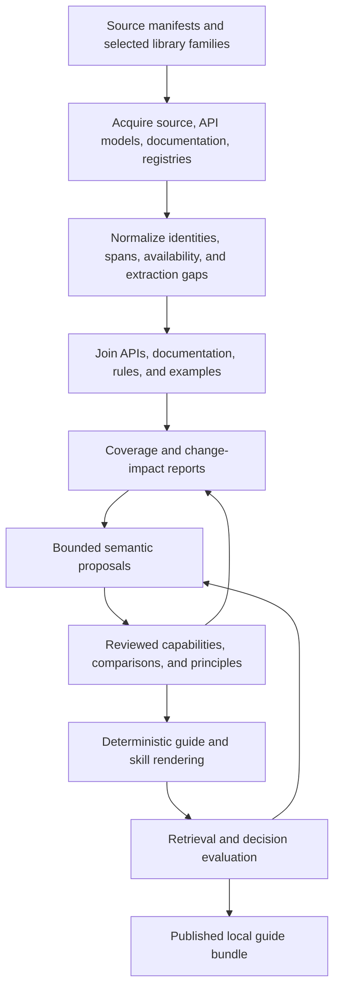

> **Migrated 2026-09-13** from `smartref/docs/library_ref/library_guide_build_and_update_tooling_2026-09-11.md` (smartref commit 5e2464345a). Frozen provenance: paths inside refer to the monorepo layout (`tooling/library_guides/...`, `docs/library_ref/...`). The deep-dive reference documents it links to were retired in favour of Context7 and code-fact lookup and are not in this repository.

# Programmatic construction and maintenance of library guides and agent skills

## 1. Recommendation

Build a small **library knowledge build system** that compiles source evidence and reviewed semantic records into the guides described in the [architecture assessment](library_reference_architecture_and_agent_skill_flow_2026-09-11.md). Automate inventory, evidence collection, identity resolution, coverage accounting, change detection, retrieval indexes, and rendering. Concentrate model reasoning on capability boundaries, competing implementations, conditional design principles, and integration decisions.

The most useful additional tools are **rustdoc JSON and the Rust API tooling around it, Griffe for Python, library-owned registries and schemas, Sphinx inventories, structured Markdown parsing, and an incremental task runner**. ast-grep and ripgrep are important components of this system. Their highest-value role is extracting targeted evidence and finding material that the API inventories do not explain.

The recommended starting stack is:

| Responsibility | Initial choice | Reason for choosing it |
|---|---|---|
| Public Rust API model | Hosted rustdoc JSON when available; local rustdoc for required build configurations; `rustdoc-types` adapter | Reuse compiler-produced structure instead of reconstructing Rust exports from syntax. |
| Rust API queries and differences | `public-api`; add `trustfall-rustdoc-adapter` for recurring relationship queries | Public-path handling and structured API queries are reusable library capabilities. |
| Public Python API model | Griffe with static loading, explicit source paths, stub merging, and alias resolution | Covers much of the work that a custom Python documentation extractor would otherwise duplicate. |
| Framework and native-library surfaces | Small adapters over documented registries, schema exporters, and selected runtime probes | A library often already knows its registered functions, options, fields, or extension points. |
| Structural evidence | ast-grep YAML rule packs and JSONL output; LibCST for Python binding-sensitive refinements | Rules are testable and reusable; refinement limits name-based false positives. |
| Lexical evidence | ripgrep, with PCRE2 only for patterns that require it | Efficient discovery across source, documentation, changelogs, and examples. |
| Documentation structure | `markdown-it-py`; `sphobjinv`; Sphinx/Docutils adapters where needed | Preserve headings, links, object identities, code blocks, and source locations. |
| Facts and retrieval | JSONL artifacts plus a rebuildable SQLite index with FTS5 | Simple inspection, relational coverage queries, exact lookup, and local search. |
| Build orchestration | Python stage functions coordinated by `doit` | Declared dependencies, reusable tasks, and changed-input checks without a persistent service. |
| Guide production | Validated Markdown/YAML records and deterministic templates | Reviewed reasoning survives updates; indexes and repeated API facts are generated. |
| Semantic authoring | A bounded, schema-validated proposal interface; initially a direct model adapter | Avoid paying for whole-library reasoning on every update. |
| Evaluation | Rule fixtures, source/coverage fixtures, selected executable examples, and decision cases | Measure whether agents choose correctly, rather than whether generated prose looks complete. |

These are architectural choices, not benchmark results. The tooling findings and primary sources below support their capabilities; the proposed allocation of work is an engineering judgment. No percentage reduction in model cost or update time is established yet.

Three distinctions must remain explicit throughout the system:

1. **A fact:** a public method exists, a function is registered, or an upstream paragraph states a constraint.
2. **An interpretation:** this capability can meet a requirement under stated conditions.
3. **A recommendation:** this capability is preferable to alternatives for a particular task.

A validated extractor can establish inventory and observation facts within its declared scope. A syntax rule establishes a source occurrence; actual registration or public reachability needs the corresponding registry or API evidence. Rules can nominate interpretations and recommendations for review, but cannot silently turn a method name, return type, or keyword into a design recommendation.

## 2. Build architecture and ownership



Use the assessment's content layout under `docs/library_ref/agent_reference/`. Put the shared build implementation under `tooling/library_guides/`, separate from the refinery application and from individual skills. The future `.codex/skills/datafusion-arrow-rust-guide/` should consume the resulting content; it should not own a duplicate extractor or a private copy of the knowledge model.

Keep three kinds of ownership:

| Layer | Authoritative material | Update behavior |
|---|---|---|
| Acquired and extracted evidence | Source snapshots, tool output, normalized facts, extraction receipts | Rebuild from declared inputs. Never manually correct a generated fact in place. Fix its adapter or record a disputed observation. |
| Reviewed semantic knowledge | Capability contracts, principle realizations, task comparisons, integration conditions, exclusions | Make targeted edits. New evidence can mark a claim for reassessment without replacing its rationale. |
| Compiled consumption views | Skill navigation, task indexes, compact decision briefs, API tables, coverage views | Regenerate deterministically from the first two layers. |

The JSONL files and authored Markdown/YAML are portable source artifacts. SQLite is a derived index, not a second editable authority. Large downloaded sources, compiler output, and model responses belong in a configurable cache; commit manifests, schemas, rules, reviewed cards, fixtures, and useful compact reports. Retain upstream attribution and license information with source records.

Library capability and SMARTREF activation remain separate. Mining SMARTREF examples can identify priority tasks and implementation patterns, but it cannot define the library's complete feature set. Conversely, finding an upstream integration does not establish that SMARTREF currently enables it.

## 3. The evidence model that makes automation useful

### 3.1 Normalize observations without flattening their meaning

Use a common envelope with language-specific payloads. A Python callable and a Rust trait method can both expose a capability, but their signatures, dispatch rules, ownership, and import paths should not be forced into one textual signature field.

| Record | Minimum useful fields |
|---|---|
| Source artifact | Source ID, package/distribution identity, upstream locator, content digest, artifact kind, acquisition result, build/configuration scope, attribution |
| API binding | Library ID, language, public access paths, defining item when known, item kind, structured signature, parent, availability conditions, documentation references |
| Non-symbol surface | Surface kind and stable name: SQL function, configuration key, Cargo feature, Python extra, plugin entry point, protocol, CLI option, file format |
| Evidence span | Artifact ID, exact byte range when available, display line range, enclosing symbol or heading, extraction method, original coordinate convention |
| Observation | Subject, predicate, value/object, source evidence, extractor/rule ID, scope, resolution state |
| Semantic claim | Subject, requirement/outcome, mechanism, conditions, exceptions, alternatives, support references, review state |
| Dependency | Consumer artifact/claim, upstream input, dependency kind, invalidation granularity |
| Extraction receipt | Enumerated inputs, processed inputs, skipped/failed inputs and reasons, tool/configuration identity, output digests, completion state |

Keep **evidence origin**, **resolution quality**, and **review state** in separate fields. For example, a syntactic occurrence can be fully extracted yet unresolved to a library symbol; a reviewed claim can still depend on an untested upstream assertion. A single `confidence: 0.95` would hide those distinctions.

Suggested evidence origins are `compiler_api`, `static_api`, `syntax_match`, `documentation_statement`, `runtime_registry`, and `behavior_observation`. Suggested resolution states are `resolved`, `candidate`, `ambiguous`, and `unresolved`. Reviewed semantic claims can be `accepted`, `needs_review`, or `superseded`; unknown behavior is represented explicitly, not filled with a guess.

### 3.2 Separate durable concepts from snapshot identities

Give capability and principle records human-owned IDs such as `datafusion.expression_composition` and `preserve_optimizer_visibility`. API identity should include ecosystem, package, public path, item kind, and owner/trait context where needed. Retain multiple public aliases for the same underlying item. Distinguish a distribution name from its import names in Python and a Cargo package name from a Rust crate path.

Snapshot records additionally carry source/build identity. Do not use raw rustdoc item IDs or source line numbers as durable cross-build identities: rustdoc IDs are opaque, and public paths may change. Reconcile changes through explicit aliases and reviewed rename mappings; ambiguous moves remain ambiguous. The [rustdoc JSON RFC](https://github.com/rust-lang/rfcs/blob/master/text/2963-rustdoc-json.md) describes the JSON identity model.[^1]

A source interval is an evidence location, not a concept ID. Preserve UTF-8 byte offsets separately from rendered line numbers and LSP character positions. This prevents a correct extraction from linking an agent to the wrong expression in a file containing Unicode.

### 3.3 Represent functionality beyond callable symbols

An API-only denominator misses much of what makes a library useful. Inventory the following alongside functions and types:

- Built-in SQL functions, operators, compute kernels, aliases, and supported options.
- Cargo features, Python extras, configuration namespaces, and environment-controlled behavior.
- Extension traits, callback/decorator registration points, plugin entry points, and lifecycle hooks.
- Supported file formats, storage backends, transports, protocols, and cross-language interchange boundaries.
- Optimizer, serialization, schema, and execution facilities exposed through configuration or composition.

Maintain separate denominators for these surfaces. Do not inflate “functionality coverage” by counting thousands of generated methods while leaving a storage integration or execution model undiscoverable.

## 4. Acquire structured evidence before crawling documentation

### 4.1 Rust: reuse rustdoc's model

Prefer a hosted rustdoc JSON artifact when it covers the required package and configuration. docs.rs exposes downloadable JSON, including format-specific and target-specific routes, and supports compressed downloads. Availability is incomplete for some releases, and the JSON contains a `format_version` that an adapter must recognize. [docs.rs JSON service](https://docs.rs/about/rustdoc-json).[^2]

This avoids compiling every dependency merely to collect its public documentation model. Record the hosted build scope, however: docs.rs has configurable features, targets, and rustdoc arguments. A hosted artifact is evidence for that documentation build, not automatically for every consumer configuration. [docs.rs build metadata](https://docs.rs/about/metadata).[^3]

The extraction sequence should be:

1. Read Cargo manifests and `cargo metadata --format-version=1` to identify packages, dependencies, features, and public library targets. Preserve requested configuration and the resolved graph; `--no-deps` omits the resolved graph. [Cargo metadata](https://doc.rust-lang.org/cargo/commands/cargo-metadata.html).[^4]
2. Acquire matching rustdoc JSON and validate its schema before normalization. If unavailable or unsuitable, build selected crates in an isolated extraction workspace with the required features and target.
3. Extract modules, types, functions, methods, traits, implementations, associated items, re-exports, attributes, documentation, and available source spans.
4. Normalize public access paths and join foreign items to explicitly acquired dependency inventories where possible.
5. Supplement the compiler model with manifest, source, registry, and example observations.

Use `public-api` for public surface listings and readable API differences. It already consumes rustdoc JSON; its `missing_item_ids` API exposes gaps encountered during construction, including missing foreign items. Keep those gaps in the receipt rather than interpreting them as absent APIs. [public-api](https://docs.rs/public-api/latest/public_api/), [missing item accounting](https://docs.rs/public-api/latest/public_api/struct.PublicApi.html#method.missing_item_ids).[^5]

Add `trustfall-rustdoc-adapter` when recurring questions need richer relationships, such as importable paths and implementation relationships. It provides a rustdoc query adapter and indexed crate data. Pilot its supported schema on the intended queries before making it mandatory; a direct normalizer is enough for basic export tables. [Trustfall rustdoc adapter](https://docs.rs/trustfall-rustdoc-adapter/latest/trustfall_rustdoc_adapter/).[^6]

Local JSON generation currently uses an unstable rustdoc facility. Keep the extraction toolchain scoped to this tooling rather than changing the application's toolchain merely to generate documentation. `cargo-semver-checks` can supply a useful compatibility-diff input, but neither a clean API diff nor a successful compile establishes unchanged behavior. [rustdoc facilities](https://doc.rust-lang.org/rustdoc/unstable-features.html), [cargo-semver-checks](https://github.com/obi1kenobi/cargo-semver-checks).[^7]

Do not default to “all features.” Some configurations are inappropriate or incompatible, and a union of feature-specific APIs can describe a library configuration that never exists. Start with a normal library profile and the intended consumer profile; add targeted profiles when a capability requires them. Broad discovery may union the records while preserving each record's conditions.

### 4.2 Python: Griffe first, targeted inspection second

Use Griffe as the primary Python API extractor. It can statically load source, combine `.py` and `.pyi` information, retain documentation, and resolve aliases after loading. Reuse one loader per bounded package set so that imported objects can resolve across its shared collection. Explicitly disable automatic inspection for the static stage with `allow_inspection=False`; bound external-package expansion. [Griffe loading](https://mkdocstrings.github.io/griffe/guide/users/loading/).[^8]

The package manifest should distinguish source roots, distribution names, import roots, declared exports, and supported extras. Preserve overloaded signatures and stub/source provenance. A stub is evidence of a declared interface; it is not proof that every declaration is operational in a particular native wheel.

For decorator-heavy libraries, add small Griffe extensions or postprocessors for known semantics rather than repeatedly asking a model to interpret the same pattern. Griffe supplies extension hooks and documents static handling of custom decorators. Validate each extension against actual package fixtures. [Griffe extension mechanism](https://mkdocstrings.github.io/griffe/guide/users/extending/).[^9]

Use `importlib.metadata` to collect installed distribution metadata, files, requirements, and entry-point declarations without importing the target package. Do not call an entry point's `load()` just to inventory it. Namespace packages and multiple distributions require explicit ownership records. [Python package metadata](https://docs.python.org/3/library/importlib.metadata.html).[^10]

Native extensions, generated objects, lazy exports, and runtime registration need a separate probe stage. Prefer documented registries and explicit object lists. Run imports in a bounded subprocess with a declared environment and no application startup. `inspect.getmembers_static` avoids invoking some dynamic attribute machinery, but it can miss dynamically created members and still requires the object to exist; it is not a replacement for static loading. [Python static inspection](https://docs.python.org/3/library/inspect.html#inspect.getmembers_static).[^11]

When the source, stub, and runtime surface disagree, preserve all observations and open a reconciliation item. Do not let whichever extractor ran last overwrite the others.

### 4.3 Ask the library for its own catalog

This is especially valuable for the DataFusion/Arrow pilot. Function registries expose a more useful inventory than a scan for public function declarations alone.

| Adapter to create | Evidence to collect | Decision work it enables |
|---|---|---|
| DataFusion function catalog | Registered scalar, aggregate, window, and table functions; names, aliases, signatures, documentation where exposed; registration scope | Discover built-ins before proposing extensions; compare scalar, aggregate, window, and relational placements. |
| DataFusion configuration and extension catalog | Configuration entries, feature gates, public provider/planner/optimizer extension surfaces, registration examples | Find existing configuration or integration hooks before designing a new abstraction. |
| PyArrow compute catalog | Function names, kinds, arity, kernel metadata and documented options | Distinguish batch compute from query expressions; identify existing operations and input restrictions. |
| Rust Arrow/Parquet catalog | Public crate APIs, conversion and reader/writer surfaces, Cargo feature definitions, relevant examples | Discover representations, IO capabilities, and interchange routes independently of Python availability. |
| Python schema/framework catalog | Pydantic field/schema metadata; validated adapters for framework registration surfaces | Identify boundary transformations and lifecycle/registration requirements. |

DataFusion's `SessionState` exposes several function maps, and `ScalarUDFImpl::documentation()` exposes structured function documentation when provided. Capture optional metadata as optional. Source rules can locate implementations and registration paths that a chosen runtime profile does not instantiate. [SessionState registries](https://docs.rs/datafusion/latest/datafusion/execution/session_state/struct.SessionState.html), [ScalarUDFImpl](https://docs.rs/datafusion-expr/latest/datafusion_expr/trait.ScalarUDFImpl.html).[^12]

PyArrow provides `compute.list_functions()` and `compute.get_function()`. A local inspection of PyArrow 25.0.1 returned 306 registered functions; `utf8_lower` reported a scalar function with arity one and two kernels. This is a bounded feasibility observation, not a count of all Arrow functionality or a Rust/Python parity claim. [PyArrow function listing](https://arrow.apache.org/docs/python/generated/pyarrow.compute.list_functions.html), [function lookup](https://arrow.apache.org/docs/python/generated/pyarrow.compute.get_function.html).[^13]

Pydantic's `BaseModel.model_json_schema()` and `TypeAdapter.json_schema()` can expose structured schema evidence. Record whether schema generation targets validation or serialization, and do not infer arbitrary validator behavior from JSON Schema. The same adapter principle applies to framework-owned catalogs, but their exact public discovery methods should be verified before implementation. [Pydantic schema generation](https://docs.pydantic.dev/latest/concepts/json_schema/).[^14]

The Rust Arrow implementation and PyArrow's underlying native implementation are distinct surfaces. Link them through documented operations and interchange contracts; never copy Python function availability onto Rust crates based only on a shared Arrow name.

### 4.4 Services: acquire once and reuse locally

| Source/service | Recommended role | Boundary |
|---|---|---|
| docs.rs | First choice for available Rust API JSON and upstream API links | A documented build profile, with explicit missing-artifact handling. |
| PyPI | Distribution metadata, source/wheel locations and digests; use the Index API for release enumeration | Metadata helps acquire artifacts; it does not describe complete functionality. |
| GitHub and upstream Git repositories | Source trees, documentation, examples, changelogs, release events | Prefer immutable snapshots and local analysis over repeated hosted code searches. |
| Read the Docs | Discover built documentation versions and available downloadable documentation bundles | Downloads vary by project; inspect returned availability. |
| Context7 | Optional interactive discovery and comparison against our retrieval results | Its snippets are useful leads, not a complete API denominator or our semantic authority. |
| Firecrawl | Optional acquisition for sites without accessible source or structured documentation | Preserve fetched URLs and failures; a fast site map is not complete site coverage. |

PyPI's JSON API exposes project/release metadata and artifact locations; its documentation recommends the Index API for enumerating distributions or versions. Read the Docs' version API can identify documentation builds and download URLs. GitHub supports conditional requests and documents rate-limit handling, which should be part of the acquisition adapter. [PyPI API](https://docs.pypi.org/api/json/), [Read the Docs API](https://docs.readthedocs.com/platform/stable/api/v3.html), [GitHub API practices](https://docs.github.com/en/rest/using-the-rest-api/best-practices-for-using-the-rest-api).[^15]

Context7 offers library search and documentation-context endpoints. Use it for gaps and unfamiliar libraries, then retain the original upstream evidence supporting a guide claim. Firecrawl's map endpoint explicitly trades completeness for speed; use its crawl facilities only where structured sources are insufficient. Neither service is required for offline guide consumption. [Context7 API](https://context7.com/docs/api-guide), [Firecrawl mapping](https://docs.firecrawl.dev/features/map).[^16]

Source acquisition should use content digests, conditional HTTP requests where supported, bounded retries, and explicit redirect handling. A successful request returning a partial listing remains partial. Download package archives directly for static examination when possible; invoking a package build backend is a separate execution step.

## 5. ast-grep and ripgrep as reusable evidence extractors

### 5.1 ast-grep rule families

The supplied [ast-grep advanced reference](/home/paul/CodeFabric/docs/library_ref/ast-grep_0.45.1_advanced_reference.md), especially chapters 7–9, 14–15, 17, 19, and 23, provides a strong basis for the implementation. Its distinction between structural matching and semantic resolution should become an explicit adapter contract.

Create a **small generic rule pack plus library-specific packs**. Do not write one rule per public function when a registry or API model already supplies the list.

| Rule family | Captures | Subsequent interpretation |
|---|---|---|
| Extension implementation | Rust `impl` blocks and trait/method structure; Python subclass/decorator patterns | Resolve the trait/base/decorator identity, then identify the extension contract. |
| Registration | Function/provider/codec/handler registration calls | Determine receiver identity, construction path, configuration, and whether registration executes. |
| Configuration | Builder chains, option setters, conditional compilation, decorator arguments | Relate settings to capabilities and identify defaults through stronger evidence. |
| Interchange | Calls or implementations around Arrow interfaces, conversions, serialization, stream adapters | Find boundary candidates; verify ownership, schema, copying, and lifetime contracts separately. |
| Examples and tests | API usage, setup/cleanup structure, assertions, expected error forms | Find candidate examples and behavioral evidence; inspect assertions rather than treating every call as a test. |
| Documentation hooks | Rust documentation attributes/macros; Python docstring/decorator metadata | Link structured catalog facts to explanations and identify generated documentation. |

For example, a proposed extraction rule can match registration-shaped Rust calls:

```yaml
id: rust-registration-udf-candidate
language: Rust
severity: info
message: Capture a candidate UDF registration call for evidence linking.
rule:
  pattern: $CTX.register_udf($UDF)
metadata:
  evidence_origin: syntax_match
  predicate: registration_candidate
  resolver: rust_receiver_and_api_identity
```

The metadata fields describe our downstream adapter contract; ast-grep does not implement the named resolver. `ctx.register_udf(...)` is a candidate until its receiver and method are associated with the relevant API. A local fixture confirmed that this pattern excludes the same text in comments and strings but also matches `other.register_udf(...)`. That is correct structural behavior and a reason to retain a resolution stage.

Use `scan --json=stream --include-metadata` for rule-pack extraction and preserve captured metavariables, rule IDs, file paths, and ranges. A matching rule's `info` severity is an extraction setting, not a semantic confidence score. [ast-grep JSON output](https://ast-grep.github.io/guide/tools/json.html).[^17]

For routine scans, the CLI is the simplest process boundary. Embed the JavaScript, Python, or Rust APIs only when a measured need justifies custom traversal or repeated in-process parsing. Avoid simultaneously maintaining independent implementations of the same rule in several bindings.

Use `outline` to produce compact source navigation for reviewers and proposal context. Custom outline extractors can summarize domain-specific item/member shapes. Keep this separate from the public API inventory: outline's export classification is structural and does not replace compiler or Python alias analysis. [ast-grep outline](https://ast-grep.github.io/guide/outline-code.html).[^18]

### 5.2 Test extraction rules as classifiers

Every reusable rule needs both expected matches and expected non-matches, plus normalized-output tests. ast-grep's `valid` and `invalid` fixture names mean “should not report” and “should report”; in this pipeline, “invalid” does not mean the source is bad code. Snapshot tests can preserve diagnostic ranges and captures. [ast-grep rule tests](https://ast-grep.github.io/guide/test-rule.html).[^19]

Include imports with aliases, similarly named unrelated APIs, nested expressions, generics, multiline formatting, comments, strings, macro invocations, conditional compilation, and Unicode offsets. Test semantic promotion separately: a structural match on an unrelated receiver may be expected at the capture stage but must not become an accepted library relationship.

Also measure rule-pack yield on a fixed upstream fixture set: matched candidate count, resolved count, rejected count, unknown count, and missed known examples. A zero-result rule should be distinguishable from a failed scan or changed grammar.

### 5.3 Python binding-sensitive refinement

Use LibCST where a Python observation requires source-preserving structure and name/scope metadata. `QualifiedNameProvider` can associate possible qualified names with nodes; `FullyQualifiedNameProvider` supports module-aware names. Preserve ambiguity rather than treating these facilities as complete runtime resolution. [LibCST metadata](https://libcst.readthedocs.io/en/latest/metadata.html).[^20]

For example, a rule that captures `@tool(...)` should be refined using the module's imports and local bindings before being classified as a framework tool registration. Griffe remains the API model; LibCST refines selected source occurrences. This avoids parsing every package three times merely to produce overlapping symbol lists.

### 5.4 ripgrep and PCRE2

Use ripgrep for candidate discovery in documentation, changelogs, manifests, and source text. The supplied [ripgrep/PCRE2 reference](/home/paul/CodeFabric/docs/library_ref/ripgrep_advanced_reference_15.2.0_pcre2_10.47.md), particularly its JSON, exit-status, PCRE2 integration, and resource-limit chapters, should guide the adapter.

The useful lexical families include semantic restrictions (`only if`, `requires`, `unsupported`), behavior changes, performance conditions, null/ordering/schema language, deprecation notes, and references to competing APIs. Their output is a set of passages worth inspecting. A paragraph containing “zero-copy” does not establish that the operation under discussion is always zero-copy.

Default to literal patterns for symbol names and a batch of ordinary regexes for terms. Use PCRE2 for genuinely useful lookarounds, backreferences, or controlled multiline patterns. Do not use recursive regexes as a Rust parser, Python parser, or Markdown section parser. The [ripgrep guide](https://github.com/BurntSushi/ripgrep/blob/master/GUIDE.md) documents the search/filtering model.[^21]

Consume `rg --json --color=never` events, including text-or-bytes payloads, and check process status and stderr. Treat exit 1 as no matches only after establishing the intended file scope; exit 2 or unreadable inputs mean the result cannot establish complete absence. Use explicit paths and controlled configuration, including `--no-config`, for reproducible scans. Keep ignored/skipped files in the acquisition inventory.

Feature-test PCRE2 facilities actually used by a rule. On this machine, `rg --pcre2-version` reported 10.45 while the conditional pattern `(?(VERSION>=10.47)^yes$|(?!))` successfully matched `yes`. The useful conclusion is that the runtime supports the tested condition despite the banner; this single probe does not identify every enabled feature. Avoid requiring all of PCRE2 10.47 when the rule pack only needs older facilities.

Use a catalog of tested patterns with explanations, examples, input limits, and expected captures. For package-wide discovery, scan once per logical pattern family and reuse results. Re-running an individual search for every capability card would discard most of the efficiency gained by automation.

## 6. Documentation mapping and meaningful coverage

### 6.1 Preserve document structure and identity

Parse the existing long references without rewriting them. Produce a section inventory containing the heading hierarchy, stable local section IDs, current source spans, links, code blocks, tables, and nearby qualifications. A section ID should survive line movement; retain a mapping when headings change.

Use `markdown-it-py` for Markdown structure and line maps. Its syntax-tree representation exposes node source maps, which can underpin precise retrieval and generated navigation. A local parse identified 565 headings and 542 fenced blocks in the supplied ast-grep reference, and 384 headings and 216 fenced blocks in the supplied ripgrep reference. These counts establish parser feasibility for the supplied material, not semantic coverage. [Markdown syntax-tree API](https://markdown-it-py.readthedocs.io/en/latest/api/markdown_it.tree.html).[^22]

For Sphinx documentation, ingest `objects.inv` with `sphobjinv`. It supplies documented object names and destinations that can be joined to API identities. It is a link inventory, not a list of all public APIs or an explanation of their behavior. When a documentation build is available, Sphinx's domain API exposes object descriptions, qualified names, document names, and anchors. [sphobjinv](https://sphobjinv.readthedocs.io/en/stable/api_usage.html), [Sphinx domain API](https://www.sphinx-doc.org/en/master/extdev/domainapi.html).[^23]

Use Docutils/Sphinx-aware parsing for reStructuredText and its directives. A plain-text pass can find candidates but may miss included content and generated API sections. A Sphinx build can execute configuration and extensions; prefer an existing inventory or an explicitly bounded documentation build. Do not load arbitrary serialized build environments as ordinary data.

If source Markdown/RST is unavailable, parse HTML with URL and anchor retention. Use Docling selectively for PDF or other layout-rich source material; its document model and format conversion are useful there, while direct parsers are simpler for code-oriented Markdown. [Docling capabilities](https://docling-project.github.io/docling/).[^24]

Keep the source heading and its dependent table, example, and caveat together during retrieval. Fixed-size chunks that separate an API recommendation from its exception are a semantic error, even when all text was successfully indexed.

### 6.2 Join documents to functionality in ordered passes

Resolve documentation links and mentions in this order:

1. Explicit upstream object links, Sphinx inventory identities, and rustdoc links.
2. Fully qualified code names and known public aliases within the appropriate library/language.
3. Code-block usage linked to enclosing imports or an explicitly declared example environment.
4. Short-name candidates qualified by module, section, receiver, or nearby type context.
5. Textual and embedding candidates for conceptual descriptions that contain no API name.

The first passes can often establish identity deterministically. The later passes produce candidates until disambiguated. Record the matching method and competing resolutions. A sentence about a “table” must not become a `pyarrow.Table` binding simply because that class exists.

Allow one passage to explain several APIs and one capability to require several passages. Preserve upstream descriptions and local explanatory material as separate evidence sources. A generated capability table may improve navigation but must not subsequently count as independent source evidence for its own claims.

### 6.3 Coverage is a matrix of obligations

Separate **upstream documentation coverage**, **local guide coverage**, and **behavioral evidence coverage**. They answer different questions. Then measure the assessment's four axes:

| Axis | Denominator | Useful states and checks |
|---|---|---|
| Surface | Declared public APIs and non-symbol surface inventories for a known scope | Discovered; documentation link; local route; unresolved; explicitly excluded. |
| Use case | Reviewed task families and required outcomes | Candidate discovery; applicable constraints; concrete API route; meaningful example. |
| Decision | Reviewed comparison obligations among plausible alternatives | Differentiating conditions; tradeoffs; counterexample or changed-condition case; supporting evidence. |
| Composition | Declared integration boundaries and selected workflows | Representation/ownership/lifecycle contract; configuration; failure behavior; executable evidence where warranted. |

Do not report a single covered/uncovered Boolean. Useful independent facets include `mentioned`, `signature_available`, `behavior_explained`, `conditions_explained`, `alternative_compared`, `example_present`, and `example_executed`. “Present” and “adequate” are different: structural checks can find an alternatives section, while review determines whether it identifies the relevant alternative and meaningful distinction.

The surface report can calculate a bounded fraction:

```text
local_route_coverage = distinct eligible surface IDs with a valid guide route
                      / distinct eligible surface IDs in the declared inventory
```

Always emit the numerator, denominator, exclusions, unresolved items, and acquisition scope alongside the fraction. If inventory completeness is unknown, label this coverage of the observed inventory. A catalog-only route earns discovery coverage; it does not earn decision coverage.

For capability families, define obligations by the decision involved. An elementwise compute family may require input shape, null behavior, output type, and expression-versus-array placement. A storage integration additionally requires setup, consistency assumptions, resource ownership, error behavior, and relevant configuration. Avoid demanding the same twelve fields from every capability regardless of relevance.

### 6.4 Generate actionable gap reports

The coverage engine should issue specific work items:

- “These public functions have upstream documentation but no task route.”
- “This task names a custom extension but has not considered a newly discovered built-in.”
- “This comparison omits the cardinality condition that distinguishes a join from a scalar operation.”
- “This integration has a conversion example but no evidence for the stated ownership behavior.”
- “This documentation link resolves to a different API or language binding.”
- “The inventory omitted a native module; overall absence claims are not justified.”

Prioritize missing decision conditions and incorrect routes ahead of adding prose for every routine accessor. Keep the full surface discoverable through generated indexes while concentrating curated depth where a wrong choice is costly.

Generic documentation-presence metrics remain useful hygiene inputs. Rustdoc's documentation coverage facility, for example, measures documentation presence over its own eligible items. It cannot establish that a guide explains use cases, compares alternatives, or preserves semantic conditions. [Rustdoc coverage facilities](https://doc.rust-lang.org/rustdoc/unstable-features.html).[^7]

## 7. Programmatic semantic authoring

### 7.1 What can be generated without a model

Generate API bindings, alias tables, signatures, inventories, exact links, source locations, configuration catalogs, and known relationships directly from structured evidence. Apply reviewed mappings to connect newly discovered family members to a capability when their membership is mechanically established.

For example, an adapter can associate functions listed in a known registry category with a discovery family. It must not automatically assign every member identical null semantics, cost, determinism, or optimizer behavior. Shared family guidance should contain defaults only when supported and allow member-specific exceptions.

Use deterministic rules to **create questions as well as answers**. A stream-shaped return type can create an obligation to investigate buffering, cancellation, and blocking operators. A registration call can create an obligation to identify its required lifetime and activation path. This is a high-value way to turn structural evidence into better agent decisions without pretending that syntax establishes the answer.

### 7.2 Make semantic signatures partly extracted and partly reviewed

The assessment's semantic signature can be populated incrementally:

| Dimension | Programmatic evidence | What still needs interpretation or verification |
|---|---|---|
| Input/output shape | Structured types, registry kind, signature, schema | Row cardinality, broadcasting, empty-input semantics, domain restrictions. |
| Execution stage | Known extension interface, expression/array API, registration point | Actual placement in the intended pipeline and relevant optimizer behavior. |
| Effects and state | Async syntax, mutable access, configuration, documented volatility | External IO, consistency, retries, invocation multiplicity, state lifetime. |
| Ownership and representation | Borrowed/owned types, Arrow interface, conversion entry point | Copies, retained buffers, release behavior, schema fidelity across boundaries. |
| Composition properties | Declared input/output contracts, example chains | Whether operations preserve ordering, metadata, backpressure, and error behavior together. |
| Selection conditions | Explicit upstream restrictions and reviewed comparison fields | Which constraints dominate for a task and when the preferred alternative changes. |

Store the provenance of each populated field. `unknown` is a useful result: it directs a targeted verification job instead of creating an unsupported guarantee.

### 7.3 The unit of model work is a decision, not a symbol

Create a bounded proposal packet for an affected task or capability family. Include:

1. The task's required outcomes and hard constraints.
2. Candidate capabilities and exact API identities discovered programmatically.
3. Relevant shared principles and existing reviewed realizations.
4. The smallest source sections, signatures, examples, and behavioral observations needed for comparison.
5. The previous accepted claim, the detected change, and unresolved evidence.
6. A structured output schema and explicit questions still requiring judgment.

Ask the model to propose capability boundaries, conditions, comparisons, missing evidence, and counterfactual cases. Require every new factual claim to cite packet evidence; distinguish a source assertion from a measured result. Allow an outcome of “insufficient evidence” with a precise next probe.

The resulting proposal should be an edit to named semantic records, not a rewrite of the entire guide. Keep the old rationale visible beside the new one. Batch related family changes into one packet so the model compares alternatives once rather than summarizing each function independently.

A proposed claim record might contain:

```yaml
claim_id: datafusion.enrichment.prefer_expression_when_sufficient
use_case: enrich_records
requirement: preserve_required_row_semantics
candidate: datafusion.expression_composition
principle: preserve_optimizer_visibility
mechanism: Keep supported operations represented in the query expression tree.
conditions:
  - Built-in expressions provide the required semantics.
  - The operation belongs within the query plan.
compare_with:
  - datafusion.scalar_extension
  - arrow.batch_compute
counterfactual:
  - Required semantics are not expressible by the available built-ins.
evidence_refs: []
review_state: needs_review
```

This is a schema illustration, deliberately lacking evidence references; publication validation must reject it as an accepted claim. The actual record needs concrete source support and relevant behavioral qualification. The principle does not mandate an expression when an Arrow operation outside the query is the better placement.

### 7.4 Review semantic connections directly

Review should answer whether the relationship is justified, not merely whether the prose is plausible:

- Does the capability satisfy the requirement, or merely have a related name?
- Is the stated mechanism supported, and are its conditions preserved?
- Were credible alternatives discovered beyond those already mentioned in the old guide?
- Is the claim about the library, a configuration, a specific example, or SMARTREF usage?
- Which changed condition would reverse the recommendation?
- Does the evidence establish the claimed behavior at the same scope?

Deterministic facts can be accepted automatically after extractor validation. New causal claims, preference changes, merges of distinct capabilities, and integration guarantees need semantic review. That review can be performed by a capable agent within an authorized authoring workflow, with human review reserved according to project policy; the system should not demand human approval for every regenerated link or signature.

Record who or what reviewed the claim and the evidence digest reviewed. A second model's agreement alone is not independent behavioral evidence. Preserve conflicting source statements and make the resolution explicit.

### 7.5 Tools for reducing the remaining model effort

**DocETL is the most directly relevant optional framework for the semantic proposal stage.** It supports declarative LLM operations over document collections, including map/reduce-style processing, and caches LLM results. It could implement passage-to-claim proposals and normalization of recurring terminology. Keep it behind the same proposal contract as a direct model adapter; do not let an automatic entity-resolution step merge capabilities with different semantics. [DocETL overview](https://ucbepic.github.io/docetl/), [pipeline caching](https://ucbepic.github.io/docetl/concepts/pipelines/).[^25]

Start with a direct adapter while the packet schema and evaluation set are changing. Compare DocETL on the same workload once repeated multi-step extraction makes orchestration code material. Its optimizer may propose useful prompt or model changes, but those changes must pass the decision evaluation set before adoption. Vendor or project efficiency examples are not evidence of savings on SMARTREF's corpus.

**DSPy is useful later for optimizing stable, scored tasks**, such as evidence-backed classification of a paragraph's semantic role or identifying a missing comparison condition. It optimizes against examples and a metric; that makes the quality of the metric central. Keep a held-out test set and penalize unsupported claims, lost exceptions, and false semantic merges. Do not optimize only for schema validity or agreement with model-generated labels. [DSPy optimization](https://dspy.ai/getting-started/gepa-optimization/).[^26]

Model-cost controls should be part of the job interface: maximum packet size, maximum calls, bounded repair attempts, response caching, batch support where available, and recorded token usage. Use a cheaper model only for tasks where measured error rates justify it. A strong model's useful role is reviewing difficult distinctions, not repeatedly listing unchanged function signatures.

## 8. Integration discovery and reusable verification

### 8.1 Discover compositions through explicit contracts

Generate integration candidates from documented adapters, protocol implementations, public input/output types, registration surfaces, and upstream examples. Join these against a small vocabulary of boundaries: array/batch, table/query, stream/materialization, schema/serialization, storage/provider, Python/native, and service/lifecycle.

Type compatibility is a discovery signal. It does not prove that two operations compose without copying, losing metadata, changing errors, buffering, or violating ownership. Record a candidate's required boundary facets and the evidence available for each.

An integration card should answer: what crosses the boundary, who owns it, when conversion occurs, how setup is performed, what semantics survive, what can fail, and which operation completes or releases resources. These questions are reusable across Rust and Python even though the concrete APIs differ.

### 8.2 Reuse test templates, not guessed expected results

Create a small collection of parameterized verification harnesses:

| Harness | Typical contract checked |
|---|---|
| Expression versus batch operation | Equivalent supported inputs, nulls, output shape/type, empty inputs. |
| Aggregate/window placement | Group boundaries, ordering assumptions, output cardinality. |
| Reader/writer or serialization boundary | Schema, metadata, selected values, explicit unsupported cases. |
| Stream consumer | Incremental consumption, cancellation/cleanup, observable buffering in the bounded fixture. |
| Provider/registration lifecycle | Visibility after setup, relevant pushdown declarations, failure before required registration. |
| Python/native interchange | Supported representations, ownership/release behavior, selected round-trip semantics. |

Each harness needs a reviewed expected contract and bounded fixtures. A passing small test supports that tested behavior; it does not prove constant memory for arbitrary plans or universal zero-copy operation. Use property-based testing when a family has useful algebraic or boundary properties, rather than adding hundreds of nearly identical examples.

Mine upstream tests for candidate fixtures and assertions. Record whether they were merely located, inspected, compiled, or executed. Preserve test names and their relevant source dependencies. A test named “streaming” may assert result equality only, so it cannot be used as evidence for backpressure.

## 9. Incremental builds and update propagation

### 9.1 Use a task runner, not a new long-running platform

`doit` provides file dependencies, target checks, and configuration-sensitive up-to-date predicates. Use it to coordinate pure stage functions and bounded external processes. Task ordering and evidence invalidation are related but distinct: the runner schedules work; our dependency records explain which claims are affected. [doit dependency model](https://pydoit.org/dependencies.html).[^27]

Compute stage keys from input content digests, adapter/rule/schema identities, configuration, and relevant environment facts. For model stages include the full packet digest, prompt/schema revision, model identifier, and generation settings. Store output receipts and reuse an unchanged result; deterministic publication must not depend on resampling a model.

Do not rely on timestamps alone. Also keep operational metadata such as acquisition time outside semantic content digests, so a refreshed unchanged source does not invalidate the whole guide. A failed or partial stage must not replace a previous complete inventory with an apparently successful empty one.

### 9.2 Invalidate by the kind of change

| Change | Recompute automatically | Reconsider semantically |
|---|---|---|
| Only line positions or document formatting | Spans, anchors, links, rendered navigation | Usually nothing if parsed semantic content is unchanged. |
| Signature, exported name, feature, or option change | API records, affected bindings, examples and coverage | Claims whose applicability or usage changed. |
| Documentation constraint or behavior paragraph changes | Passage observations and linked claim packets | Conditions, exceptions, guarantees, and affected comparisons. |
| Relevant implementation or test changes with stable API | Affected source observations and verification receipts | Behavior claims even when compatibility tooling reports no API change. |
| New built-in or integration | Inventory, family membership, discovery indexes | Existing custom-extension advice and task comparisons in that candidate family. |
| Removed source or failed native inspection | Availability/coverage state and evidence validity | Claims that now lack adequate support; absence must remain qualified. |
| Extraction rule or identity resolver changes | Facts produced by that rule/resolver and downstream joins | Claims whose evidence or candidate identity changed. |
| Shared principle changes | Linked decision packets and compiled briefs | Every affected library-specific realization. |
| Retrieval template or skill route changes | Rendered outputs and retrieval tests | Decision content only if evaluation exposes omissions. |

Crucially, record **dependencies on candidate sets**, not only on chosen APIs. A decision that prefers a UDF because no suitable built-in was found depends on the relevant built-in inventory and its search scope. A newly added function must reopen that decision even though the UDF's source and signature are unchanged.

Likewise, an absence claim depends on a completed bounded search, its rules, and its inventory. Retain that query dependency and rerun it when the relevant domain changes. Do not represent an open-ended statement such as “the library cannot do this” as an ordinary positive fact.

Source dependencies are not always perfectly known. Use enclosing-module or capability-family digests when finer dependency extraction is uncertain. Periodically reconcile complete declared inventories and rerun a stratified set of decision cases to detect gaps in incremental propagation. These bounded reconciliation runs protect against missing dependencies without requiring whole-corpus LLM regeneration.

### 9.3 A normal update cycle

1. Refresh source manifests and acquire changed artifacts. Produce a complete account of fetched, reused, unavailable, and failed inputs.
2. Re-extract only affected package/module/profile units, then resolve cross-unit identities and aliases.
3. Re-run relevant structural and lexical rule packs; regenerate documentation joins and coverage.
4. Compare normalized facts and semantic passages. Generate a change report and affected decision packets.
5. Automatically refresh deterministic fields. Run bounded authoring jobs only for packets requiring semantic work.
6. Validate proposed claims, resolve review items, and execute relevant examples and decision evaluations.
7. Render into staging. Validate links, referenced IDs, publication completeness, and the exact output changes.
8. Publish the checked bundle atomically, preserving authored records and unrelated work.

The default update plan should report what will be fetched, rebuilt, re-reviewed, and written. An explicit apply mode should carry out the planned writes. This is an inspectable CLI contract, not a requirement to interrupt an already authorized workflow for repeated permission.

### 9.4 Alternatives and adoption conditions

| Tool | What it contributes | Recommendation |
|---|---|---|
| DVC | Pipeline stage signatures and restoration of cached outputs; shared artifact workflows | Adopt if distributing large extraction artifacts across machines becomes a significant need. Avoid overlapping caches with `doit` without clear ownership. |
| Dagster | Asset dependencies, observability, and declarative materialization | Consider when many library collections require scheduled multi-user operation. Its operational surface is unnecessary for the first local guide. |
| LlamaIndex | Document ingestion, node transformations, caching, document management, retrieval integrations | Useful if a larger retrieval application already needs it. Do not make generic chunking or inferred graph edges the semantic authority. |
| CodeQL | Queryable code analysis for Python and Rust, including deeper program relationships | Use for a bounded question that justifies extraction and query-model effort. It is a complement to API documentation models, not the initial inventory engine. |
| Semgrep | Another rule and dataflow analysis ecosystem | Consider when a required flow query is better served by a supported Semgrep analysis. Adding it for the same syntax patterns already handled by ast-grep creates duplication. |
| SQLite FTS5 | Local full-text indexing, ranking, and snippet retrieval beside relational facts | Adopt initially, with exact symbol/alias indexes kept separate from tokenized text search. |
| A vector or graph service | Semantic recall or large-scale traversal | Defer until retrieval evaluation identifies a failure ordinary files, SQL, aliases, and reviewed task maps cannot address. |

DVC's run cache restores stage results under matching conditions; Dagster models asset automation; LlamaIndex caches node/transformation combinations. These are useful existing mechanisms, but none eliminates the need to declare semantic dependencies correctly. [DVC run cache](https://doc.dvc.org/user-guide/pipelines/run-cache), [Dagster automation](https://docs.dagster.io/guides/automate/declarative-automation), [LlamaIndex ingestion](https://developers.llamaindex.ai/python/framework/module_guides/loading/ingestion_pipeline/).[^28]

Current CodeQL documentation includes both Python and Rust; older assumptions that Rust is unavailable should not guide tool selection. Its supported-language and framework coverage still needs to match the specific query. Semgrep's dataflow facilities likewise need to be evaluated for the chosen language and analysis scope. [CodeQL support](https://codeql.github.com/docs/codeql-overview/supported-languages-and-frameworks/), [Semgrep dataflow](https://docs.semgrep.dev/writing-rules/data-flow/data-flow-overview).[^29]

SQLite FTS5 supplies text search, ranking, and snippets. Normalize identifier search separately so punctuation in `::`, dotted names, and snake_case does not undermine exact API retrieval. Store typed semantic edges in ordinary tables and use explicit query templates. An optional Parquet export can support larger analytical reports without becoming a new content authority. [SQLite FTS5](https://www.sqlite.org/fts5.html).[^30]

## 10. Scripts and artifacts to create

The following is a proposed implementation layout. These commands and modules are **not yet implemented**.

```text
tooling/library_guides/
  pyproject.toml
  dodo.py
  library_guides/
    cli.py
    models.py
    acquire.py
    rustdoc_adapter.py
    python_api_adapter.py
    registry_adapters/
    source_rules.py
    documents.py
    identities.py
    coverage.py
    impact.py
    proposals.py
    render.py
    evaluate.py
    publish.py
  rust_extract/                  # small helper for Rust-owned API models/registries
  manifests/
  schemas/
  rules/ast_grep/{generic,rust,python,datafusion,arrow}/
  rules/text/
  templates/
  tests/{rules,extractors,coverage,updates,retrieval}/

docs/library_ref/agent_reference/
  INDEX.md
  principles/
  use_cases/
  libraries/<library>/{capabilities,api,profiles}/
  stacks/datafusion-arrow-rust/{INDEX.md,manifest.yaml,decisions}/
  integrations/
  projects/smartref.yaml
  examples/
  evidence/{sources.jsonl,coverage.json}
  evals/

.codex/skills/datafusion-arrow-rust-guide/
  SKILL.md
```

Keep acquisition/build manifests in the tooling tree and library/stack content manifests in the assessment's content tree. Reference one from the other by ID; do not maintain duplicate dependency or capability lists. If Python tooling needs a separate environment, its dependency declaration belongs to this tooling package, not the refinery application's runtime dependency set.

### 10.1 Stage contracts

| Proposed stage | Inputs → outputs | Important behavior |
|---|---|---|
| `acquire` | Source manifests → cached artifacts + source receipts | Prefer structured sources; record gaps and scope; avoid implicit package imports/builds. |
| `extract-api` | Rustdoc/Griffe/package metadata → API and non-symbol JSONL | Preserve aliases, structured types, source provenance, and unknowns. |
| `probe-registry` | Named adapter + declared environment → registry observations | Enumerate documented metadata through bounded probes; keep runtime scope. |
| `mine-source` | Explicit file inventory + rule packs → observations | Batch scans, parse machine output, validate completion, retain rule IDs. |
| `index-docs` | Markdown/RST/HTML/inventories → document spans and links | Retain semantic section boundaries and code context. |
| `resolve` | APIs + occurrences + links → resolved and ambiguous relationships | Never silently choose among competing identities. |
| `coverage` | Inventories + reviewed obligations → matrices and gap queue | Separate discovery, explanation, comparison, and verification. |
| `impact` | Previous/current normalized artifacts + dependencies → affected work | Include new candidates and bounded absence-query dependencies. |
| `propose` | Affected decision packets → schema-valid proposed edits | Cache responses; cite evidence; bound cost; never directly overwrite accepted cards. |
| `render` | Accepted content + API facts → staged guides, briefs, indexes, skill | Deterministic ordering and stable links; preserve qualifiers. |
| `evaluate` | Staged bundle + fixtures → evidence/decision results | Test retrieval and behavior at their actual scope. |
| `publish` | Validated staged bundle + expected file digests → owned outputs | Refuse stale overwrite; publish exactly the declared changed artifacts. |

Use one CLI with subcommands rather than a pile of unrelated shell scripts. Proposed invocations could be `library-guides update datafusion-arrow-rust --plan`, `library-guides update datafusion-arrow-rust --apply`, `library-guides coverage datafusion-arrow-rust`, and `library-guides check datafusion-arrow-rust`. The entry point should be installed from the tooling package; the examples describe an interface to build, not commands available today.

`check` should be reproducible and should not secretly fetch sources or call a model. It validates an existing staged or published bundle. `update` performs acquisition and generation. Keep “complete,” “partial,” “failed,” and “requires semantic review” distinct in machine-readable results even if the CLI also summarizes them in prose.

### 10.2 Rendering the outputs from the assessment

| Output | Generated portion | Reviewed portion |
|---|---|---|
| Thin skill | Validated links, supported stack names, exact lookup route | Trigger description, scope, decision procedure, escalation conditions. |
| Task map | Capability/API links and reverse indexes | Task definitions and relevant requirement dimensions. |
| Capability cards | API tables, available evidence, family membership where established | Semantic contract, mechanisms, exceptions, alternatives. |
| Decision briefs | Join of selected task, candidate, principle, API, and evidence records | The underlying comparisons and conditions. |
| Integration cards | Adapter/API links, setup references, example results | Boundary contracts and conditions under which the composition is appropriate. |
| Profiles/project overlay | Resolved configuration and activation evidence | Project-specific preferences and constraints. |
| Examples | Harness packaging and execution reports | Intended contract, representative cases, expected results. |
| Coverage/evidence indexes | Fully generated accounting and provenance | Scope exclusions and adequacy judgments where needed. |
| Evaluation cases | Parameter expansion and execution | Task objectives, acceptable choices, disqualifying errors, counterfactuals. |

Keep the skill itself compact. Known-API questions should route directly to a binding and its relevant conditions. Design questions should retrieve a decision brief covering requirements, alternatives, and exact APIs. The skill should not require reading the whole capability inventory before every task.

Do not regenerate trigger wording freely on every update. Treat it as reviewed routing policy and test false activations, missed activations, and overlap with adjacent skills. For the pilot, the old `datafusion-pyarrow-rust-ref` remains available; evaluate explicitly selecting the new guide before deciding how both should coexist in automatic discovery.

### 10.3 Compile retrieval paths as well as documents

Expose three small read interfaces, initially through the same local CLI and optionally through a thin MCP wrapper later:

| Proposed operation | Result |
|---|---|
| `lookup` with a qualified symbol or alias | Exact binding, relevant capability, conditions, and source links; an explicit ambiguity result when needed. |
| `discover` with an intent and language/stack scope | Candidate task families and capabilities, including relevant built-in and integration alternatives. |
| `brief` with a use-case ID and known constraints | A joined comparison with requirements, applicable principles, candidates, disqualifying conditions, exact APIs, and evidence gaps. |

Generate forward and reverse mappings from the reviewed records so a newly added API is discoverable both by name and through its task family. Use exact IDs and aliases first, then lexical search over task language and reviewed synonyms. Add embeddings only if held-out paraphrase cases show a material recall gap; an embedding match nominates records rather than asserting a semantic relationship.

For brief construction, retrieve the candidate family, apply established hard exclusions, retain candidates with unresolved conditions as unresolved, and include the distinctions that could change the choice. Never rank a candidate as safe merely because its missing constraint data yields fewer exclusions. Bound the returned material by decision relevance, preserving exceptions and the closest alternatives before adding supplementary examples.

The compiler should emit a retrieval manifest listing which source records contributed to each brief. Test its output against direct source records to detect lost qualifiers or stale API links. Files remain usable without the CLI, and the CLI remains usable without a hosted retrieval service.

## 11. DataFusion/Arrow pilot and acceptance criteria

### 11.1 Build breadth mechanically, curate a representative decision set

Inventory the selected DataFusion and Arrow crate families broadly, including their function/configuration surfaces and integration entry points. Use the five existing Rust deep-dives as explanatory evidence. Independently inventory a bounded Python surface, such as PyArrow compute, to prove that the shared pipeline does not encode Rust-only assumptions.

Start semantic curation with a small set of decisions that exercise different dimensions:

| Decision | Required alternatives or distinctions |
|---|---|
| Transform values | Built-in expression composition, existing compute kernel, custom scalar extension. |
| Enrich records | Join/provider/preprocessing versus per-row extension; cardinality and IO placement. |
| Aggregate or calculate across rows | Aggregate, window, scalar, and external batch placement. |
| Consume results | Stream versus collect; consumer behavior and stateful operators. |
| Read large datasets | Existing scan/provider/configuration features before custom readers. |
| Move data across Python/Rust | Documented interchange, conversion, ownership, representation, and schema conditions. |

These are pilot coverage targets, not predetermined preferred answers. Populate exact alternatives and conditions from the acquired evidence. Add concise catalog routes for the remaining surface so broader functionality is still discoverable.

### 11.2 Example of an initial build

For “normalize a text column within a query,” the API and function inventories discover available built-ins; documentation and registry metadata identify candidates; the decision packet compares query expressions with Arrow batch compute and custom extension mechanisms. Reviewed guidance explains where the operation belongs and which semantics matter. The renderer emits a brief with the relevant APIs and qualification links.

The system does not need a separate model call for every string function. It can group established family members, generate their lookup table, and allocate reasoning to meaningful distinctions such as Unicode behavior, null handling, type support, and execution placement. A member with insufficient behavioral evidence remains cataloged and explicitly incomplete.

### 11.3 Example of a later update

Suppose an upstream release introduces a built-in operation that overlaps an existing UDF recipe. The registry/API diff adds its binding and opens the affected capability-family candidate set. Documentation linking retrieves its semantics. The impact stage reopens the relevant comparison even if the old recipe and UDF API are untouched.

If the new function satisfies the task under the required conditions, the proposal replaces the preference and preserves the exception that still requires a custom extension. Focused examples and a changed-condition decision case validate the change. Other capability families are reused without model work.

This is the maintenance behavior to optimize: **a small change packet produces a small, justified semantic edit**.

### 11.4 Evaluation at four levels

1. **Extraction correctness.** Golden fixtures cover Rust re-exports, trait methods, macros/configuration, Python aliases/stubs/decorators/native gaps, and non-symbol surfaces. Include missing-source and failed-tool cases.
2. **Coverage correctness.** Fixtures distinguish a name mention from an explanation, a generated table from independent evidence, a wrong-language API link from a valid binding, and partial inventory from a complete denominator.
3. **Maintenance correctness.** Inject changes to signatures, documentation caveats, implementations, candidate sets, rules, and principles. Verify the affected work is reopened and unrelated authored content is preserved. Verify an unchanged rebuild makes no model calls.
4. **Agent decision quality.** Compare the current reference skill with the new guide on the same tasks and constraints. Test changed-condition pairs, unfamiliar wording, missing evidence, and cases where a custom extension is actually justified.

Use deterministic assertions for record identities, links, forbidden unsupported claims, and measurable behavior. Use a semantic rubric for the reasoning that cannot be reduced to exact strings. Promptfoo is an optional runner for model comparisons and custom assertions; a small Python runner is sufficient initially if it preserves prompts, retrieved context, outputs, costs, and scores. [Promptfoo assertions](https://www.promptfoo.dev/docs/configuration/expected-outputs/).[^31]

The decision metric should reward discovering the relevant built-in, choosing an appropriate placement, preserving conditions, and reaching a working implementation. Penalize unnecessary custom code, wrong-language APIs, omitted setup, unsupported guarantees, and excessive retrieval. Accept more than one answer when the task permits more than one sound design.

Record cold/warm build time, bytes and files processed, cache reuse by stage, model input/output tokens, calls per changed decision, reviewer effort, retrieval size, implementation success, and correction effort. Compare total effort, not just generation tokens. No numerical improvement target should be presented as achieved before running this evaluation.

### 11.5 Delivery sequence

| Increment | Deliverable | Exit condition |
|---|---|---|
| 1. Evidence foundation | Schemas, manifests, source acquisition, Rust/Python inventory adapters, document parser | Reproducible inventories with explicit gaps and no model dependency. |
| 2. Mapping and coverage | Tested rule packs, identity joins, coverage matrices, gap reports | Known fixtures produce correct relationships and honest coverage. |
| 3. Semantic authoring | Reviewed pilot capabilities/decisions, proposal packets, integration/example contracts | Recommendations have traceable support and changed-condition cases. |
| 4. Guide compilation | Deterministic briefs/indexes and new `datafusion-arrow-rust-guide` skill | Full local navigation, valid links, preserved existing skill. |
| 5. Update qualification | Dependency propagation, cached rebuilds, injected-change tests, agent comparison | Small updates produce correct bounded work; decision quality is assessed against the baseline. |
| 6. Optional optimization | DocETL/DSPy, hosted acquisition, richer retrieval, shared caches as justified | Measured benefit exceeds added maintenance and runtime cost. |

The first implementation should therefore be the shared evidence and coverage machinery, followed by a curated decision pilot. Creating every card by hand before that machinery exists would make the next library and the next update repeat much of the same work.

## 12. Feasibility findings and remaining uncertainties

The local environment already exposes ast-grep 0.45.3, ripgrep 15.2.0 with PCRE2, and importable Griffe, LibCST, `markdown-it-py`, Docutils, JSON Schema, SQLite-related Python support, and Arrow tooling. `cargo-semver-checks` is available. The `cargo-public-api` and `doit` commands were not found, and `sphobjinv` was not importable. Importability and command presence are feasibility observations, not proof that a complete compatible tooling environment has been qualified.

The bounded checks established that Griffe can statically resolve a deliberately aliased export without executing a package that raises on import; ast-grep can distinguish source calls from textual lookalikes while retaining receiver ambiguity; both supplied long references can be structurally parsed; and PyArrow's runtime registry is a practical discovery source.

The hosted rustdoc acquisition path, Trustfall integration, complete DataFusion catalog adapter, cross-library coverage joins, and end-to-end update pipeline have not been executed in this assessment. The implementation should validate those contracts before committing to their use across every guide. In particular, hosted JSON availability and configuration coverage, Python native/stub discrepancies, and the adequacy of semantic dependency tracking remain pilot questions.

The expected efficiency gain comes from reusing structured library knowledge, compiling repeated facts, preserving reviewed reasoning, and processing only affected decisions. The architecture succeeds when it reduces incorrect API choices and repeated investigation—not merely when it produces more reference files automatically.

## Sources

The two supplied references and the preceding architecture assessment are local source documents. Upstream pages below were consulted on 2026-09-11; most are living documentation rather than dated publications. Product capabilities described from them should be checked against the selected tool environment during implementation. No hosted paid service was exercised for the feasibility checks.

- [Architecture assessment](library_reference_architecture_and_agent_skill_flow_2026-09-11.md), especially semantic modeling, authoring, coverage, and evaluation sections.
- [ast-grep 0.45.1 advanced reference](/home/paul/CodeFabric/docs/library_ref/ast-grep_0.45.1_advanced_reference.md), chapters 7–9, 14–15, 17, 19, and 23. Local reference supplied for this assessment.
- [ripgrep 15.2.0 / PCRE2 10.47 advanced reference](/home/paul/CodeFabric/docs/library_ref/ripgrep_advanced_reference_15.2.0_pcre2_10.47.md), JSON/status contracts and PCRE2 integration/resource-limit sections. Local reference supplied for this assessment.
- Existing [Rust reference skill](../../.codex/skills/datafusion-pyarrow-rust-ref/SKILL.md), [companion index](../../.codex/skills/datafusion-pyarrow-rust-ref/REFERENCE.md), and [FastMCP/Pydantic reference skill](../../.codex/skills/fastmcp-fastapi-pydantic-ref/SKILL.md), for the intended consumption and semantic-authoring context.

[^1]: Rust project. [RFC 2963: Rustdoc JSON](https://github.com/rust-lang/rfcs/blob/master/text/2963-rustdoc-json.md). JSON design and item identity.
[^2]: docs.rs. [Rustdoc JSON](https://docs.rs/about/rustdoc-json). Hosted artifacts, availability, formats, and download routes.
[^3]: docs.rs. [Metadata](https://docs.rs/about/metadata). Documentation build configuration.
[^4]: Rust project. [cargo metadata](https://doc.rust-lang.org/cargo/commands/cargo-metadata.html). Package and resolved dependency metadata.
[^5]: cargo-public-api contributors. [public-api](https://docs.rs/public-api/latest/public_api/) and [PublicApi](https://docs.rs/public-api/latest/public_api/struct.PublicApi.html). Public surface extraction, differences, and missing-item accounting.
[^6]: Trustfall contributors. [trustfall-rustdoc-adapter API](https://docs.rs/trustfall-rustdoc-adapter/latest/trustfall_rustdoc_adapter/) and [repository](https://github.com/obi1kenobi/trustfall-rustdoc-adapter). Query adapter and indexed crate model.
[^7]: Rust project. [Rustdoc unstable features](https://doc.rust-lang.org/rustdoc/unstable-features.html). JSON and documentation-coverage facilities. cargo-semver-checks contributors. [Project documentation](https://github.com/obi1kenobi/cargo-semver-checks). Compatibility analysis.
[^8]: Griffe contributors. [Loading](https://mkdocstrings.github.io/griffe/guide/users/loading/). Static/dynamic loading, stubs, and aliases.
[^9]: Griffe contributors. [Extending](https://mkdocstrings.github.io/griffe/guide/users/extending/). Extension hooks and custom analysis.
[^10]: Python Software Foundation. [importlib.metadata](https://docs.python.org/3/library/importlib.metadata.html). Distribution metadata and entry points.
[^11]: Python Software Foundation. [inspect](https://docs.python.org/3/library/inspect.html#inspect.getmembers_static). Static object inspection and its limitations.
[^12]: Apache DataFusion. [SessionState](https://docs.rs/datafusion/latest/datafusion/execution/session_state/struct.SessionState.html) and [ScalarUDFImpl](https://docs.rs/datafusion-expr/latest/datafusion_expr/trait.ScalarUDFImpl.html). Registries and function metadata.
[^13]: Apache Arrow. [list_functions](https://arrow.apache.org/docs/python/generated/pyarrow.compute.list_functions.html) and [get_function](https://arrow.apache.org/docs/python/generated/pyarrow.compute.get_function.html). Public Python compute registry access.
[^14]: Pydantic contributors. [JSON Schema](https://docs.pydantic.dev/latest/concepts/json_schema/). Model/type schema generation and modes.
[^15]: Python Package Index. [JSON API](https://docs.pypi.org/api/json/). Read the Docs. [API v3](https://docs.readthedocs.com/platform/stable/api/v3.html). GitHub. [REST API best practices](https://docs.github.com/en/rest/using-the-rest-api/best-practices-for-using-the-rest-api). Artifact discovery and efficient refresh.
[^16]: Context7. [API guide](https://context7.com/docs/api-guide). Firecrawl. [Map](https://docs.firecrawl.dev/features/map). Optional documentation discovery and acquisition services.
[^17]: ast-grep contributors. [JSON mode](https://ast-grep.github.io/guide/tools/json.html). Structured match output.
[^18]: ast-grep contributors. [Outline code](https://ast-grep.github.io/guide/outline-code.html). Navigation-oriented syntax extraction.
[^19]: ast-grep contributors. [Test your rule](https://ast-grep.github.io/guide/test-rule.html). Match/non-match fixtures and snapshots.
[^20]: LibCST contributors. [Metadata](https://libcst.readthedocs.io/en/latest/metadata.html). Scope, names, positions, and module-aware metadata.
[^21]: ripgrep contributors. [User guide](https://github.com/BurntSushi/ripgrep/blob/master/GUIDE.md). Search and file-filtering behavior; supplemented by the supplied advanced reference for PCRE2-specific details.
[^22]: markdown-it-py contributors. [Syntax tree API](https://markdown-it-py.readthedocs.io/en/latest/api/markdown_it.tree.html). Structured Markdown and source maps.
[^23]: sphobjinv contributors. [API usage](https://sphobjinv.readthedocs.io/en/stable/api_usage.html). Sphinx contributors. [Domain API](https://www.sphinx-doc.org/en/master/extdev/domainapi.html). Documentation inventories and object identities.
[^24]: Docling contributors. [Overview and features](https://docling-project.github.io/docling/). Structured conversion of layout-rich document formats.
[^25]: UC Berkeley EPIC/DSF and DocETL contributors. [Overview](https://ucbepic.github.io/docetl/) and [Pipelines](https://ucbepic.github.io/docetl/concepts/pipelines/). Declarative LLM processing and caching.
[^26]: DSPy contributors. [GEPA optimization](https://dspy.ai/getting-started/gepa-optimization/). Optimization against examples, metrics, and held-out evaluation.
[^27]: doit contributors. [Dependency system](https://pydoit.org/dependencies.html). File/configuration dependencies and up-to-date checks.
[^28]: DVC contributors. [Run cache](https://doc.dvc.org/user-guide/pipelines/run-cache). Dagster contributors. [Declarative automation](https://docs.dagster.io/guides/automate/declarative-automation). LlamaIndex contributors. [Ingestion pipeline](https://developers.llamaindex.ai/python/framework/module_guides/loading/ingestion_pipeline/). Alternative orchestration and ingestion mechanisms.
[^29]: GitHub/CodeQL. [Supported languages and frameworks](https://codeql.github.com/docs/codeql-overview/supported-languages-and-frameworks/). Semgrep. [Dataflow analysis overview](https://docs.semgrep.dev/writing-rules/data-flow/data-flow-overview). Optional deeper program analysis.
[^30]: SQLite project. [FTS5](https://www.sqlite.org/fts5.html). Local full-text indexing and ranking.
[^31]: Promptfoo contributors. [Assertions and metrics](https://www.promptfoo.dev/docs/configuration/expected-outputs/). Model-output evaluation and custom assertions.
