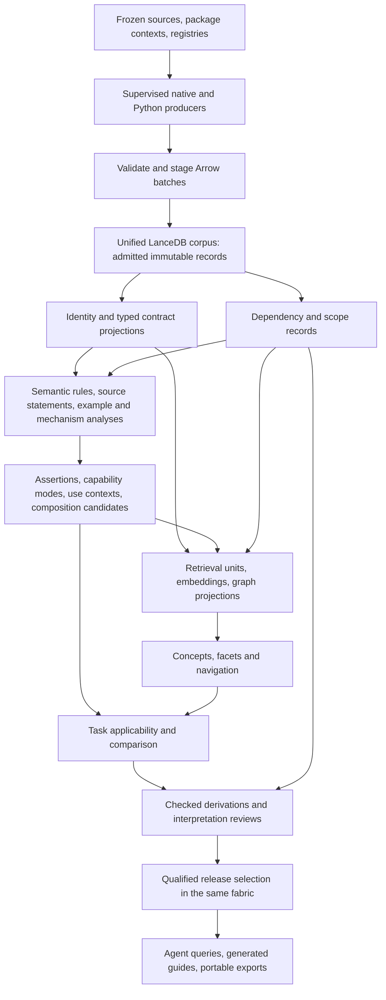

> **Migrated 2026-09-13** from `smartref/docs/library_ref/library_guide_programmatic_semantic_intelligence_target_design_2026-09-12.md` (smartref commit 5e2464345a). Frozen provenance: paths inside refer to the monorepo layout (`tooling/library_guides/...`, `docs/library_ref/...`). The deep-dive reference documents it links to were retired in favour of Context7 and code-fact lookup and are not in this repository.

# Library guides: unified data fabric and programmatic semantic intelligence

**Date:** 2026-09-12

**Status:** the accepted seven-step retained-pilot implementation is complete. See the [completion ledger](../../tooling/library_guides/pilot/intelligence/COMPLETION.md) and [finite acceptance matrix](../../tooling/library_guides/pilot/intelligence/ACCEPTANCE.md). The 24-task assessment reports 4 supported, 4 partial and 16 gaps; broader semantic coverage and unresolved native bridges remain explicit. The design below retains its original review context.

**Scope:** the standalone `tooling/library_guides/` product, including ingestion, evidence, semantic analysis, discovery, authoring, qualification, publication, and maintenance.

This design reviews the [library-intelligence handoff][handoff] against the current codebase and extends the [source-semantic implementation plan v2][v2]. It incorporates the explicit requirement to **replace the existing evidence and publication machinery with a unified data fabric and flow**. The current file-based collection is a migration input, not the target architecture. Useful native extractors, observations, analyses, and correctness requirements survive that replacement.

The intended product is a compiler of **library operations, conditions, capabilities, problem contexts, alternatives, and compositions**. Its principal output is structured decision knowledge that an LLM programming agent can query and inspect. Markdown guides and skill navigation are generated views of that knowledge. Generating a fluent description, a large API inventory, or an attractive concept tree is insufficient by itself.

The original text below is a design assessment. No implementation changes, dependency installations, or new extraction runs were undertaken during that initial review. Subsequent implementation, actual integration and finite qualification are documented in the linked completion ledger; they do not certify the handoff's deployment examples or every upstream semantic property.

## 1. Recommended direction

Adopt the handoff's unified LanceDB/Arrow fabric, source-grounded retrieval units, local embeddings, typed graph projections, extractive labels, and bounded formal concept analysis. Extend it with a **semantic compiler and task-selection layer** that the handoff does not yet specify sufficiently.

The target has five cooperating parts:

1. **One admitted corpus:** original bytes, normalized observations, contextual identities, derivations, semantic assertions, policy revisions, reviews, and releases share one fabric, admission protocol, and evidence resolver.
2. **Programmatic semantic construction:** reusable rules derive operation contracts, mode-specific capabilities, parameter roles, lifecycle transitions, conditional effects, and mappings from evidence. Documentation and examples supply additional structured statements and candidate mappings.
3. **Concept discovery and navigation:** explicit contract families, formal concepts, source phrases, and structural/semantic communities organize the corpus. Each relationship retains its actual meaning and derivation.
4. **Task suitability and composition:** typed requirements select applicable built-ins, expose unresolved constraints, compare alternatives, and construct bounded multi-operation plans. Retrieval supplies candidates; it does not decide semantic validity.
5. **Generated publication:** qualified assertion sets and task comparisons become immutable releases and concise guides. Routine mechanically justified statements do not require an agent to write and approve the same interpretation separately for every function.

The highest-value change is moving interpretation into **reusable definitions, semantic models, and checked derivations**. A capable agent still establishes new vocabulary and reviews difficult assumptions, but its work should normally improve a rule or library pack that covers many operations. Editing individual prose cards becomes an exception.

“Optimal” must mean optimal **within a named candidate universe, explicit task constraints, and a declared preference order**. When cost, applicability, or coverage is unknown, return the unresolved alternatives or a Pareto set. Do not turn similarity, fewest calls, or library popularity into an unconditional best-choice verdict.

### 1.1 Changes from the supplied handoff

| Area | Decision |
|---|---|
| Primary facts and original bytes | Adopt LanceDB family tables and managed byte objects; replace permanent JSONL shards and SQLite offset indexes after migration. |
| Authoring and publication | Go further than the handoff: put authoritative policy snapshots, proposals, reviews, qualification receipts, and release selections in the same fabric. YAML is an import/export and pack-authoring format. |
| Semantics | Add a typed predicate vocabulary, condition expressions, operation modes, contract transitions, rule derivations, and task requirements. |
| Qualification | Replace mandatory review of every semantic object with two explicit routes: checked derivation under an approved rule/model, or attributed interpretation review. Neither route fabricates a review for the other. |
| Concept induction | Retain all three routes—structural communities, contract families, formal concepts—but make evidence-backed attributes useful before clustering. |
| Problem/use-context mappings | Generate conditional mappings from typed goals, documented roles, examples, contracts, and composition rules. An explicitly authored problem node is no longer the only entry point. |
| Embeddings | Retain Qwen3-Embedding-8B/vLLM as the initial local retrieval recipe. It is an embedding worker, not a generative author, evaluator, or approval runner. |
| Reasoning libraries | Add Soufflé for finite relational derivations; add bounded Z3 checking for modeled applicability/composition constraints; use compiler/typechecker witnesses for actual callability. |
| Semantic evidence enrichment | Add structured documentation assertions, option/default specialization, example dataflow, contrastive witnesses, and targeted native-boundary analysis. |
| Delivery order | Deliver a unified-fabric vertical slice that generates useful task mappings and a release early. Do not put every clustering algorithm or full-corpus MIR on its critical path. |

## 2. Review findings and implementation evidence

### 2.1 What the handoff gets right

The handoff explicitly distinguishes evidence from communities, similarity from substitutability, documented availability from compiled availability, and positive support from logical truth. Its treatment of isolated APIs, typed parallel edges, source phrase boundaries, embedding recipe identities, FCA closure checks, uncertain calls, and bounded scans is worth retaining. It also recognizes that a coherent corpus needs application-level multi-table publication rather than independent reads of each table's latest version.

Its examples are design aids. The [validation notes][handoff-validation] report syntax/YAML checks and small numerical checks of [the c-TF-IDF helper][ctfidf], but no LanceDB, Leiden, FCA, vLLM, GPU, or target-repository integration. The [Compose file][compose] and [defaults][handoff-defaults] are templates, not a qualified deployment. Reading those examples supports an architectural review; it does not establish their operational acceptance.

### 2.2 Material shortfalls and refinements

| Finding | Consequence for the intended outcome | Required refinement |
|---|---|---|
| **F01. Discovery is more developed than suitability.** Handoff §§8–12 specify resemblance, groups, attributes, and retrieval, while applicability remains mostly a returned field. | An agent can find related operations and still manually reconstruct which one satisfies its problem. | Make task constraints, operation transitions, candidate elimination, and conditional recommendations first-class executable records. |
| **F02. Property acquisition is underspecified.** FCA consumes “evidence-backed selectors,” but the rich behavioral selectors are the difficult part. | Exact FCA over shallow attributes produces an exact organization of shallow knowledge. | Specify the semantic passes, evidence requirements, failure cases, and rule-certification path in §§5–7. |
| **F03. Problem classes remain restricted to sourced/authored nodes.** | The central task-to-capability mapping can remain almost as manual as today. | Introduce parameterized task schemas and derive candidate use contexts from documentation roles, example outcomes, semantic contracts, and backward composition. Preserve nominated versus established mappings. |
| **F04. An operation is often treated as one semantic object.** | Flags, overloads, null policies, execution modes, and input representations change suitability. | Model operation modes and symbolic conditions; avoid either one unconditional card or enumeration of every argument combination. |
| **F05. Leaving authoring/review files authoritative would preserve a split flow.** Handoff §1.1 permits this. | The database becomes another layer around the existing collection machinery. | Migrate authoring, policy, review, and release authority into the fabric, as explicitly required for this target. |
| **F06. The suggested storage swap understates caller changes.** | Replacing `facts/store.py` alone cannot eliminate path-based evidence and publication. | Refactor all consumers onto a pinned `CorpusReader` and admission service; replace collection loading, support resolution, review persistence, release construction, and build scheduling together. |
| **F07. Ranking and top-k expansion do not define a candidate universe.** | A correct built-in outside the first retrieval page can disappear from a comparison. | Enumerate task-relevant universes independently of relevance ranking and retain unclassified/failed surfaces. |
| **F08. Multiple algorithms can recycle the same evidence.** | Embedding/cluster/label agreement can look like independent semantic corroboration. | Record evidence ancestry; keep hypothesis generation outside proof premises; prevent descriptors feeding their own base graph. |
| **F09. Labels and topics are weaker than behavioral abstraction.** | “Execution” or “schema operations” helps navigation but does not explain resource ownership, metadata policy, or cardinality. | Generate contract cards and conditional comparisons from typed assertions; use labels as display metadata. |
| **F10. Algorithm defaults are unqualified.** Exact kNN still has quadratic work; FCA can grow combinatorially. | Large raw corpora could make routine refresh unnecessarily expensive. | Use bounded operation projections, demand-driven closure, explicit budgets, and scoped recomputation. Full lattice enumeration is a separate product. |
| **F11. Per-object review remains a scaling bottleneck.** | Automatic discovery would merely create a much larger queue for manual prose approval. | Review rules/models and exceptions; automatically qualify their narrow, replayable consequences. Keep interpretive review for assertions outside those rules. |
| **F12. Native Python boundaries remain particularly important for PyArrow.** | Additional Python syntax/type analysis alone cannot settle Cython/C++ behavior. | Add a targeted bridge lane and behavioral witness recipes; retain unresolved native effects when that lane is absent. |

One concrete dependency correction: avoiding `LanceModel` does **not** avoid installing Pydantic. LanceDB 0.38.0 declares Pydantic as a runtime dependency. Keep attrs/cattrs as our contract authority and accept the SDK's dependency without adopting a second model system. The package metadata also does not substitute for a Python 3.14/PyArrow pilot compatibility test. [LanceDB 0.38.0 package metadata](https://pypi.org/pypi/lancedb/0.38.0/json)

### 2.3 Current code makes the redesign concrete

| Current surface inspected | What exists | Target treatment |
|---|---|---|
| [Knowledge contracts][knowledge], [V3 extension][knowledge-v3] | Capabilities, claims, principles, decisions, integrations, reviews, and source artifacts already exist. Many semantic fields remain strings: `Facet.value`, `Capability.intent`, `Decision.requirements`, `Candidate.when`. | Preserve the concepts; replace string-only decision semantics with typed predicates and expressions. Avoid a parallel ontology that cannot drive these objects. |
| [Fact contracts][fact-contracts], [fact store][fact-store] | Artifact paths, JSONL shards, file digests, JSON selectors, and SQLite offsets are deeply connected. | Migrate to logical record/field selections and managed byte objects. Retain a verified legacy-selection resolver only for imported historical evidence. |
| [Collection loader][collection], [generation builder][generations] | `knowledge.yaml` is loaded as an entire collection. Publication copies a set of files into immutable generation directories and updates `current.json`. | Replace with corpus manifests, transactional authoring records, release selections, and exportable support closure. |
| [Qualification][qualification], [support policy][support] | Support classes, exact selectors, profiles, and current dependencies are checked. Non-binding semantic subjects ordinarily require an accepted review. The support validator explicitly does not review arbitrary prose entailment. | Retain those safeguards as requirements. Add typed, independently replayable derivation certificates; do not assume valid citations prove a free-text claim. |
| [Nominations][nominations], [declaration drafts][declaration-drafts], [Python source drafts][source-drafts] | Pattern-based family nomination and real signature/docstring-backed drafts; Python drafts seed six missing semantic dimensions. | Fold into semantic construction passes and generated cards. An unknown slot is useful gap accounting, not completed semantic mapping. |
| [Candidate universes][universes], [contract queries][contract-queries] | Independently specified nominal declaration queries; composition reports matching type occurrences while explicitly leaving inference/coercion/lifetimes/effects unresolved. | Generalize universe expressions and integrate guarded contract matching plus targeted compiler witnesses. |
| [Registry probes][registry] | Runtime function/settings surfaces with library-owned descriptions and attributes. | Give these typed operations and field-level support, and use them as high-value semantic inputs rather than flattening attributes into strings. |
| [MIR analysis pipeline][mir-analysis], [flow][flow], [effects][effects] | Bounded owner flow/control/effect analysis with primitive input dependencies. | Reuse the analysis logic behind fabric stage contracts; add missing summaries and stricter certificate checking before using stronger predicates. |
| [Reader][reader], [build scheduler][build-system] | SQLite search over collection subjects; a coarse build fingerprint and one doit build action. | Replace with corpus-backed retrieval and an actual stage/dependency DAG. |

The [implementation status report][implementation-status] still says `in_progress`. The retained reports identify 47 completed rustdoc jobs, two Python syntax jobs, one Python type job, and four selected MIR crate units. Those are valuable migration inputs, not evidence that the original twenty gates or task-selection outcome are complete. This review did not rerun those workers or re-certify every retained artifact. The newest native work also remains an unfinished working-tree checkpoint; migrated evidence must be tied to the producer that actually emitted it.

A read-only hardware query during this review reported an RTX 5090 with 32,607 MiB and driver 580.178.04. That establishes the available device identity, not that the proposed vLLM image, memory limits, or embedding request have been tested.

## 3. One data fabric, one admission and release flow

### 3.1 Architecture



Every derived stage writes new records back through the same admission service. The diagram shows computation dependencies, not separate authoritative databases. NetworkX, igraph, NumPy, Soufflé, Z3, and the embedding service consume finite projections and return typed products. They cannot write release heads or mutate source observations.

Use LanceDB OSS as the primary local fabric with explicit Arrow schemas and batch I/O. Lance is the storage format; Parquet is the portable interchange format. Do not introduce Neo4j, a second operational SQLite database, or another authoritative SQL store. Relational joins and recursive semantic inference belong to bounded analytical workers; the design does not assume that every desired multi-table join is available through a local LanceDB query builder.

### 3.2 Logical record families

Keep family-specific typed payloads with a common identity/context/provenance envelope. Avoid both a universal JSON payload table and a table per function.

| Family | Authoritative contents |
|---|---|
| Acquisition | Package/source snapshots, files, licenses, original byte objects/chunks, acquisition observations. |
| Context | Language/runtime/compiler profiles, Cargo package/target/unit facts, feature selections, Python environment/stub order, registry contexts. |
| Interface | Entities, public routes, declaration revisions, recursive type nodes/ordered links, parameters, overloads, trait/protocol/impl contracts. |
| Mechanism | Body owners, calls, CFG/events, places, argument/return flows, effects, errors, configuration reads, native-boundary joins. |
| Documentation and examples | Source passages and maps, statement candidates, parsed parameter/return/error sections, example dataflow, compile/run observations. |
| Semantic model | Predicate definitions, expression nodes, rule/model revisions, semantic assertions, assessment records, proof steps, operation modes, capability instances. |
| Decision model | Problem/task schemas, use contexts, conditional realizations of principles, candidate universes, composition plans, applicability and comparison results. |
| Discovery | Retrieval units, embedding recipes/vectors, graph projections, community memberships, FCA contexts/concepts, labels and their source links. |
| Assurance | Support links, scope certificates, policy revisions, obligations, rule approvals, interpretation reviews, qualification/revalidation receipts, unresolved work. |
| Lifecycle | Stage specifications/runs, immutable manifests, manifest membership, authoring transactions, release records, control heads, export/import receipts. |

The exact table registry follows producer ownership and scan patterns. High-volume MIR events, source bytes, and vectors stay physically separate. Common filter keys—revision, entity, family, profile, run, owner, membership set—are scalar columns. Recursive expressions use typed nodes and ordered links rather than recursive Arrow structs. Maps, large integers, floating-point special values, and language constants need explicit canonical encodings; Arrow null cannot ambiguously mean “not observed,” “not applicable,” and a literal null value.

Keep original source and raw normalized-record bytes in managed blob objects, initially chunked as proposed by the handoff. Normalized typed rows and raw bytes are complementary representations inside the **same** corpus. A source selection addresses an object digest and original byte range. Chunk layout and database row positions never enter evidence identity. Large source objects are streamed and verified, not reassembled during ordinary graph/search reads.

### 3.3 Authority and writable boundaries

All admitted facts, semantic records, reviews, and releases are immutable revisions. Mutable control heads select revisions. One coordinator owns writes; producers and readers receive explicit capabilities to stage or read, not arbitrary table handles.

Version-controlled library packs and rules remain useful authoring inputs. A build imports their exact revision into the fabric. Active queries use the admitted revision; editing a YAML pack does not silently alter an already admitted corpus. Likewise, exported `knowledge.yaml`, Markdown, and review reports are views, not additional places where live facts can be changed.

“Independent obligations” means independent **write authority and dependency lineage**, not a requirement for a second YAML truth source. Extraction, clustering, task matching, and proposal import cannot change required coverage or remove difficult candidates. An explicit policy transaction can update those records, with a visible before/after revision.

### 3.4 Coherent commit protocol

Lance provides atomic versioned **table** commits. Our multi-table corpus protocol must establish its own consistency contract; do not infer it from table MVCC. [Lance transaction specification](https://lance.org/format/table/transaction/)

1. Pin the input manifest and requested stage identities; create a run and private Arrow IPC staging area.
2. Supervise producers. Validate schema, sequence, exact inputs, byte/row counts, terminal status, record IDs, and referential requirements before admission.
3. Acquire the corpus writer lock; refresh the control-head read and compare the expected predecessor. Long-running work based on another predecessor must explicitly revalidate its dependencies or report a conflict.
4. Append immutable rows and exact membership records idempotently. An existing revision ID with different canonical content is an error. Application validation supplies uniqueness and referential checks.
5. Record outcomes for every requested job, including failed or partial attempts. A failed new request cannot leave an old artifact presented as the current successful result of that request.
6. Verify selected support closure and admitted membership, then capture exact family-table versions. Build required search projections/indexes before declaring that search product ready; source admission need not wait for an embedding job.
7. Store an immutable manifest and its membership selection. Its logical digest excludes its own physical storage version. Physical table bindings are recorded separately from portable logical identity.
8. Protect referenced versions under the tested retention policy, then atomically advance the named head in a final control-table commit. The head binds the manifest ID and the manifest-table version needed to read it. This avoids a self-referential manifest hash.
9. Release the lock after the commit receipt is durable. Recovery reconciles staged, admitted-but-unpublished, and published runs explicitly.

A reader resolves one control head, pins the named manifest and family versions, and applies the manifest's membership selection. It never scans independent “latest” tables. Freshness policy for the control read must be explicit because SDK handles can retain a snapshot. Pins and version tags are storage mechanisms, not evidence IDs. The SDK exposes version selection and tag APIs; test them against the pinned local SDK. [LanceDB versioning](https://docs.lancedb.com/tables/versioning), [Python API](https://lancedb.github.io/lancedb/python/python/)

Rows from a failed attempt can exist in a table version without belonging to an admitted corpus. This is application-level atomic publication for sanctioned readers, not global transactional invisibility to arbitrary external database clients. A single local writer and an advisory lock are an explicit deployment boundary. Supporting multiple independent writers later requires a separately qualified coordinator protocol.

### 3.5 Unified publication

Replace directory-copy publication with a `ReleaseSelection` over a pinned corpus manifest. It names eligible assertion/capability/decision revisions, assurance receipts, candidate-universe versions, renderer versions, and their support closure. Publishing advances a named release head through the same coordinator protocol.

An analysis head may advance while a release remains on an older qualified selection. These are lifecycle views of one fabric, not duplicate corpora or two authoring systems. New evidence can be explored before its interpretation is qualified. A release never silently imports a later label, assertion, review, or vector merely because it is now the latest row.

Portable publication exports selected typed records, original byte objects, exact support, retained policy/model definitions, scope membership, and qualification/revalidation history to Parquet plus a manifest. Imported physical table versions will differ; logical IDs, selected bytes, derivations, and release meaning must survive. Include a compatible reader and pre-rendered guide views so normal offline use needs no model service or native extractor. Rebuilding embeddings is not required to read or verify a release. Search indexes can be recreated from exported units and retained vectors.

Garbage collection follows retained manifests, release support closure, and active reader leases. Default to no automatic pruning until crash/recovery, tag protection, and export/import tests pass. Compaction, index maintenance, and deletion eligibility are separate operations. Storage consolidation must not erase the bytes that make a citation inspectable.

## 4. The semantic data model

### 4.1 Concepts with distinct jobs

The fabric needs a small explicit metamodel; algorithms populate its instances and propose extensions. A discovered word cluster must not implicitly define the semantics of a predicate.

| Record | Meaning | Example shape, not a newly verified library claim |
|---|---|---|
| `Entity` / `Operation` | A contextual library item and a callable interface. | A method, SQL function, compute kernel, or constructor with exact routes. |
| `OperationMode` | A guarded specialization of an operation. | One overload, checked arithmetic mode, join kind, error policy, or streaming consumer mode. |
| `PredicateDefinition` | A typed, versioned property or relation with an explicit interpretation. | `declares_output_type`, `documented_result_delivery`, `modeled_writes_place`, `requires_unique_keys`. |
| `SemanticAssertion` | One predicate application under explicit context, quantification, and conditions. | “For this mode and input domain, the documented result delivery is incremental.” |
| `Assessment` | Supported, refuted, unknown, conflicting, or not applicable **under a named evidence interpretation**. | A document states the property; a body model proves a narrower property; a native effect remains unknown. |
| `CapabilitySchema` | A reusable operation pattern with typed inputs, outcomes, preconditions, and transition/effect slots. | Construct a schema, transform an array, plan an expression, read selected columns, consume batches. |
| `CapabilityInstance` | A schema realized by actual operations/modes and supported mappings. | A particular function's realization of a conversion or aggregation capability. |
| `ProblemSchema` / `TaskRequirement` | A parameterized goal and the conditions needed by a consumer. | Obtain selected rows incrementally while retaining a particular metadata contract. |
| `UseContext` | A partial assignment of goal, input state, consumer needs, and operating constraints. | Query expression input versus already materialized array input. |
| `ConditionalRealization` | A capability's applicability to a problem or principle under conditions. | A built-in satisfies a task if representation, options, and semantic preconditions match. |
| `CompositionPlan` | A bounded graph of operations and value/resource flows. | Decode → transform → consume, including required setup, conversions, and ownership obligations. |
| `ConceptOccurrence` | A grouping with its derivation semantics. | Contract family, observed-support conjunction, semantic topic, subsystem, or task lens. |
| `ComparisonResult` | An evaluated candidate set with reasons and unresolved dimensions. | Eligible alternatives, rejected modes, conditional plans, and preference/Pareto result. |

Keep type expressions, semantic predicates, and natural-language terms distinct. A type can identify a carrier; it does not supply all properties of the carried data. `Arc<T>` is not a proof that an operation is immutable. A stream result is not a proof of bounded memory for all upstream operators. A nullable field is not a complete null-propagation rule.

### 4.2 Assertion contract

Replace string-valued facets and free-text conditions as the computational interface. Retain prose as a generated or reviewed explanation of the structured assertion.

An assertion revision contains:

```text
subject/entity or operation-mode reference
predicate definition reference and typed argument/value references
context and applicability expression
quantifier/domain and phase: declared, planning, execution, consumption, release, etc.
evidence interpretation: declaration | upstream_contract | modeled | witnessed | interpreted
support/refutation records, rule/model revision, and scope/frontier
status and exact derivation/qualification references
rendering template or separately reviewed narrative reference
```

Use explicit tagged values and expression nodes for conjunction, disjunction, equality, set membership, ranges, and supported negation. Expressions are data, not Python `eval`, SQL fragments, or executable source supplied by documentation. Bind parameters and default expressions through language-aware adapters. Unresolved defaults remain expressions with dependencies, not fabricated constants.

Do not merge evidence states into a single confidence number. A useful assessment can contain both positive and negative support. `unknown` means neither adequate support nor refutation; `conflicting` means incompatible admitted evidence remains; `not_applicable` requires a justified context exclusion. ML scores belong to candidate ranking and have no automatic conversion to any of these truth dispositions.

Documentation, source models, and executions can disagree without corrupting the corpus. Record “upstream documents X” and “this modeled/executed case exhibits Y” separately, then generate a conflict or scope-reconciliation task. Different versions, modes, or assumptions must be checked before declaring a contradiction.

### 4.3 Identity and exact selections

Separate an entity's identity, its observation revision, its profile-specific operation mode, and its display label. Package/source/version and actual compilation/environment context remain part of resolution. Rust item IDs are local to their rustdoc artifact; MIR identities require their compilation unit; Python names require the frozen module/stub environment. Central resolution records exact, ambiguous, candidate, and unresolved joins rather than merging by spelling.

A new logical field selection should name `(record_revision, field_path, canonical_value_digest, role)`. Source selections additionally name the original blob and byte/source-map intervals. Resolving a selection checks the record's admitted membership, normalized schema, selected value, and provenance closure. Physical column order, Lance row addresses, dictionary codes, graph integers, and Parquet file names are not selectors.

During migration, retain each old normalized record's exact bytes in the fabric and map legacy `FactSelection` references to those bytes. A verified mapping can preserve the meaning of an old selection; it cannot automatically approve a newly strengthened semantic assertion. Legacy record identifiers remain historical aliases, not the only identity available to new analyses.

Keep separate digests for raw integrity, normalized contract meaning, interpretation/model inputs, rendering text, and embedding recipe/input. Moving source text can preserve a semantic derivation only through a declared equivalence check while its byte anchors are refreshed. A label change must not pretend the underlying concept's membership changed; a membership change must not hide behind a stable label.

## 5. Building semantics programmatically

### 5.1 Produce useful assertions before topic induction

The semantic compiler consumes C0/D0/L1–L4, Griffe, registries, structured documentation, and examples. It emits typed assertions with exact input selections, operation modes, mapping candidates, and concrete missing requirements. Each pass declares supported constructs and rejects or reports unsupported ones.

The following passes constitute the target, rather than leaving “attribute selectors” as future agent work.

| Pass | Programmatic construction | Evidence limit and decisive counterexample |
|---|---|---|
| **S01. Interface and public route reconciliation** | Callable shape, parameter positions/defaults, overloads, return structure, trait/protocol requirements, export routes, and profile applicability. | Private/doc-only declarations do not become ordinary consumer APIs. Duplicate versions and aliases stay distinct. |
| **S02. Registry semantics** | Typed function kind, arity, option schemas, signatures, volatility/determinism declarations, kernel/input domains, descriptions, settings/default reports, registration context. | Registered in one loaded engine does not establish a different Rust/Python build. A registry's description is an upstream statement, not a whole-body proof. |
| **S03. Operation and argument roles** | Constructors, producers, consumers, adapters, builders, callbacks, configuration values, schemas, keys, predicates, and output handles from ordered type roles plus exact documentation/link roles. | A nested `T` in `Result<Vec<T>>` does not mean the call yields a directly usable `T`; a parameter called `schema` is only a lexical hint. |
| **S04. Structured documentation assertions** | Parse parameter/return/raise sections, admonitions, option tables, “see also,” examples, negation, conditions, and source-linked purpose statements. | “May,” “unless,” “not,” platform conditions, and method-specific exceptions survive. A parser match alone does not establish behavioral truth. |
| **S05. Mode and default specialization** | Build guarded modes from enum/Literal options, overload branches, configuration/default sources, and constant arguments. Propagate constraints symbolically. | A default expression evaluated at runtime, environment override, or branch-dependent value is not a constant default. Avoid exponential enumeration of every flag combination. |
| **S06. Value and effect summaries** | Owner-local dataflow and bounded interprocedural summaries: argument-to-result flow, reads/writes, retained references, external effects, allocation/copy candidates, resource escape. | Shared-reference interior mutation, aliasing, discarded construction, opaque call, recursion, and unresolved dispatch prevent unjustified stronger summaries. |
| **S07. Shape and data-semantics transfer** | Conditional models for scalar/array/table shape, row cardinality, field selection, ordering, nullability, metadata, units/representation, and overflow behavior. | Nominal type equality does not prove metadata, units, ordering, or row preservation. A library pack supplies and qualifies the semantic transfer model. |
| **S08. Phase and lifecycle** | Planning versus execution versus result consumption; create/configure/register/activate/invoke/release transitions; required setup and invalid call orders. | A constructor may execute work; registration may immediately call a callback; returning a stream does not locate all buffering. Require actual evidence for the transition. |
| **S09. Error and exceptional behavior** | Rust error construction/conversion/return flow; Python raise/handler/re-raise/finally flow; parameter conditions and declared exception differences. | Constructed-and-discarded errors and locally handled exceptions do not reach callers. Unknown callees prevent a complete public error inventory. |
| **S10. Configuration influence** | Exact field/key reads, default origins, override precedence, control/data dependence, and scope of affected operations. | A read without demonstrated influence is not “controls X.” Dominance alone is not control dependence. |
| **S11. Extension and built-in coverage** | Required methods/associated items, default implementations, impl polarity, registry families, activation routes, and existing implementations before extension advice. | Trait membership does not settle bounds or runtime activation. An unenumerated competitor cannot justify a negative built-in search. |
| **S12. Example and test dataflow** | Resolve operations, argument binding, data dependencies, setup, consumer representation, and asserted outcomes in source examples and tests. | Nearby calls are not necessarily a pipeline. Parse/typecheck success is not execution; observed assertions may be weak or unrelated to the target property. |
| **S13. Composition and boundary mapping** | Connect producers to consumers through typed slots, transformations, ownership/lifetime requirements, and explicit bridge adapters. | Same-named types across versions/languages are not interchangeable. Type correctness alone does not preserve semantic postconditions. |
| **S14. Contrast and change** | Pair explicit alternatives, option/profile differences, deprecations, changed contracts, and changed witnessed outcomes; generate reversing conditions. | A release delta with many changed settings does not isolate a causal feature. Similar names do not identify checked/wrapping pairs without supporting evidence. |
| **S15. Gap-to-evidence planning** | Convert unresolved decision predicates into the smallest relevant documentation lookup, lane analysis, compiler check, or behavior witness request. | Lack of evidence remains a gap; an expensive probe is not scheduled merely because it exists. |

S01–S05, S11, and source-grounded portions of S12 can operate without MIR. Body evidence enriches specific assertions as available. The existing six semantic dimensions remain useful reporting lenses, but each expands into explicit predicates; they are no longer six string slots awaiting prose.

### 5.2 Documentation analysis without a generative author

Start from existing Markdown/RST/Griffe parsing, preserving section structure and source maps. Use declared API links, parameter references, and cross-references to resolve mentions. Extract a `DocumentStatement` with its exact sentence/paragraph, subject candidates, relation candidates, argument spans, negation, modality, conditions, exceptions, and inherited section context.

Separate three operations:

1. **Lossless structure extraction:** a `Raises` section, a parameter description, a linked example, an option/default table cell, or a verbatim upstream statement. These can be admitted mechanically with source attribution.
2. **Constrained semantic parsing:** explicitly defined source templates map to a narrow documented predicate. Their rules retain all relevant qualifiers and have counterexample fixtures. Only a qualified template/model can support an automatic structured assertion.
3. **Broad language interpretation:** dependency patterns, phrase matching, embeddings, and optional classifiers nominate roles, purposes, alternative relations, and problem contexts. These remain candidates unless another rule or review establishes the stronger mapping.

Use spaCy's `Matcher`/`PhraseMatcher` for optional lexical patterns and `DependencyMatcher` for grammatical relation candidates. The latter requires a parser model and is therefore probabilistic analysis despite a deterministic pattern specification. Pin that model and preserve its outputs/uncertainty; do not make a natural-language parse part of the trusted proof kernel. [spaCy matching documentation](https://spacy.io/usage/rule-based-matching)

A high-value example is locating a parameter's documented effect, its default declaration, the body branch that consumes it, and an example demonstrating one setting. These are four linked records that a generic mode-specialization rule can use. Merely extracting a subject–verb–object triple and calling it a capability would recreate the earlier unsupported-prose problem in graph form.

Preserve “documented as” separately from “modeled to do.” General NLP candidates can still improve discovery without waiting for every item to be reviewed. The product should display a source-grounded candidate with its uncertainty rather than hide it or falsely qualify it.

### 5.3 Semantic transfer models

Introduce small, inspectable semantic models over a finite vocabulary. A model describes a transition from an input state and argument assignment to an output state and effects. A state can include:

```text
carrier/type and representation
shape/cardinality constraints
schema and field provenance
ordering/key/uniqueness information
null/empty/error policy
metadata and optional domain annotations
resource ownership, lifetime and materialization stage
environment/configuration assumptions
```

The generic engine owns propagation, unknown handling, dependency tracking, and consistency checks. A family pack defines what a documented or analyzed library operation means in that vocabulary. A library pack maps exact operations/modes to those models using evidence-backed selectors. This is the reusable unit of interpretation.

For example, a relation-join model can express cardinality as conditional on key multiplicities, join mode, and missing matches. A concrete library mapping must establish that an operation implements that modeled join semantics under the selected options. The engine can then generate many task-specific cardinality explanations without an agent independently writing each one. The generic model cannot assume every library's method named `join` implements it.

Use named abstractions for effects: local field writes, modeled reachable state, callback retention, observable I/O, and so on. A closed local-place analysis does not become a whole-program purity claim. Store lower/upper bounds only where the model warrants them. “May allocate” does not imply “always copies,” and no measured allocation in a witness does not prove zero allocation for every input.

### 5.4 Example mining and targeted witnesses

Examples should contribute more than snippets. Generate an example graph of values, operations, argument bindings, setup, and assertions. Match these graphs against capability schemas to produce candidate use contexts: what representation enters, what transformation occurs, which output is consumed, and under what setup.

Use templates grounded in actual signatures and declared finite option domains to construct compile/typecheck witnesses and small behavior experiments. Existing examples are good seeds. A witness records the exact input/environment, expected property and independent oracle, result, unsupported aspects, and source/model it is testing. It must not use the same derived statement as both the hypothesis and the oracle.

Add Hypothesis for generated boundary cases and stateful operation sequences; it can generate both values and sequences and retain reduced counterexamples. Reuse the same semantic test specification for Python calls and generated Rust harnesses where feasible. Hypothesis is a test-data/sequence generator, not a proof of a universal API property. [Hypothesis stateful testing](https://hypothesis.readthedocs.io/en/latest/stateful.html)

Prioritize contrastive cases that can reverse a choice: empty versus nonempty, null versus valid, duplicate versus unique keys, overflow versus in-range, lazy versus materialized consumption, metadata conflicts, mutable alias versus fresh object, optional feature present versus absent. Pairwise option coverage is a test strategy, not a completeness guarantee for interactions.

Run foreign code only through the tooling's declared isolated witness mechanism. Importing a Python package, compiling build scripts, or executing a documentation example can have effects. A task query returns planned evidence work; it does not silently execute arbitrary retrieved code. A previously authorized build can run the finite witness catalog under its configured policy.

### 5.5 Targeted native-boundary extension

For Python libraries implemented through Rust or C++, define a bridge record with both environment identities, exported Python name, wrapper signature/argument transformation, target candidates, ownership behavior, and exact supporting metadata. PyO3 annotations and wrapper source are useful for Rust-backed Python; Cython `.pyx`/`.pxd`/`.pxi` sources and generated/native declarations are relevant to PyArrow.

A targeted Cython adapter may use a pinned `Cython.Compiler` parser/visitor implementation behind an isolated worker; treat this as an internal, version-sensitive integration. Use libclang for selected C/C++ declaration and source-location relationships when matching compilation arguments are available. Neither provides automatic full native behavior. The immediate product is better identity, conversion, and ownership evidence around selected public boundaries. [Cython compiler visitor source](https://github.com/cython/cython/blob/master/Cython/Compiler/Visitor.py), [libclang tutorial](https://clang.llvm.org/docs/LibClang.html)

Do not require indexing all Arrow C++ internals before publishing Python contract knowledge. Activate this lane for unresolved pilot questions that Python syntax/types cannot answer, and explicitly retain the boundary when source or build context is unavailable.

## 6. Reusable rules and checked derivations

### 6.1 Rule records

An `AnalysisRule`/`SemanticRule` revision declares input relation schemas, scope requirements, conditions, emitted predicate schema, allowed evidence interpretations, unknown/frontier behavior, dependency sensitivity, resource limits, and validation fixtures. A `ModelApproval` records the reviewed meaning and permitted conclusions of that exact rule/model revision. A declaration projector cannot emit a whole-body behavioral predicate simply by naming it.

Use Soufflé as the initial worker for finite relational joins and recursive derivations over admitted facts. Its rule language supports typed relations and stratified negation. Restrict our rules further: no unbounded value generation, arbitrary functors, or untrusted executable rules; finite input domains and bounded output/reconciliation are mandatory. [Soufflé rules](https://souffle-lang.github.io/rules)

Keep numerical transfer functions, compiler queries, and graph algorithms in their appropriate workers. Datalog is the semantic relationship engine, not a replacement Python/Rust typechecker or a universal numerical analyzer. Store all worker outputs in the fabric through owned DTOs; stage-local relation files are transport only.

### 6.2 Derivation and absence semantics

For each admitted consequence retain a derivation reference, instantiated rule, relevant premises, conditions, profile, and scope. Soufflé's provenance facility can help explain a tuple with a proof tree, but that is not automatically a complete update dependency or a semantic truth certificate. In particular, one positive proof does not enumerate every possible alternative proof, and a failed relation lookup does not prove absence in the library. [Soufflé provenance](https://souffle-lang.github.io/provenance)

Separate:

- **Explanation support:** a finite proof or selected witnesses showing why a consequence follows.
- **Invalidation support:** the rule's actual read sets and universe dependencies, including negative premises, aggregates, unification domains, and candidate sets.
- **Assurance check:** replay or independently validate the typed consequence using the approved rule and its exact premises/scope.

Recursive analysis can use SCC/fixed-point computation. Its call/data graph may be cyclic; its persisted artifact inputs remain acyclic. Store one finite run/fixed-point result and bounded proof structure, not recursively hashed claim objects that cannot terminate.

Permit semantic absence only when a rule explicitly requires a matching closed-scope certificate. For example, “no modeled writes in this owner closure” requires the named place/effect abstraction, all relevant current receipts, modeled callees, and an empty unresolved frontier. Soufflé's negation-as-failure alone does not satisfy that requirement.

### 6.3 Change the unit of review

Introduce distinct qualification routes:

| Route | Automatically publishable meaning | Required authority |
|---|---|---|
| Observed interface/registry record | What this producer observed in this context. | Verified producer/schema/receipt and exact source/input closure. |
| Extracted upstream statement | What the selected source states, with its qualifiers and attribution. | Exact source selection and a lossless rendering/structuring policy. |
| Checked semantic consequence | The specific typed predicate entailed under a named model and premises. | Current approved rule/model plus a valid derivation certificate and scope. |
| Witnessed behavior | What happened for the retained input/environment and oracle. | Valid execution receipt and bounded observation semantics. |
| Interpretive assertion | A claim requiring judgment beyond the admitted rules or source template. | Attributed review of that assertion and its complete relevant support. |
| Task comparison | Applicability and preference consequences of explicit requirements over a named universe. | Checked requirements/models and complete relevant comparison scope; reviewed interpretation for unresolved premises. |

The third and sixth routes are the deliberate change from V2's default per-object review. They must be implemented as real qualification logic, not as automatic creation of `Review(reviewer="system", disposition="accepted")` records. Rule approval also must not authorize arbitrary prose that happens to cite the rule's output.

Validate the consequence itself, not just its source pointer. A producer that emits `preserves_metadata=true` cannot pass because it supplies an authentic signature record. The checker must validate the approved predicate/model, required field selections, conditions, output value, and unresolved frontier. Machine qualification says precisely which interpretation has been established; it is not a claim of independent human review.

A capable programming agent remains responsible for novel domain abstractions, new rule meanings, disputed source semantics, unsupported natural-language mappings, and explicitly chosen objective preferences. Its ordinary output should be a reusable pack/model change with counterexamples, not hundreds of detached capability summaries.

## 7. Programmatic task-to-capability mapping and composition

### 7.1 Typed task requirements

Introduce a `TaskSpec` containing a goal expression, input state/types, required output semantics, hard constraints, preferences, environment/profile, candidate-scope policy, and evidence expectations. A useful illustrative request is:

```yaml
goal: consume_query_rows
input:
  representation: logical_query_frame
requirements:
  - predicate: result_delivery
    relation: equals
    value: incremental_batches
  - predicate: terminal_materialization
    relation: equals
    value: absent
preferences:
  - minimize: custom_extension_count
candidate_policy: query_result_consumers
unresolved_policy: return_conditions_and_gaps
```

This is a proposed contract example, not an existing command or a claim that any particular library already meets it. A request for bounded **total operator memory** would require another predicate and evidence; the example does not insert that assumption.

Free text remains accepted for discovery. A parser can propose a partial `TaskSpec`, with each interpreted field linked to its user-text span and confidence/ambiguity. The consuming programming agent can provide the typed requirement directly or confirm its own intended mapping. Do not turn an uncertain phrase match into a mandatory constraint or a false approval. Missing values remain unknown; the system can show the small number of choices they affect.

### 7.2 Derive problem and context mappings

Build mappings through several explicit routes:

| Route | Generated mapping |
|---|---|
| Contract realization | An operation/mode instantiates a capability schema because its typed roles and semantic assertions satisfy that schema. |
| Goal matching | A capability's supported postconditions establish a task goal under derived preconditions. |
| Example realization | A resolved example demonstrates or documents a task context and operation sequence, with its execution status. |
| Documented usage | A source passage ties an operation to a problem or operating condition; preserve statement strength and qualifiers. |
| Principle rule | An explicit preference principle applies when its triggering predicates hold, subject to exceptions. |
| Similarity nomination | Embedding/phrase/graph evidence suggests an additional task or alternative; retain candidate status. |

The compiler can generate parameterized problem schemas such as “convert representation A to B,” “reduce rows by key under policy P,” or “consume result under delivery constraint D” from capability schemas and supported contract transitions. It can specialize them from examples and consumer requirements. This avoids requiring an agent to author every use-context instance in advance.

A generic “prefer an applicable built-in before implementing an extension” principle should operate over a named required outcome and candidate universe. It must permit a custom extension when supported built-ins cannot realize the required semantics. “A custom extension is necessary” requires stronger coverage evidence than “no applicable built-in has yet been established.”

Do not equate technical preconditions with normative preferences. “No new dependencies,” “favor plan visibility,” “minimize network calls,” or a particular performance tradeoff is a task/policy choice. The system can evaluate these preferences where evidence exists; it cannot infer what the user values from graph centrality.

### 7.3 Candidate universes independent of ranking

Generalize the current nominal-only `CandidateUniverse` into a typed, versioned query over interfaces, registries, capability schemas, operation modes, extension families, and explicit alternative links. Its record includes the source population, query/policy, context, membership digest, exclusions with reasons, unresolved identity/applicability, and completeness disposition.

Exact/lexical/dense search may nominate additional candidate families, but its top-k set is never the complete decision denominator. Evaluate declared task families independently, including operations with poor documentation or no embeddings. Return a separate “unclassified or unresolved candidates” remainder when necessary. A manifest with every row successfully ingested can still have an incomplete semantic mapping universe.

New registry members, overloads, impls, public routes, or supported capability mappings can change a comparison even if every formerly cited function is unchanged. Track this as a query/universe dependency. A failed extraction or failed rule run cannot shrink the universe and thereby make a custom-extension recommendation appear justified.

### 7.4 Applicability checking

For each candidate mode evaluate:

1. Environment, public route, feature, and invocation availability.
2. Input representation/type and required argument binding.
3. Semantic preconditions and desired postconditions.
4. Resource, lifecycle, ownership, and effect compatibility.
5. Required assurance/evidence level and any remaining frontier.

Return `eligible`, `ineligible`, `conditional`, `unknown`, or `conflicting`, with the evaluated predicates and evidence. Unknown is not false and not eligible by default for a hard requirement that demands established support. “Ineligible” needs a demonstrated mismatch; missing evidence receives its own status.

Add Z3 for bounded formulas over the supported condition language: finite option domains, feature conditions, cardinality constraints, and small composition plans. It can check consistency and help explain incompatible modeled requirements. A satisfiable model supplies a candidate assignment, not evidence that an unmodeled API behavior holds. For a claimed implication, require the supported model to entail the conclusion; do not confuse satisfiability with validity. [Z3 logic guide](https://microsoft.github.io/z3guide/docs/logic/intro/), [satisfiability and validity](https://microsoft.github.io/z3guide/docs/logic/propositional-logic/)

Encode unknown predicates explicitly or keep them outside the solvable fragment. The solver must not choose a favorable value for unknown copying, native dispatch, or metadata preservation to manufacture eligibility. Resource bounds and solver `unknown`/timeout propagate to the result. An unsatisfiable core explains a conflicting subset of the **modeled** requirements; it is not automatically a minimal explanation or a global impossibility proof.

Rustdoc-style type-signature search is a useful candidate mechanism and precedent, but its matching is approximate. Use our retained typed declarations to narrow candidates, then compile an ordinary consumer witness for selected generic/trait/coercion cases. Python witnesses similarly retain the actual runtime/stub environment and distinguish type acceptance from observed execution. [Rustdoc search](https://doc.rust-lang.org/rustdoc/read-documentation/search.html)

### 7.5 Compositions require a hypergraph

A function with several inputs and one or more outputs is a transition requiring all relevant inputs together. Model compositions as an AND/OR hypergraph of typed value states and operations. A pairwise edge between matching type names loses joint prerequisites, receiver state, resources, and argument correlations.

Use backward goal matching and bounded forward propagation to nominate plans. Preserve argument order, wrappers, defaults, ownership tokens, lifetime obligations, semantic state, and side effects. Constants and options can be chosen from declared finite domains; arbitrary lambdas or invented conversion code are not free edges. An adapter is another evidenced operation with costs and conditions.

Type-directed component synthesis using Petri-net reachability is an established precedent for finding operation sequences. Adopt the bounded search idea rather than treating the original Java-oriented SyPet implementation as a ready-made Rust/Python solution. Our semantic conditions and ownership checks are additional requirements. [Component-Based Synthesis for Complex APIs](https://www.cs.sfu.ca/~yuepeng/pubs/popl17.pdf)

Rank only plans whose relevant constraints are established, or label conditional plans explicitly. Validate promising concrete plans through compiler/typechecker checks and small declared witnesses. A passing compile checks callability for that instantiation; it does not prove every semantic transition used in the plan.

### 7.6 Selection and reversing conditions

After hard constraints, use explicit lexicographic preferences or a Pareto frontier over comparable supported dimensions. Z3 supports both styles for modeled objectives, but the objectives must come from the task/policy, and measured cost requires an actual workload receipt. [Z3 objective combinations](https://microsoft.github.io/z3guide/docs/optimization/combiningobjectives/)

Good default explanations are “satisfies these requirements,” “requires this additional condition,” “rejected because of this mismatch,” and “tradeoff unresolved on this dimension.” Relevance rank, community membership, number of citations, and model confidence are not objective performance or suitability scores.

Generate reversing conditions by reevaluating adjacent task/option contexts in the declared domain. For example, changing an input from a query expression to a materialized array can select a different operation family; requiring checked overflow can eliminate a previously plausible mode. Store the changed predicates and comparison delta, not a manually written reversal detached from the evaluated candidates. Counterfactual results remain bounded by the modeled domains.

### 7.7 Worked migration example: result-consumption mappings

The [retained Python draft collection][python-drafts] already contains specific declaration/documentation records for `datafusion.dataframe.DataFrame.collect` and `execute_stream`. The former records a `list[pa.RecordBatch]` return annotation and a source statement about collecting results into memory; the latter records a `RecordBatchStream` annotation and a source statement about a stream over one partition. Their bindings remain candidates, and these draft records do not independently certify native behavior.

The target converts that useful but shallow material into the following flow:

| Step | Generated product | Remaining qualification |
|---|---|---|
| Import exact record selections and source bytes | Separate return-type and upstream-statement observations for each operation. | Verify migrated selections, source ownership, profile, and producer identity. |
| Apply declaration and qualified source-template rules | `declares_return(list[RecordBatch])`, `documented_result_form(collected_in_memory)`, and corresponding stream-form observations. | The source-template rule must preserve the actual statement and its conditions; the type name alone cannot supply the delivery behavior. |
| Match the reusable result-consumer schema | Two capability instances with distinct result-form contracts and unresolved invocation/native facets. | Resolve public routes and the stream consumer contract needed by the task. |
| Evaluate a consumer requirement | A consumer requiring a materialized list and one requiring incremental batches obtain different candidate evaluations. | Eligibility requires the relevant delivery/iteration assertions; a missing iterator or native-boundary contract yields a conditional result. |
| Generate a comparison and release view | Concrete operation routes, requirements each satisfies, conditions, and exact rule/source evidence. | Total operator memory and cancellation timing remain separate unresolved predicates until supported. |

The reusable work is the result-consumer schema, documented-form parsing rule, invocation/consumer checks, and task-comparison logic. Adding another library's result consumer should primarily add source/registry evidence and a contextual operation mapping. It should not require an agent to rewrite the same collection-versus-streaming explanation from scratch. This example describes the proposed transformation of existing draft records, not an already executed semantic compiler result.

## 8. Concept induction and navigation

### 8.1 Three complementary structures

Implement all three useful structures from the handoff, with capability-oriented contract navigation as the first task-facing lens:

- **Contract and task families:** exact type/trait/registry relations, capability schemas, supported predicates, and problem mappings. These answer what an operation can participate in and under what conditions.
- **Formal support concepts:** exact conjunctions of admitted attributes within a recorded context. These answer which operations share a chosen set of supported properties.
- **Subsystem and semantic communities:** structural cohesion and source-text resemblance. These explain architecture and expose additional alternatives, including cross-cutting groups.

Topic, concept, problem schema, and capability are separate node kinds. Use typed relations such as `realizes_under`, `requires`, `produces`, `documented_for`, `member_of_community`, `shares_supported_attributes`, `candidate_alternative_to`, and `related_topic`. Do not produce behavioral equivalence, subtype, or dependency edges by renaming a similarity edge.

Use SKOS-style preferred/alternative labels, broader/narrower topics, and related topics as a navigation vocabulary. An RDF/OWL service is unnecessary. Keep logical refinement, inherited API types, and topic hierarchy in distinct relation families. [W3C SKOS reference](https://www.w3.org/TR/skos-reference/)

### 8.2 FCA after meaningful attribute assessment

Retain `AttributeAssessment` states rather than reducing the fabric to a Boolean matrix. FCA receives a projection in which `true` means admitted positive support under a specified evidence interpretation. `false` means no such admitted positive support in this projection. Refutation, unknown, conflict, and inapplicability remain separately retrievable; conflicting assertions should not silently count as ordinary positive support.

Generate attribute instances from semantic predicate definitions and the selected family. Prefer useful dimensions—representation, required input shape, documented/qualified null mode, delivery mode, setup requirement, extension contract—over thousands of arbitrary type-name columns. Record the selected attributes, eligibility population, exclusions, assessment policy, and completeness.

Use FCApy's `FormalContext.extension`/`intention` for demand-driven attribute selection and closure first. Add exact `ConceptLattice.from_context(..., algo="CbO")` for bounded navigation contexts, validating both closure equations and the resulting order. Do not enumerate a global lattice as a prerequisite for answering a simple conjunction query. [FCApy FormalContext](https://fcapy.readthedocs.io/en/latest/generated/fcapy.context.FormalContext.html), [ConceptLattice](https://fcapy.readthedocs.io/en/latest/generated/fcapy.lattice.ConceptLattice.html)

The handoff's 256-object/24-attribute/20,000-output/60-second bounds are provisional ceilings for full enumeration, not guarantees that it will finish. Add a memory limit, a supervised timeout, and explicit `closure_only`, `complete_lattice`, or `incomplete` outcomes. Do not call a subset of discovered concepts a complete lattice. Hide an empty-extent concept from operation recommendations while preserving its mathematical role where the full lattice is retained.

An implication observed in one support matrix is a property of that matrix. It may nominate a new semantic rule, but it cannot approve that rule or establish a universal guarantee. A new operation with weaker documentation can change the support lattice without changing the library's actual behavior.

### 8.3 Graph projection and communities

Keep NetworkX as the interface for bounded heterogeneous neighborhoods; use igraph/leidenalg for positive-weight community projections. Build structural, semantic, and optional fused views separately. Multiplex Leiden shares a partition over aligned layers; it is not an overlapping-community algorithm. Preserve overlaps by recording memberships across distinct views/families. [leidenalg multiplex documentation](https://leidenalg.readthedocs.io/en/stable/multiplex.html)

Select operation/type/contract nodes explicitly, retain isolates, and keep uncertain edges out of a “resolved structural” layer unless its policy expressly admits them as candidates. Aggregate repeated call sites by declared relation-family policy while retaining their support links. Generic carriers such as `Result`, `Option`, and `Arc` must not create giant all-pairs cliques. Public entry points and rare capabilities remain discoverable even when centrality is low.

Use one canonical source-grounded intent/contract view per operation for the base semantic graph. Additional mechanism and example units can improve retrieval without multiplying the graph influence of a heavily documented operation. Start with bounded exact cosine neighbors, account for quadratic computation, and preserve the chosen scope. ANN may later accelerate exploratory neighbors but can never define a complete negative-search universe.

Structural/semantic agreement is a navigation diagnostic. Initial weights, resolution, neighbor count, and recursive splitting policy are configuration, not calibrated truth. The handoff's 0.75/0.25 fused weighting is a reasonable canary value, not a reason to discard either original view. Do not infer nested hierarchy from independent resolution sweeps; build explicit recursive containment and retain cross-links.

### 8.4 Labels, descriptors, and concept continuity

Retain source phrase extraction and the supplied c-TF-IDF approach. Keep blocks separate before n-gram extraction, normalize duplicated documentation contributions, preserve identifier transforms, and retain label support. A label such as “returns,” “value,” or a generic wrapper should trigger a low-specificity result rather than masquerade as an informative capability title.

Prefer an exact contract label when available: a trait family, registry category, documented action/object phrase, or “operations producing X under Y.” Generate descriptors from typed shared assertions and representative operations, including unresolved dimensions. No generative label fallback is required.

Occurrence IDs depend on context, kind, membership/intent, and recipe. Reconcile cross-generation concepts explicitly. Membership overlap or label similarity can propose continuity; a stable semantic definition can establish stronger continuity. Do not reuse a community ordinal, centroid, or display string as a concept's durable identity.

## 9. Retrieval, generated documentation, and agent interaction

### 9.1 Retrieval units are semantic views

Retain the handoff's operation contract, mechanism facet, documentation passage, example composition, capability/decision, and concept descriptor units. Add **mode-specific contract**, **task comparison**, and **boundary contract** units. Each names its exact assertion/support revisions, view policy, profile, certainty, missing facets, and source lineage.

Render text from structured records. Include the purpose, input/output roles, conditions, required setup, supported properties, exceptions, alternatives, and unknowns. Exact names/aliases and split identifiers belong in lexical search text. Opaque hashes, raw payload dumps, and whole-body MIR do not belong in ordinary embedding text.

Keep claims with their qualifying clauses and required context. A 2,048-token ordinary-unit limit is a useful initial policy, subject to the pinned tokenizer. Oversize units split at semantic/source boundaries with required parent/qualifier links; they do not drop the exception. Bounded packets must reserve room for limitations and competing candidates before adding optional examples or community context.

### 9.2 Embeddings and hybrid search

Adopt Qwen3-Embedding-8B with a pinned snapshot and tokenizer, BF16 inference, native 4,096-dimensional normalized float32 stored vectors as the first recipe. Its model card documents the dimensionality and query/document instruction distinction. This is a concrete initial choice, not a claim that it is universally the best model for this corpus. [Qwen3-Embedding-8B](https://huggingface.co/Qwen/Qwen3-Embedding-8B)

Use the local vLLM pooling/embedding service through a typed HTTP client, pinned image, read-only model snapshot, bounded batches, and explicit token accounting. Validate response index/cardinality, dimension, finiteness, and norm; preserve actual output vectors because GPU replay need not be bitwise identical. The runtime recipe includes model/tokenizer, input renderer, prompt role, pooling, dtype, image/runtime, and normalization policy. [vLLM embedding interface](https://docs.vllm.ai/en/stable/models/pooling_models/embed/)

Store query-role and document-role policies separately. The semantic-neighbor graph compares document views to document views. Never use a model-generated or community-derived summary as independent source support, and do not feed a community descriptor back into the base graph that produced it.

Use exact path lookup, identifier-aware FTS, and dense retrieval as separate channels, with per-entity deduplication and an explainable RRF merge. LanceDB supports explicit-vector hybrid search and RRF; qualify the exact builder chain and filtering behavior in the pinned SDK. Start with flat search for bounded scopes; scalar/profile/membership filtering precedes ranking. [LanceDB hybrid search](https://docs.lancedb.com/search/hybrid-search)

An embedding outage leaves source admission, typed queries, lexical retrieval, semantic rules, and existing releases available. New dense-query work reports unavailable/pending and uses an explicitly reported lexical/typed route. It must not silently emit zero vectors or claim that semantic search ran. There is no dependency on an automated generative model runner or API key, and no such runner is a terminal acceptance condition.

### 9.3 One callable interaction model

Expose a small set of operations through the existing CLI namespace and a shared typed service layer. These are proposed application interfaces, not claims that the commands already exist:

| Operation | Agent receives |
|---|---|
| `discover` | Candidate operations/capabilities from text, exact identifiers, or partial task constraints; retrieval reasons and scope. |
| `match-task` | Structured applicability evaluation across the declared universe, including unknown and rejected candidates. |
| `compose` | Bounded operation plans, unresolved prerequisites, and optional planned witnesses. |
| `compare` | Predicate-by-predicate alternatives, objective/Pareto result, and reversing conditions. |
| `explain` / `evidence` | Assertion → rule/model → exact premises → original source/receipt, with paged support. |
| `explore` | Contract families, attribute conjunctions, related concepts, and useful unclassified operations. |
| `why-unknown` / `plan-evidence` | Missing predicates, relevant frontier, and the smallest useful next analysis. |
| `build` / `status` / `impact` | Stage work, provenance, currentness, expected downstream changes, and explicit failed/pending products. |
| `release` / `export` / `import` | Qualified release selection and verified portable interchange through one fabric. |

A result carries the pinned corpus/release, actual candidate policy, interpreted task fields, status, useful assertions, competing choices, and continuations. Search rank and applicability are separate fields. “No matching operation established” is distinct from “the declared complete modeled universe contains none.”

Retrieval must not require the agent to understand the physical store or write SQL/Datalog. The first screen should explain functionality and choice. Rule IDs, compiler events, and storage receipts are available through evidence expansion when they help assess a claim.

### 9.4 Generated guides and skill navigation

Render guides from qualified structured records and templates:

1. What goal the capability serves and the concrete entry points/modes.
2. Required input/context and the supported outcome.
3. The built-in alternatives and the conditions that change the choice.
4. Important boundaries: ownership, materialization, null/error/metadata behavior, and unresolved properties.
5. A minimal supported invocation/composition and its witness status.
6. Exact source/derivation links and a bounded route to deeper evidence.

Generate task routes and concept navigation from release selections, rather than hand-maintaining hundreds of source line references. Preserve the existing DataFusion/Arrow skill scope as an input coverage declaration; generated routing must expose uncovered areas rather than silently shrinking the skill to whatever clustered well.

Existing long-form references remain source/explanation material with their origin and review status. They are not independent corroboration of the upstream evidence they paraphrase. When an agent adds narrative explanation, store it as an attributed assertion/narrative revision linked to structured premises; it cannot silently change the semantic fields.

## 10. Build flow, maintenance, and resource policy

### 10.1 A real dependency DAG

Replace the current single-action doit layer with declared stage records:

```text
pack/context acquisition
  -> source and registry extraction
  -> normalized admission
  -> entity/route/type/bridge resolution
  -> declaration/document/mode/mechanism projections
  -> semantic rules and assessments
  -> capability and use-context realization
  -> retrieval units; graph/attribute projections
  -> embeddings; communities; labels; FCA products
  -> search views and task comparisons
  -> qualification, release selection, rendering, export
```

Independent lanes can run concurrently within a supervised build's resource budget; this is an implementation scheduling property, not a requirement to delegate agent work. A new witness or reviewed model is a new admitted input revision for a later stage/run. Do not create a cyclic “generated claim proves its own example” dependency.

Every stage has a typed input selection, exact producer/model/schema/recipe identity, declared output family, budget, completeness contract, dependency sensitivity, and execution receipt. Use the existing doit dependency machinery where useful, while storing run/admission authority in the fabric. Scratch workspaces, IPC files, compiler caches, and GPU caches are operational resources, not additional corpus authorities.

### 10.2 Invalidation rules

| Change | Required recomputation or reassessment |
|---|---|
| Source bytes/anchors only | Verify a new exact source mapping; reuse semantic/rule/vector products only under their specific equivalence/input rules. |
| Declaration/default/overload/route change | Recompute affected modes, invocation applicability, task families, comparisons, and sensitive assertions. |
| Callee, stub, native bridge, config, or body change | Recompute dependent semantic summaries even when caller text is unchanged. |
| New operation/impl/registry entry | Refresh the relevant candidate and concept universes and affected decisions, including formerly uncited competitors. |
| Rule/model/predicate semantics change | New interpretation revision; rederive and requalify every dependent assertion and comparison. |
| Label or visualization policy change | Rebuild labels/views; do not rerun source extraction or unrelated base embeddings. |
| Embedding model/prompt/tokenizer change | New embedding space/search view and dependent semantic-neighbor products; structural facts remain reusable. |
| Required task/policy change | Reevaluate applicability, qualification, and release eligibility. Do not rewrite evidence to match the new requirement. |
| Failed refresh, missing receipt, broken source map, or unsupported schema | Record the new failure/currentness state; prevent old results from impersonating success for the new request. |
| Compaction or index maintenance | Update physical bindings where needed; preserve logical identities and every retained release's readability. |

A positive assertion may have another valid proof after one premise changes. Recompute its rule closure rather than treating a selected explanation as its entire possible support. Conversely, a negative or “best among” assertion depends on a population/query, not only the items printed in its explanation.

An unchanged warm build invokes zero extractors and zero embedding calls. A render-only change invokes neither. A bounded analysis change does not hash/rebuild the entire tooling tree or corpus. Reuse decisions must be checked against current requested job heads and receipts, not file existence alone.

### 10.3 Initial resource boundaries

Keep the handoff's numerical defaults as editable canary settings, with explicit row/byte/token limits at every interface. Add:

- Total output and peak-memory supervision for semantic-rule, graph, FCA, solver, and witness workers.
- Small typed projections before NetworkX materialization; no conversion of the whole MIR corpus into Python graph objects.
- Batched full-family scans with exact consumed/eligible counts and stable continuation. Search defaults cannot determine analysis coverage.
- A bounded composition horizon and state/candidate budget; a reached limit produces `search_incomplete`, not impossibility.
- Per-stage disk accounting for source blobs, typed facts, proof links, vectors, temporary compiler workspaces, and retained generations.
- Required-limitation preservation under packet budgets. A truncated proof cannot be qualified by the renderer.

At 4,096 float32 components, one vector contains 16,384 bytes before indexes and metadata. One hundred thousand such vectors require about 1.64 GB of raw component data. This arithmetic supports explicit storage budgeting; it is not an estimate of this corpus's final number of units. Avoid eagerly duplicating vectors for every label, example fragment, concept, and overlapping group.

Prefer demand-driven work that can resolve a decision: a specific owner slice, option case, native bridge, or compiler witness. Full-corpus scans remain useful for declared discovery coverage, but missing high-cost mechanisms should not block all lower-tier contract products.

## 11. Reuse boundaries and library choices

### 11.1 Library packs should be data and small adapters

A `LibraryPack` declares acquisition, profiles, package identities, supported exports/registries, semantic family bindings, argument-role selectors, source templates, exact semantic models, witness recipes, and coverage policy. Packs can share reusable family packs such as:

```text
collections and iteration
columnar data and schemas
query planning/execution
serialization and validation
I/O and resource lifecycle
registries and extension contracts
```

The core owns identities, expression semantics, evidence states, rule execution, conditional composition, qualification, publication, and maintenance. It must not contain DataFusion/PyArrow symbol-name branches. Small library adapters are justified where a library provides a particular registry or native bridge; their outputs must enter the same schema and assertion model.

A family pack may contain reviewed semantic knowledge—for example, the definition of a modeled relational join or checked arithmetic domain. That is honest reusable interpretation, not a claim that all concepts are discovered without prior definitions. The improvement is that one qualified definition and operation mapping can generate many capability, context, alternative, and comparison records.

Use language-level role rules and source templates before adding per-symbol mapping lists. When a one-off override is unavoidable, retain its reason and create a follow-up rule/generalization candidate. Unrelated-library acceptance must track these overrides; otherwise “reusable” can disguise a large hidden manual catalog.

### 11.2 Dependency decisions

| Technique/library | Target decision | Role and boundary |
|---|---|---|
| LanceDB OSS + PyArrow | Adopt as the primary fabric; begin compatibility work from the local 0.38.0 reference. | Typed persistent families, versions, scalar/FTS/vector retrieval, portable Arrow/Parquet. Test local APIs and supported wheels; do not assume remote/Enterprise features. |
| attrs/cattrs | Retain as the owned semantic contract boundary. | Explicit structured validation/conversion before Arrow admission. SDK dependencies do not establish a second contract authority. |
| Existing C0/D0/L1–L4 and Griffe/registry producers | Retain and adapt. | Evidence acquisition and exact language/context interpretation already provide valuable substrate. |
| Soufflé | Add as the first relational semantic-rule worker. | Finite joins/recursive rules and explanation support. Own the certificate and read-set protocol; do not import closed-world assumptions unchecked. |
| Z3 | Add behind bounded applicability/composition checking. | Mode/feature/shape conditions, contradictory requirements, small plans and explicit objectives. It does not implement Rust/Python semantics automatically. |
| NetworkX + igraph/leidenalg | Adopt the handoff's bounded adapter arrangement. | Inspectable graph views and CPU community optimization. Algorithm outputs remain analytical records. |
| FCApy | Adopt for support contexts, demand-driven closure, and bounded exact lattices. | Exact conjunction/order under the recorded matrix, not universal ontology induction. |
| NumPy/SciPy/scikit-learn | Adopt within analysis workers. | Sparse phrase counts, c-TF-IDF, normalization, bounded nearest neighbors. Preserve deterministic representation and recorded numerical recipes. |
| Qwen3-Embedding-8B + vLLM + httpx/tokenizer | Adopt as the initial local embedding lane. | Source-grounded retrieval and semantic neighborhoods. No generative review service; deployment qualified on the actual device. |
| spaCy matching/parser | Add as an optional documentation nomination lane. | Structured phrase/relation candidates with exact source spans and model uncertainty. Lossless document parsing remains available without it. |
| Hypothesis | Add for deterministic-policy behavioral test generation and counterexample reduction. | Finite witnessed properties and model validation; no universal inference from passing examples. |
| Cython compiler adapter / libclang | Add selectively after boundary-specific canaries. | Native identity, conversion, and source evidence for chosen Python/C++ gaps. No mandatory whole-C++ semantic graph. |
| Snorkel | Defer. | Potentially useful when a stable taxonomy has many overlapping weak labeling rules and a reviewed calibration set. Correlated rules from the same source can inflate apparent agreement; its documented label-model assumptions matter. [Snorkel LabelModel](https://snorkel.readthedocs.io/en/v0.9.3/packages/_autosummary/labeling/snorkel.labeling.LabelModel.html) |
| Learned rerankers / cross-encoders | Defer until qualitative retrieval failures justify them. | Can rescore a bounded relevance set; cannot override hard task constraints or qualify semantics. |
| DuckDB/Polars, graph databases, RDF/OWL server, BERTopic/UMAP/HDBSCAN stack | No launch dependency. | Current needs have explicit owners. Add a transient analytical backend only for a demonstrated missing operation or cost problem; never another authoritative corpus. |
| General symbolic execution, universal type solving, automatic invariant discovery | No baseline promise. | Consider a targeted technique only with a bounded question, supported domain, useful counterexamples, and a clear assurance contract. |

The standalone tooling currently requires Python 3.14. Pin and test the Arrow/LanceDB, scientific/FCA/graph, tokenizer, and optional NLP package combinations instead of assuming all published APIs imply compatible wheels. If an analysis dependency needs a different Python runtime, isolate that optional worker behind the same versioned transport protocol; do not change SMARTREF's root environment to accommodate it. CUDA/PyTorch/vLLM remain in the embedding container.

All new library choices are design recommendations informed by their primary documentation, not locally executed compatibility claims. There is no need for a broad model tournament, but each adopted component needs a real positive canary, a failure canary, and an integration result that contributes to a task answer.

## 12. Codebase changes and migration

### 12.1 Target ownership

Use a new explicit corpus contract version rather than stretching V3's file-path fields until they ambiguously refer to database rows. The following module ownership is proposed; it is not a second implementation to run permanently alongside the current one.

```text
library_guides/
  corpus/
    contracts.py          # identity, manifest, membership, run, and control contracts
    schemas.py            # family-specific Arrow schema/codec registry
    store.py              # only persistent table admission/read adapter
    admission.py          # validation, idempotence, head comparison, recovery
    evidence.py           # logical selections, raw byte ranges, support resolution
    manifests.py          # pinned logical snapshots and physical bindings
    lifecycle.py          # leases, retention, compaction and recovery policy
    migration.py          # finite legacy collection imports and equivalence records
  semantics/
    contracts.py          # predicates, conditions, assessments, modes, capabilities
    vocabulary.py         # generic metamodel and approved predicate definitions
    rules.py              # typed rule compilation and worker boundary
    proofs.py             # independent consequence/scope checks
    realization.py        # capability/problem/principle mapping
    task_matching.py      # requirement evaluation and candidate-universe handling
    composition.py        # bounded hypergraph plans and witness requests
    comparison.py         # constraints, preferences, reversals and explanations
  analyses/               # retained flow/effects plus document/mode/example passes
  retrieval/              # units, embeddings, hybrid search, bounded expansion
  concepts/               # graph projections, labels, support contexts and views
  publication/            # qualification, reviews, release selections and export
  workflows/              # stage DAG, currentness, execution and impact
  packs/                  # generic families and library-specific data/adapters
  assets/                 # packaged schemas, templates, rule sources, deployment
```

The CLI remains one product facade. Existing native workers keep their standalone build/toolchain boundary and feed the new staging/admission path. The root SMARTREF graph/runtime and its dependency/toolchain configuration stay outside this product.

| Existing module family | Required migration |
|---|---|
| `knowledge.py`, `knowledge_v3.py`, `models/records.py` | Reconcile legacy inventory and knowledge records into the typed corpus/semantic model; keep legacy deserialization for import. |
| `collection.py`, `facts/store.py`, `facts/locations.py` | Replace whole-YAML loads and file-offset reads with pinned, projected corpus reads. |
| `source_pipeline.py`, `rust_pipeline.py`, `python_environment.py` | Preserve acquisition and supervision; return/stage typed observations and receipts through admission instead of attaching file paths to `knowledge.yaml`. |
| `facts/identity.py`, D0/type/registry adapters | Establish contextual entity/route/operation joins as versioned fabric records. |
| `analyses/*`, `nominations.py`, `docmap.py` | Produce semantic assertions, evidence-linked candidates, and assessment records through stage contracts. Eliminate direct authoring-file mutation from analysis. |
| `facts/support.py`, `evidence_graph.py`, `scope.py` | Share the new evidence resolver, logical dependency closure, scope memberships, and proof checker. |
| `authoring.py`, `qualification.py`, `revalidation.py` | Use immutable proposal/review/model-approval transactions; add checked derivation qualification and preserve attributed interpretation. |
| `generations.py`, `reader.py` | Replace copied-directory release construction and SQLite search with pinned corpus/release reads, generated views, and portable export. |
| `build_system.py`, `impact.py`, `qualitative.py` | Store stage/run/dependency and qualitative records in the fabric; expose real execution/currentness and exact task evidence. |

### 12.2 Migration rules

1. **Freeze the actual checkpoint.** Record relevant source digests, unfinished edits, the producer identity of each retained artifact, current releases, and test/status evidence. Do not describe the interrupted V2 work as complete.
2. **Create the new fabric in a separate task-owned location.** Import a finite retained collection, original bytes, legacy record streams, policies, reviews, and release selections. Legacy inputs are read-only during this import.
3. **Establish exact migration equivalence.** Compare logical fields, selected bytes, source maps, support dependencies, candidate membership, and review subjects. Preserve unmappable/unsupported records with explicit dispositions; do not silently drop them.
4. **Prove a release round trip early.** Read the imported release from the fabric and export/import it into a clean local store without the old collection paths. This is a migration gate before bulk retirement of the old machinery.
5. **Move producers and consumers to the new interfaces.** Compatibility wrappers can retain familiar CLI entry points, but every migrated write uses the new coordinator. Never dual-write independent YAML and database authorities.
6. **Qualify changed semantics separately.** An old review can remain valid for the identical imported historical assertion. New predicates, stronger inferred behavior, or broader candidate scopes need their own model/check/review; a migration hash match is not permission to strengthen a claim.
7. **Cut over active heads and stop legacy writes.** Once the required equivalence/behavior gates pass, use the fabric for build, discovery, review, and release. The legacy implementation becomes an import/archival compatibility surface and is then removed from the active path.
8. **Retire only with a complete scope report.** Keep original archives until all retained citations/releases have a verified fabric representation. This design does not authorize deleting unrelated work or concurrent files.

Moving records into Lance while continuing to read `knowledge.yaml` for decisions or `current.json` for active publication fails the target. Conversely, a temporary read-only importer and verified historical byte representation are necessary migration facilities, not permanent competing authorities.

### 12.3 Relationship to the active V2 work packages

| V2 work | Go-forward disposition |
|---|---|
| WP00–02: feasibility, contracts, sources/context | Retain valid source/worker evidence. Add fabric/runtime canaries and replace the authoritative collection contract. |
| WP03: transport/storage/orchestration | Retain bounded worker transport; replace storage admission and implement the full stage DAG. |
| WP04A–04D: Cargo, rustdoc, declarations, joins | Retain and finish relevant correctness gaps. Emit unified context/entity/contract families; prioritize joins required for task mapping. |
| WP05–08: syntax, lexical/type semantics, MIR | Preserve useful workers and unfinished acceptance obligations. Schedule additional mechanism coverage according to semantic questions. |
| WP09: seeds/analyses | Expand into the semantic compiler, mode/transition models, task matching, and concept induction. |
| WP10: maintenance | Rebuild on record/query/model dependencies and fabric currentness. Keep the counterexample and new-competitor requirements. |
| WP11: authoring/retrieval/publication | Replace the file-based machinery with unified transactions, structured qualification, and release selections. |
| WP12: pilot/reuse | Retain all independently declared tasks/gaps; add semantic-generation and unified-fabric acceptance. |
| WP13: optional Rust analysis enrichment | Still question-driven. Do not adopt another analyzer merely to enlarge the inventory. |

G01–G12 and G14–G20 remain substantive requirements where applicable: exact support, uncertainty, scopes, profiles, native activation, portability, reuse, context/format retention, and cost. **G13 changes explicitly:** arbitrary proposal import still cannot approve itself, but an approved reusable rule plus a checked typed consequence can qualify a generated assertion without a per-item interpretation review. Evidence integrity and current support closure remain mandatory for both paths.

## 13. Delivery sequence and acceptance

### 13.1 Milestones with visible task outcomes

| Milestone | Concrete deliverable | Exit evidence |
|---|---|---|
| **T0 — Recorded baseline and contracts** | Current checkpoint inventory, typed fabric/semantic interfaces, dependency/runtime canaries, migration plan. | No silently lost legacy family; supported pins and source contexts explicit; unsupported inputs accounted for. |
| **T1 — Unified vertical slice** | One real D0/registry/source slice plus policies/reviews imported; exact selections resolved; release published and exported through the new fabric. | Crash/predecessor controls, exact field/byte equivalence, clean-store import, and no dependency on legacy paths for the selected release. |
| **T2 — First programmatic decision** | A reusable family pack derives operation modes and capability/use-context mappings; a typed task gets alternatives and reversing conditions; a generated guide is released. | At least one useful decision consequence is checked programmatically without a hand-authored per-operation card; misleading near-neighbor and unknown cases handled. |
| **T3 — Discovery and concepts** | Real local embeddings, hybrid retrieval, contract/attribute navigation, structural/semantic communities, source labels, and bounded FCA products. | Relevant operations—including an isolate and an operation outside the initial community—reach a task comparison with exact support. No mock vectors. |
| **T4 — Compositions and semantic enrichment** | Mode/default, error/configuration/lifecycle/shape analyses and bounded multi-operation plans; targeted native bridge/witnesses where needed. | A real multi-operation plan with supported semantic conditions, a compiler/witness check, and a counterexample that rejects a superficially type-compatible plan. |
| **T5 — Maintenance and full scope** | All selected producers/authoring/read/release paths use the fabric; independent candidate dependencies and stage invalidation work. | Warm reuse, model/body/stub/new-candidate mutations, failure recovery, and migration scope closure. |
| **T6 — Pilot and reuse qualification** | Twenty-four task assessments, original gap dispositions, four-main-library chains, unrelated-library runs, installed reader/export acceptance. | Concrete qualitative evidence of useful generated choices and remaining interpretation, with no automated model judge or API key. |

T1 and T2 should be completed together as the first useful vertical slice. Database consolidation without an actual semantic decision would leave the central risk untested. T3 can enrich that slice without waiting for every native body. T4 extends capability depth; it does not license overstatement of incompletely modeled behavior.

### 13.2 Pilot content

Use the existing [twenty-four task catalog][pilot-tasks] and V2's activation/gap matrix as independent inputs. Preserve the actual profiles: existing Rust DataFusion 54.1/Arrow 58.4 observations and Python DataFusion 54.0/PyArrow 25.0.1 observations are distinct from newer references elsewhere in the repository. An upgrade is a new explicit corpus context, not a silent normalization convenience.

Prioritize these semantic demonstrations:

| Question family | Programmatic contribution to demonstrate |
|---|---|
| Query expression versus materialized Arrow compute | Goal/representation matching, registry alternatives, overflow-mode constraint, and an automatically recomputed reversing choice. |
| Collect versus incremental result consumption | Documented/declared result contract, consumption mode, ownership/lifecycle evidence, and explicit inability to infer total operator-memory guarantees. |
| Rust/Python schema and dataset evolution | Operation family generation, metadata/nullability/nested-shape conditions, scanner/materialization choices, native gaps. |
| Built-ins before scalar/aggregate extensions | Registry/trait/impl universe, required extension checklist, exact missing semantics, and a new competitor that invalidates old advice. |
| Enrichment/join/provider versus remote scalar work | Conditional row multiplicity, placement, freshness/retry requirements, and gaps that library structure cannot settle. |
| Arrow interchange, NumPy/DLPack, IPC/Flight | Typed directed boundaries, release/ownership requirements, representation/null distinctions, and narrowly scoped witnesses. |
| Conditional object-store operations and feature-reduced builds | Mode/backend/feature applicability; conflicting preconditions; ordinary-consumer availability witness where needed. |
| Python wrappers and native kernels | Source/type/registry reconciliation and a targeted bridge or explicitly retained native frontier. |

For each of DataFusion Rust, Arrow Rust, DataFusion Python, and PyArrow, archive a complete chain:

```text
source/context -> admitted record -> resolved entity/operation -> semantic rule/premises
-> capability/mode -> use-context/task mapping -> alternatives or composition
-> qualification/gap -> released guide -> a relevant change and its impact
```

Include a case where a declaration/documented contract is sufficient and a case where mechanism or behavior evidence materially changes the answer. Retain the unresolved output when evidence cannot settle a property. Do not require every original gap to become a supported guarantee merely to make the pilot green.

Freeze the core before Pydantic and serde_json reuse runs. Permit new manifests, profiles, semantic pack data, and justified registry/protocol adapters. Record any core code change as a reuse finding requiring generalization. The new library must obtain useful capabilities and a task comparison without recreating per-function prose cards. Count and explain manual overrides as engineering evidence.

### 13.3 Deterministic acceptance matrix

These checks are in addition to retained relevant V2 native/evidence gates.

| Gate | Required counterexample or result |
|---|---|
| **U01. One authority** | After cutover, modifying legacy YAML/index/generation files cannot change active queries or releases; migrated writes go through the corpus coordinator. |
| **U02. Typed round trip** | attrs → Arrow → Lance → portable export/import retains enum/mode/condition/type ordering, unknowns, large values, original selected bytes, and support. |
| **U03. Coherent manifests** | Crash after any family write or before the head commit leaves the previous head usable; orphan/history rows cannot leak through a selected view. |
| **U04. Concurrent updates** | Stale predecessor or changed relevant inputs rejects/revalidates the transaction; no mixed evidence/review generation. |
| **U05. Failure currentness** | A failed refresh, analysis, or embedding attempt records its disposition; an old artifact does not masquerade as success for the new request. |
| **U06. Typed entailment** | Changing a predicate value or omitting a required qualifier while retaining valid source citations fails consequence qualification. |
| **U07. Rule authority** | Unapproved rule output stays a candidate; approved rule outputs can qualify narrowly without fabricated per-item reviews; an arbitrary narrative cannot inherit that approval. |
| **U08. Open-world semantics** | Unknown/refuted/conflicting/not-applicable survive projection; no missing fact becomes a semantic negative or favorable solver assignment. |
| **U09. Source-language controls** | Negation, modality, exceptions, overloads, dynamically computed defaults, duplicate names, and native wrappers produce correct narrow statements or explicit candidates/gaps. |
| **U10. Task applicability** | A highly similar function with wrong representation, null/overflow policy, phase, ownership, or availability is rejected or marked conditional with exact reasons. |
| **U11. Candidate independence** | A relevant candidate outside dense top-k, outside the seed community, or newly added to a registry enters the comparison; incomplete mapping prevents unjustified “none exists.” |
| **U12. Composition correctness** | Multi-input prerequisites, wrappers, resource use, version mismatches, and a semantically invalid type-compatible chain are detected or left explicitly unresolved. |
| **U13. Concept semantics** | FCA closure/order, conflicting/unknown attributes, isolates, layered memberships, no invented source phrases, and no similarity-to-subtype promotion. |
| **U14. Witness limits** | A passed example remains input-scoped; handled/discarded errors and a counterexample to a proposed invariant defeat the stronger assertion. |
| **U15. Invalidation precision** | Body/model/default/stub/bridge/new-competitor changes affect the correct products; label-only changes do not rerun extraction or base embeddings. |
| **U16. Real retrieval** | Actual validated embeddings and explicit lexical/dense/typed reasons; outage, malformed response, profile mismatch, and incompatible vector recipe handled. |
| **U17. Budgets and closure** | Oversized scan/packet/FCA/solver/graph work returns explicit limits and continuations; no truncated proof or universe is labeled complete. |
| **U18. Portable publication** | A clean installed reader reads and verifies the release with no original source paths, native workers, GPU service, or legacy collection machinery. |
| **U19. Reuse** | Pydantic/serde_json use the frozen core and the same semantic/fabric contracts; every demanded core exception is reported. |
| **U20. Task evidence** | Every retained task has an attributed supported/partial/gap observation tied to exact compared releases, findings, reversing conditions, and remaining manual interpretation. |

The oracle for semantic rules should include deliberately misleading fixtures and independent expected outcomes, not merely serialization of the implementation's own output. Narrow positive controls establish actual extraction/analysis activation. Negative controls establish where a rule must abstain. Broader tests follow a new failure or changed semantic contract rather than repeating expensive unrelated runs.

### 13.4 Qualitative evaluation and completion standard

Keep the existing no-runner qualitative workflow. For each task record the baseline and generated release, chosen built-ins/composition, alternatives considered, exact evidence inspected, what programmatic mapping contributed, what conditions reverse the decision, unresolved gaps, and author/reviewer identities. If the same agent creates and reviews the material, say so; do not imply blind independent assessment.

Maintain deterministic engineering measures—coverage denominators, successful/failed producers, rule and mapping coverage, unresolved applicability, witness results, manual overrides, cache execution, storage and runtime costs. Do not translate them into invented model-accuracy or agent-productivity percentages.

Completion means a working unified flow produces useful structured semantic mappings and qualified, inspectable choices on real libraries, survives relevant changes, and generalizes through reusable packs. Tables, adapters, embeddings, clusters, generated text, or passing source extraction alone do not meet that standard.

## 14. Immediate go-forward priorities

The next implementation revision should organize work around **T1/T2: one unified corpus-to-decision-to-release slice**. Start with retained evidence and the result-consumption or checked-compute task family, where signatures, registry descriptions, source statements, options, and contrasting contexts provide concrete inputs. Specify the minimum semantic vocabulary and qualified reusable rules for that slice before adding broad concept products.

Then expand to the other pilot families, bounded compositions, and targeted body/native analyses. Build communities and formal concepts from those increasingly meaningful records. The architectural payoff comes from one evidence flow and reusable conditional semantics driving discovery, comparison, documentation, and updates together.

### Local evidence references

[handoff]: ../../tooling/library_guides/library_intelligence_implementation_handoff_2026-09-12/library_intelligence_handoff/IMPLEMENTATION_SPEC.md
[handoff-validation]: ../../tooling/library_guides/library_intelligence_implementation_handoff_2026-09-12/library_intelligence_handoff/VALIDATION_NOTES.json
[ctfidf]: ../../tooling/library_guides/library_intelligence_implementation_handoff_2026-09-12/library_intelligence_handoff/ctfidf_reference.py
[compose]: ../../tooling/library_guides/library_intelligence_implementation_handoff_2026-09-12/library_intelligence_handoff/compose.yaml
[handoff-defaults]: ../../tooling/library_guides/library_intelligence_implementation_handoff_2026-09-12/library_intelligence_handoff/default_config.yaml
[v2]: library_guide_source_semantic_evidence_lanes_implementation_plan_v2_2026-09-11.md
[knowledge]: ../../tooling/library_guides/library_guides/knowledge.py
[knowledge-v3]: ../../tooling/library_guides/library_guides/knowledge_v3.py
[fact-contracts]: ../../tooling/library_guides/library_guides/facts/contracts.py
[fact-store]: ../../tooling/library_guides/library_guides/facts/store.py
[collection]: ../../tooling/library_guides/library_guides/collection.py
[generations]: ../../tooling/library_guides/library_guides/generations.py
[qualification]: ../../tooling/library_guides/library_guides/qualification.py
[support]: ../../tooling/library_guides/library_guides/facts/support.py
[nominations]: ../../tooling/library_guides/library_guides/nominations.py
[declaration-drafts]: ../../tooling/library_guides/library_guides/analyses/declarations.py
[source-drafts]: ../../tooling/library_guides/library_guides/analyses/source_capabilities.py
[universes]: ../../tooling/library_guides/library_guides/analyses/universes.py
[contract-queries]: ../../tooling/library_guides/library_guides/analyses/contracts.py
[registry]: ../../tooling/library_guides/library_guides/registry_adapters
[mir-analysis]: ../../tooling/library_guides/library_guides/analyses/pipeline.py
[flow]: ../../tooling/library_guides/library_guides/analyses/flow.py
[effects]: ../../tooling/library_guides/library_guides/analyses/effects.py
[reader]: ../../tooling/library_guides/library_guides/reader.py
[build-system]: ../../tooling/library_guides/library_guides/build_system.py
[implementation-status]: ../../tooling/library_guides/pilot/source_semantics/reports/implementation.json
[pilot-tasks]: ../../tooling/library_guides/pilot/tasks.yaml
[python-drafts]: ../../tooling/library_guides/pilot/source_semantics/python/knowledge.yaml
