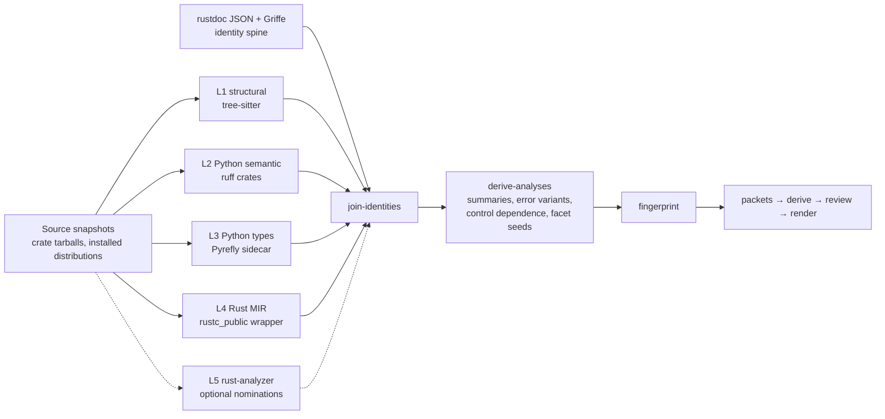

> **Migrated 2026-09-13** from `smartref/docs/library_ref/library_guide_source_semantic_evidence_lanes_target_design_2026-09-11.md` (smartref commit 5e2464345a). Frozen provenance: paths inside refer to the monorepo layout (`tooling/library_guides/...`, `docs/library_ref/...`). The deep-dive reference documents it links to were retired in favour of Context7 and code-fact lookup and are not in this repository.

# Source-semantic evidence lanes for library guides: target design

**Date:** 2026-09-11
**Status:** Target design. Nothing described here is implemented; section 13 gives the delivery sequence and section 2 the verified baseline it starts from.
**Design authority it extends:** [`library_reference_architecture_and_agent_skill_flow_2026-09-11.md`](library_reference_architecture_and_agent_skill_flow_2026-09-11.md) (the architecture assessment) and [`library_guide_build_and_update_tooling_2026-09-11.md`](library_guide_build_and_update_tooling_2026-09-11.md) (the build system). This document changes neither the content contracts nor the ownership rules of those two; it adds evidence lanes beneath them.
**Library references reviewed in full:** [`tree_sitter_rust_python.md`](tree_sitter_rust_python.md) (9,439 lines), [`ruff_python_crates_advanced_reference_2026-08-18.md`](ruff_python_crates_advanced_reference_2026-08-18.md) (7,246), [`pyrefly_rust_cpg_advanced_reference_1.2.0_2026-08-19.md`](pyrefly_rust_cpg_advanced_reference_1.2.0_2026-08-19.md) (8,231), [`rust_mir_cpg_continuous_reference_2026-08-18.md`](rust_mir_cpg_continuous_reference_2026-08-18.md) (5,207). No local reference covers rust-analyzer; section 4.5 says what was verified about it directly.
**Scope boundary:** this design is a fresh implementation inside `tooling/library_guides/`, built directly on the libraries above. It does not reuse, wrap or depend on any other extractor in the repository.

## 1. Recommendation

Add four **source-semantic evidence lanes** to the library knowledge compiler, and one optional fifth, each a separate worker that reads a frozen library source snapshot and emits owned, versioned, byte-anchored facts:

| Lane | Library | Language | What it owns in the evidence graph |
|---|---|---|---|
| L1 structural | tree-sitter (`tree-sitter` 0.26, `tree-sitter-rust` 0.24, `tree-sitter-python` 0.25, `tree-sitter-md` 0.5) | Rust, Python, Markdown | definitions and attributes with byte spans; doc-comment and docstring code fences parsed in place; `#[cfg]`, `#[deprecated]`, decorator and `__all__` shapes; the join from rustdoc and Griffe items to source bodies; parse-quality receipts |
| L2 Python semantic | ruff component crates (`ruff_python_parser`, `ruff_python_ast`, `ruff_python_semantic`, `ruff_python_trivia`, `ruff_python_index`, `ruff_source_file`, `ruff_text_size`) | Python | scopes, bindings, imports and re-exports, import-qualified names, decorators, `raise`/`except`/`with`/`await` body facts, handled exceptions, execution context, version-gated syntax, structural body digests |
| L3 Python types | Pyrefly 1.2.0 through its in-crate `Query` API, with the Type Server Protocol for per-position detail | Python | inferred and declared types, type-aware callees, member semantics, Protocol conformance, stub and extension-module boundaries, synthesized members, overload sets |
| L4 Rust MIR | `rustc_public` on a pinned nightly, driven as a Cargo `RUSTC_WORKSPACE_WRAPPER` over a generated extraction workspace | Rust | call graph with dispatch class and resolution confidence, place accesses (moves, borrows, writes through `self`), asserts and unwind edges, drops, unsize sites, constants, trait-impl applicability, per-owner effect summaries, error-variant derivation, control dependence, semantic body fingerprints |
| L5 rust-analyzer (optional, gated) | `ra_ap_*` crates or the `rust-analyzer` binary | Rust | nominations only: HIR-typed doctest expressions and macro expansion text where L4 leaves a measured gap |

The existing rustdoc JSON and Griffe inventories remain the **identity spine**. Every lane fact attaches to a binding through that spine; no lane creates a second symbol namespace. Facts enter the graph as `Relation` and `Observation` records with the existing three-axis provenance (evidence origin, resolution state, review state) plus a certainty tier per fact. They never enter as claims. The semantic signature that capability cards need is seeded programmatically from those facts, with provenance, and promoted to a reviewed facet only through a claim that cites the seed's evidence. Derivation packets gain a `mechanism` section so a derived behavior can be `source_reviewed` on the strength of a compiler-resolved call or a body-level access rather than a paraphrased doc comment. Three digests per binding (source, declaration, body) make a body change with a stable signature reopen exactly the behavioral claims that cite it.

Five decisions follow from the references and are argued in section 5:

1. **Process boundaries, not one binary.** The ruff train inside Pyrefly 1.2.0 (0.0.6) and the ruff train the ruff reference pins (0.0.7) cannot coexist in one binary, and the MIR lane needs a nightly toolchain with `rustc-dev`. There are therefore three native workers (`structural-and-ruff`, `pyrefly-facts`, `mir-facts`) and one Python control plane. Workers exchange only source digests and byte ranges.
2. **The MIR lane extracts the library as the primary workspace.** `RUSTC_WORKSPACE_WRAPPER` sees workspace members only, so the crate family under documentation is unpacked into a generated extraction workspace whose members are those crates, pinned to the profile's lock resolution and feature set. Cross-family callees stay body-less external stubs, and every absence claim carries the completeness mode it was computed under.
3. **Compiler-proven facts are separated from compositions.** Call terminators, access events, asserts and drops are emitted as the compiler produced them. Error-variant sets, configuration gating, trait-object storage sites, defaults and null handling are derived analyses with their own version and the tier `static_heuristic`, because the MIR reference does not describe them.
4. **Fences are parsed in place.** Rust doctests and Python docstring examples are parsed through tree-sitter included ranges so their evidence spans point into the host file, then resolved against the inventory with the existing passes and promoted by Pyrefly's qualified-name resolution or the MIR identity join. That turns roughly 1,700 DataFusion and Arrow doctest fences into typed composition evidence.
5. **rust-analyzer is not a Rust authority.** Its batch subcommands carry no stability guarantee, and the ownership question it might have answered (`Send`/`Sync`) is already answered by the synthetic auto-trait impls docs.rs rustdoc JSON ships. It is scheduled only after the MIR lane has been measured, for doctest typing and macro expansion, and only if that gap is material.

The measurable target is the same one the build document sets, sharpened: more derived behaviors per packet that cite a mechanism at `source_reviewed`, wider built-in candidate sets for extension traits, and change detection at body granularity, with every number reported against its denominator.

## 2. What the evidence graph proves today

Verified against `tooling/library_guides/` on 2026-09-11 (12,126 lines of Python across 79 modules plus a one-file Rust helper; uncommitted). The point of this section is to state, per dimension of the semantic signature, which extractor populates it and with what certainty, so that the additions in later sections attach to a concrete baseline.

### 2.1 Extractors and the facts they emit

| Lane (today) | Adapter | Evidence origin | Emits | Does not emit |
|---|---|---|---|---|
| Rust API spine | `adapters/rust/semantic.py` over docs.rs rustdoc JSON (formats 57/59/60/61) validated by `rustdoc-helper` (`rustdoc-types` 0.57/0.59/0.60/0.61 + `public-api` 0.52.1) | `compiler_api` | `Binding` (rendered signature, parameters, returns, generics as raw JSON, attrs as `conditions`, aliases from `use` re-exports and impl ownership); `Relation` kinds `consumes`, `produces`, `type_reference`, `constrained_by`, `intradoc_link`, `member_of`, `implements`; `Evidence` `json:/index/<id>` and `json:/index/<id>/docs`; item `span` (file, begin/end line and column) is present for 67,214 of 103,722 local items across the acquired crates, and the items without a span are almost entirely `impl` blocks | Anything about a function body. No error paths, no calls, no borrows, no `#[cfg]` evaluation beyond the docs.rs build |
| Rust doc comments | `stages/extract_documentation.py` | `documentation_statement` | `Observation` `upstream_documentation` per local item (16,671 documented local items; 1,244 items carry roughly 1,700 fenced code blocks, 58 marked `ignore`, 50 `no_run`) | Parsing of the fenced blocks; names inside them are not resolved |
| Python API spine | `adapters/python/griffe_api.py` (Griffe 2.3, `allow_inspection=False`, `resolve_aliases=False`, canonical-path dedupe) | `static_api` | `Binding` (parameters with kind/default/annotation, returns, bases, labels, canonical alias, NumPy-docstring types kept apart as `documented_type`) | Bodies, decorator semantics, `@overload` sets, `__all__` versus importable surface, inferred types for un-annotated code, Cython sources |
| Python native probe | `adapters/python/native_worker.py` (`inspect.getmembers_static` in a subprocess) | `runtime_api` | Native signatures where `inspect.signature` works; docstrings | Anything for `.pyx`-backed objects without text signatures |
| Registries | `registry_adapters/` (DataFusion `information_schema.routines/.parameters/.df_settings`; PyArrow `compute.list_functions()`) | `runtime_registry` | `SurfaceEntry` (755, including 149 configuration keys) and `upstream_documentation` observations from registry descriptions | The implementing item behind a registered name |
| Source rules | ast-grep, 3 patterns in `assets/rules/source-patterns.yaml` (`rust_trait_impl`, `python_registration`, `python_context_manager`), `certainty: syntactic` | `syntax_match` | `Observation` candidates with rule id and span | Receiver identity; the build document (section 5.1) records that `other.register_udf(...)` matches and is left as a candidate. The `mine-source` stage has mined zero files |
| Text nominations | 6 ripgrep families in `assets/rules/candidates.yaml` | `syntax_match` | Capability-family nominations over prose | Anything about code |
| Local deep-dives | `adapters/docs/behaviors.py` + `stages/resolve.py` (5 ordered passes) | `documentation_statement` | `Behavior` sections joined to bindings; `Observation` `documents_api` | Nothing beyond backticked identifiers |
| Executable witnesses | `examples.py` (bounded subprocess, environment fingerprint) | `behavior_observation` | Receipts pinned to exact inputs; 5 jobs in the pilot | Everything not explicitly scripted |

### 2.2 Semantic-signature coverage by source

The architecture document's six signature dimensions (its section 5.8) are the columns capability cards need. Today every one of them is populated by the model reading `upstream_documentation` text; the only non-prose seeds are those in the middle column.

| Dimension | Programmatic seed today | Certainty of that seed | Still prose-only |
|---|---|---|---|
| Shape and cardinality | Rendered signature types (`consumes`/`produces`); registry `kind` (scalar/aggregate/window) | `compiler_api` for the type names; nothing about row cardinality | preserve/reduce/expand semantics, empty input, broadcasting |
| Execution stage | Registry kind; trait `implements` edges to extension traits | `compiler_api` for the impl edge | Where the operation runs in a plan; optimizer visibility |
| State and effects | `async` in the rendered header | `compiler_api` | External reads/writes, determinism, panics, error variants, configuration reads |
| Ownership and lifetime | `&`/`&mut`/owned in rendered parameter types | `compiler_api` (textual) | Whether the return borrows from an argument; drop behaviour; `Send`/`Sync` |
| Representation and semantics | Nothing | none | nulls, errors, precision, ordering, metadata loss |
| Composition properties | `intradoc_link` | `compiler_api` | Mergeability, partitionability, cancellation, buffering |

Two consequences follow. First, a derived behavior's `mechanism` is today a paraphrase of a doc comment, so its `verification_level` can honestly be no higher than `documented`; `source_reviewed` is reachable only by a person opening the source. Second, the four-bucket agreement measurement (5.0 behaviors per packet, 80% novel on the two measured packets) measures what doc comments say that the deep-dives did not, not what the code does. Both are the properties the lanes in section 5 change.

### 2.3 Facts about the target libraries that bound what any source lane can see

These are properties of the libraries under documentation and of the machine, not of any other tooling. They were measured, not assumed.

| Fact | Measured value | Consequence for the design |
|---|---|---|
| Rust crate sources | Every pilot crate version is present as an unpacked source tree and a `.crate` tarball in the Cargo registry cache (for example `datafusion-54.1.0`, `datafusion-expr-54.1.0`, `arrow-array-58.4.0`), and docs.rs serves the same tarballs. `datafusion-physical-plan` is 101,233 lines of Rust, `datafusion-functions` 54,727, `datafusion-expr` 38,573, `datafusion` 38,678, `arrow-array` 46,520 | Source snapshots are cheap to acquire and digest; body-level extraction over the whole DataFusion family is a six-figure-line workload per profile and must be cached per crate |
| Rust tests shipped in tarballs | Crate tarballs carry inline `#[cfg(test)]` modules (31 in `datafusion-expr`) but not `tests/` directories (0 files under `datafusion-54.1.0/tests`) | Upstream integration tests are a separate acquisition job from the Git tag; the snapshot lane can mine only inline test modules and doctests |
| Rust doctests | Roughly 1,700 fenced blocks in doc comments across the acquired crates; 58 `ignore`, 50 `no_run` | A doctest lane has a real corpus; fence attributes must be carried as evidence attributes because they change what a fence proves |
| PyArrow 25.0.1 | 105 `.py`, 0 `.pyi`, 55 `.pyx`/`.pxd`, 24 shared objects | Any Python source lane sees the `.py` layer only. The Cython layer is opaque to ruff and Pyrefly alike; its facts stay with the registry probe and docstrings, and every absence claim about PyArrow must say so |
| pydantic 2.13.4 and `pydantic_core` | 105 `.py`; the core is 2 `.py`, 1 `.pyi`, 1 shared object | pydantic is fully analyzable; the core's surface is stub-declared |
| DataFusion Python 54.0.0 | 22 `.py` and `_internal.abi3.so` with no stub | The wrapper layer is analyzable; calls into `_internal` resolve to an untyped native module and must be recorded as such |
| Toolchains | rustc 1.100.0-nightly (2026-09-10) as the default toolchain, four dated nightlies, stable 1.98.x; a `tree-sitter` CLI; `pyrefly` 1.2.0; ast-grep 0.45 | Environment facts only. Section 12 states what each lane needs; nothing here proves a lane works |
| Publication status of the libraries | `ruff_python_semantic` 0.0.13 and `ruff_linter` 0.16.7 are on crates.io (the reference pins 0.0.7 / 0.16.1); `ra_ap_hir`, `ra_ap_hir_ty`, `ra_ap_ide`, `ra_ap_ide_db` 0.0.351 are on crates.io; `tree-sitter-md` 0.5.3 and `rustdoc-types` 0.61.0 are on crates.io | Availability is not a constraint; API stability and coupling are, and those are taken from the reference documents |

## 3. The gaps, and the lane that closes each

The ten gaps below are the dimensions where the current graph has no source-derived fact (section 2.2). For each, the table names the primary lane, the supporting lanes, the best certainty the references support, and the honest limit that stays attached to the fact. The references' own section numbers are given in section 4.

| Gap | Primary lane | Supporting | Best certainty | Limit that stays attached |
|---|---|---|---|---|
| 1a. Which error variants a Rust function can return | L4 derived analysis: `Aggregate` of an error variant reaching the return place, `?` lowered to `Try::branch`/`From::from` calls | rustdoc (`Result` type), L1 (`?` and `Err(` shapes as nominations) | `static_heuristic` | variants built in dependency crates are `external`; constants folded at compile time can hide a construction |
| 1b. Which exceptions a Python function raises | L2 `raise` statements and handled-exception context | L3 resolves the exception class; docstring `Raises` section for reconciliation | `resolved` class, `candidate` reachability | transitive raises from callees need L3 callees plus a bounded closure |
| 1c. Panics and asserts | L4 `Assert` terminators and calls to panicking functions | none | `compiler_proven` for asserts | which asserts exist depends on the build profile (`panic=abort` removes unwind edges) |
| 1d. Reads configuration or environment | L4 place reads typed as a declared configuration type; calls to `std::env::var`; L2 import-qualified `os.environ` | L4 control dependence gives "which key gates which call" | `resolved` (Rust), `candidate` (Python) | the configuration type list is manifest-declared per library |
| 1e. Mutates its receiver; moves or borrows its arguments; drops | L4 access events on argument locals; `Drop` terminators | `var_debug_info` names the locals | `compiler_proven` for the event; `static_sound` for "returns argument-derived value" (dataflow) | never labelled "borrowck exact"; generic `T` without `Copy` is emitted as a move |
| 1f. Holds a lock, spawns, blocks, allocates | L4 call-target filters (`Mutex::lock`, `tokio::spawn`, `Box::new`) | none | `compiler_proven` edge, `static_heuristic` predicate | the predicate is a manifest-declared classification of targets |
| 1g. Calls which other public APIs | L4 call terminators with `Instance::resolve`; L3 `get_callees_with_location` | L2 import-qualified names as candidates | `resolved` / `candidate` / `ambiguous` | inside a generic body, `T::method()` resolves to the declaration only; Python receiver typed `Any` yields no target |
| 1h. Null and empty-input handling | L4 `discriminant_read` on `Option`/`Result`, `length_read`, branch control dependence to early returns; L3 narrowed types after `is None` | L2 supplies the narrowing cause | `static_heuristic` | interpretation, not a compiler fact |
| 2a. `Send`/`Sync`/`Unpin`/`Drop` for Rust types | existing rustdoc spine: synthetic auto-trait impls (`is_synthetic`), negative impls, `Drop` impls | L4 `drops` for glue reachability | `compiler_proven` (rustdoc emits them) | for the docs.rs build configuration; a different feature set is a different snapshot |
| 2b. Python decorators that change signatures, properties, classmethods, overloads, Protocols, dataclass-like synthesis | L3 post-decoration computed type, `get_attributes`, TSP `Overloaded`/`Synthesized` declarations, `is_subtype` | L2 decorator identity; L1 decorator spans | `static_sound` for types; `static_heuristic` for member summaries | `get_attributes` is not MRO-complete; TSP is per-position |
| 2c. `__all__` versus importable versus defining surface | L2 module-scope bindings and `__all__` literal; L3 export stage with both re-export and origin names | Griffe canonical path | `resolved` | star imports resolved by L3, low confidence in L2 |
| 3. Call graph from public API to internal mechanism | L4 (Rust), L3 (Python) | L2 candidates; L1 syntactic sites | as 1g | stops at crate-family and extension-module boundaries; recorded as `external` |
| 4a. Where `dyn Trait` is dispatched and which implementors ship | L4 unsize sites, `Virtual` dispatch, trait-impl applicability; rustdoc `implements` seeds the inventory | none | `compiler_proven` sites; `static_sound` candidate set | over-approximation is never presented as the executed target |
| 4b. Where a trait object or callback is stored at registration | L4 `references_fn` (stored, not invoked) with argument flow into a manifest-declared registration surface; write to a place typed with `Dynamic` | L1 registration-call shapes as nominations | `static_heuristic` | composition over primitives |
| 5. Upstream examples and tests as evidence | L1 fences and inline `#[cfg(test)]` modules; L2 assert statements | L3/L4 promote names in examples | `located` or `parsed` status | `compiled` and `executed` remain `Example` jobs; integration tests need the Git tag |
| 6a. Feature and cfg gating | rustdoc `cfg` attrs for items visible in the docs.rs build; L1 attribute text; L4 multi-context set difference for items compiled out | none | `resolved` condition text; attribution by set difference | one snapshot per build context; never one unqualified snapshot |
| 6b. Deprecation, `must_use`, `doc(hidden)`, `non_exhaustive` | rustdoc `deprecation` and `attrs` (already carried as `conditions`) | L1 for private items | `compiler_proven` | private items are outside rustdoc's denominator |
| 6c. Configuration defaults | L4 constants in `Default` impl bodies; registries (`df_settings`) | none | `compiler_proven` values, `static_heuristic` attribution | a `const`-built value can be opaque |
| 6d. Unsafe and FFI boundaries | L4 raw-pointer operations, unsafe calls, foreign items | rustdoc `unsafe fn` header | `compiler_proven` | MIR records operations, not `unsafe {}` blocks |
| 7. Python/native boundary | L3 module kinds (`extension`), `typed_by_stub`, calls into stub-declared targets; L1 `#[pyfunction]`/`#[pymethods]` attributes in the Rust source of the extension | L4 macro-expansion provenance for the generated trampolines | `resolved` for the boundary; `candidate` for the Rust body behind a Python name | pyo3 is not discussed by any reference; the join is inferred and must be verified |
| 8. Byte-exact spans | L1 (`byte_range()`), L2 (`TextRange`), L3 (converted in the sidecar), rustdoc `span` records for 65% of local items | L4 line/column recomputed against snapshot bytes | exact | `rustc_public::Span` does not promise byte offsets; recomputation or a private `SourceMap` adapter is required |
| 9. Change detection at semantic granularity | L4 semantic versus source fingerprints and owner diff states; L2 `comparable` digests; L3 type-table hashes and callee diffs | none | `compiler_proven` inputs | a nightly or engine bump can move semantic hashes without a source change; the toolchain tuple is part of the key |
| 10. Doctests and docstring examples as typed composition evidence | L1 included ranges; resolution passes; L3 `resolve_target_from_qualified_name`; L4 identity join | L2 `parse_string_annotation` for forward references | `resolved` by qualified path | status `parsed`, never `executed`, unless an `Example` job is authored |

## 4. Library review: what each tool contributes to the evidence graph

Each subsection answers the same four questions against its reference document: what facts it can produce for the gaps in section 3, at what certainty, at what cost, and what it must not be used for. Section references are to the reference documents themselves. Statements the references do not make are marked *inferred*.

### 4.1 Tree-sitter (`tree_sitter_rust_python.md`)

**Role.** The structural lane. It parses the frozen source snapshots of both languages, runs query packs, locates doc-comment and docstring code fences, and supplies byte-exact spans for everything the other lanes anchor to. It is never a semantic authority: the reference states that a query "matches tree structure", that name resolution, types, control flow and macro expansion are outside its scope, and that "Using query captures as a substitute for semantic name resolution" is an anti-pattern (§0.1, §0.9, §0.10, §12.0, §41.3).

**What it yields.**

| Fact family | Mechanism (§) | Record produced | Certainty |
|---|---|---|---|
| Definitions, attributes, `impl` headers, `use` declarations, decorators, imports, `__all__` assignments | Query packs over `function_item` (fields `name`, `parameters`, `return_type`, `type_parameters`, `body`), `impl_item` (`trait`, `type`, `body`), `attribute_item`, `use_declaration`, `macro_invocation`; Python `decorated_definition` (`definition`), `function_definition`, `class_definition` (`superclasses`), `import_from_statement` (`module_name`, `name`), `aliased_import` (`name`, `alias`), `assignment` (`left`, `right`) (§13-§15, §45.10-§45.16). Node kinds and fields above were verified against the pinned `node-types.json` of `tree-sitter-rust` 0.24.2 and `tree-sitter-python` 0.25.0, because the reference does not describe the Rust grammar at all and cites master-branch Python grammar files (§22.3, fact 10 of the review) | `Observation` with `evidence_origin = syntax_match`, `extractor_id = <pack>/<pattern_index>/<capture>`, `EvidenceSpan` from `byte_range()`; `gated_by` relation from `attribute_item` text; `decorated_by` candidates; `re_exports` candidates with `in_all` | `syntactic`; `resolution = candidate` |
| Doc-comment and docstring code fences with document-global offsets | `Parser::set_included_ranges` over the bytes after each `/// ` prefix, or over `string_content` of a docstring; ranges keep coordinates relative to the whole file, which the reference names as "the principal reason to use the API instead of concatenating embedded snippets" (§19.0-§19.4) | `Example` records at status `located` or `parsed`; `exemplified_by` candidates for every `call_expression`/`scoped_identifier` (Rust) or `call`/`attribute` (Python) inside the fence | `syntactic` |
| Bodies of public items, and private helpers rustdoc never lists | `named_descendant_for_byte_range` from the rustdoc `span` or Griffe line range to the owning `function_item`/`function_definition`; body-scoped queries with `set_containing_byte_range` (§8.5, §17.3, §43.4) | Owner containment (`enclosing_symbol`) for every observation; a private-item denominator | exact join when both coordinate spaces are UTF-8 bytes of the same artifact (§6.1, §44.2) |
| Per-record parse quality and receipt completeness | `has_error()`, `is_error()`, `is_missing()`, `(ERROR)`/`(MISSING)` patterns, `did_exceed_match_limit()` (cap 65,536), progress cancellation (§17.6, §18, §20.5, §45.24) | `ExtractionReceipt` partial with the exact error spans as unprocessed inputs; `resolution` downgraded for captures intersecting an error | n/a |
| Signature-versus-body spans | `function_item` fields versus `body` field (§43.4) | inputs to `declaration_fingerprint` and the Python `body_fingerprint` fallback | exact |

**Rule-pack substrate.** The query language offers what the current three ast-grep patterns lack: field constraints and negated fields, anchors, supertypes, alternations with captures, quantifiers, `#eq?`/`#match?`/`#any-of?` predicates, and inert `#set!` metadata read back through `property_settings()` (§12-§17). That last point matters: the build document's rule metadata (`evidence_origin`, `predicate`, `resolver`) can live inside the `.scm` file. Two pitfalls shape the packs: anchors ignore anonymous nodes only, so a doc comment between `#[cfg(...)]` and `fn` breaks adjacency patterns unless comments are absorbed in the alternation (§14.6, §14.7, review fact 2); and quantified alternations change match cardinality, so every quantifier near a capture needs a golden test (§14.5, §14.8). Method calls in the Rust grammar are `call_expression` nodes whose `function` field is a `field_expression`; there is no `method_call_expression` node (verified).

**Cost.** No build of the target library, no Cargo metadata, no Python environment; one grammar bundle compiled once per process; the reference gives no absolute latency or memory figures and warns that libc allocation failure aborts the process, so the lane runs in its own worker (§35.3). Incremental parsing is irrelevant for a frozen snapshot; the reference's own batch-indexer pattern is a fresh parse per file and "one tree, many query packs" (§12.1, §41.1).

**Not useful here.** Incremental editing, changed-range oracles, editor daemons, highlighting, WASM grammars, grammar authoring, UTF-16 input (§10-§11, §24-§33, §41). Markdown files need a Markdown grammar the reference does not cover; `tree-sitter-md` 0.5.3 is published and is adopted for the deep-dives and upstream `README`/`docs/*.md` fences (inferred).

**Decision-changing facts.** `Parser::parse` returning `None` is never a syntax error (§39.4); `MISSING` nodes are zero-width (§13.7); byte-range restriction is intersect-semantics and `(0, 0)` means the whole tree (§17.1-§17.4); the Python `function_definition` node excludes its decorators, so `decorated_definition` is the owner span (§45.11); Python parse success is not CPython validity and the grammar still accepts Python 2 forms (§45.23); query caches must be keyed by grammar fingerprint, not query text (§40.5); five independent version axes must all be recorded (§40.0).

### 4.2 Ruff crates (`ruff_python_crates_advanced_reference_2026-08-18.md`)

**Role.** The Python semantic lane below types: parser, typed AST, trivia, source coordinates, and the linter's semantic model of scopes, bindings, imports, qualified names, handled exceptions and execution context. The reference's critical non-goal is explicit: `ruff_python_semantic` is Ruff's linter state, and "Never write '`ruff_python_semantic` gives us Python typing'" (§0.1, §8.0). Everything type-shaped goes to Pyrefly (§8.21).

**What it yields.**

| Fact family | Mechanism (§) | Record produced | Certainty |
|---|---|---|---|
| Qualified names for any `Name`/`Attribute`; builtins versus shadowed names | `SemanticModel::resolve_qualified_name`, `match_typing_expr`, `resolve_builtin_symbol`, tri-state `Symbol::{Binding, Builtin, Unbound}` (§8.10-§8.13) | `calls`, `decorated_by`, `type_reference` relations at `resolution = candidate` with confidence class `IMPORT_QUALIFIED`; the resolver the build document's ast-grep registration rule lacks | `static_heuristic`: "a lexical/import fact, never dispatch" (§8.11, §22.4) |
| Module-scope bindings, imports, re-exports, shadowing | `Scopes`, `Bindings`, `BindingKind`, `Definitions`, `Import`/`FromImport`/`SubmoduleImport`/`StarImport` (§8.5-§8.9, §8.14) | `re_exports` relations with the local alias and imported name; the importable surface of a module; unresolved references as first-class facts | `static_sound` within one module under the lint model (§22.4) |
| Body facts | Typed visitor over `Stmt::Raise`, `Stmt::Assert`, `Stmt::With`, `Expr::Await`, `Expr::Yield`, `Stmt::Return`, decorators, annotations, literals (§5.1, §5.5, §14.2) | `raises` (candidate), `handles` (lexical), `awaits`, `is_generator`, `uses_context_manager`, `returns` observations | `syntactic`; receiver mutation is not a binding event, so `self.x = ...` stays syntactic (§8.6) |
| Handled exceptions, execution context, branch context | `Exceptions`, `ExecutionContext` (runtime / annotation / typing-only), `BranchId` (§8.15-§8.17) | `handles` relations; `gated_by` for `TYPE_CHECKING`-only imports and `sys.version_info` branches | `static_sound` as lexical facts; not reachability (§8.15) |
| Version-gated syntax | `Parsed::unsupported_syntax_errors()` under a configured `target_version`; `has_valid_syntax()` is not `has_no_syntax_errors()` (§4.10, §4.13) | `uses_version_gated_syntax` observation; receipt completeness | `static_sound` |
| Byte-exact spans, string annotations, docstring examples with absolute offsets | `TextRange`/`TextSize`, `LineIndex`, `parse_string_annotation`, `parse_expression_range` (§3, §4.3, §4.5, §11.4) | `EvidenceSpan`; forward-reference annotation shapes; parsed docstring snippets | exact |
| Comments, pragmas, suppression | `CommentRanges`, `Indexer`, `is_pragma_comment` (§6.2-§6.9, §7.3) | `has_suppression` observations; rationale comments near definitions as retrieval context | lexical |
| Structural body digest | `ruff_python_ast::comparable` (§5.19) | Python `body_fingerprint` | structural equality only, "not semantic program equivalence" |

**The one costly fact.** `SemanticModel::new` only initializes state; the traversal that populates it lives in `ruff_linter`'s AST checker, not in `ruff_python_semantic` (§8.3, §8.4, §25.3). `ruff_linter` is published on crates.io (0.16.7 at the time of writing), so depending on it is possible, but the reference recommends reproducing the bounded Binding → Traversal → Cleanup pass "isolated behind a version-pinned adapter, because this traversal behavior is an internal Ruff contract and can change" (§8.4). Section 5.2 adopts that recommendation and adds a differential oracle the reference does not mention: the `ruff` CLI at the same release reports unresolved names and unused imports as diagnostics, which the adapter's binding and reference sets must reproduce on the snapshot.

**Silences.** The reference never mentions `__all__`, `@overload`, `classmethod`/`staticmethod`/`property`, or pyo3; it lists `analyze::visibility` and `analyze::function_type` by name only (§8.18; review fact 7). Those facts are therefore taken from tree-sitter and Pyrefly, or verified against the pinned tag before the ruff lane claims them.

**Cost.** Stable Rust, no nightly, no Python execution ("Parsing source does not execute Python", §21.0); one parse and one traversal per file; the formatter is the heavy dependency and stays out of the analysis binary (§10.1, §10.21). All nine component crates must be on one release train (`=0.0.7` for the reference's Ruff 0.16.1), and mixing trains is a stop condition (§1.4, §20.1).

**Not useful here.** The source-preserving edit engine, codegen as a rewrite tool, formatter policy, live-editor tolerance, notebooks, incremental daemons, LibCST migration (§12-§18, §13.10). Only `format_module_ast` on snippets is retained, for presenting example code (§10.3).

### 4.3 Pyrefly (`pyrefly_rust_cpg_advanced_reference_1.2.0_2026-08-19.md`)

**Role.** The Python type lane: inferred and declared types for un-annotated code, type-aware callees, class member semantics, Protocol conformance, import and re-export resolution against the real environment, and synthesized members. The central rule is "Ruff tells you what the source says. Pyrefly tells you what the source means statically" (feature inventory). Pyrefly 1.2.0 is a type checker, so no fact is compiler-proven; the reference frames output as "best-effort static semantic resolution" with "explicit uncertainty" (§0.4, §17.0).

**The decisive constraint.** There is no `pyrefly query` command; the CLI on this machine offers `check`, `snippet`, `dump-config`, `lsp`, `tsp`, `infer`, `coverage`, `suppress` and `stubgen`. Bulk extraction exists only as the experimental in-crate `pyrefly::query::Query` API, which upstream marks "not intended for external use" (§1.0, §9.0). The lane is therefore a Rust sidecar built against a pinned copy of the 1.2.0 source tree, vendored with its `Cargo.lock` and path dependencies rather than taken as a Git dependency (§1.2, App. A.0). Pyrefly 1.2.0 depends on ruff component crates 0.0.6 from crates.io, and passing AST objects between 0.0.6 and 0.0.7 is a compile error, so the sidecar and the ruff lane share only source digests and byte ranges (§5.0-§5.2, §5.4).

**What it yields.**

| Fact family | Mechanism (§) | Record produced | Certainty |
|---|---|---|---|
| Type-aware call targets | `Query::get_callees_with_location(name, path, None)` returns `(PythonASTRange, Callee{kind, target, class_name})` for a whole file; kinds `function`, `method`, `classmethod`, `staticmethod`; unions yield several targets; constructors, `__call__`, decorators and `lru_cache` handled (§11.1-§11.4, §11.8, §27.7-§27.8) | `calls` relations at `resolved` (one target), `ambiguous` (several), `external` (stub or site-packages target), `unresolved` (empty); `dispatch_kind` observation | `static_heuristic`; "an empty result is not 'dead call'" (§11.5); TODO and panic branches exist (§11.6) |
| Deduplicated per-file type table | `Query::get_type_table_in_file(name, path, walker)` returns `SerializedTypeTableEntry{kind, hash}` plus located references; shapes `Named`, `Callable`, `TypeVariable`; xxh64 structural hashes (§7.2, §9.5, §10) | `computed_type` observations per occurrence; `Binding.returns` for un-annotated functions; `Never` return as an always-raises marker; per-symbol type hashes for change detection | `static_sound` relative to the environment; degrades to `Any` |
| Member semantics | `Query::get_attributes(name, path, class)` gives `Attribute{name, kind, annotation, is_final}` with property-like detection (§12) | `is_property`, `is_final` observations; member relations | `static_heuristic`: annotation is a display string, not MRO-complete, may read a field's first value expression (§12.2-§12.5) |
| Protocol conformance | `Query::is_subtype(name, path, lt, gt)` (§13.1) | `satisfies_protocol` relations, distinct from inheritance (§27.3) | `static_sound` (solver-backed) |
| Promotion of nominated names | `Query::resolve_target_from_qualified_name` type-checks a synthetic `x = qname` snippet (§13.0) | `Binding.resolution` candidate to resolved for registry, entry-point and doctest names | `static_sound` for resolvable names |
| Imports, re-exports, stubs, module kinds | Export stage and TSP `resolveImport`; module kinds namespace / regular / source / stub / extension / bundled; definition provenance source / stub / bundled_typeshed / third_party_stub / synthesized (§2.4, §26) | `re_exports` with both public and origin names retained (§26.3); `typed_by_stub`; extension-module boundary for the pyo3 and Cython layers | `static_sound` given the environment fingerprint |
| Synthesized members and overload detail | Type Server Protocol: `getDeclaredType`, `getComputedType`, `Overloaded` and `Synthesized` type categories, `Literal`/`Optional`/`Unbound` flags, declaration `regular` versus `synthesized` (§14.4-§14.9) | dataclass/attrs/pydantic field synthesis; overload sets; `Literal` shapes that the type table collapses | `static_sound`; per-position only, no bulk (§14.12) |
| Diagnostics and coverage | `Query::add_files` returns rendered diagnostic strings; `pyrefly check` for structured output; coverage ratios (§9.3, §33.1, App. A.3) | receipt state and `degraded` markers; never discard a file's facts for one type error (§19.6) | n/a |

**Precision vocabulary.** The reference supplies two classifications the graph adopts verbatim: `TypePrecision` (Precise, Union, ExplicitAny, ImplicitAny, ErrorAny, Unknown, Unbound, Unsupported) and `ResolutionConfidence` (Exact, UnionResolved, TypeInferred, StubResolved, Synthesized, Conservative, DynamicUnresolved, DegradedByError), and a provenance ranking: Pyrefly direct resolution above Pyrefly union candidates above ruff qualified-name heuristics above syntax-only candidates (§8.5, §25.2, §25.3). A receiver typed `Any` never yields a fabricated target (§28.0).

**Frozen-package caveat.** The reference is written for a repository workspace. `add_files` accepts arbitrary `(ModuleName, ModulePath::filesystem)` pairs (§9.3, App. A.3), so the target distribution's `.py` modules can be loaded at `Require::Everything` while the rest of the virtual environment stays at `Exports` (§6.1, §30.4). Two consequences are inferred and must be verified in the first increment: importers of a package that ships `.pyi` or partial stubs see the stub while the explicitly loaded `.py` is analysed as source, so both views carry provenance (§26.6); and configuration discovery without a `pyrefly.toml` at the package root is not described (§4.2).

**Cost.** One long-lived `Query` per environment; `Require::Everything` retains AST, bindings, answers and trace and "can be memory expensive" (§30.4); the type table is "orders of requests" cheaper than per-position TSP (§10.1); no absolute figures are given. Engine upgrades change facts without source changes (`Any` narrowing on `isinstance`, unioned unannotated attributes in 1.2.0), so the engine version and environment fingerprint belong in claim conditions (§0.7, §8.6, §2.5, §25.1).

**Not useful here.** `change_files`, epochs, watchers, sidecar supervision for a daemon, MVCC and history tables, IPC security, Buck/Bazel mapping, notebooks, IDE features (§6.2-§6.7, §20, §23, §31, §34.4).

**Decision-changing facts.** The type table drops `Literal` values, overload sets and the `AnyStyle` distinction (inferred from §7.1-§7.2; TSP is the only path to them); `get_attributes` is a summary API; the fine-grained dependency categories and affected-module set are internal and not returned by `Query`, so semantic change detection is built from type-table hashes and callee diffs (§6.3, §6.5, App. D.5); synthesized declarations are visible only through TSP or member resolution, never through Griffe or ruff (§14.9, §28.6).

### 4.4 rustc MIR through `rustc_public` (`rust_mir_cpg_continuous_reference_2026-08-18.md`)

**Role.** The Rust body lane. MIR is "a semantic/flow layer attached to source-level definitions, not a replacement for the source layer" (§0.1). The reference's default surface is `rustc_public`, with `rustc_private` as a narrow escape hatch and textual MIR dumps as diagnostics only (§0.3, §4.0). `rustc_public` is compiler-shipped, not a crates.io dependency: the extractor is compiled with a dated nightly, declares `#![feature(rustc_private)]`, links `rustc_driver`/`rustc_interface`/`rustc_middle` for initialization, and must convert every compiler object to an owned record inside the `run!` callback because use after the callback "can panic or return incorrect values" (anchors, §1.1, §2.1, §39.0). The nightly sysroot on this machine ships `rustc_public` and `rustc_public_bridge` (verified).

**What it yields.**

| Fact family | Mechanism (§) | Record produced | Certainty |
|---|---|---|---|
| Item and body inventory | `all_local_items()`, `CrateItem` body/kind/type accessors, `Body` with locals, blocks, `var_debug_info` (§7-§9) | `Binding` for every body-bearing item including private helpers; argument locals joined to documented parameter names | `compiler_proven` |
| Call edges with dispatch class and confidence | `TerminatorKind::Call`, `TyKind::fn_def()`, `Instance::resolve`, `resolve_for_fn_ptr`, `resolve_closure`, `resolve_drop_in_place` (§12.1, §20, §21, App. C, App. L); dispatch kinds Direct, StaticTrait, FunctionPointer, Closure, DynamicTrait, Intrinsic, Foreign, Shim; confidence `EXACT_INSTANCE`, `EXACT_DECLARATION_ONLY`, `FLOW_SINGLETON`, `FLOW_CANDIDATE`, `TRAIT_IMPL_OVERAPPROX`, `VTABLE_OBSERVED`, `EXTERNAL_OPAQUE`, `UNRESOLVED` (J.10, L.14) | `calls`, `references_fn`, `dispatches_virtual` relations with attributes | `compiler_proven` for declared targets and resolved instances; `static_sound` for Tier-1 candidate sets |
| Access events on canonical places | `StatementKind::Assign`, `Rvalue::{Use, Ref, AddressOf, Aggregate, Cast, Discriminant, Len}`, `Operand::{Copy, Move}`, `Place` with projections and `Place::ty` (§11, §13-§15, §26, K.2-K.12, J.9) | `access` observations (Read, Copy, Move, Write, BorrowShared, BorrowMut, AddressOf, Drop, DiscriminantRead, ...) with type keys; `moves`, `mutates_receiver`, `borrows_from` relations | `compiler_proven` events; "not a complete alias analysis" (§14.3) |
| Asserts, unwind, drops, unsafe and FFI | `TerminatorKind::{Assert, Drop, Resume, Abort, Unreachable}`, `UnwindAction`, cleanup blocks, raw-pointer operations, foreign items (§10, §12.3, §24, §34, K.17-K.21) | `may_panic`, `unwinds_to`, `drops`, `crosses_unsafe`, `crosses_ffi` | `compiler_proven` |
| Trait dispatch and impl applicability | `TyKind::Dynamic`, unsize casts, `InstanceKind` (§23, L.6-L.8) | `creates_trait_object`, `dispatches_virtual`, `implements` with applicability | `compiler_proven` sites; the reference asserts impl inventories but names no enumeration API, so rustdoc `implements` seeds the set (review fact 12) |
| Constants and statics | `Operand::Constant`, `Rvalue::ThreadLocalRef`, const evaluation, `CONST_VALUE` summaries (§33, K.6, L.10) | `reads_const`, `references_static`; configuration defaults from `Default` impl bodies | `compiler_proven` references; value fidelity bounded by the summary |
| Control dependence | `SwitchInt` with derived dominators and control-dependence frontier (§31, K.15) | `controls` relations; "which configuration key gates this call" | `static_sound`, owner-local |
| Reaching definitions | def-use over assign and call destinations (§30) | dataflow behind `borrows_from` and "returns argument-derived value" | `static_sound` |
| Per-owner effect summaries | derived over access events, calls and drops with SCC iteration for recursion (§35) | facet seeds: may read/write globals, may panic, unsafe/FFI flags, moves and borrows of arguments | `static_sound` to `static_heuristic`, conservative when any callee is `EXTERNAL_OPAQUE` |
| Semantic versus source fingerprints | per-owner `definition_fingerprint`, `body_structure_fingerprint`, `cfg_fingerprint`, `access_event_fingerprint`, `callsite_fingerprint`, `summary_fingerprint`; diff states `CHANGED` versus `SOURCE_ONLY_CHANGED` (§38, M.9) | `body_fingerprint` and owner diff states | `compiler_proven` inputs; canonicalizer versioned |
| Source anchors and macro provenance | `rustc_public::Span` file, line and column; expansion kind SourceAuthored, MacroExpansion, CompilerGenerated (§17, J.4) | `EvidenceSpan` after recomputing bytes; `expanded_from` | line and column `compiler_proven`; bytes recomputed |
| Build-context identity and gating | `cargo metadata --format-version 1`; `BuildContextKey` (package, target, features, cfg, triple, profile, build-script hash, toolchain) (§5, J.2, Q.21) | `Profile` conditions; `gated_by` by set difference across contexts | `compiler_proven` per context |
| Closures, async, coroutines | closure and coroutine lowering, `var_debug_info` captures (§32) | `calls` inside coroutine bodies attributed to the source async owner | `compiler_proven` lowering; `await` mapping best-effort (§32.2) |

**Targeting a third-party crate.** The reference never states the library-as-target case. `RUSTC_WORKSPACE_WRAPPER` is invoked for workspace members only; `RUSTC_WRAPPER` intercepts every compilation (§6.0). Its Mode B, "index external crate definitions/types/public call targets once per exact package version/feature/target tuple; reuse across workspaces" (§48.0), is structurally the artifact a library guide wants. Section 5.4 therefore unpacks the crate family into a generated workspace whose members are the family crates, so all of them are primary units and intra-family calls have bodies; callees outside the family are body-less external stubs (§21.2) and summaries stop there, as the reference says they must.

**Silences that shape the design.** The reference has zero mentions of rustdoc JSON, doc comments, doctests, `Send`/`Sync`, `#[deprecated]`/`#[must_use]`/`#[doc(hidden)]`/`#[non_exhaustive]`, pyo3, tests as evidence, `Result` error enums, and rust-analyzer (review section 1). Its "error/panic path" recipe (§56.3) is unwind and cleanup reachability. Every error-variant, configuration-gating, storage-site, default-value and null-handling fact in section 3 is a composition over the reference's primitives and is labelled `static_heuristic` with its own `analysis_version`.

**Cost and trust.** `cargo check`, never `cargo build` (§6.3); one check per build context; the completeness ladder `calls-basic` (low), `calls-flow` (medium), `uses-codegen` (higher), `instances-full` ("potentially very high") must be recorded on the receipt "so consumers know whether a missing edge means 'not present' or 'not extracted in this mode'" (L.13). A library has no entry point, so instance enumeration is not attempted (§49.2). `cargo check` executes the library's and its dependencies' build scripts and proc macros, "a substantially different trust boundary from Tree-sitter parsing raw source" (§53.1). Byte offsets are not promised by `rustc_public::Span` (§17.1). Generic bodies resolve trait calls on `T` to declarations only (App. C). A nightly bump can change lowering and resolution, so fingerprints carry the toolchain tuple (§51.0, Q.22).

**Not useful here.** The continuous-update half of the reference: two-speed updaters, debounce, cancellation, last-known-good state, edit-to-owner mapping, incremental target-directory reuse, daemon deployment (§41-§46, §54-§55, App. D, App. M). `MutMirVisitor`, `entry_fn()`, inline assembly, alias level 4 and binary serialization are out of scope for capability cards (§18, §28, §34.1, §49.3).

### 4.5 rust-analyzer (no local reference; verified directly)

**What was verified.** The installed `rust-analyzer 1.100.0-nightly (2026-09-10)` exposes the batch subcommands `parse`, `symbols`, `highlight`, `analysis-stats`, `run-tests`, `rustc-tests`, `diagnostics`, `unresolved-references`, `prime-caches`, `ssr`, `search`, `lsif` and `scip`, and its help states that "Subcommands and their flags do not provide any stability guarantees and may be removed or changed without notice". `analysis-stats` accepts `--with-deps`, `--only <path>`, `--disable-build-scripts`, `--disable-proc-macros` and `--no-sysroot`; `scip` writes a SCIP index and can exclude vendored libraries. The library crates `ra_ap_hir`, `ra_ap_hir_ty`, `ra_ap_ide` and `ra_ap_ide_db` are published on crates.io at 0.0.351 with no stability promise beyond the weekly release cadence.

**What it could add that L4 does not** (inferred, because no reference covers it):

| Candidate contribution | Why L4 does not provide it | Certainty if adopted |
|---|---|---|
| Types of expressions inside doctests and examples without compiling the crate on nightly | L4 sees only compiled bodies; a doctest is not a body unless the crate's doctests are compiled as test targets | IDE-grade inference; `static_heuristic` |
| Macro expansion text for `plan_err!`-style invocations, to show what a macro-generated error path expands to | L4 carries expansion provenance but not the expanded source | `static_heuristic` |
| Bulk symbol and reference index over private items at a stable toolchain (`scip`) | L4 gives the same from `all_local_items()` plus call sites, but needs the nightly build | `syntactic`-to-`static_heuristic`; SCIP relationships are IDE resolutions |
| Trait-bound satisfaction queries through HIR (`Type::impls_trait`) | rustdoc already ships synthetic auto-trait impls for `Send`/`Sync`/`Unpin`, so this is only useful for non-auto bounds | unverified |

**Decision.** L5 is an optional nominating lane, scheduled after L4 has been measured (section 13, increment 7). Its output is never `resolved`, never authorizes absence, and is kept only if the count of nominations later confirmed by the rustdoc or MIR identity join is material. The reasons are the absence of a stability guarantee on the batch surface, the absence of a local reference from which to derive soundness limits, and the fact that its most tempting use, ownership facts, is already covered by the spine.

## 5. Target architecture

### 5.0 Principles

1. **One fact contract, several workers.** Every lane emits length-delimited JSON frames with a version tuple (`protocol_version`, `normalizer_version`, `analysis_version`, tool tuple), a snapshot digest, per-file or per-owner fact chunks with chunk digests, and exactly one terminal receipt. The Python control plane decodes frames into the record model; workers never write to the knowledge store.
2. **The spine is the identity.** rustdoc JSON public paths and Griffe canonical paths remain the durable binding identities (build document 3.2). Lane facts attach through the join in section 5.6 and are recorded with the resolution state that join produced. No lane mints a second symbol namespace; anonymous owners (closures, impl blocks, coroutine bodies) attach to their nearest named owner.
3. **Frozen snapshots.** A lane runs once per (snapshot, tool tuple, configuration). No incremental machinery from any reference is adopted; the reusable parts are "one tree, many query packs", owner-level replacement and semantic fingerprints.
4. **Fail closed.** A lane that cannot process an input names it in the receipt. Absence claims cite complete receipts only, with completeness mode and depth.
5. **Compiler-emitted facts and derived analyses are separate records** with separate versions, so a change in an analysis algorithm reopens derived facts without touching emitted ones.



### 5.1 L1: structural lane (tree-sitter)

**Worker.** `library-guides-source-facts`, a Rust binary linking `tree-sitter` 0.26.12, `tree-sitter-rust` 0.24.2, `tree-sitter-python` 0.25.0 and `tree-sitter-md` 0.5.3, and the ruff crates for L2 (section 5.2), so one parse serves both lanes for Python. Grammar fingerprints (`hash(node-types.json)` plus crate, runtime and ABI versions) are recorded in every receipt (tree-sitter §23.9, §40.5).

**Inputs.** A source snapshot (every `.rs`, `.py`, `.pyi`, `.md` file with digests) and a query bundle per language.

**Query bundles.** Compiled once per process from `.scm` files under `tooling/library_guides/assets/queries/{rust,python,markdown}/`. Each pattern carries `#set!` metadata (`predicate`, `resolver`, `evidence_origin`) read back through `property_settings()` (tree-sitter §16.5). The Rust bundle covers `function_item`, `function_signature_item`, `impl_item` (fields `trait`, `type`), `trait_item`, `struct_item`, `enum_item`, `type_item`, `use_declaration`, `attribute_item` with `attribute` (fields `value`, `arguments`), `line_comment`/`block_comment` with the `doc` field, `macro_invocation`, `call_expression` whose `function` is a `field_expression` (method-call shape), `scoped_identifier`, `try_expression`, `await_expression`, `unsafe_block`, `async_block`, `closure_expression`. The Python bundle covers `decorated_definition` (owner span) with `decorator`, `function_definition`, `class_definition` (`superclasses`), the `parameter` family, `import_statement`, `import_from_statement`, `aliased_import`, `assignment` and `augmented_assignment` of `__all__`, `raise_statement`, `try_statement`/`except_clause`, `with_statement`, `await`, `yield`, `call`/`attribute`, `type_alias_statement`, `global_statement`, and the first `expression_statement` string of a body as the docstring (tree-sitter §45.21). All node and field names above were checked against the pinned crates' `node-types.json`.

**Fence and doctest discovery.**

- Rust: consecutive `line_comment` nodes with the `doc` field form a doc block; fenced regions are located by their ```` ``` ```` lines; each physical line's bytes after the `/// ` or `//! ` prefix become one included range, and the fence body is parsed with `tree-sitter-rust` through `set_included_ranges` so every node's `byte_range()` is a host-file offset (tree-sitter §19.2-§19.4). Fence info strings (`ignore`, `no_run`, `should_panic`, `compile_fail`, `edition20xx`) become `doctest_attributes`. Lines beginning with `# ` are hidden by rustdoc but are code and are included. If the body does not parse as items (statements at top level), it is re-parsed once in a scratch buffer as `fn main() { ... }` with a constant prefix; because the region is a single contiguous range, host offsets are recovered exactly by subtracting the prefix length, which is not the multi-region concatenation the reference rejects.
- Python: the docstring string's `string_content` is scanned for `>>> ` and `... ` prompt lines; the bytes after each prompt become included ranges parsed with `tree-sitter-python`; expected-output lines are recorded as the example's expected text, not parsed; `# doctest:` directives become attributes.
- Markdown (deep-dives, upstream `README`, `docs/*.md`): `tree-sitter-md` locates `fenced_code_block` nodes with their info strings; bodies are parsed with the matching grammar through included ranges.

Each fence yields an `Example` record at status `located`, promoted to `parsed` when the embedded tree has no `ERROR` or `MISSING`, and `exemplified_by` candidates for every call or path inside it.

**Outputs.** Per file: node-kind inventory, definition and attribute observations with byte spans, signature-versus-body spans, fence records, parse-quality flags (`Clean`, `RecoveredAncestor`, `ErrorNode`, `MissingNode`), match-limit and cancellation flags. Everything is `syntactic` and `candidate`.

**Receipts.** Complete for a file only if no `ERROR`/`MISSING` intersects an owner scope, the match limit was not exceeded and no query was cancelled (tree-sitter §17.6, §18.7, §20.5). `Parser::parse` returning `None` is a lane failure, never a syntax error (§39.4).

### 5.2 L2: Python semantic lane (ruff crates)

**Worker.** The same binary as L1, with the nine ruff component crates pinned to one release train (`=0.0.7` for Ruff 0.16.1; the train is a manifest constant). The formatter crate is excluded from the analysis path and linked only in a separate presentation tool if needed (ruff §10.1, §10.21).

**Parsing.** `parse_module` once per file, retaining `Parsed` for the AST, tokens, trivia and index (ruff §15.7, §17.2); `target_version` from the profile; `unsupported_syntax_errors()` recorded per definition as `uses_version_gated_syntax`; `PySourceType` recorded so `.pyi` declarations and `.py` implementations keep separate provenance (§5.2, §4.10, §4.13).

**Semantic adapter.** `SemanticModel::new` initializes state only; the traversal that populates scopes, bindings and references lives in the linter checker (ruff §8.3, §25.3). The adapter reproduces a bounded Binding → Traversal → Cleanup pass over the AST in evaluation order, feeding the model's binding, scope, definition, reference, import, handled-exception, execution-context and branch facilities, and is isolated behind a version-pinned facade as the reference recommends (§8.4, §8.20). Two oracles validate it on every snapshot: the `ruff` CLI at the same release, whose unresolved-name and unused-import diagnostics must match the adapter's unresolved-reference and unreferenced-binding sets on the same files; and Pyrefly's callee targets, which must be consistent with the adapter's import-qualified names where both resolve. Depending on `ruff_linter` directly is the fallback if the reproduction proves brittle; it is published on the same train.

**Facts emitted** (all with `TextRange` byte spans): module-scope bindings with kind and flags; `re_exports` with `in_all` from the `__all__` literal or augmented assignment; imports as both statement and local binding; import-qualified names for every call, decorator and annotation expression at confidence `IMPORT_QUALIFIED`, builtins as `Symbol::Builtin`, unbound names as first-class unresolved facts; `raises`, `handles` (from the handled-exception context), `awaits`, `is_generator`, `uses_context_manager`, `returns`; `gated_by` for `TYPE_CHECKING`-only imports and `sys.version_info` branches; pragma comments as `has_suppression`; docstring spans via `ruff_python_ast::docstrings`; forward-reference annotations parsed with `parse_string_annotation` at absolute offsets; the `comparable` digest of each definition body.

**Limits recorded on every fact.** Qualified names are lexical, never dispatch (§8.11); receiver mutation is not a binding event (§8.6); star imports are low confidence (§8.14); nothing here is a type (§0.1).

### 5.3 L3: Python type lane (Pyrefly)

**Worker.** `library-guides-pyrefly-facts`, a Rust binary in its own Cargo workspace under `tooling/library_guides/pyrefly-facts/`, built against a vendored copy of the Pyrefly 1.2.0 source tree with path dependencies and the upstream `Cargo.lock` (pyrefly §1.2 option B, App. A.0). It links Pyrefly's own ruff 0.0.6 and exchanges only file digests and byte ranges with L1/L2 (§5.2). Release profile mirrors upstream (`lto = true`, `codegen-units = 1`) (§1.3).

**Environment.** The profile names the interpreter and site-packages roots of the frozen virtual environment. The sidecar builds a config finder from those roots without executing package code (§4.3, §34.1), restricts filesystem access to the environment and the snapshot (§34.2), and records the `SemanticEnvironmentFingerprint` (Pyrefly version, config digest, Python version, interpreter identity, search-path digest, typeshed digest) as the `semantic_environment_id` on every fact (§2.5, §25.1).

**Loading.** The target distribution's `.py` modules are added through `add_files` as `(ModuleName, ModulePath::filesystem)` pairs at `Require::Everything`; every other module in the environment stays at `Exports` (§6.1, §9.3, §30.4). Where the distribution ships `.pyi` or partial stubs, importers see the stub while the loaded `.py` is analyzed as source; both views are emitted with provenance (`typed_by_stub`) rather than reconciled silently (§26.6).

**Requests (one long-lived `Query` per environment).**

| Request | API | Emitted |
|---|---|---|
| type table | `get_type_table_in_file` with a filtered `TypeQueryStmtWalker` over names, attributes, calls, subscripts, decorators, class bases, return values, assignment right-hand sides, annotations and comprehension targets (§9.5-§9.6, §10.4) | `computed_type` per occurrence with the interned canonical type and its xxh64 structural hash; `Binding.returns` for un-annotated functions; `Never` return marker |
| callees | `get_callees_with_location(name, path, None)` per file (§11.1) | `calls`, `decorated_by`, `constructs` relations with `dispatch_kind` and confidence; all targets of a union kept; empty results recorded as `unresolved` |
| members | `get_attributes(name, path, class)` per class (§12.0) | `is_property`, `is_final`, member kinds; type as display text flagged as such |
| protocols | `is_subtype(name, path, lt, gt)` for manifest-declared Protocol pairs (§13.1) | `satisfies_protocol` |
| nominated names | `resolve_target_from_qualified_name` for registry entries, entry points and doctest names (§13.0) | `Binding.resolution` promotion; `exemplified_by` promotion |
| diagnostics | `add_files` return value, and `pyrefly check` for structured output (App. A.3) | per-file `semantic_status`; degraded markers; coverage ratios (§29.6, §33.1) |

**Per-position detail through TSP.** For positions L2 identifies as decorated definitions, class bodies with dataclass-like decorators or bases, and overloaded names, a second process, `pyrefly tsp --transport stdio`, answers `getDeclaredType`/`getComputedType` and is used only for facts the type table collapses: `Overloaded` sets, `Literal` and `Optional` flags, and `synthesized` declarations (§14.4-§14.9). Responses are bound to the snapshot id (§14.11). TSP ranges are character offsets and are converted to bytes in the sidecar (§14.8, §24.2).

**Supervision.** The `Query` code has TODO and panic branches (§11.6); each file is processed under a catch boundary and a timeout, a failure marks that file `backend_failed` without discarding others (§19.6, §29.4), and the lane's receipt lists such files as unprocessed.

### 5.4 L4: Rust MIR lane (`rustc_public`)

**Worker.** `library-guides-mir-facts`, an isolated Cargo workspace under `tooling/library_guides/mir-facts/` with its own `rust-toolchain.toml` (dated nightly, `rustc-dev`, `llvm-tools`, `rust-src`), never a member of any other workspace (MIR §1.0, §1.3). It is a rustc-compatible wrapper binary: Cargo invokes it as `RUSTC_WORKSPACE_WRAPPER` with the real rustc path as the first argument; for non-primary units it execs rustc unchanged; for a primary unit it runs the compiler in-process through `rustc_public::run!`, converts facts to owned records inside the callback, and streams them to a side channel (a per-unit JSONL file under the extraction target directory, or a Unix socket), never to stdout, which Cargo owns (§6.1-§6.2, §39). Ordinary dependencies: `serde`, `serde_json`, `blake3`.

**Extraction workspace generator (Python control plane).** For a Rust profile the generator:

1. resolves the crate family from the manifest's `surface_packages` and the profile's lock resolution (the existing `_resolved_version` logic);
2. unpacks each crate's `.crate` tarball from the registry cache into `<cache>/mir-workspaces/<build-context-key>/crates/<name>-<version>/`, digesting every file (this is also the L1 snapshot);
3. writes a generated `Cargo.toml` whose `[workspace] members` are those directories, with `[patch.crates-io]` entries pointing every family crate at its unpacked copy so intra-family dependencies resolve to workspace members, and copies the lock resolution the profile pins;
4. records the `BuildContextKey` (package ids, target kind `lib`, crate names, sorted feature set, cfg set, target triple, profile semantics, build-script hash, toolchain commit) (§5.1, J.2);
5. runs `cargo +<nightly> check --workspace --lib [--features ...]` with `RUSTC_WORKSPACE_WRAPPER` set, a fresh `CARGO_TARGET_DIR` per build context, and the section 12.3 sandbox.

Every family crate is then a primary unit and receives a body-level extraction in one Cargo invocation; crates outside the family compile normally and appear as external definition stubs with `has_body = false` (§21.2, §48.0). Feature gating for items absent from the docs.rs build is established by running a second context and taking the set difference of owner manifests (Q.21).

**Extraction passes** (MIR K.1 order): header and build context; items and locals with `var_debug_info`; blocks, terminators and CFG edges including unwind; access events derived structurally from statement and rvalue shape (public `PlaceContext` is "intentionally coarse", §18.2); references, calls, drops with `Instance::resolve` and the dispatch and confidence vocabulary; canonicalization and fingerprints; emit. Completeness mode defaults to `calls-flow`; `instances-full` is never enabled for a library.

**Facts emitted.** The compiler-emitted families in section 4.4: owners, locals, blocks, terminators, CFG edges, access events, call sites with dispatch class and confidence, unsize sites, constants and statics, boundary markers, expansion provenance, per-owner fingerprints, and a terminal receipt with per-family totals and the completeness mode.

**Derived analyses (control plane, versioned separately).** Reaching definitions and control dependence per owner; per-owner summaries with SCC iteration; error-variant derivation (aggregate constructions of `Result::Err` and error-enum variants reaching `_0`, plus `?`-lowered conversion calls); trait-object storage sites (writes to places typed with `Dynamic` or `Arc<dyn ...>` fields, `references_fn` into manifest-declared registration surfaces); configuration reads and gating (reads of places typed as declared configuration types joined with `controls`); defaults from `Default` impl constants; null and empty-input paths (`discriminant_read` on `Option`/`Result`, `length_read`, early-return control dependence). Each carries `analysis_version`, the tier `static_heuristic` or `static_sound` as section 10 assigns, and the completeness mode of its inputs.

**Spans.** `rustc_public::Span` yields file, line and column; bytes are recomputed against the snapshot file's bytes (line index plus character-to-byte mapping within the line), checked by re-reading the spanned text; the private `SourceMap` adapter is admitted only through the reference's six-condition checklist (§4.2, §17.1, App. P). Registry checkout paths are normalized to package-relative file keys (O.2).

**Identity.** Owners are keyed by the application tuple (package, crate, fully qualified definition name, item kind) (§37.1), which coincides with the spine's `ApiIdentity`; `DefId` and local indexes never leave the callback (§37.0). Anonymous owners use the reference's fallback keys (impl header fingerprint; closure parent plus anchor neighbourhood plus structural fingerprint) (O.3-O.4).

### 5.5 L5: optional rust-analyzer lane

Runs only when increment 7 (section 13) is authorized. Two shapes are possible: the `rust-analyzer` binary's batch subcommands over the same extraction workspace, or an in-process `ra_ap_ide` host. Either emits nominations only: HIR-inferred types for doctest expressions and macro expansion text keyed to L4 expansion provenance. Facts are `static_heuristic`, `candidate`, and never cited by an absence claim.

### 5.6 Identity join

| From | To | Key | State on failure |
|---|---|---|---|
| rustdoc item (`span.filename`, `begin`, `end`) | L1 `function_item`/`struct_item`/... node | file key plus recomputed byte range, then `named_descendant_for_byte_range` | item without a span (35% of local items, almost all `impl` blocks) attaches through its impl's methods or stays span-less |
| rustdoc public path | L4 owner FQN | package plus qualified name plus kind; span agreement as a check | mismatch reported; re-exports resolved through the existing alias table |
| L4 call target (external) | rustdoc binding in another family crate | package plus qualified name | `external` when the target crate is outside the family |
| Griffe canonical path | L2 module-scope binding | module plus name; file plus definition span | Cython and native members have no L2 binding: `unprocessed` |
| L2 binding span | L3 located occurrence | `(file digest, byte range)` (pyrefly §24.3-§24.4) | fuzzy matching is forbidden; unmatched occurrences are reported |
| L3 callee target qname | Griffe canonical path | exact qname, then module plus class plus function, then stub or external, then unresolved placeholder (pyrefly §11.7) | never a name-only guess |
| fence call or path | any binding | existing resolution passes; L3 `resolve_target_from_qualified_name` for Python; L4 owner FQN for Rust | `candidate` |

### 5.7 Packaging inside `tooling/library_guides/`

```text
tooling/library_guides/
  source-facts/                 Rust workspace (stable): tree-sitter + ruff 0.0.7 worker
    crates/lg-facts-protocol/   frame and receipt types, version tuple
    crates/lg-structural/       grammars, query bundles, fences, spans
    crates/lg-python-semantic/  ruff parse, semantic adapter, body facts
    src/main.rs                 `library-guides-source-facts`
  pyrefly-facts/                Rust workspace: vendored Pyrefly 1.2.0 (ruff 0.0.6)
    vendor/pyrefly/             pinned source tree with Cargo.lock
    src/main.rs                 `library-guides-pyrefly-facts` (Query + TSP client)
  mir-facts/                    Rust workspace (nightly, rustc-dev): wrapper binary
    rust-toolchain.toml
    src/main.rs                 `library-guides-mir-facts`
  library_guides/
    adapters/source/            frame decoders → records (structural, python_semantic, python_types, rust_mir)
    stages/acquire_source.py    snapshots and digests
    stages/facts_*.py           one stage per lane
    stages/join_identities.py
    stages/derive_analyses.py   summaries, error variants, control dependence, seeds
    stages/fingerprint.py
    mir_workspace.py            extraction workspace generator
  assets/queries/{rust,python,markdown}/*.scm
  assets/analyses/*.yaml        manifest-declared configuration types, registration surfaces, effect target classes
```

The Python package keeps its reuse contract: adding a library still means a manifest, and the new manifest fields are only `source_lanes` (which lanes to run), `configuration_types`, `registration_surfaces`, `protocol_pairs` and the Rust profile's feature set.

## 6. Record-model and schema extensions

The v2 knowledge contract (`library_guides/knowledge.py`, `library-guides.knowledge.v2`) already has the right skeleton: `Source` with an `origin`, `Evidence` as an exact selector into a source, `Binding`, `Relation` ("a compiler or static-analysis relationship, never a behavioral inference"), `Claim` with `verification`, `Capability` with `Facet`s, and `Obligation`s as independent denominators. The additions below are deliberately small. Nothing introduces a second authority: every new record is either evidence rebuilt from inputs or a provenance-tagged seed that review can overrule.

### 6.1 New artifact kinds

`Source.origin` keeps its six values. New `artifact_kind` values distinguish snapshots from the fact streams computed over them:

| Artifact kind | Origin | Produced by | Digested content |
|---|---|---|---|
| `rust_source_snapshot` | `static_api` | crate tarball from the Cargo registry cache or docs.rs, unpacked; file list with per-file SHA-256 | every `.rs` file and the tarball's `Cargo.toml` |
| `python_source_snapshot` | `static_api` | installed distribution files enumerated through `importlib.metadata` `files`, filtered to `.py` and `.pyi`; Cython and shared-object files listed as unprocessed | every listed file |
| `structural_facts` | `static_api` | structural lane (section 5.1) | the lane's frame stream |
| `python_semantic_facts` | `static_api` | ruff lane (section 5.2) | frame stream |
| `python_type_facts` | `static_api` | Pyrefly lane (section 5.3) | frame stream |
| `rust_mir_facts` | `compiler_api` | MIR lane (section 5.4) | frame stream, including the terminal receipt and ordered chunk digests |
| `rust_hir_nominations` | `static_api` | optional rust-analyzer lane (section 5.5) | frame stream |

A fact artifact records the source-snapshot digest it was computed from, the tool identity (crate versions, toolchain commit, extractor binary digest, grammar fingerprint, engine version), the configuration digest (features, target triple, Python target version, environment fingerprint) and, for the MIR lane, the completeness mode. That tuple is what the stage key in section 7 hashes.

### 6.2 New relation kinds

`Relation.kind` is a free string today; the pilot uses seven values. The lanes add a closed vocabulary. Each row names the lanes that may emit the kind and the highest `resolution` it may carry. A lane must not emit a kind it does not own. Rust mechanisms are named in `rustc_public` vocabulary as the MIR reference spells them.

| Kind | Meaning | Owner lanes (mechanism) | Max resolution |
|---|---|---|---|
| `calls` | source callable invokes target at a call site | MIR (`TerminatorKind::Call` with `Instance::resolve`; declared target when resolution fails); Pyrefly (`get_callees_with_location`); ruff (import-qualified callee only) | `resolved` for a compiler-resolved instance or a single Pyrefly target; `candidate` for a declared-only Rust target or a ruff qualified name; `ambiguous` for a multi-target callee set; `external` for a body-less target |
| `references_fn` | a function is taken as a value, not invoked (`&foo`, closures passed on) | MIR (`Operand::Constant` of `FnDef` type, `Instance::resolve_for_fn_ptr`) | `resolved` |
| `dispatches_virtual` | call through a trait object or Protocol; target is the trait method | MIR (`TyKind::Dynamic` receiver, `InstanceKind::Virtual`); Pyrefly (Protocol or union receiver) | `resolved` for the trait method; concrete implementors form a `candidate_set` |
| `creates_trait_object` | an unsize coercion produces a `dyn Trait` value | MIR (`Rvalue::Cast` unsize) | `resolved` |
| `may_return_error` | return type is `Result<_, E>` and an `E` value reaches the return place | MIR (`Rvalue::Aggregate` of the error variant reaching `_0` through def-use; `?` lowered calls to `Try::branch`/`From::from`) | `resolved` for a variant constructed in-body; `candidate` when propagated from a callee |
| `may_panic` | body contains an `Assert` terminator or calls a panicking function | MIR (`TerminatorKind::Assert`; calls to `core::panicking::*`, `unwrap`, `expect`) | `resolved` |
| `unwinds_to` | cleanup edge; used only to qualify drop-on-error claims | MIR (`UnwindAction`, cleanup blocks) | `resolved` |
| `raises` | Python callable contains `raise X` | ruff (syntactic); Pyrefly (type of `X`) | `candidate` from ruff; `resolved` when Pyrefly resolves the class |
| `handles` | a call site executes under a handler for exception type `E` | ruff (handled-exception context) | `resolved` (lexical) |
| `borrows_from` | the return value is derived from a parameter through a shared or mutable borrow | MIR (`Rvalue::Ref` on an argument local whose result reaches `_0`) | `resolved` as dataflow; never labelled "borrowck exact" |
| `moves` | a parameter is consumed in the body | MIR (`Operand::Move` on an argument local) | `resolved`; meaningful only relative to the parameter's `Copy` bound |
| `mutates_receiver` | a `&mut self` receiver is written through | MIR (`Assign` whose destination place is rooted at `_1` through `Deref`) | `resolved` |
| `reads_configuration` | body reads a field of a manifest-declared configuration type | MIR (`Place::ty` of a read place matches the declared type) | `resolved` |
| `reads_environment` | body reads an environment variable with a literal key | MIR (call to `std::env::var`); ruff (import-qualified `os.environ`/`os.getenv`) | `resolved` (Rust), `candidate` (Python) |
| `crosses_unsafe`, `crosses_ffi` | body contains a raw-pointer operation, an unsafe call, or a foreign call | MIR (`Rvalue::AddressOf`, `Deref` through raw pointers, foreign items) | `resolved` |
| `drops` | a `Drop` terminator runs on a place of the given type | MIR (`TerminatorKind::Drop`, `Instance::resolve_drop_in_place`) | `resolved` |
| `controls` | a branch on a value controls a statement or call | MIR (`TerminatorKind::SwitchInt` plus derived control dependence) | `resolved` (owner-local) |
| `implements` (existing) | now carries `applicability` (explicit, default method, blanket, supertrait) and `is_synthetic` | rustdoc (including synthetic auto-trait impls); MIR (impl inventory seeded from rustdoc) | `resolved` |
| `decorated_by` | Python definition is decorated by target | ruff (import-qualified); Pyrefly (resolved) | as `calls` |
| `overloads` | one member of an `@overload` set; target is the implementation | ruff (syntactic set); Pyrefly TSP (reconciled) | `resolved` when reconciled |
| `re_exports` | a module binding re-exports target under a public name; attribute `in_all` in {true, false, unknown} | ruff (module-scope bindings, `__all__` literal); Pyrefly (export stage); Griffe (canonical path) | `resolved` |
| `typed_by_stub` | a runtime symbol's declared interface comes from a `.pyi` | Pyrefly | `resolved` |
| `satisfies_protocol` | type is assignable to a Protocol | Pyrefly (`is_subtype`) | `resolved` |
| `synthesizes` | a decorator or base class generates a member | Pyrefly TSP (`synthesized` declarations) | `resolved` |
| `gated_by` | item exists only under a `#[cfg(...)]`, `sys.version_info` branch, `TYPE_CHECKING` guard, or target-version syntax | tree-sitter (attribute text); ruff (execution and branch context); rustdoc (`cfg` attrs); MIR (multi-context set difference) | `resolved` for the condition text; evaluation is a profile question |
| `exemplified_by` | a doctest or docstring example calls the binding | tree-sitter (parsed fence) with the resolution passes and Pyrefly promotion | `resolved` by qualified path; else `candidate` |
| `registers_into` | a call passes a value into a manifest-declared registration surface | MIR or Pyrefly `calls` with argument evidence; MIR `references_fn` distinguishes stored from invoked | `resolved` |
| `expanded_from` | a MIR-level fact originates in a macro expansion | MIR (span expansion kind) | `resolved` |

`Relation` gains one optional field, `attributes: tuple[tuple[str, str], ...]`, so a kind can carry its qualifier (variant name, applicability class, condition text, call ordinal, dispatch kind, confidence class) without a schema change per kind. `Relation.evidence` stays a single evidence id; multi-site relations are emitted once per site, keyed by expansion span and call ordinal.

### 6.3 Facet seeds with provenance

`Capability.facets` are reviewed. The lanes do not write them. They write `FacetSeed` records:

```yaml
- capability: datafusion.rust.consume_query_result
  facet: state_and_effects
  value: "async; may_return_error DataFusionError::Execution, DataFusionError::ArrowError;
          no external write observed within the crate family at call depth 2"
  extractor: rust_mir@1 / summaries@1
  certainty: static_sound
  evidence: [evidence:mir:datafusion-54.1.0:<owner-key>:callsites, ...]
  completeness: calls-flow
  review_state: needs_review
```

A seed is promoted to a `Facet` only by a review that cites the seed's evidence closure; qualification rejects a facet whose `claims` do not include a claim whose evidence covers the seed. This keeps the build document's rule that a semantic signature is "partly extracted and partly reviewed" (its section 7.2) while making the extracted part inspectable, and it makes the absence half of a seed ("no external write observed") carry the completeness mode and depth it was computed under.

### 6.4 Binding fingerprints

`Binding` gains three optional digests, defined in section 11: `source_fingerprint`, `declaration_fingerprint` and `body_fingerprint`. The body digest is the MIR lane's semantic hash for Rust and the ruff `comparable` digest for Python, and is absent when no lane saw a body (native, Cython, stub-only).

### 6.5 Observation predicates

The lanes use these predicates on `Observation`: `has_docstring_example`, `has_doctest`, `doctest_attributes` (`ignore`, `no_run`, `should_panic`, `compile_fail`, `edition`), `uses_version_gated_syntax`, `has_suppression`, `is_classmethod`, `is_staticmethod`, `is_property`, `is_final`, `is_protocol`, `is_dataclass_like` (with the synthesizer named), `is_generator`, `awaits`, `is_unsafe`, `is_const`, `visibility`, `computed_type`, `declared_type`, `narrowed_type` (with cause), `dispatch_kind`, `type_precision`, `resolution_confidence`, `access` (place, kind), `constructs`, `casts_to`, `discriminant_read`, `length_read`, `reads_const`, `references_static`, `node_kind_inventory`, `parse_completeness`.

### 6.6 Receipts

`ExtractionReceipt` is unchanged in shape. Each lane writes one receipt per snapshot with `enumerated_inputs` (files, or bodies for MIR), `unprocessed` naming every file the tool could not parse and why, and `tool_identity` carrying the provenance blocks the references recommend: `ruff_release`, `component_version`, `adapter_schema_version`, `target_python`; `pyrefly_version`, `semantic_environment_id`; `toolchain_commit`, `rustc_public_surface_date`, `extractor_binary_sha256`, `build_context_key`, `completeness_mode`; `grammar_fingerprint`, `query_bundle_version`. The existing rule stands and matters more once bodies are in scope: an absence claim may cite only a complete receipt, and a body-level absence ("no external write observed") must also name the completeness mode and the call depth it was computed under.

## 7. Stage contracts and cache keys

The stage graph (`stages/graph.py`) already keys every stage by input digests, adapter identity, schema revision, configuration and environment facts, and refuses to let a partial run replace a complete inventory. The lanes register as ordinary stages. Each row states inputs, outputs, the facts that enter its key, and the receipt it must write.

| Stage | Inputs | Outputs | Key material beyond inputs | Receipt rule |
|---|---|---|---|---|
| `acquire-source` | library manifest, profile, lockfiles | `rust_source_snapshot` or `python_source_snapshot` with per-file digests | package identity, version, source locator | complete only when every declared crate or distribution file was acquired and digested; `.pyx`, `.so`, generated files listed as unprocessed with reasons |
| `facts-structural` | source snapshot | `structural_facts` | grammar fingerprints (`hash(node-types.json)` plus crate, runtime and ABI versions), query bundle digest, match limit, timeout | partial when any file has `ERROR`/`MISSING` in an owner scope, tripped the match limit, or was cancelled; the exact spans are the unprocessed inputs |
| `facts-python-semantic` | Python snapshot, `structural_facts` (docstring spans) | `python_semantic_facts` | ruff release and component version, adapter schema version, `target_version`, source type per file | partial for files with invalid syntax; `.pyi` and `.py` processed separately with provenance |
| `facts-python-types` | Python snapshot, environment (interpreter, site-packages roots), `python_semantic_facts` (merge key) | `python_type_facts` | Pyrefly version, semantic environment fingerprint, `Require` levels, capability flags | per-file `semantic_status`; `backend_failed` never poisons other files; coverage ratios recorded |
| `facts-rust-mir` | Rust snapshot for the crate family, profile features, target triple, pinned nightly | `rust_mir_facts` | `BuildContextKey` (package id, target kind, crate name, features hash, cfg hash, target triple, profile semantics, build-script hash, toolchain hash), extractor schema and analysis versions, completeness mode | fail closed on owner extraction failure unless explicit partial mode; stream must end in a terminal receipt with per-family totals |
| `facts-rust-hir` (optional) | Rust snapshot, stable toolchain | `rust_hir_nominations` | rust-analyzer version, `ra_ap_*` versions | candidates only; never authorizes absence |
| `join-identities` | rustdoc and Griffe inventories, all fact artifacts | `Binding` spans, owner keys, relations with resolution states | join algorithm version | reports unjoined items per lane with reasons |
| `derive-analyses` | `rust_mir_facts`, `python_type_facts` | summaries, error-variant relations, control dependence, storage sites, facet seeds | `analysis_version` per analysis | inherits the weakest input completeness |
| `fingerprint` | inventories, fact artifacts | three digests per binding, owner diff states against the previous generation | canonicalizer version, toolchain tuple | n/a |
| existing `resolve`, `coverage`, `impact`, `packet`, `derive`, `qualify`, `bundle` | unchanged inputs plus the artifacts above | unchanged outputs, enriched | unchanged | unchanged |

Two rules carry over from the build document unchanged: timestamps never enter a key, and operational metadata (acquisition time, worker host) stays outside the semantic digests so a refreshed unchanged source does not invalidate the guide.

## 8. How the derivation loop changes

The evidence-first loop (`packets.py`, `derivation.py`, `divergence.py`) stays the unit of model work. Three things change inside it.

### 8.1 Packets carry mechanism evidence

An `EvidenceItem` today is an API item or a registry surface with its documentation. Packets gain a third item kind, `mechanism`, holding the body-derived relations and observations for the packet's bindings, rendered compactly:

```text
api_item   datafusion::dataframe::DataFrame::execute_stream
           async fn execute_stream(self) -> Result<SendableRecordBatchStream>
mechanism  calls        -> datafusion::physical_plan::execute_stream            [resolved, direct]
           calls        -> datafusion::execution::context::SessionState::create_physical_plan [resolved]
           may_return_error -> DataFusionError::Plan                            [resolved, in-body]
           may_return_error -> DataFusionError::Execution                       [candidate, from callee]
           moves        -> self                                                  [resolved]
           drops        -> Arc<dyn ExecutionPlan>                                [resolved]
           completeness calls-flow, depth 2, receipt complete
documentation (upstream doc comment, unchanged)
grounding  (local deep-dive claims, unchanged: an unverified prior)
```

The packet budget gains a `max_mechanism_rows` bound so a hub function with hundreds of call sites does not crowd out documentation; overflow is summarized by kind with counts and the full set stays retrievable by evidence id.

### 8.2 Facts generate questions

The build document's principle that deterministic rules should "create questions as well as answers" (its section 7.1) becomes a small obligation generator run before packet assembly. Each rule is a predicate over facts and emits an `open_question` on the packet and, where a family obligation exists, a required facet:

| Trigger | Question or obligation |
|---|---|
| return type is a stream or iterator (`SendableRecordBatchStream`, `impl Stream`, `Iterator`, Python generator) | buffering, cancellation on drop, and blocking operators: which of these does the body establish? |
| `may_return_error` set has more than one variant | which conditions select each variant; is any variant recoverable? |
| `dispatches_virtual` on an extension trait | the implementor candidate set is the built-in alternative list: does the documented recommendation compare against it? |
| `registers_into` with `references_fn` (stored, not invoked) | lifetime of the stored callable; activation path; what happens before registration |
| `reads_configuration` | which configuration key, its default (from the `Default` impl constants), and its scope |
| `crosses_unsafe` or `crosses_ffi` | ownership and release responsibility at the boundary |
| `mutates_receiver` on a method whose doc comment does not mention mutation | is the mutation observable to a caller holding a shared clone? |
| `raises` set differs from the docstring's `Raises` section | reconcile: documentation omission or dead branch? |
| `synthesizes` present | the synthesized signature is the real constructor contract; the source `__init__`, if any, is not |
| receiver typed `Any` at a call site in a public wrapper | the native boundary: record as unresolved, not as absence |

### 8.3 Verification levels and agreement buckets

A derived behavior whose `mechanism` cites at least one lane relation with `resolved` state and a complete receipt is stored at `verification = source_reviewed` automatically; today that level is reachable only by a person. `behavior_tested` still requires an `Example` receipt. The divergence report splits `novel` into `novel_from_docs` and `novel_from_source` by the origin of the cited evidence, so the effect of this design is measurable on its own.

### 8.4 Facet seeding

After derivation, the `derive-analyses` stage writes `FacetSeed` records (section 6.3) for every capability whose bindings carry lane facts, one per signature dimension it can speak to:

| Dimension | Seed source |
|---|---|
| Shape and cardinality | rustdoc and Pyrefly return types; `length_read`/`SwitchInt` early-return paths for empty input; registry kind |
| Execution stage | `implements` edges to extension traits with applicability; `dispatches_virtual` sites; Pyrefly `dispatch_kind` |
| State and effects | summaries: `may_panic`, `may_return_error` set, `reads_configuration`, `reads_environment`, external-write calls, `crosses_ffi`; Python `raises`/`handles` |
| Ownership and lifetime | `moves`, `borrows_from`, `mutates_receiver`, `drops`, synthetic `Send`/`Sync` impls from rustdoc, Pyrefly `is_final` |
| Representation and semantics | `casts_to`, checked-arithmetic tags, `discriminant_read` on `Option`/`Result`, Pyrefly `Optional` and `type_precision` |
| Composition properties | `references_fn`/`registers_into` (stored callables), `creates_trait_object` sites, `exemplified_by` compositions from doctests |

Seeds are `needs_review` and carry their completeness mode. A seed never becomes a facet without a claim.

## 9. Worked examples

Each example states the question a capability card must answer, what the graph can say today, what each lane adds, and the derived behavior with its evidence. Symbol names inside the mechanism columns are illustrative of the fact shapes; the actual names come out of the lanes.

### 9.1 Rust: registering a scalar function (`SessionContext::register_udf`)

**Question.** Does registration invoke the function, what stores it, and what is the built-in alternative set?

**Today.** rustdoc gives the signature and the doc comment; the registry gives the names of built-in scalar functions; the deep-dive says registration "adds the UDF to the session".

**Lanes.**

- L1 nominates the call shape (`call_expression` with a `field_expression` `register_udf`) and finds the doctest fence on the item.
- L4 emits `calls` from `SessionContext::register_udf` to the state's `FunctionRegistry::register_udf` implementation (`Direct` or `StaticTrait`, `EXACT_DECLARATION_ONLY` or `EXACT_INSTANCE`), then a `calls` to `HashMap::insert` with a `Write` access to a place typed `HashMap<String, Arc<ScalarUDF>>` rooted at the state; the `Arc<ScalarUDF>` argument appears as `references_fn`/`passes_callable` and no `calls` edge targets the UDF's `invoke` in that owner.
- The impl universe (rustdoc `implements` plus L4 applicability) lists every shipped `ScalarUDFImpl` implementor, which is the candidate set the decision layer compares against.

**Derived behavior.** Claim: registration stores the implementation in the session state's scalar-function map under its name and does not invoke it; a registered name shadows or is shadowed by a built-in of the same name according to the map's insert semantics. Mechanism: `registers_into` with `references_fn`, `calls -> HashMap::insert`, storage-site observation. Verification: `source_reviewed`, completeness `calls-flow`, depth 2. Open question generated: lifetime of the stored callable relative to the session, and what happens when the name already exists.

### 9.2 Rust: consuming results incrementally (`DataFrame::execute_stream`)

**Question.** What can fail, what is dropped, and what does "streaming" establish?

**Today.** The architecture document's own card says streaming avoids collecting all output but "does not establish a bound on state inside sorts, joins, aggregations"; that sentence is a doc-comment paraphrase.

**Lanes.**

- L4 emits `moves -> self`, `calls -> SessionState::create_physical_plan` and `calls -> physical_plan::execute_stream`, `may_return_error -> DataFusionError::Plan` (constructed in-body) and `may_return_error` candidates propagated from callees, `drops` on the `Arc<dyn ExecutionPlan>` temporaries, and an `async` owner whose coroutine body attributes the calls to the source function.
- L1 parses the doctest fence and `exemplified_by` links it to `execute_stream`, `SessionContext::sql` and `StreamExt::next`.

**Derived behavior.** Claim: the call consumes the frame, plans before returning, can fail at planning with a plan error before any batch is produced, and returns a stream whose drop runs only glue in this owner. Mechanism: the relations above. What the lanes deliberately do not support: any statement about operator state bounds, because no body-level fact reaches the operators' internals in this owner; the facet seed for composition properties therefore reads "buffering: not established by this owner; see operator summaries", which is the honest form of the existing card's caveat.

### 9.3 Python: validating an existing type (`pydantic.TypeAdapter.validate_python`)

**Question.** Which entry points exist, what they raise, and where validation actually happens.

**Today.** Griffe gives the signature and docstring; the deep-dive explains strict mode.

**Lanes.**

- L2 emits `decorated_by` for the class's methods, `raises` candidates, the `handles` context around the core call, module-scope bindings showing `TypeAdapter` re-exported from `pydantic.__init__` with `in_all = true`.
- L3 resolves the callee of the validation call to a method on a stub-declared class in the native core module (`resolution = external`, module kind `extension`), types the `strict` parameter, and, through TSP, reports the `Overloaded` constructor set and any `Literal` mode flags.
- L1 parses the docstring example and `exemplified_by` links it.

**Derived behavior.** Claim: validation is delegated to the compiled core validator; the Python layer selects the entry point (Python object versus JSON text) and forwards strictness; the exception raised is the core's validation error class. Mechanism: `calls` (external, stub-resolved), `raises` (resolved class), `re_exports`. Verification: `source_reviewed` for the delegation, `documented` for the core's behavior, because the core is outside every lane's reach and the graph says so.

### 9.4 Python: a PyArrow compute wrapper and the Cython boundary

**Question.** What does `pyarrow.compute.<kernel>` do, and how far can static analysis see?

**Lanes.**

- The snapshot receipt lists 55 Cython files and 24 shared objects as unprocessed.
- L2 shows that the wrapper functions in `pyarrow/compute.py` are generated at import time from the registry (module-scope binding through a loop and `setattr`-style assignment), which L2 marks as a dynamic construct and L3 cannot type.
- L3 emits `calls -> pyarrow._compute.call_function` with `resolution = external` and receiver precision `ExplicitAny` where the stub declares `Any`.
- The registry probe remains the authoritative inventory of kernels.

**Derived behavior.** Claim: every compute wrapper dispatches by name through the registry's call function; kernel semantics (nulls, arity, options) are not visible to static analysis of the Python layer. Mechanism: the L3 external call plus the L2 dynamic-construct marker. This example exists to show the negative-recall certificate: the graph records why it cannot see further, instead of leaving an empty relation set that looks like "no behavior".

### 9.5 Python: a framework decorator that rebinds a name

**Question.** After `@app.tool` (or `@field_validator`), is the module-level name still the original function?

**Lanes.** L2 records `decorated_by` with the import-qualified decorator; L3 records the post-decoration computed type of the decorated name (for example a `FunctionTool` or a descriptor-proxy class) and a `calls` edge to the decorator factory; TSP reports whether the resulting declaration is `synthesized`.

**Derived behavior.** Claim: the decorator returns a wrapper object, so the name bound in the module is no longer directly callable as the original function; the original is reachable through the wrapper's attribute named by L3's member summary. Mechanism: `computed_type` at the decorated occurrence, `calls` to the factory, member observation. This is the fact the architecture document's Pydantic card (its section 6.2) could only assert from a source read.

## 10. Certainty policy: what each tier may back

The existing three axes (evidence origin, resolution state, review state) are kept. The lanes add a certainty tier per fact, recorded on the relation or observation, and the following policy says what each tier may support. The tiers are the ones the four references use, reconciled.

| Tier | Meaning | Lanes and facts | May back |
|---|---|---|---|
| `compiler_proven` | the compiler emitted the fact for this build context | MIR events as emitted: call terminators, resolved instances, access kinds, `Assert`, `Drop`, unwind edges, unsize casts, constants; rustdoc signatures and synthetic impls | `Claim.verification = source_reviewed` directly; `Relation.resolution = resolved` |
| `static_sound` | a sound over-approximation under a stated model | MIR derived analyses with a versioned algorithm (def-use, control dependence, trait-impl candidate sets); Pyrefly resolved types, imports, subtype answers; ruff bindings and handled exceptions within a module | `source_reviewed` when the model's assumptions are stated in `Claim.conditions`; a candidate set may back a comparison but never a "the only implementor" claim |
| `static_heuristic` | best-effort static resolution with documented failure modes | Pyrefly callees and member summaries; ruff qualified names; MIR compositions (error variants, storage sites, configuration defaults, null handling); rust-analyzer nominations | `Claim.verification = documented` at most, unless corroborated by a higher tier or an `Example`; `resolution` at most `candidate` or `ambiguous` |
| `syntactic` | the source has this shape | tree-sitter captures; ruff visitor body facts; fence extraction; `gated_by` attribute text | nomination and location only; may be the `EvidenceSpan` for a claim whose mechanism is established at a higher tier |

Three rules apply across tiers. A negative statement ("no external write", "no shipped implementor calls `spawn`") requires a complete receipt, a named completeness mode and a named depth. A fact whose owner-level receipt is partial is presented with the partial marker in every retrieved view. And a tier never rises by aggregation: ten heuristic observations do not make a sound one.


## 11. Change detection and fingerprints

The build document's invalidation table (its section 9.2) already distinguishes "only line positions or document formatting", "signature change", "documentation constraint change", and "relevant implementation or test changes with stable API". Today only the first three are detectable, because the graph has no body. The lanes make the fourth row mechanical and add a fifth.

### 11.1 Three digests per binding

| Digest | Computed from | Changes when | Does not change when |
|---|---|---|---|
| `source_fingerprint` | bytes of the item's span in the source snapshot | any edit inside the span, including comments | edits elsewhere in the file |
| `declaration_fingerprint` | normalized signature (rustdoc `inner` for Rust; ruff `FunctionDef` header with `comparable` normalization for Python) | parameter, return, generic, `async`/`unsafe`/`const` header, decorator list | body, comments, doc comment |
| `body_fingerprint` | canonical digest of the MIR lane's normalized body facts (Rust; computed over the `mir_built` body) or ruff comparable-AST digest of the body (Python) | any statement-level change, including a change in a callee name | comments, whitespace, doc comments, formatting; for Rust also changes that do not alter `mir_built` (attribute-only edits on other items) |

The doc-comment digest is already carried by the `json:/index/<id>/docs` evidence for Rust and by the docstring span for Python.

### 11.2 Invalidation rows added to the build document's table

| Change observed | Recompute automatically | Reconsider semantically |
|---|---|---|
| `body_fingerprint` changed, `declaration_fingerprint` unchanged | body-derived relations and facet seeds for that binding; transitive `calls` closure at the declared depth | every claim whose evidence closure includes a body-derived relation of that binding (`may_return_error`, `mutates_receiver`, `reads_configuration`, `calls`, ...); the claim is marked `needs_review` with the diff of relation sets attached |
| `calls` target set of a public binding changed | packets for the binding's group | comparisons that cite the internal mechanism ("delegates to a join", "goes through the registry") |
| impl universe for an extension trait gained or lost an `ApplicableImplTargetFact` | built-in candidate set for that trait's capability family | every decision whose `candidates` are drawn from that family, exactly as an added registry function reopens a decision today (`DependencyEdge` with `dependency_kind = candidate_set`) |
| doctest fence added, removed, or its attributes changed (`ignore`/`no_run`) | `exemplified_by` relations; example inventory | claims that cite the example as `source_reviewed` support |
| tool identity changed (ruff train, Pyrefly version, nightly commit, grammar ABI) | the lane's whole artifact | claims whose `verification` rests on that lane's facts are reopened only if the recomputed relation set differs; identical facts under a new tool version keep their reviews, with the new receipt appended |

### 11.3 Source-sensitive versus semantic-sensitive hashing

Both are kept, deliberately. The source digest pins an `EvidenceSpan` to bytes and is what `qualification.integrity_errors` verifies. The semantic digest decides whether review work is reopened. A whitespace-only upstream patch release therefore invalidates spans (they are recomputed) and nothing else; a one-line change inside `DataFrame::execute_stream` reopens the streaming claims and nothing about `collect`. The rule the MIR reference states for its own graph, that source-sensitive and semantic-sensitive hashes must be separate, is adopted verbatim.

### 11.4 What is not attempted

No cross-version identity is inferred from fingerprints. A Rust item whose `DefPathHash` changes between crate versions is matched by public path (the existing rustdoc identity), never by hash; an item that moved is an explicit alias record, as the build document already requires. Fingerprints answer "did this change", not "is this the same thing".

## 12. Environment, versions, cost and security

Availability is not a constraint: any crate or tool the lanes need is added to the tooling environment. The constraints below are about publication status, API stability and coupling, and are taken from the references and the checks recorded in Appendix B.

### 12.1 Pins and stability

| Component | Pin | Stability statement | Source |
|---|---|---|---|
| `tree-sitter` runtime | `=0.26.12`; grammar ABI 13 to 15 | `Parser::set_language` is the authoritative compatibility gate; five version axes | tree-sitter reference §1.0, §40.0 |
| `tree-sitter-rust`, `tree-sitter-python`, `tree-sitter-md` | `=0.24.2`, `=0.25.0`, `=0.5.3` | grammar upgrades are "often more semantically disruptive to an extractor than a core runtime patch"; node names taken from each crate's `NODE_TYPES` | §22.3, §40.4; verified against the pinned crates |
| ruff component crates | one release train, `=0.0.7` (Ruff 0.16.1) | "internal components whose Rust APIs are unstable and will have frequent breaking changes"; never mix trains | ruff reference source-of-truth block, §1.4, §20.1 |
| `ruff_linter` (if depended on for the traversal) | same train as the components | same statement; published on crates.io | verified publication |
| Pyrefly | 1.2.0, vendored source tree with its `Cargo.lock`; ruff 0.0.6 inside it | `pyrefly::query` "not intended for external use"; nested config-finder export "documented as unstable" | pyrefly reference §9.0, App. A.1 |
| rustc nightly for the MIR lane | dated nightly with `rustc-dev`, `llvm-tools`, `rust-src`; the reference's anchor is `nightly-2026-08-18` | "Nightly is an API dependency"; every bump is a migration with fixture diffs; `rustc_public` is compiler-shipped, not crates.io | MIR reference §0.3, §1.0, §51 |
| `rustdoc-types`, `public-api` | already pinned per format (0.57, 0.59, 0.60, 0.61; 0.52.1) | unchanged | existing helper |
| rust-analyzer (optional lane) | `ra_ap_*` 0.0.351 or the installed binary | batch subcommands "do not provide any stability guarantees and may be removed or changed without notice" | `rust-analyzer --help` on this machine |

Two binaries cannot share a ruff train, so the Python side is two workspaces: the structural-plus-ruff facts binary at 0.0.7 and the Pyrefly sidecar with its vendored 0.0.6. They exchange only `(file digest, byte range)` pairs, which the Pyrefly reference names as the correct boundary (§5.2).

### 12.2 Cost expectations

None of the references gives absolute latency or memory figures; each characterizes cost qualitatively and asks for measurement. The design therefore bounds cost structurally and records measurements per run:

- Structural and ruff lanes: linear in source bytes, one parse per file, per-file workers; the pilot snapshots total roughly 300,000 lines of Rust across the DataFusion family and under 30,000 lines of analyzable Python.
- Pyrefly lane: one long-lived `Query` per environment; target modules at `Require::Everything`, the rest at `Exports`; thread count bounded by `ThreadCount` (at most 64); stack size through `PYREFLY_STACK_SIZE` (App. A.9-A.10).
- MIR lane: one `cargo check` per build context for the crate family, which compiles the dependency closure once; fact volume in "millions of MIR facts" for a whole workspace (§35.0); the completeness ladder `calls-basic` (low) to `instances-full` ("potentially very high", L.13) is a profile setting, with `calls-flow` as the default and `instances-full` never enabled for a library (no entry point, §49.2).
- Caching: every artifact is keyed by the section 7 tuple; a rebuild with unchanged snapshots, tools and configuration does no lane work.

### 12.3 Security

Two lanes execute third-party code and one does not:

| Lane | Executes library code? | Control |
|---|---|---|
| structural, ruff | no; "Parsing source does not execute Python" (ruff §21.0); tree-sitter reads bytes | resource caps only (match limit, timeout, memory limit) |
| Pyrefly | no for analysis (§34.1); interpreter discovery may run the configured Python | sandboxed interpreter probe; filesystem roots restricted to the environment and the snapshot (§34.2) |
| MIR | yes: `cargo check` runs the library's and its dependencies' build scripts and proc macros (§53.1) | run in an isolated extraction workspace and target directory with CPU, memory and time limits, no network after vendoring, no execution of produced binaries, and a recorded `build_script_hash` in the build context key |
| rust-analyzer | yes by default (build scripts and proc-macro expansion) unless `--disable-build-scripts --disable-proc-macros`, which reduce fidelity | same isolation as MIR; lane is optional |

### 12.4 Coverage boundaries that stay visible

The Cython layer of PyArrow, native extension modules (`_internal.abi3.so`, `pydantic_core`), items compiled out of the selected build context, and generic bodies whose trait calls resolve only to declarations are all listed as unprocessed or `external` in receipts. None of them may silently become "not present".

## 13. Delivery sequence

Each increment has an exit condition and an activation proof. An activation proof is a check that the new facts actually reached a derived behavior, a facet seed, or a reopened review, because a lane that produces a well-formed empty artifact looks identical to a working one.

| Increment | Deliverable | Exit condition | Activation proof |
|---|---|---|---|
| 0. Source snapshots | `acquire-source` stage for crate tarballs and installed distributions; per-file digests; receipts | Pilot profiles acquire every declared crate and distribution; the unprocessed list is empty or explained | The rustdoc identity join links at least 95% of local public items that carry a `span` to a file and byte range in the snapshot, with the unresolved list attached |
| 1. Structural lane (tree-sitter) | `library-guides-source-facts` helper binary; query packs for Rust and Python; fence and doctest extraction; `gated_by` from attributes | Node-kind inventories, definitions, attributes, fences for all snapshot files; a hand-verified control set of 40 facts per language passes with zero false positives | At least one derived behavior per pilot library cites an `exemplified_by` relation; the doctest inventory count matches the independent count from rustdoc JSON within the `ignore`/`no_run` accounting |
| 2. Python semantic lane (ruff) | semantic adapter behind a pinned facade; module-scope bindings, imports, qualified names, decorators, raises, handled exceptions, version-gated syntax | pydantic and the DataFusion Python wrapper fully processed; PyArrow's `.py` layer processed with the Cython files listed as unprocessed | The `pydantic.TypeAdapter.validate_python` packet shows `raises` and `decorated_by` relations, and a derived behavior about its error model cites them at `source_reviewed` |
| 3. Pyrefly lane | sidecar over the pilot virtual environment: type table, callees, attributes, subtype | Type-fact coverage report per module with `Unknown` and unresolved shares reported, not hidden | A `calls` relation with `resolved` state exists for a wrapper-to-native call in `datafusion/dataframe.py`, and a claim about the Python/native boundary cites it |
| 4. MIR lane | extraction workspace generator; `rustc_public` extractor; fact projection into relations; impl-universe candidate sets; error-path relations | `datafusion-expr`, `datafusion-physical-plan`, `datafusion` and `arrow-arith` extracted under the pilot feature set; per-crate receipts with body totals; time and peak memory recorded | The `ScalarUDFImpl` implementor set from the impl universe agrees with the registry's scalar function list on names, with every difference explained; `DataFrame::execute_stream` shows `may_return_error` and a `Drop` terminator, and the streaming decision's claims cite them |
| 5. Facet seeding and obligation generation | seeds for the six dimensions; obligations from return shapes, boundary markers, dispatch classes | Every pilot capability has at least one seed per required facet or an explicit `unknown` with a reason | Promoted facets are counted; the divergence report separates `source_reviewed` from `documented` behaviors |
| 6. Fingerprints and impact | three digests on bindings; the new invalidation rows | An injected body-only change reopens exactly the dependent claims and no others (test) | The impact report on a synthetic patch release lists the reopened claims with their relation diffs |
| 7. Optional rust-analyzer lane | nominations for macro-expanded and doctest expressions | Only if increment 4 leaves a measured gap in doctest resolution | Nominations later confirmed by the MIR or rustdoc identity join are counted; the lane is kept only if that count is material |

Increments 1 and 2 are independent of 3 and 4 and can run first; 3 depends on 2 (merge key), 4 depends on 0. Increment 7 is not scheduled until 4 has been measured.

## 14. Evaluation

The build document's section 11.4 evaluates extraction correctness, coverage correctness, maintenance correctness and agent decision quality. The lanes add the following measurable questions, each with its denominator.

| Question | Measure | Denominator |
|---|---|---|
| Did source facts change what is derived? | share of derived behaviors whose `mechanism` cites at least one body-derived relation; behaviors per packet before and after | packets processed in both configurations |
| Did verification levels rise honestly? | behaviors at `source_reviewed` whose evidence closure contains a lane fact, versus behaviors at `documented` | derived behaviors |
| Are the lanes precise? | false-positive rate on a known-positive/known-negative control set per relation kind (`calls`, `may_return_error`, `raises`, `re_exports`), hand-verified against the source | control set size, published with the run |
| Are the lanes complete enough to authorize absence? | share of source files with complete receipts; share of public bindings with a body fingerprint | files; bindings |
| Did candidate sets widen? | for each extension-trait family, impl-universe count versus registry count versus doc-comment mentions | families |
| Did change detection narrow work? | on an injected body-only change, reopened claims divided by total claims; time to recompute | claims |
| Is cost bounded? | wall time, peak memory and cache size per lane per profile, cold and warm | recorded per run |

The four-bucket agreement measurement stays the headline, with one refinement: `novel` is split into `novel_from_docs` and `novel_from_source` by the origin of the cited evidence, so the benefit of this design is visible separately from the benefit of harvesting doc comments.

## 15. Rejected alternatives

| Alternative | Why not |
|---|---|
| Parse MIR text dumps (`--emit=mir`) instead of an in-process extractor | The MIR reference rejects it: the text format is unversioned, loses `DefId`-based identity, and cannot be joined to types or spans reliably |
| Run the MIR lane over every dependency crate (the reference's Mode C) | Monomorphization and build time scale with the dependency closure; the profile's `surface_packages` allowlist already names the crates whose bodies matter. Dependencies stay rustdoc-only unless a profile opts a crate in |
| Rust-analyzer as the primary Rust semantic authority | Its batch subcommands are declared to carry no stability guarantee; its HIR type inference is IDE-grade rather than compiler-exact, and it cannot distinguish a resolved `Instance` from a best-effort candidate the way MIR can. It stays an optional nominating lane |
| Tree-sitter as the Python or Rust semantic authority | It is a concrete syntax tree with no name resolution; the design uses it only for structure, attributes, fences and byte spans |
| ast-grep for everything structural | Kept for library-specific pattern packs and its tested-rule workflow; tree-sitter queries are used where field-aware multi-capture, included ranges, or in-process use with ruff are needed. Both share the same grammars, and the build document's rule against maintaining the same rule in two bindings is honoured by assigning each rule family to one substrate |
| LibCST for Python binding-sensitive refinement (build document 5.3) | LibCST is a source-preserving rewrite engine that this tool never needs; ruff's semantic model plus Pyrefly cover the resolution question with byte-exact spans, no Python execution, and no second parse of every file |
| CodeQL or Semgrep for body facts | The build document already scopes them to bounded questions; both would add a third identity space and their own build steps for no fact the MIR and Pyrefly lanes do not produce |
| Executing upstream test suites to obtain behavior | Executing a crate's tests executes build scripts, proc macros and the tests themselves; behavioral evidence stays with the bounded `Example` jobs this tool already governs, with upstream tests mined as located or parsed evidence only |
| A single "confidence" number per fact | The existing three-axis model (evidence origin, resolution state, review state) is kept; the lanes add a certainty tier per relation kind rather than a score |

## 16. Open questions

These are the questions the references leave open and the first increments must answer with measurements rather than assumptions.

1. **Pyrefly on site-packages.** Whether `add_files` over a distribution's modules at `Require::Everything`, with the rest of the environment at `Exports`, produces callee and type coverage comparable to a workspace load, and how stub-versus-source views should be presented when both exist (pyrefly §26.6). Measured by the per-module coverage ratios.
2. **The ruff traversal.** Whether a reproduced bounded traversal matches the `ruff` CLI's diagnostics on the pilot snapshots, or whether depending on `ruff_linter` is the cheaper path. Decided by the differential oracle in section 5.2.
3. **Byte offsets from `rustc_public`.** Whether line and column recomputation against snapshot bytes is exact for every span the lane emits, including macro-expanded spans, or whether the private `SourceMap` adapter must be admitted through the reference's checklist (MIR §4.2, §17.1).
4. **Impl inventory through `rustc_public`.** Whether an enumeration of trait implementations exists on the pinned nightly; until verified, rustdoc `implements` seeds the candidate set and L4 adds applicability and dispatch sites (MIR review fact 12).
5. **Family-workspace compilation.** Whether every pilot crate family compiles on the pinned nightly with the profile's feature set inside a generated workspace, and what the wall time and fact volume are at `calls-flow`.
6. **Doctest `fn main` wrapping.** How often the scratch-buffer re-parse is needed and whether any fence uses constructs (attributes on `main`, custom preludes) that defeat the constant-offset recovery.
7. **pyo3 trampolines.** Whether the `#[pyfunction]`/`#[pymethods]` expansion provenance in L4 plus the attribute text in L1 reliably joins a Python name to its Rust body for the pilot extension (pyo3-arrow), which no reference covers.
8. **rust-analyzer's residual value.** Only after 5 and 6 are measured: how many doctest expressions remain untyped and whether HIR nominations would resolve them.

## Appendix A. Reading guide for the four references

| Reference | Sections that decided this design | Sections deliberately not applied |
|---|---|---|
| tree-sitter | §6-§8 (bytes, nodes), §12-§17 (queries), §19 (included ranges), §20 (error recovery), §22-§23 (node types, fingerprints), §32 (tags), §40 (version axes), §43 (recipes), §45 (Python) | §10-§11 (incremental), §24-§30 (grammar authoring), §31 (highlighting), §33-§34 (WASM, FFI), §41 (daemons) |
| ruff crates | §3-§5 (coordinates, parser, AST), §6-§7 (trivia, index), §8 (semantic model and its non-goals), §14.2-§14.6 (fact families, call tiers), §20 (release-train discipline), §22 (decision tables) | §9 (codegen as rewrite), §10 (formatter policy), §12 (edit engine), §13 (LibCST migration), §15-§18 (incrementality, services) |
| Pyrefly | §0.6-§0.7 (invariants, 1.2.0 delta), §5 (ruff coupling), §6.1 (`Require`), §7.2 (type table), §9-§13 (`Query` API), §14 (TSP), §24-§26 (ranges, provenance, imports), §27-§28 (dispatch, dynamism), §35 (migration) | §6.2-§6.7 (incrementality), §20-§23 (sidecar topology, bootstrap, change workflow), §30-§31 (performance tuning, persistence), §34.4-§34.5 (IPC security) |
| rustc MIR | §0-§4 (mental model, surfaces), §5-§7 (Cargo, wrapper, discovery), §8-§17 (body, terminators, places, types, spans), §19-§24 (instances, calls, dispatch, drops), §26-§31 (dataflow), §33-§35 (constants, unsafe, summaries), §37-§39 (identity, fingerprints, protocol), §48 (external crates), §53 (security), App. C, H, J, K, L, P, Q | §41-§46 (continuous updating), §43 (incremental reuse), §54-§55 (daemons), App. D, M |

## Appendix B. Verification log (2026-09-11)

Facts this document relies on that were measured on this machine rather than taken from a reference. Each can be re-run.

| Fact | How it was checked |
|---|---|
| rustdoc JSON items carry `span` (file, begin and end line/column) for 67,214 of 103,722 local items across the acquired crates; items without a span are almost entirely `impl` blocks | Python over `tooling/library_guides/pilot/qualified/sources/*.json` and `pilot/collection/sources/*.json` |
| rustdoc JSON carries synthetic auto-trait impls (`Send`, `Sync`, `Freeze`, `Unpin`, `UnwindSafe`, `RefUnwindSafe`, `UnsafeUnpin`) with `is_synthetic`, negative impls, `deprecation` records, and `cfg` attributes with feature values | same sources; `datafusion` has 175 synthetic impls (25 per trait) and 22 negative impls |
| roughly 1,700 fenced code blocks in doc comments across the acquired crates, 58 `ignore`, 50 `no_run` | same sources, fence count over `docs` strings |
| `tree-sitter-rust` 0.24.2 and `tree-sitter-python` 0.25.0 node kinds and fields used in section 5.1 | `src/node-types.json` of the pinned crates in the Cargo registry |
| `pyrefly` 1.2.0 CLI subcommands (no `query`) | `pyrefly --help` |
| `rust-analyzer` 1.100.0-nightly subcommands and the no-stability statement | `rust-analyzer --help`, `rust-analyzer scip --help`, `rust-analyzer analysis-stats --help` |
| the nightly sysroot ships `librustc_public` and `librustc_public_bridge` | `ls $(rustc --print sysroot)/lib/rustlib/*/lib` |
| crates.io publication of `ruff_linter` (0.16.7), `ruff_python_semantic` (0.0.13), `ra_ap_hir`/`ra_ap_ide` (0.0.351), `tree-sitter-md` (0.5.3), `rustdoc-types` (0.61.0) | `cargo search` |
| pilot crate sources and tarballs present in the Cargo registry cache; DataFusion family line counts; crate tarballs ship inline `#[cfg(test)]` modules but no `tests/` directories | `ls`, `find`, `wc` over `~/.cargo/registry/src/` and `registry/cache/` |
| PyArrow 25.0.1, pydantic 2.13.4, `pydantic_core`, DataFusion 54.0.0 file composition (`.py`, `.pyi`, `.pyx`, `.so`) | `find` over the pilot virtual environment |
| current extractor behaviour and record model | read of `tooling/library_guides/library_guides/` (adapters, stages, `knowledge.py`, `models/`, `packets.py`, `derivation.py`, `evidence_graph.py`) |
