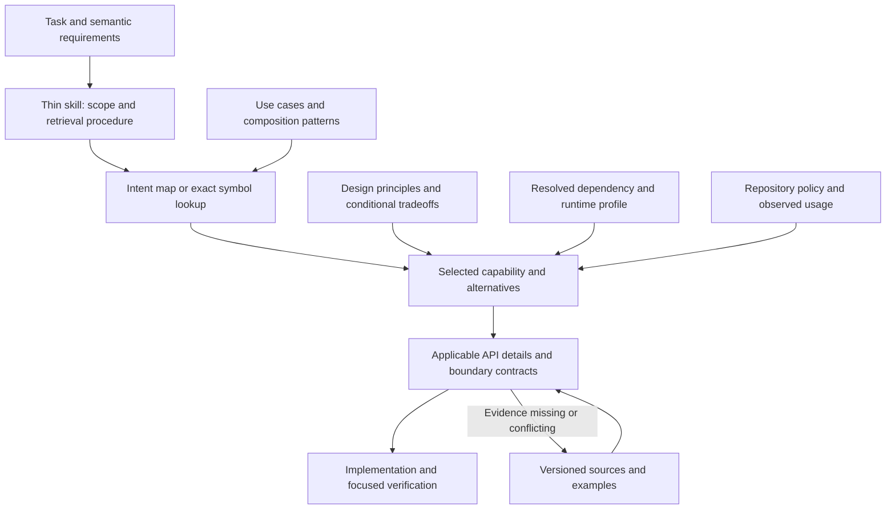

> **Migrated 2026-09-13** from `smartref/docs/library_ref/library_reference_architecture_and_agent_skill_flow_2026-09-11.md` (smartref commit 5e2464345a). Frozen provenance: paths inside refer to the monorepo layout (`tooling/library_guides/...`, `docs/library_ref/...`). The deep-dive reference documents it links to were retired in favour of Context7 and code-fact lookup and are not in this repository.

# Library reference architecture and agent skill flow for Python and Rust

**Assessment date:** 2026-09-11  
**Status:** Recommended architecture and migration process; not an implemented documentation system.  
**Audience:** Strong coding agents and the people maintaining their library references.  
**Scope:** Assessment of the [proposed restructuring](../reviews/Assessment_of_library_ref_documentation_and_skill_flow.md), grounded in the DataFusion/Arrow Rust and FastMCP/Pydantic/FastAPI reference skills, their companion indexes, selected underlying sections, and current dependency evidence.

## 1. Recommendation

Adopt the proposal's emphasis on capability discovery, decisions, and targeted examples. Develop its semantic graph into **a decision model connecting use cases, requirements, design principles, capabilities, and concrete APIs**, presented through compact task-oriented guides. The important design problem is the meaning of those connections and how they improve an agent's choices; a particular graph storage or retrieval technology is secondary.

The central path should be **task → semantic requirements → candidate capabilities and compositions → comparison under relevant principles → API selection**. Version assurance remains a straightforward supporting check. The highest-value work is structuring the library knowledge so that an agent discovers the right alternatives, compares them on the right dimensions, and recognizes when a normally good principle points to the wrong choice.

For an agent at this capability level, the most useful reference answers five questions quickly:

1. Which existing library capability, configuration option, or composition already solves this problem?
2. What distinguishes it from the closest alternatives under this task's requirements?
3. Which exact public API exposes it in the relevant language and resolved environment?
4. What conditions, boundary semantics, and failure modes could invalidate that choice?
5. What evidence or small executable example establishes that the intended behavior actually works?

The agent needs help discovering options it did not think to search for, and checking details it cannot safely infer. It needs relatively little explanation of ordinary programming concepts. Intelligence does not establish current package contents, feature activation, protocol compatibility, or runtime behavior.

I recommend a **hybrid representation**: a thin skill; compact task and capability maps; readable decision cards with small structured metadata; generated symbol indexes; explicit integration contracts; versioned source evidence; and selective executable examples. Keep the existing long references available as research and explanatory material. Add a database, graph service, or semantic search only if evaluation shows that ordinary indexed files leave meaningful retrieval failures.

The core additions to the original proposal are the [semantic model and principle mappings](#56-semantic-model-what-the-relationships-must-mean), [worked Rust and Python decisions](#64-worked-rust-decision-enrich-records-without-defaulting-to-a-udf), [decision brief used by the agent](#75-retrieve-a-decision-brief-not-a-disconnected-set-of-records), and [semantic authoring process](#96-review-semantic-mappings-as-carefully-as-api-facts).

The optimization target should be **successful library selection and implementation per total effort**, including retrieval, verification, correction, and documentation maintenance. Semantic density is useful, but a short answer that omits a condition and causes a wrong implementation is expensive.

This is an architectural recommendation, not a measured claim that one representation is universally optimal. Section 11 defines how to compare it with the current system.

## 2. What the examples actually reveal

The current references have valuable content. Their intent routes, calculation-placement decisions, lifecycle distinctions, and cross-library explanations should survive. The main opportunity is to make the connections among tasks, capabilities, and design principles explicit and directly retrievable. Excessive routing material and compression that turns a scoped recommendation into a universal rule impede this; stale applicability claims are a separate supporting concern.

| Observation from the current files | Implication for the new design |
|---|---|
| The Rust `SKILL.md` contains 86 lines but approximately 13.6 KB; the FastMCP skill contains 147 lines but approximately 24.2 KB. Their description fields alone contain roughly 957 and 1,953 characters, including enclosing quotes. | Line limits do not measure context cost. Shorten the trigger description and measure the complete retrieved text. |
| Their `REFERENCE.md` files contain 660 and 567 lines. Much of this is document navigation, overlap mapping, repeated constraints, and project context. | Let agents jump directly from an intent or symbol to the relevant card. Do not require reading a second large navigator. |
| The detailed DataFusion calculation-placement chapter compares cardinality, execution stage, and alternative extension surfaces, while a short navigator branch routes external I/O directly to an async UDF. | Preserve the semantic comparison when compressing. The useful knowledge is why a candidate fits and what could change the choice. |
| The Rust index places the built-in function chapter at line 10,540 and streaming at 20,469. The current headings are at 10,667 and 20,753. | Hand-maintained offsets have already drifted. Generate locations against a specific document revision. |
| The FastMCP skill says 3.4.7 is exactly what is installed, and Pydantic 2.13.4 is installed. On this review date, both `uv.lock` and installed package metadata report FastMCP 4.0.3 and Pydantic 2.13.5. | Reference baseline, dependency declaration, lock resolution, and installed environment are different facts. Never embed a timeless “currently installed” claim in a generic skill. |
| The Rust skill's opening baseline is DataFusion 53.1.0; its project section separately identifies 54.1.0. Current Cargo declarations and lock resolution agree on DataFusion 54.1.0 and Arrow/Parquet 58.4.0. | Version distinctions are already necessary. Make their ownership explicit and present the applicable version alongside retrieved advice. |
| The Rust skill says `Expr` has no operator overloading. The locally cached `datafusion-expr` 54.1.0 source implements arithmetic operators and bitwise operators. `&` constructs a bitwise operation; it is not the fluent logical `.and(...)` operation. | Preserve exact distinctions. A memorable prohibition can be less accurate than a small operator table. |
| The Rust skill directs agents to derive catalog-only material from adjacent deep-dives. | A catalog entry proves discoverability, not sufficient implementation evidence. Retrieve the matching upstream API or source when details are absent. |
| The FastMCP skill requires a module-level `TypeAdapter` singleton while also warning broadly against module-global state. | Separate construction-cost advice from state ownership. Reuse an adapter at a suitable lifetime; a global singleton is one implementation option. |

Sources: [Rust skill](../../.codex/skills/datafusion-pyarrow-rust-ref/SKILL.md), [Rust companion](../../.codex/skills/datafusion-pyarrow-rust-ref/REFERENCE.md), [FastMCP skill](../../.codex/skills/fastmcp-fastapi-pydantic-ref/SKILL.md), [FastMCP companion](../../.codex/skills/fastmcp-fastapi-pydantic-ref/REFERENCE.md), [Cargo manifest](../../Cargo.toml), [Cargo lock](../../Cargo.lock), [Python lock](../../uv.lock), and [DataFusion reference](datafusion_rust.md). Installed versions were read through package metadata without importing or modifying the applications. The operator finding was checked in the cached package source at `/home/paul/.cargo/registry/src/index.crates.io-1949cf8c6b5b557f/datafusion-expr-54.1.0/src/operation.rs`, particularly lines 26–76. These observations are a dated snapshot, not a full audit of every statement or deployed service.

OpenAI's current skill documentation describes loading names and descriptions before the selected skill body, and recommends concise descriptions with the important trigger language first. That makes description design part of retrieval quality, rather than a place for a compressed table of contents. [Official skill guidance](https://learn.chatgpt.com/docs/build-skills).

## 3. Changes I would make to the proposal

| Proposed element | Recommended treatment | Reason |
|---|---|---|
| Capability registry as the primary representation | Keep a capability catalog, but author decision-rich content as Markdown cards with minimal metadata. Generate the public-symbol inventory separately. | A capability is a task-level behavior, not necessarily one symbol. Hundreds of uniform, repetitive YAML objects can be as costly to read as prose. |
| Capability graph | Make use cases, requirements, principles, and comparisons first-class alongside capabilities. Represent their relationships explicitly; keep traversal relevant to the decision. | A semantic graph is valuable when its links explain choices. A graph database is a separate implementation decision. |
| Global principle and outcome ontology | Define a small, reusable principle vocabulary with mechanisms, applicability conditions, competing considerations, and library-specific realizations. | Tags alone cannot explain why a capability serves an outcome or when another principle should take precedence. |
| Separate decision-policy objects | Keep small comparison tables beside the competing options; extract a shared decision guide only when several tasks reuse it. | Selection depends on interacting constraints, not just one predicate. Most rules need interpretation, not execution by a rules engine. |
| Eliminate the overlap matrix | Replace navigation duplication with explicit ownership of facts and integration behavior. Retain concise cross-layer comparison tables. | Pydantic validation and FastMCP argument handling are different contracts, even when they involve the same object. |
| Separate conceptual and version facts | Separate their authoring, but join the applicable version and conditions into the retrieved view. | Making the agent fetch and mentally reconcile a separate version ledger for every card wastes effort and invites mistakes. |
| Standalone examples | Keep complete runnable examples for important compositions and small inline fragments for API shape. | A separate file is worthwhile when it proves behavior; a one-line call need not require another retrieval. |
| Compile-test the examples | Add behavior checks where the claim is behavioral, including integration boundaries. | Compilation does not prove null behavior, correct registration, resource cleanup, or protocol output. |
| Strong-model inference | Compress familiar explanations; keep causal exceptions explicit. | A strong model can infer a likely benefit but cannot promote it to a guarantee. |
| Fixed sequence of several layers | Make the flow conditional, with direct routes for known APIs and broader discovery for design tasks. | Not every task needs a manifest, a principle file, a policy object, and two recipes. |

Two corrections are especially important.

First, streaming output does not by itself establish bounded total query memory, prompt first results, or end-to-end backpressure. DataFusion's `execute_stream` avoids collecting every output batch, but stateful or blocking operators and the consumer's buffering remain relevant. The current long reference already contains these qualifications; the proposed normalized record must preserve them. [DataFusion 54.1.0 execution API](https://docs.rs/datafusion/54.1.0/datafusion/dataframe/struct.DataFrame.html#method.execute_stream), [local streaming discussion, §21.8–§21.10](datafusion_rust.md).

Second, “needs external I/O” should open a comparison among a provider scan, bulk lookup and join, preprocessing, caching, and an async function. It should not automatically select an async scalar UDF. Cardinality, consistency requirements, optimizer placement, call multiplicity, retries, and supported versions can change the answer. The existing [calculation reference](datafusion_calculations_rust.md) has a richer placement model than that single branch suggests.

## 4. Overall architecture

Use separate ownership for reusable library knowledge, cross-library composition, and repository-specific choices. Present them together when a task needs them.



The boxes are responsibilities, not mandatory sequential file reads. A known API with current evidence can go directly to its exact contract. A design request needs a capability-family map before selecting a narrow route.

### 4.1 Content layout

The following is a logical end state. Introduce files when they have content, rather than scaffolding every directory immediately.

```text
.codex/skills/<existing-stack-ref>/SKILL.md    thin entry point in the current setup

docs/library_ref/
  <existing long references>.md             retained research and explanation
  agent_reference/
    INDEX.md                               generated cross-stack discovery map
    principles/                            shared principles and realization links
    use_cases/                             semantic task families and variations
    libraries/<library>/
      manifest.yaml                        identity, scope, sources, inventory method
      capabilities/<family-or-task>.md     authored metadata and decision content
      api/<profile>.jsonl                  generated symbol/function inventory
      profiles/<profile>.yaml              versions, conditions, verification scope
    stacks/<stack>/
      manifest.yaml                        member libraries and task routes
      INDEX.md                             generated compact route table
      decisions/<shared-choice>.md         only for substantial reused comparisons
    integrations/<boundary>.md             directed composition contracts
    projects/smartref.yaml                  declared policy and dated observations
    examples/<library-or-boundary>/         selected runnable examples and assertions
    evidence/sources.jsonl                 source identities and bounded locators
    evidence/coverage.json                 inventory and documentation coverage
    evals/                                 task cases and recorded comparison results
```

Keep the current skill names during migration so existing invocations continue to work. The layout above is not a recommendation to relocate the host's skill discovery directories. Verify host discovery separately if packaging or installation changes.

### 4.2 Ownership and generation rules

| Material | Canonical owner | Derived views |
|---|---|---|
| Library capability, semantic caveat, alternative | The capability card | Search entries and short family listings |
| Design principle and its general rationale | Shared principle record | Relevant principle excerpt in decision guides |
| Principle's effect on a particular choice | Owning decision guide or capability relation | Conditional recommendation with mechanism and exceptions |
| Use-case requirements and meaningful variations | Use-case record | Intent routes and decision evaluation cases |
| Public symbol, signature, alias, package location | Versioned upstream API/source inventory | `api/<profile>.jsonl`, symbol-to-card links |
| Task route across libraries | Stack manifest | Stack `INDEX.md` and global discovery rows |
| Cross-library lifecycle or data conversion | Integration card | Links from both participating libraries |
| Reference baseline and tested environment | Profile record | Applicability summary attached to a lookup result |
| SMARTREF requirement | Existing policy source, referenced by project overlay | Short scoped policy reminder |
| Observed use or non-use in SMARTREF | Dated repository evidence | Usage field in the project overlay |
| Exact source location | Source ledger | Generated links, anchors, and line hints |

Do not author the same fact independently in YAML, a skill, a reference index, and a long-form chapter. Generate concise projections when useful. Small duplication within a retrieved card is desirable when it keeps a critical condition next to the recommendation; derive that duplication from the owning record where practical.

A universal ontology of every library abstraction is unnecessary. Use a small semantic model whose relations explain requirements, alternatives, causal benefits, and composition. Sections 5.6–5.9 define this model. Expand the vocabulary when it distinguishes a real decision, rather than adding unbounded “related” neighborhoods.

## 5. Content contracts

### 5.1 Broad inventory and selective depth

Cover the full declared public surface broadly; deepen the parts where an agent needs selection help or could make a consequential mistake.

Maintain two distinct inventories:

| Inventory | Unit | Purpose |
|---|---|---|
| Public API inventory | Public symbol, function name/alias, option, feature, extension hook, or documented protocol surface | Exhaustive lookup within a stated version and collection scope |
| Capability catalog | User task or meaningful family of behavior | Intent discovery, alternatives, composition, and semantic guidance |

A hundred arithmetic or string functions do not require a hundred nearly identical essays. Generate compact family tables with exact names, supported signatures, aliases, and evidence links. Write individual cards for important semantic distinctions or composition choices. Conversely, a single capability such as “publish a generated MCP API” may require several symbols and an integration contract.

Inventory more than functions: configuration defaults, registration mechanisms, package extras, feature flags, serialization formats, extension traits, lifecycle hooks, diagnostics, testing utilities, transports, and officially documented integrations can eliminate as much custom code as a built-in function.

“Full array” must have a denominator. Record the targeted release, modules/crates, feature profiles, public API boundary, and documented ecosystem sources. Classify each inventoried item as mapped to a family/card, reference-only, intentionally excluded with a reason, or unresolved. Track integration coverage separately. An open ecosystem cannot honestly be certified complete across all third-party packages.

Do not infer that a feature is absent because its card is missing. Likewise, a complete default-feature inventory cannot prove absence under a different build profile. The retrieval output must expose that distinction.

### 5.2 Capability card

Use Markdown with a small metadata header. Required metadata should support identity, retrieval, and evidence, not force every author to populate an ontology.

| Field | Required content |
|---|---|
| Identity | Stable ID, short title, owning library, language/surface |
| Retrieval | One-sentence intent, exact symbols, common aliases and user phrases |
| Semantic role | Relevant shape, execution stage, state/effects, and composition properties |
| Principle realization | Applicable principle, causal mechanism, and condition; not just a tag |
| Applicability | Profile reference and any additional version, feature, registration, or platform conditions |
| Choice | Preferred use, closest alternatives, and conditions that change the recommendation |
| Contract | Inputs/outputs, important semantics, and relevant failure modes |
| Evidence | Exact source references and verification level; example reference when available |

Only add specialized fields where relevant. Ownership and release callbacks matter to FFI; null and empty-input behavior matter to analytics; authorization and request lifetime matter to service integrations. A uniform record with dozens of empty fields has little value.

Every recommendation should be independently understandable within its retrieved excerpt. A list of IDs that requires six more lookups is not an efficient card.

### 5.3 API entries

An API entry should connect intent to the spelling the agent must actually use:

- Qualified Python import path or Rust crate/module path, symbol kind, aliases, and re-exports.
- Exact signature or a locator to it; ownership, `async`, overload, and type constraints where applicable.
- Version/profile, optional package or build feature, registration requirement, and known availability limits.
- Owning capability and source location; deprecation or replacement if established.

Treat SQL function names, Rust expression constructors, Python wrappers, and runtime-registered functions as distinct surfaces connected by evidence. Do not generate a fictitious one-to-one mapping from naming similarity.

Extract signatures and enumerations when feasible. Author the choice criteria and non-obvious semantics. Generated API breadth and reviewed semantic depth serve different purposes.

### 5.4 Integration cards

An integration deserves its own record when its composition changes behavior or introduces a boundary. “A integrates with B” is insufficient.

| Required dimension | What the card establishes |
|---|---|
| Direction and purpose | Producer, consumer, artifact/protocol, and the task being enabled |
| Compatibility | Independently versioned components, protocol versions, features/extras, host requirements |
| Representation | Schema, units, nulls, metadata, serialization and possible loss |
| Ownership | Allocation owner, lifetime, cleanup, thread/process/device constraints |
| Execution | Sync/async boundary, buffering, cancellation, retries and partial failure |
| Policy | Identity, credential, authorization, or tenant boundary when relevant |
| Alternatives and limits | What composition replaces; conditions under which another route is preferable |
| Evidence | End-to-end example or boundary test and its exact profile |

For Arrow C Data/C Stream exchange, distinguish in-process interchange from IPC serialization or Flight transport. State when buffers can be shared and when conversion, device transfer, or incompatible types require copies. Rust crate type compatibility and cross-language protocol compatibility are different questions; Python and Rust package version numbers need not match numerically.

For FastMCP/FastAPI, API-to-MCP generation and mounting an MCP application into an ASGI application are separate directed integrations. The former maps routes and schemas; the latter must establish hosting, lifecycle, path, and transport behavior. They should not share one generic “FastAPI integration” recipe. The existing [FastMCP reference, §26](fastmcp_python_advanced_reference_3.4.7.md) already recognizes this distinction for its 3.4.7 baseline.

### 5.5 Evidence, advice, and policy

Give statements one of four meanings in their wording or metadata:

| Kind | Example | Treatment |
|---|---|---|
| Library contract | `collect` buffers all output batches in the documented version. | Cite exact API evidence. |
| Conditional recommendation | Prefer streaming when the consumer can process batches incrementally. | Include conditions and relevant counterexamples. |
| Repository policy | The solver route must use the configured external executable. | Link its authoritative repository instruction; preserve scope. |
| Observed fact | This environment resolves FastMCP 4.0.3 on the review date. | Record environment and observation date; refresh when needed. |

References should not silently grant permission to expand work, install packages, change transports, or rewrite architecture. They inform choices within the user's authorized task and applicable repository instructions. A library recommendation does not supersede a project contract.

### 5.6 Semantic model: what the relationships must mean

The graph should explain how a task becomes a defensible implementation choice. A list of capabilities connected to favorable design-principle tags does not achieve this. Distinguish the following concepts:

| Concept | Meaning | Example |
|---|---|---|
| Use case | A recognizable task, independent of a preferred implementation | Enrich event records with reference attributes |
| Requirement or desired outcome | What must hold, or what the user wants to improve | Preserve unmatched events; reduce remote requests |
| Design principle | A reusable preference with a causal explanation and limits | Batch repeated external work when its semantics permit |
| Capability | A coherent behavior supplied by a library or composition | Relational join; bulk source scan; async scalar evaluation |
| API binding | The concrete public surface exposing a capability | A Rust expression constructor, Python method, configuration setting, or provider interface |
| Integration pattern | An arrangement of capabilities with explicit boundary behavior | Fetch a reference snapshot, expose it as a table, then join |
| Decision guide | Comparison of alternatives for a use-case family | Where should an external lookup occur? |

These mappings are many-to-many. A use case can have several valid implementations; one capability serves many use cases; a principle may support one option in one context and a different option elsewhere. An integration can produce a useful capability that neither component provides independently.

Use a small set of relationships with explicit meanings:

| Relationship | Required interpretation |
|---|---|
| Use case **requires** property | A candidate that cannot preserve it is inadmissible for that task. |
| Use case **prefers** outcome | A preference to compare after satisfying requirements; include priority where known. |
| Capability **provides** behavior | State the semantic contract, not just a favorable adjective. |
| Capability **realizes** principle | Explain the mechanism and the conditions under which the principle applies. |
| Mechanism **supports** outcome | State why the effect follows and which assumptions could defeat it. |
| Capability **competes with** alternative | Name the discriminator that makes one preferable. |
| Pattern **composes** capabilities | Specify order, exchanged artifact, ownership, and relevant loss or effects. |
| API **exposes** capability | Identify the language-specific binding and important differences from other bindings. |

For example, a bulk lookup can reduce remote requests by amortizing work across records. That is a causal link, conditioned on a bulk endpoint and acceptable snapshot semantics. Merely attaching `PERF.EFFICIENT` to the lookup conveys neither the mechanism nor the reason to choose it.

Use readable predicates such as “a single reference snapshot is acceptable” or “the consumer needs random access.” They are decision inputs for the agent, not a new predicate programming language. Introduce machine-executable predicates only for facts that can actually be evaluated reliably, such as a declared feature flag.

### 5.7 Principles as conditional decision guidance

Keep principles as first-class shared knowledge, but give each a precise role. A useful initial vocabulary is:

| Principle | Decision it helps make | Limit or competing consideration |
|---|---|---|
| Preserve semantic structure for its execution owner | Prefer query expressions where the planner can use them; use framework declarations where the framework owns behavior | A specialized algorithm or missing semantic capability may require an extension |
| Reuse supported mechanisms before introducing custom ones | Look for built-ins, configuration, composition, and supported extension hooks | Less handwritten code is not worth incorrect semantics or a forced abstraction |
| Derive related interfaces from one contract | Generate schemas and adapters from a shared definition where supported | Validation, serialization, and consumer-facing projections can legitimately differ |
| Keep ownership and lifetime explicit | Select process, request, session, task, or buffer ownership deliberately | Reuse must not accidentally share request-specific or mutable state |
| Batch work at a meaningful boundary | Compare bulk reads, joins, vectorized operations, and reusable construction | Freshness, latency, failure isolation, or tiny workloads can favor a different granularity |
| Preserve useful representations across boundaries | Avoid needless row conversion, serialization, or intermediate formats | Different processes, devices, or consumer contracts may require conversion |
| Bound resources according to the workload | Choose incremental execution, bounded concurrency, limits, or materialization consciously | A streaming interface alone does not bound internal state; random access may justify materialization |
| Observe and verify behavior at the layer that owns it | Verify a tool contract through the framework or a schema boundary through interchange | Lower-level unit checks remain useful for the local algorithm |

Semantic correctness is an admissibility requirement, not a benefit to trade against these preferences. Similarly, explicit project requirements are constraints; general library principles do not outrank them.

A principle record should contain: **definition → mechanism → applicability → observable consequences → exceptions/competing principles → concrete library realizations**. The definition is shared; a realization explains why that principle matters to a particular API choice.

For example:

```yaml
id: preserve_semantic_structure
definition: Keep operations represented where their execution owner can inspect them.
mechanism: Explicit structure permits supported planning and transformation rules.
applies_when:
  - the operation can be expressed faithfully in the owner's representation
  - the owner can use that structure for the relevant task
decision_implications:
  - compare DataFusion expressions before an opaque custom calculation
  - compare framework schema declarations before parallel handwritten schemas
limits:
  - do not approximate required semantics merely to stay declarative
  - do not assume every declared operation receives every optimization
verification:
  - inspect the relevant plan or generated contract
```

This is an illustrative authored record, not a claim that query planning and schema generation are the same mechanism. Their library-specific realizations must explain the actual behavior separately.

Principles should sharpen the agent's comparison, not mechanically score candidates. Avoid counting how many principle tags a capability satisfies. Avoid a universal “always use the highest abstraction” or “always use the lowest sufficient abstraction”: choose the level that preserves the task's semantics and gives the relevant execution owner useful control.

### 5.8 Give each capability a semantic signature

A type signature describes how to call an API. A semantic signature describes what role it can safely play. Add the relevant parts of the following to capability cards and comparison tables:

| Dimension | Decision-relevant distinctions |
|---|---|
| Shape and cardinality | Scalar, column, row, group, window, relation, stream; preserve, reduce, expand, or reorder |
| Execution stage | Declaration, validation, planning, scanning, execution, transport, presentation |
| State and effects | Pure calculation, local mutable state, external read, external write; determinism and consistency |
| Ownership and lifetime | Borrowed/owned/shared data; process/request/session/task lifetime; release responsibility |
| Representation and semantics | Nulls, errors, precision, ordering, schema, metadata, coercion, and conversion loss |
| Composition properties | Planner visibility, mergeability, partitionability, async support, cancellation, and buffering |

Populate only dimensions that distinguish realistic alternatives. A scalar transform does not need an authentication section; an HTTP integration does not need a generic array-layout essay.

This gives cross-language reuse without assuming API equivalence. A Rust and a Python binding can expose the same conceptual operation but differ in ownership, eager/lazy behavior, accepted objects, configuration, or error propagation. Share the use case and principle; keep those differences attached to each binding and boundary.

Capability granularity should follow decision boundaries. Split a family when variants have meaningfully different selection criteria, contracts, or composition behavior. Group variants when the agent only needs to choose an exact name or overload from a table. This avoids both a vague “DataFusion can query data” record and an essay for every arithmetic helper.

### 5.9 Use-case maps and composition coverage

Organize the primary map by **what the agent is trying to accomplish**, then expose the library surfaces that could accomplish it. Keep a secondary symbol index for exact lookup. For these stacks, useful semantic families include:

| Task family | Candidate surfaces to make discoverable |
|---|---|
| Transform, summarize, rank, or reshape data | Expressions, built-ins, aggregates, windows, nested operations, kernels, extension functions |
| Obtain, expose, or persist data | Readers, datasets, catalogs, providers, partitioning, pushdown, sinks, storage integrations |
| Move data between runtimes or consumers | Interchange protocols, Arrow bridges, IPC, Flight, serializers, adapters |
| Declare and validate a contract | Supported types, constraints, models, adapters, schema generation, validation and serialization hooks |
| Compose or expose services | Providers, generated APIs, proxies, mounting, transforms, transport facilities |
| Control cross-cutting execution behavior | Dependency injection, middleware, configuration, lifespan, tasks, observability and test utilities |

For each family, keep a few representative use cases plus variations that change the preferred implementation. “Enrich records” should expose differences among local reference data, a reusable snapshot, and a remote per-request lookup. “Validate a payload” should distinguish an existing supported type from a model with independent domain behavior. These variations are more useful than a large set of recipes differing only in names.

Discover integrations in both directions: **what can produce this capability's input, and what can consume its output?** Inspect matching semantic contracts, not just matching type names. A pattern should include the necessary adapters and ownership changes. It should also show when a direct built-in replaces the entire pattern—for example, a supported writer may remove the need for a manual consume/convert/write loop.

This is how the system surfaces less familiar features: a familiar task exposes an unfamiliar candidate through its semantic role. Do not limit routes to APIs already used in SMARTREF, and do not turn every unused capability into a recommendation to adopt it.

## 6. Examples of the proposed agent-facing content

These examples illustrate content shape. They are not new installed skills, complete API catalogs, or claims of executed example tests.

### 6.1 Rust: consume a DataFusion result incrementally

```yaml
id: datafusion.rust.consume_query_result
intent: Consume query output without accumulating all output batches.
language: rust
use_cases: [deliver_large_result_incrementally]
semantic_shape: relation to a stream of record batches
decision_dimensions: [output retention, partition handling, ordering]
principle_realizations:
  - principle: bound_resources_according_to_workload
    mechanism: Avoid retaining the entire output in the consumer.
    condition: Consumer buffering is bounded; operator state is assessed separately.
symbols:
  - datafusion::dataframe::DataFrame::execute_stream
  - datafusion::dataframe::DataFrame::execute_stream_partitioned
  - datafusion::dataframe::DataFrame::collect
search_terms: [stream results, large query output, incremental batches, collect]
profile: datafusion-rust-54.1.0
evidence_level: api_and_source_reviewed
example_status: not_executed_in_this_assessment
```

**Choose:** `execute_stream` when the consumer accepts incremental batches through a single output stream. Use the partitioned form when the consumer needs separate partition streams. Use `collect` when the complete, bounded result is required and its memory cost is acceptable.

**API shape:** `execute_stream(self)` is async and returns `Result<SendableRecordBatchStream>`. The frame is consumed. Handle failures both when creating the stream and while consuming batches. The published 54.1.0 API documents cancellation when the stream is dropped. [Exact execution API](https://docs.rs/datafusion/54.1.0/datafusion/dataframe/struct.DataFrame.html#method.execute_stream).

**Important limits:** Streaming avoids full output collection; it does not establish a bound on state inside sorts, joins, aggregations, or the downstream consumer. Separate partition streams do not imply a global output ordering. If ordering or bounded resource use is required, check the plan and consumer contract.

**Related decision:** If the goal is to write a supported dataset format, compare the library's sink/write APIs before building a manual stream-to-file loop.

**Evidence to add in the runnable example:** output and schema equivalence on a bounded fixture, error propagation, and early termination. Add memory or first-result measurements only when claiming those properties under a specified workload. Do not label them proven from the return type alone.

This is more useful than a list of unconditional performance tags. It provides the choice, exact surface, limits, and next useful alternative in one retrieval.

### 6.2 Python: validate an existing type without inventing a model wrapper

**Capability:** `pydantic.python.validate_existing_type`  
**Intent:** Validate or serialize a type such as `list[SomeType]` without adding a wrapper `BaseModel` solely to access validation.  
**Surface:** `pydantic.TypeAdapter`; Python-object and JSON entrypoints.  
**Applicability:** Pydantic v2; establish the exact installed patch and target annotation for implementation.

| Task condition | Candidate |
|---|---|
| Existing supported annotation; no independent model behavior required | `TypeAdapter` |
| A named domain model with fields, methods, and model-level behavior is useful | `BaseModel` |
| Add supported constraints to a type | Built-in types, `Annotated`, and `Field` before custom validation hooks |
| Custom behavior remains necessary | Select the narrowest appropriate validator or type hook after identifying the gap |

**Contract:** Identify whether the input is an already-decoded Python value or JSON text/bytes. Strict validation can differ between the two entrypoints; JSON arriving over a network does not establish which Pydantic entrypoint a framework calls. [Pydantic strict-mode documentation](https://pydantic.dev/docs/validation/latest/concepts/strict_mode/).

**Performance advice:** Reuse an adapter when its target type and configuration are stable instead of reconstructing its validators on each call. Choose a lifetime suitable for application initialization, configuration changes, and tests; a module-level singleton is not a universal requirement. [Pydantic performance guidance](https://pydantic.dev/docs/validation/latest/concepts/performance/).

**Composition evidence:** The installed FastMCP 4.0.3 `FunctionTool._execute` calls `TypeAdapter.validate_python(arguments, strict=...)` on its normal async, threadpool, and synchronous branches. This was inspected in [the installed source](../../.venv/lib/python3.14/site-packages/fastmcp/tools/function_tool.py), lines 449–481. It establishes that boundary for this source version, not every FastMCP version or execution path. An integration example should validate through the actual tool boundary as well as testing Pydantic in isolation.

This card prevents both unnecessary wrapper classes and a plausible but incorrect cross-library inference.

### 6.3 FastMCP: discover framework mechanisms before building them

The current 3.4.7 reference provides useful discovery routes. Preserve their breadth, but resolve each route against the target version before recommending an implementation.

| Requested behavior | Discovery candidates | Selection issue the card must answer |
|---|---|---|
| Expose an existing HTTP API through MCP | Generated provider / OpenAPI or FastAPI conversion | Which routes should be exposed, how names and schemas map, and where credentials belong |
| Host MCP beside an HTTP application | MCP ASGI export and host mounting | Lifespan ownership, mounted paths, middleware layers, and transport behavior |
| Reuse components from another server | Provider, composition, or proxy surfaces | Live vs copied behavior, remote failure, naming collisions, and identity propagation |
| Reduce a large tool catalog | Curated exposure, pagination, search transforms, Code Mode where supported | Which changes affect discovery only, invocation shape, client support, or authorization |
| Add reusable cross-cutting behavior | Existing middleware and dependency mechanisms | Correct execution layer, order, request scope, and built-in coverage |
| Validate and describe a structured tool payload | Pydantic-supported type and schema mechanisms | Runtime validation, advertised schema, serialization, and their differences |
| Persist work beyond a request | Supported task facilities and persistence integration | Durability, ownership, cancellation, supported client protocol, and backend requirements |

These are opportunities to investigate, not a backlog of changes the project should automatically adopt. A currently unused capability may be unnecessary or deliberately inappropriate. The project's existing decisions remain relevant evidence.

The example also shows why an API-only index is insufficient: useful built-ins include middleware, providers, transforms, configuration, and lifecycle facilities, not just callable functions.

### 6.4 Worked Rust decision: enrich records without defaulting to a UDF

**Task:** Enrich a large event relation with reference attributes from a service. The service supports a bulk snapshot. A single snapshot per run is acceptable, unmatched events must remain, and enrichment must not multiply event rows.

Start with the semantic requirements: a relation-to-relation transformation; external reads; stable reference semantics during the run; preserved event cardinality; and explicit handling of missing or duplicate reference keys. “External I/O” alone is not enough to select an API.

| Candidate | Relevant mechanism | Fit to this task |
|---|---|---|
| Fetch snapshot, register it as a relation, use a built-in join | Moves repeated lookups into relational execution and amortizes service access | Strong initial choice if the snapshot size and retrieval cost are acceptable |
| Provider exposing the reference source | Encapsulates source access and may offer useful scan behavior | Useful when reusable source integration or source-side selection is required; may be unnecessary for one available snapshot |
| Async scalar UDF per lookup | Performs external work from scalar evaluation | Worth considering when lookup semantics require it; otherwise adds call multiplicity and consistency questions |
| Custom physical operator | Controls execution mechanics directly | Requires an execution requirement that the simpler candidates cannot satisfy |

**Principle mapping:** Batching favors obtaining the snapshot once; preserving semantic structure favors expressing enrichment as a join; explicit ownership places snapshot acquisition and lifetime at the run boundary; reusing supported mechanisms favors registration and join APIs before a custom operator. These are mechanisms attached to the task's conditions, not four independent votes.

**Semantic check that determines correctness:** A left join preserves unmatched events, but does not by itself preserve event count when a reference key has multiple matches. Establish key uniqueness or an explicit domain rule for duplicates before selecting the final composition. Do not silently deduplicate to make the cardinality work.

**Binding route:** The selected guide should now point directly to the relevant DataFusion table-registration, join, and expression APIs, with the source/provider route available if needed. The agent should not have to read every UDF chapter before discovering this option. The [calculation-placement reference, C1](datafusion_calculations_rust.md) and [source/join sections of the engine reference](datafusion_rust.md) provide the underlying material.

**Condition that reverses the choice:** If each lookup must observe a separate live state and a snapshot is unacceptable, the snapshot composition no longer satisfies the requirements. Reconsider the async lookup route and its concurrency, retry, and consistency contract. If a snapshot is too large but source-side selection is available, reconsider a provider or batched key lookup. This change of recommendation is precisely what the semantic mapping should enable.

The same method applies within a built-in function family. A grouped weighted mean may be expressible through built-in conditional expressions and sums rather than a UDAF. The numerator and denominator must use the same eligible rows, and zero total weight needs an explicit result policy. The guide should discover the composition and expose these semantic questions before recommending a custom accumulator or a superficially similar aggregate.

### 6.5 Worked Python decision: expose a useful MCP interface over an existing API

**Task:** Expose a curated set of workflows from an existing HTTP API. The API has a machine-readable contract. Callers need stable, understandable tool inputs; credentials come from the application; request tracing is required; and a pooled client should be reused.

This is a composition problem. Selecting `FastMCP` or `BaseModel` alone does not determine a good design. Decompose the use case into behaviors and map each to its likely owner:

| Required behavior | Capabilities to compare | Principle and selection condition |
|---|---|---|
| Derive tools from existing operations | OpenAPI/FastAPI generation versus explicit workflow tools | Reuse a source contract where its operation semantics fit the desired tools |
| Present a small stable workflow surface | Supported selection/transforms versus a workflow facade | Reduce accidental interface complexity; a business workflow may need composition beyond one endpoint |
| Validate and describe inputs | Supported annotations, constraints and Pydantic models/adapters versus custom validation | Derive related behavior from one contract; add hooks only for a real semantic gap |
| Supply application-owned credentials or context | Supported dependency/context mechanisms | Keep identity and lifetime owned by the application rather than ordinary caller input |
| Reuse a pooled service client | Lifespan-managed client with scoped access | Reuse expensive resources without conflating process lifetime with request identity |
| Apply request tracing consistently | Framework middleware/instrumentation versus repeated per-tool wrappers | Place cross-cutting behavior at the layer that observes the required events |

**Likely composition under these assumptions:** Generate the operations that already have suitable semantics, curate the exposed surface, use supported schema and dependency facilities, and manage the client at its proper lifetime. Keep an explicit workflow tool where the desired action combines operations or imposes a domain contract that generation cannot express cleanly.

**Tradeoff:** Minimizing handwritten code and producing a good agent-facing interface can conflict. A generated endpoint inventory may be easy to create yet require callers to understand internal API mechanics. Prefer generation where it preserves the intended workflow; prefer an explicit facade where it materially simplifies or enforces that workflow. Do not force either approach across the whole API.

**Verification follows the selected principles:** Inspect the resulting tool names and schemas, call through the framework boundary, check credential injection and lifecycle cleanup, and exercise a composed workflow. A direct Python call can establish local business logic but does not establish the generated interface. The existing [FastMCP reference, §26 and §30](fastmcp_python_advanced_reference_3.4.7.md) supplies the integration and testing context for its documented baseline.

**Condition that changes the route:** If the task is instead to host an already-designed MCP server beside FastAPI, retrieve the ASGI mounting/lifespan integration. Generating tools from the API answers a different use case. The use-case map should make this distinction before presenting code.

## 7. Agent workflow and skill design

### 7.1 Trigger on intent as well as existing imports

An import-triggered skill can arrive too late: the agent may already have chosen to implement a custom mechanism. Descriptions should lead with the design tasks the library can solve, then recognizable imports or symbols, then exclusions.

Suggested description shapes:

```text
DataFusion/Arrow Rust:
Choose existing DataFusion, Arrow, Parquet, and object_store capabilities for
Rust queries, columnar transforms, storage, and Python interchange. Use when
designing these flows or editing their Rust APIs/Cargo dependencies. Python-only
DataFusion/PyArrow usage routes to the Python reference.

FastMCP/Pydantic/FastAPI:
Choose FastMCP built-ins and integrations for MCP servers, clients, schemas,
providers, middleware, discovery, and ASGI hosting. Use for MCP design or
FastMCP code changes. Route ordinary web UI work to the web-stack reference.
```

Keep detailed inventories outside the description. Keep model-specific assumptions outside reusable library content; record tested model and host versions in evaluation results instead of treating `model-baseline` metadata as a behavioral guarantee.

### 7.2 What the skill body should contain

The body needs the task scope, direct use-case and decision-map locations, a short selection procedure, and a few high-impact semantic distinctions. Include a brief applicability check and link to project context rather than embedding a current crate/module inventory.

A suitable shared procedure is:

1. **Classify the need.** Identify intended behavior, language, execution layer, input/output shape, and decisive constraints. Infer ordinary details from the task and repository; ask only for information that materially changes the choice.
2. **Establish the relevant environment.** Read the applicable profile and refresh cheap evidence when the lockfile, interpreter, build features, registration, or deployment differs. Resolve only the dependencies relevant to the task.
3. **Discover candidates.** Search the intent map and API-family inventory before introducing custom behavior. Include the closest built-in composition and relevant integration route; avoid committing to an extension point before this comparison.
4. **Compare semantics.** Eliminate candidates that fail requirements, then compare the remaining options using the relevant principles and their mechanisms. Check the conditions that could reverse the recommendation.
5. **Verify the exact surface.** Use matching API/source evidence for signatures, availability, and behavior. Load an example or integration contract when needed. Follow the repository's code-intelligence requirements when changing or calling repository-owned APIs.
6. **Implement within scope.** Prefer the maintained library mechanism when it meets requirements. Record the semantic gap briefly if custom logic is needed; this is a reasoning step, not an approval gate.
7. **Verify the relevant behavior and stop.** Run checks appropriate to the actual change. Fetch more documentation only for a specific unresolved question, mismatch, or failure.

No mandatory “read the final 200 lines” step. No mandatory full corpus scan. No permission request just because a cookbook option is not being followed.

### 7.3 Built-in selection is a comparison, not a rigid ladder

Prefer standard public capabilities and composition when their semantics fit, including standard-library facilities where sufficient. The choice should consider existing project abstractions and accepted constraints. Using the lowest-level kernel is not automatically better than retaining a query expression that the optimizer understands.

For a calculation, compare built-in expressions, supported configuration, combinations of built-ins, adapters/providers, and extension points as relevant. Do not declare a custom extension unnecessary based only on a similarly named function.

Check the dimensions that matter to the task: nulls, empty input, precision, overflow, timezone, ordering, cardinality, state, determinism, side effects, error behavior, ownership, concurrency, and resource bounds. Most tasks need only a subset. Retain a concise reason for the chosen surface and the nearest rejected alternative.

Before concluding that no suitable built-in exists, broaden a failed name search to intent aliases and the relevant family inventory. If collection coverage is incomplete, say “not found in the checked surface” and inspect a matching upstream source. Do not invent a capability to fill a documentation gap.

### 7.4 Retrieval modes and stopping conditions

| Mode | Default retrieval |
|---|---|
| Exact known API | Applicable API entry and its critical caveats; direct source lookup if the entry is stale |
| Implement a familiar task | Task route, selected capability, closest alternatives, and an example only if useful |
| Design or discover possibilities | Family map, relevant unused/adjacent capabilities, comparison guide, integration cards |
| Diagnose a failure | Symptom → likely semantic/availability mismatch → source evidence and minimal diagnostic |
| Upgrade dependencies | Old and target profiles, affected API/semantic deltas, integration examples |

Default to ordinary text/symbol search plus curated intent aliases. An optional semantic index can improve unfamiliar phrasing; exact names and profile filters remain essential. A direct file workflow must remain usable if optional services are unavailable.

Retrieve the selected contract together with its critical caveats and applicable profile. Batch independent reads. Follow a dependency link when it affects the decision; do not recursively load every related node. If an index or tool truncates results, expose truncation and a continuation route instead of presenting a complete-looking answer.

Stop when the task has a suitable candidate, known applicability, understood decision-changing semantics, and enough evidence to implement and verify. If these are missing, identify the missing fact and retrieve it. A prescribed number of records is not a correctness criterion.

As initial tuning targets, try a roughly 50–90 word description, a 500–900 token skill body, and a few hundred tokens per routine capability card. These are starting points for measurement, not enforced maxima. Boundary-heavy tasks legitimately need more. Measure aggregate skill-description cost and retrieved context, not file line counts.

### 7.5 Retrieve a decision brief, not a disconnected set of records

Normalize the authored knowledge, but present enough of it together that the agent can make a choice without reconstructing the graph manually. The principal retrieval unit for a nontrivial task should be a **decision brief** containing:

| Brief component | Content |
|---|---|
| Task and decisive requirements | Semantic shape and constraints that distinguish the alternatives |
| Candidate set | Best-fit capability, closest alternative, and a composition or extension route when relevant |
| Comparison | Which requirement each candidate satisfies; relevant principle, mechanism, and tradeoff |
| Choice-changing conditions | Facts that would invalidate or reverse the recommendation |
| Concrete next step | Exact API bindings, boundary contract, or targeted example to inspect |

This can be a readable section in a decision guide; it does not require a new retrieval service. Generated views can inline the owning principle's short rationale and each candidate's decisive properties. Keep the full records separately available for deeper questions.

Candidate generation and candidate selection should be distinct. Retrieval should maximize discovery of plausible alternatives before the agent narrows the choice. A search that returns only the most keyword-similar API can reinforce the agent's first guess, especially when the prompt already mentions “write a UDF” or “build middleware.” Respect an explicitly required implementation, but recognize when that phrase is merely the user's proposed means to a functional goal.

Use the following comparison discipline for substantial choices:

1. Remove options that cannot satisfy hard requirements.
2. Check whether an existing capability or composition satisfies the task with fewer independently maintained mechanisms.
3. Compare relevant benefits and costs; discard an option only when another is at least as suitable on the decisive dimensions and better on one.
4. If tradeoffs remain, use the task's priorities and the established project context. Ask only when a missing preference materially determines the design.
5. Identify the most plausible condition that would make the chosen option wrong and check it with focused evidence.

This is not a requirement for a lengthy narrated analysis or a numerical scoring system. A concise implementation rationale can state the chosen surface, the deciding condition, and the closest alternative. Simple exact-API lookups should retain the fast path in section 7.4.

For example: “Use a registered snapshot and join because one reference state per run is acceptable and repeated remote calls are unnecessary; check reference-key uniqueness to preserve event count.” That sentence shows a useful decision connection. “Use joins because they align with scalability and composability” does not.

## 8. Version and applicability model

This is supporting assurance, not the main documentation architecture. Resolve the relevant environment cheaply, attach its applicability to the selected guidance, and return attention to the semantic decision. Most improvement effort should go to the use-case, principle, capability, and comparison material above.

### 8.1 Record the distinct facts

| Fact | Python evidence | Rust evidence |
|---|---|---|
| Declared dependency intent | `pyproject.toml` ranges, extras and sources | `Cargo.toml` dependencies, features and source overrides |
| Resolved package | Relevant lockfile distribution/version/source | `Cargo.lock` package/version/source |
| Selected environment | Interpreter identity and installed metadata | Package target, target triple, toolchain, resolved feature configuration |
| Activated capability | Imports, configuration, plugin/backend registration, application lifecycle | Enabled features, crate composition, session/function/provider registration |
| Verified behavior | Example/test on a recorded interpreter and dependency profile | Example/test on a recorded build and runtime profile |
| Deployed behavior | Evidence from the specific service or packaged application | Evidence from the specific executable or packaged application |

Installed metadata is not proof that every import succeeds. A Cargo lockfile is not proof that every optional feature is enabled. Dependency presence is not runtime registration. Local resolution is not evidence about a separately deployed process.

Use one profile record to describe a coherent environment rather than copying version matrices into every card. However, repeat the selected profile label and decisive conditions in the returned view so they cannot be overlooked.

### 8.2 Scope compatibility and confidence

Track independent states: upstream stability, documentation coverage, local applicability, and verification level. Avoid a single `status: stable` field that conflates all four.

Useful verification labels are `documented`, `source_reviewed`, `compiled_or_imported`, `behavior_tested`, and `integration_tested`. Attach profile and date to the evidence. A successful example proves its scenario, not every claim in the owning card. Record conditions and unknowns rather than numerical confidence scores without calibration.

Version semantics belong in the applicable profile or card override. Do not classify concepts as timeless if release changes can affect null handling, coercion, defaults, registration, ownership, or protocol behavior. Keep migration deltas with links to the affected capabilities, not only lists of added or removed symbols.

When evidence conflicts, use it for the question it can answer: manifests explain intent; installed/resolved artifacts explain what is selected; version-matched source and tests explain that implementation; official contract documentation explains promised behavior. Preserve a disagreement between documentation and implementation instead of silently redefining the contract. Rolling documentation is a discovery source until its applicability is checked.

For a runtime-specific request, the live profile takes precedence over a stale skill snapshot. For an explicitly requested older release, use that release and isolate its examples. Do not mutate the environment simply to make it agree with the reference.

## 9. Authoring, maintenance, and verification process

### 9.1 Establish coverage before summarizing

Start each library with a declared scope and a source ledger: official versioned API docs, tagged source or package artifact, release notes, and relevant existing local references. Classify the long references as secondary research, even when detailed; their assertions require reconciliation when promoted into decision guidance.

Collect public symbols, configuration surfaces, feature inventories, and documented integrations before selecting the popular recipes. Otherwise the new corpus will become an excellent guide to a small familiar subset and fail the user's breadth objective.

For Python, combine documented exports, source/stubs, package metadata, and controlled introspection where needed. Avoid blindly importing every module: imports can have side effects and optional dependencies. AST or stubs alone may miss dynamic/generated surfaces.

For Rust, combine versioned rustdoc/source, manifests and feature information, re-exports, trait methods, and relevant macro-generated APIs. Rustdoc JSON may be useful where the toolchain supports it; do not make a special compiler/toolchain or new graph service a prerequisite for reading references. Record gaps in whatever collector is used.

### 9.2 Author decisions against evidence

Map inventoried surfaces into capability families. Write high-value cards by answering concrete task questions, not by mechanically condensing chapters into YAML.

For each card, identify the likely built-in, one or two close alternatives, decision-changing conditions, exact surface, and source evidence. Review every “always,” “never,” performance guarantee, and version claim. Preserve a non-obvious causal explanation when it prevents misapplication.

Write integration cards jointly across the relevant sources. Do not infer compatibility from the fact that both libraries mention the same protocol or type. Keep project-specific choices in the project overlay with links to the existing policy source.

### 9.3 Add selective executable evidence

Create examples for non-obvious API shapes, extension protocols, and important compositions. Include imports, dependencies/features, setup, invocation, expected outcome, and cleanup so “runnable” has a concrete meaning.

Use Rust compile checks or doctests to establish API shape, then focused tests for behavioral claims. For Python, import/signature checks and type checking can establish useful structural evidence, while tests establish validation and execution semantics. Respect the project's existing test and native-build rules when examples exercise its runtime.

Prioritize boundary assertions: null/empty cases, schema/metadata preservation, registration, resource ownership, cancellation, and protocol-visible behavior as relevant. Keep performance measurements separate and state workload and environment. Do not create a large test matrix merely to certify trivial examples.

Reuse an existing repository test as evidence when it proves the required behavior. Do not copy production logic into an example and call that an independent proof.

### 9.4 Generate views and validate structure

Generate navigation from canonical metadata. Use stable IDs and explicit anchors for newly authored content. For old chapters, keep a source digest, heading path/occurrence, and generated start/end offsets; validate that the target is still the expected section. Line numbers alone are hints.

The small deterministic validation surface should check:

- Unique IDs; valid profile, source, example, and integration references.
- File links and bounded locators; changed source digests invalidate stale offsets.
- Inventory accounting, unresolved collection gaps, and unclassified additions.
- Applicability evidence for API recommendations; no invented version ranges or “tested” labels.
- Generated views match their owning inputs; examples retain their recorded profile.

Author these checks against a deliberately small schema. Do not introduce elaborate tooling before the pilot demonstrates which validations save work.

### 9.5 Handle change through a repeatable update loop

Trigger review when a relevant lockfile, package source, feature profile, documented API, integration protocol, or project policy changes. A calendar review can catch upstream developments, but freshness should depend primarily on whether relevant evidence changed.

The update loop is: **refresh affected inventory → classify API and semantic deltas → identify affected cards/integrations → review guidance → run relevant examples → regenerate indexes → publish the documentation change**.

Use dependency links to narrow the work, while also reviewing release notes for semantic changes that a signature diff misses. A newly available built-in should prompt a review of custom recipes that may now be unnecessary. A removed or changed primitive should identify every affected composition.

Keep removed IDs as redirects or tombstones where useful. Preserve historical profiles explicitly. Do not rewrite an old baseline to look as though it always described the current environment.

Provide maintainership through a named owning team/person or repository ownership rule. The generating process owns mechanical output; a reviewer owns semantic recommendations. Neither “LLM generated” nor “all links pass” constitutes semantic review.

### 9.6 Review semantic mappings as carefully as API facts

The difficult authoring work is deciding what a feature enables and when that matters. Mechanical chapter summarization or automatic principle tagging should not be the acceptance criterion. Use this process for each important capability family:

1. **Build its decision portfolio.** Identify tasks agents are likely to face, including uncommon features and integrations. Include at least one task where the familiar default is inappropriate. Use the full library inventory to find candidates, not only current project usage.
2. **Extract semantic contracts.** Separate guaranteed behavior, conditional effects, and recommendations in the source material. Describe the dimensions that distinguish competing capabilities, using the semantic signature in section 5.8.
3. **Map mechanisms to outcomes.** For each principle link, finish the sentence: “This capability supports this outcome in this use case because …, provided that ….” If the explanation is interchangeable across almost every capability, the link is probably too generic to help.
4. **Author the contrast.** Explain why a nearby API, configuration option, built-in composition, or integration would be preferable under different requirements. Include a legitimate custom-extension case where appropriate.
5. **Check the composition.** Confirm which component owns each behavior and which assumptions cross the boundary. A useful end-to-end pattern must not leave an essential conversion, lifecycle, registration, or error behavior implicit.
6. **Exercise the choice.** Present the task without naming the desired API, then change one decisive condition. Check whether the guide supports the right choice in both cases. Use independent cases not lifted directly from the guide's examples.
7. **Review for semantic loss.** Compare the new guide with the source discussion. Preserve exceptions and causal explanations whose omission changes the decision; remove repetition that does not. Keep a traceable source pointer for the retained claim.

The acceptance unit is a **decision that the documentation supports**, not a number of cards produced. A completed family should have discoverable alternatives, explicit discriminators, useful principle realizations, and enough evidence to bind the choice to concrete APIs.

Track four kinds of coverage separately:

| Coverage | What it asks |
|---|---|
| Surface coverage | Are the declared public features and integrations represented or explicitly classified? |
| Use-case coverage | Can important task families reach plausible capabilities without knowing their names? |
| Decision coverage | Are the common confusions and choice-changing conditions explained? |
| Composition coverage | Are required cross-library connections and boundary responsibilities represented? |

Do not generate every combination of task, principle, and API. Use a sparse map of meaningful connections, reviewed against the inventory for omissions. A high-frequency built-in may need only one concise family row; an infrequent but subtle integration may deserve a substantial decision guide.

When an agent makes a poor choice, diagnose whether it failed to discover a candidate, misunderstood its semantics, misapplied a principle, or missed a composition. Fix that specific layer. Adding another universal rule to `SKILL.md` is rarely the best response to every failure.

## 10. Migration of these two reference skills

Perform an incremental migration with useful deliverables at every stage.

| Stage | Concrete deliverable | Completion evidence |
|---|---|---|
| 1. Baseline | Snapshot current navigators, dependency observations, representative tasks, and retrieval costs | Reproducible evaluation inputs; current approach measured |
| 2. Correct routing and applicability | Short descriptions/bodies, direct routes, dated profiles, generated chapter locations | Both skills activate on intent prompts; stale version and offset claims no longer guide new code |
| 3. Inventory breadth | Public API/family and integration inventories for declared profiles | Every collected item has a coverage classification, with collection gaps visible |
| 4. Pilot decision cards | High-value Rust, Python, and integration cards with use-case/principle mappings | Meaningful alternatives, causal recommendations, choice-changing conditions, and focused evidence |
| 5. Compare workflows | Run baseline and candidate approaches on the same task set | Correctness, discovery, cost, and maintenance results recorded |
| 6. Expand and simplify | Extend the better approach by observed gaps; remove duplicated navigation after replacement | Links preserved, affected tasks still succeed, coverage remains explicit |

For DataFusion/Arrow Rust, begin with built-in calculation discovery versus UDFs, query execution versus collection/writing, provider pushdown versus custom scan logic, and Arrow/Python interchange. Preserve schema qualification and plan lifecycle distinctions in the relevant cards. Index the remaining public families from the outset, even where detailed cards remain reference-only.

For FastMCP/Pydantic/FastAPI, begin with tool schema construction, provider/composition choices, discovery shaping, and ASGI mounting versus API generation. Add reusable Pydantic type-validation and serialization cards referenced by both the MCP and web stacks. The current 3.4.7 reference remains an older baseline; establish evidence for 4.0.3 separately before making current-version implementation claims.

Retain concise architecture maps and decision tables from both companions. Generate their navigation portions from the new index where possible. Move dated usage inventories into the project overlay and revalidate before using them to justify changes. Do not copy their existing negative usage claims into a permanent registry as fact.

Keep the long documents intact during the pilot. Later split or revise them only when a demonstrated retrieval or maintenance problem warrants it. Eliminate duplicated authoring, not explanatory material merely because it is long. The 228,134 lines across the eight examined deep references are a knowledge asset whose statements need controlled retrieval and verification, not a mandatory rewrite project.

## 11. Evaluation: what “more effective and efficient” must mean

Compare three configurations if resources permit: the current navigators; compact capability cards and API lookup; and those same cards enriched with explicit use-case, principle, and comparison mappings. This tests whether the semantic structure improves decisions independently of document shortening. A graph or semantic retrieval service is a separate experiment only if a specific retrieval failure justifies it.

Hold model, tool access, dependency profile, task scope, and applicable repository instructions constant. Use separate task sessions so one configuration does not inherit another's discoveries. Repeat enough cases to distinguish consistent changes from model variability, and keep some tasks out of the authoring set.

| Test family | Example challenge | What success demonstrates |
|---|---|---|
| Familiar built-in | Implement a supported transformation from a natural-language request without naming its function | The agent finds and selects the correct existing capability |
| Obscure capability | Task whose best option is a less familiar function, option, provider, or testing utility | Breadth beyond the common recipes |
| Near-match semantics | Similar APIs differ on nulls, empty input, precision, order, or validation mode | Correct distinction, not name matching |
| Configuration availability | A public function exists upstream but is unavailable under the selected registration/features | The agent checks activation rather than hallucinating usability |
| Appropriate custom extension | Built-ins do not satisfy one required semantic condition | The agent identifies the gap without forcing a wrong built-in |
| Streaming | A large query has a blocking operator or a buffering consumer | No unjustified bounded-memory or latency claim |
| External lookup | Choose between provider/join/bulk lookup and async UDF | Cardinality, consistency, and execution placement inform the choice |
| Rust/Python boundary | Preserve schema, metadata, and ownership across interchange | Language/API differences and conversion costs are understood |
| Framework integration | Distinguish HTTP hosting from generation of MCP tools | The correct composition and lifecycle are selected |
| Version mismatch | Skill baseline differs from the lockfile and active environment | Correct profile used; older evidence handled explicitly |
| Incomplete evidence | Missing card, stale anchor, or partial inventory | Agent recovers without claiming unsupported absence |
| Trigger discrimination | Intent-only positive tasks and unrelated negative tasks | Skills activate when useful and avoid unnecessary loading |
| Principle conflict | Reuse favors generation but the required workflow favors a facade | Agent applies the task's priorities instead of counting principle tags |
| Changed requirement | Switch snapshot enrichment to per-lookup live-state semantics | Recommendation changes for the correct reason |
| Irrelevant change | Rename entities or alter an incidental task detail | Recommendation remains stable when its decisive conditions are unchanged |
| Cross-library discovery | A useful solution combines capabilities from two reference families | Agent discovers the composition without a ready-made recipe for the exact prompt |

Assess final behavior with appropriate executable checks and expert review of semantic choices. Evaluate retrieval separately so a lucky implementation does not hide a missed capability. Allow multiple correct solutions; the goal is fit to requirements, not reproducing one author's favorite API.

Require short, checkable decision evidence: the selected capability, the requirement or preference that decides the choice, and the closest alternative. Score whether that explanation identifies a real discriminator. Fluent references to “composability,” “performance,” or “best practices” should earn no credit unless connected to the task and mechanism.

Record:

- Correct capability selection and final behavioral success.
- Missed suitable built-ins, unnecessary custom mechanisms, and appropriate custom extensions.
- Unsupported API, version, performance, or compatibility claims.
- Relevant capability discovery, including uncommon functions and integrations.
- Correct application of principles, responsiveness to decisive requirement changes, and stability under irrelevant changes.
- Retrieved tokens, tool calls, elapsed time, and retries/corrections.
- Update effort after a controlled dependency/API change; stale claims left behind.

Treat serious semantic/version regressions as unacceptable even if token use falls. Prefer a candidate that maintains or improves correctness and breadth while reducing total task and maintenance cost. Report the measured tradeoff rather than compressing every outcome into a single score.

## 12. Architectural decision

The proposed move away from chapter-first navigation is sound. The best next step is a compact semantic decision layer connecting tasks and requirements to library capabilities through explicit principles, causal mechanisms, alternatives, and composition patterns.

Use structured data for identity, semantic relationships, API inventories, applicability, coverage, and generated views. Use concise prose and tables to explain why those relationships support a choice and when the choice should change. Use runnable examples for important claims that static documentation cannot establish. Keep repository policy separate from library capability, and make unknown coverage visible.

A strong agent should spend its attention on the few facts that determine the right implementation: what exists, what fits, what is active, what changes across boundaries, and what the evidence proves. The documentation system should deliver those facts together with minimal navigation and without turning convenient heuristics into universal rules.
