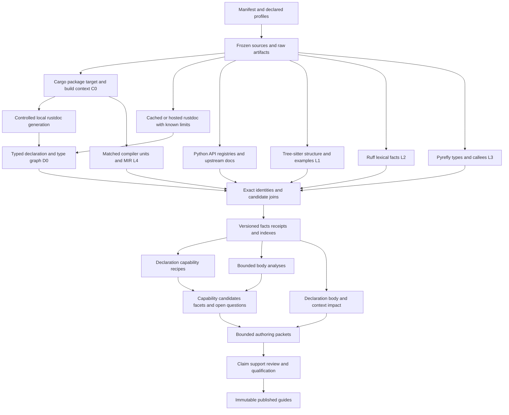

# Library guide source-semantic evidence lanes: implementation plan v2

**Date:** 2026-09-11

**Status:** Proposed integrated revision; this document does not implement or certify the tooling.

**Supersedes for implementation:** [the v1 plan](library_guide_source_semantic_evidence_lanes_implementation_plan_2026-09-11.md), preserved unchanged. This is a complete plan, including the retained Python, structural, MIR, review, maintenance, and pilot work. §3.1 explains the changes introduced by v2.

**Implementation boundary:** `tooling/library_guides/`, including its standalone native workers, package assets, tests, pilot, and documentation.

**Evaluation constraint:** No automated model runner or API key is required. Content quality is assessed through attributed qualitative reviews; extraction, provenance, invalidation, and execution checks remain automated.

## 1. Outcome and scope

Extend the library knowledge compiler so an agent can answer **what a library can do, how it does it, which alternative fits a task, and what could invalidate that choice** using inspectable source evidence. The deliverable is a working path from frozen upstream sources through extraction and analysis to reviewed capabilities and decisions. Large fact inventories alone do not meet this objective.

Build a **Cargo context tier (C0)** and a **typed Rust declaration tier (D0)** before depending on deep body analysis for Rust capability discovery. Use `cargo_metadata` for project/build observations and version-specific `rustdoc-types` adapters for rustdoc JSON. D0 must produce usable, reviewable type/trait/operation neighborhoods, not another name inventory. Retain the four source lanes in the [target design](library_guide_source_semantic_evidence_lanes_target_design_2026-09-11.md): Tree-sitter structure and embedded examples (L1), Ruff lexical semantics (L2), Pyrefly type information (L3), and Rust MIR mechanisms (L4). Preserve Griffe, native signature probes, runtime registries, upstream documentation, and bounded executable examples. Evaluate rust-analyzer only after the core tiers and lanes reveal a specific residual gap.

The change is one of ownership and delivery order: resolve package/build identity once, retain compiler-produced declaration structure once, derive useful capability candidates early, and acquire body evidence for the questions those declarations cannot answer. More fields alone do not establish functionality. Every new extraction family must feed a named capability question, an inspectable support chain, or a maintenance decision.

This plan follows the target design's explicit boundary: new extraction code is built directly on upstream libraries within `tooling/library_guides/`. It must not wrap, import, depend on, or copy the repository's other extractors or code-intelligence services. The existing library-guides acquisition, review, cache, and publication components are the substrate to extend. No change to SMARTREF's application runtime, root Cargo workspace, root toolchain, or root dependency set is needed.

The pilot covers the current scope of `.codex/skills/datafusion-pyarrow-rust-ref` and `.codex/skills/datafusion-pyarrow-ref`: the Rust DataFusion/Arrow crate families and DataFusion Python/PyArrow distributions already declared in the pilot. Pydantic and serde_json remain useful reuse controls. Broader acquisition and selective semantic qualification stay separate. Preserve the original reference skills and deep dives until particular replacement routes are qualified; source extraction does not itself justify retiring them.

### Completion conditions

1. Each enabled lane processes a declared immutable input universe and reports exact successes, unsupported surfaces, failures, and limits.
2. Every retained mechanism has a stable application-owned identity, exact evidence, applicable environment/build context, producer identity, and explicit uncertainty.
3. Agents can retrieve bounded mechanism neighborhoods, competing built-ins, examples, and gaps without loading an entire source or MIR corpus.
4. Source-supported claims undergo an explicit entailment review. Neither a compiler fact nor a nonempty citation list grants automatic approval.
5. A body, callee, configuration, candidate-universe, or analysis change invalidates the appropriate evidence and reviews. Byte integrity and semantic review reuse are independently checked.
6. At least one end-to-end capability/decision improvement is demonstrated for each main pilot library; all existing qualitative tasks are revisited, including the nine recorded gaps.
7. A second Python library and Rust crate can use the tooling through manifests and data-authored rules without new library-name branches in core code.
8. The supported rustdoc formats retain all declared semantic families or report exact unsupported/not-represented dispositions; package, target, public route, type expression and impl applicability remain distinguishable through retrieval.
9. At least one Rust capability improvement is delivered from typed declarations and reviewed upstream contract evidence before MIR is required. A declaration-only result must expose the behavioral questions it leaves unanswered.

## 2. Evidence reviewed and current implementation

The target design, v1 plan, three additional Rust references, and relevant sections of the original four lane references inform this integrated revision. The active collection, acquisition, adapter, authoring, cache, qualification, retrieval, publication, and qualitative-review code were reviewed for v1; v2 additionally inspected the current Rust helper, Rust normalization/linking/nominations, legacy Cargo readers, and the locally cached `rustdoc-types` 0.61.0 source. The newer **Pyrefly 1.2.0** document is the reference for this plan; the navigator also mentions an older 1.1.1 reference, which must not determine new API signatures.

Code-intelligence MCP tools were not exposed in this session. Findings below come from direct file reads and scoped text searches; they are not transitive-callgraph proofs. No application tests or native builds were run for this documentation-only review. Counts below were read from current authoring files, not inferred from old implementation reports.

### 2.1 Current baseline that the implementation must preserve

| Area | Verified current behavior | Consequence for this work |
|---|---|---|
| Public contracts | [`knowledge.py`](../../tooling/library_guides/library_guides/knowledge.py) defines strict `library-guides.knowledge.v2`: sources, selected evidence, bindings, relations, claims, capabilities, decisions, integrations, obligations, reviews, examples, profiles, and principles. | This is the active authority. Extend it through an explicit version migration. |
| Missing semantic contracts | V2 has no source snapshot, extraction-fact observation, semantic environment, lane receipt, facet seed, example discovery, or claim-to-fact support record. `Relation` has no ID, profile, certainty, candidate resolution, or typed payload. | The proposal's description of these as small additions to already existing V2 records is inaccurate. They require coordinated contract, reader, validator, and dependency changes. |
| Intake | [`intake.py`](../../tooling/library_guides/library_guides/intake.py) recognizes five adapter kinds and records aggregate per-input outcomes. A failed input preserves the prior collection. The pilot manifest contains 64 jobs: 47 rustdoc, 2 Python static, 12 Python native, and 3 registry jobs. | Preserve acquisition and failure behavior; add frozen-source acquisition and lane execution through a typed manifest. Do not treat aggregate intake success as body-analysis completeness. |
| Rust API normalization | [`adapters/rust/semantic.py`](../../tooling/library_guides/library_guides/adapters/rust/semantic.py) retains signatures, types, raw impl evidence, aliases, and item-level citations. `impl_relations()` emits `implements` without carrying `is_negative`, synthetic status, or applicability qualifiers. | Fix impl semantics before using these edges to recommend implementors or claim `Send`/`Sync`. Raw evidence can be reprojected. |
| Python API normalization | [`adapters/python/semantic.py`](../../tooling/library_guides/library_guides/adapters/python/semantic.py) is the active Griffe adapter. It explicitly resolves aliases with limits and keeps declared and documented types separate. | Extend this adapter, not just the older `griffe_api.py` named in the proposal. Add source/stub/defining/exported views without overwriting declared signatures with inferred types. |
| Evidence and reviews | [`collection.py`](../../tooling/library_guides/library_guides/collection.py) and [`evidence_graph.py`](../../tooling/library_guides/library_guides/evidence_graph.py) resolve exact JSON/byte selections and fingerprint semantic subjects. Relations are not first-class dependency nodes. Evidence fingerprints include selection metadata and source provenance. | Simply adding three fields to `Binding` will not provide precise body invalidation or whitespace-safe review reuse. Add typed support dependencies and separate digest purposes. |
| Qualification | [`qualification.py`](../../tooling/library_guides/library_guides/qualification.py) rejects API-existence evidence for behavioral claims and requires execution evidence for `behavior_tested`. It does not validate a source-fact support proof or absence certificate. | Preserve existing safeguards and add enforceable semantic-evidence policies. |
| Active authoring | [`authoring.py`](../../tooling/library_guides/library_guides/authoring.py) exports file-based V2 packets, imports drafts, and accepts fingerprint-bound reviews. It currently gathers adjacent relations and selected evidence in memory. | Implement mechanism packets here, with explicit closure and output budgets. Do not build a second authoring loop in older `packets.py`/`derivation.py`. |
| Active build | [`build_system.py`](../../tooling/library_guides/library_guides/build_system.py) invokes a doit build action over qualification, examples, rendering, index, and bundle creation. [`artifact_cache.py`](../../tooling/library_guides/library_guides/artifact_cache.py) uses verified cached products but fingerprints the entire Python package. | Add a real lane dependency graph to the active orchestration; a list of newly registered stages is insufficient. Use producer-specific cache keys. |
| Worker execution | [`processes.py`](../../tooling/library_guides/library_guides/processes.py) bounds time and captured output, kills the process group, then reads whole outputs. It does not provide streaming frame ingestion, memory/CPU enforcement, or a hermetic filesystem/network boundary. | Add a separate supervised streaming worker facility. Keep the current small-job interface for existing examples and probes. |
| Publication | [`generations.py`](../../tooling/library_guides/library_guides/generations.py) stages sources and example inputs, revalidates, builds immutable bundles, and publishes with an expected-predecessor check. | Extend its verified write set to include fact shards, receipts, source maps, and review-revalidation proofs. Preserve atomic publication. |
| Pilot | Current qualified authoring input contains 26 bindings/capabilities, 28 claims, 10 decisions, 1 integration, and 5 example jobs. [`qualitative.py`](../../tooling/library_guides/library_guides/qualitative.py) supports attributed task observations without a model runner. | These are baseline artifacts, not proof of source-lane coverage. Preserve and compare against them. |

The older `models/records.py` does define `Observation` and `ExtractionReceipt`, and `stages/registry.py` defines a compatibility stage graph. Those are not the contracts or authoring route used by the active CLI. Port useful invariants into the active model; do not revive the older knowledge system. Also keep the new extraction observation distinct from `qualitative.Observation`, which represents a review of a user task.

### 2.2 Reading anchors

| Reference | Sections used to shape the plan |
|---|---|
| [Ruff crates](ruff_python_crates_advanced_reference_2026-08-18.md) | §3–5 coordinates, recovery, typed AST and comparable AST; §8.3–8.4 construction versus traversal; §8.7–8.22 binding identity, lexical resolution, uncertainty and Pyrefly boundary; §19–21 validation, upgrades and resource limits. |
| [Pyrefly 1.2.0](pyrefly_rust_cpg_advanced_reference_1.2.0_2026-08-19.md) | §5 independent Ruff train; §6.1 `Require`; §9–13 bulk APIs, missing/multiple callees and subtype; §14 TSP negotiation, snapshots and type detail; §24 exact range/role joins; §25–29 provenance, stubs, dynamism and errors; §30, §32, §35 costs and upgrade gates. |
| [Tree-sitter](tree_sitter_rust_python.md) | §12–18 queries, cardinality, containment and cancellation; §19 included ranges; §20 recovered syntax; §22–23 grammar contracts; §35–36 memory/threading; §40 upgrade axes; §45 Python decorators, docstrings and grammar limitations. |
| [Rust MIR](rust_mir_cpg_continuous_reference_2026-08-18.md) | §3–7 actual MIR surface and Cargo units; §10–24 events, spans, dispatch and drops; §26–35 bounded dataflow and summaries; §37–39 identity, hashes and protocol; §48–53 external bodies, tests, toolchains and build execution; appendices J–L, O–Q. |
| [cargo_metadata 0.23.1](cargo_metadata_comprehensive_advanced_reference_2026-09-11.md) | §2–12 command configuration, metadata, package/target/dependency IDs, resolve graph and feature contexts; §13–17 build messages and lifecycle; §19–26 persistence, analyses, caching and upgrades. |
| [rustdoc JSON](rustdoc_json_comprehensive_advanced_reference_2026-09-11.md) | §1–5 generation, artifact granularity, root and IDs; §8–16 declarations, traits, visibility, links and context; §17–23 sysroot/hosted acquisition, formats, typed normalization, cost and diffs; §26–28 combined architecture/provenance/testing. |
| [rustdoc-types 0.61.0](rustdoc_types_comprehensive_advanced_reference_2026-09-11.md) | §2–18 root, items, IDs, types, generics, impls, exports and documentation; target metadata, raw/typed ingestion and compatibility sections; feature selection, performance, fixtures and upgrade discipline. |
| [Architecture](library_reference_architecture_and_agent_skill_flow_2026-09-11.md) and [build tooling](library_guide_build_and_update_tooling_2026-09-11.md) | Task/capability/decision ownership, six semantic dimensions, broad inventory with selective depth, independent coverage obligations, and evidence-first maintenance. |

These references supply API contracts and useful limits, not a promise that the proposed extraction behavior has already been demonstrated. Pinned upstream source, compile probes, and fixtures are required in the implementation.

### 2.3 Additional implementation findings behind v2

| Inspected surface | Finding | Planned change |
|---|---|---|
| [`rustdoc-helper/Cargo.toml`](../../tooling/library_guides/rustdoc-helper/Cargo.toml), [`src/main.rs`](../../tooling/library_guides/rustdoc-helper/src/main.rs) | The helper already deserializes formats 57/59/60/61 with matching `rustdoc-types` crates, discards the typed value, and emits a generic JSON value with supplemental `public-api` output. Python then parses it again. | Extend this existing helper into the typed declaration normalizer. Preserve original upstream bytes separately from helper-enriched artifacts. Retain `public-api` as an independent public-surface comparison. |
| [`adapters/rust/semantic.py`](../../tooling/library_guides/library_guides/adapters/rust/semantic.py), [`shapes.py`](../../tooling/library_guides/library_guides/adapters/rust/shapes.py) | The active adapter is richer than the early failed name inventory, but renders types/generics into strings and recursively finds referenced paths. Generic position, wrapper structure and impl qualifiers are not represented as full typed contracts. Root/path and export handling contains simplifying assumptions. | Normalize typed items/type expressions before rendering. Separate nested type references from direct inputs/outputs, local IDs from public paths, and declared impls from applicable methods. |
| [`adapters/rust/cargo_metadata.py`](../../tooling/library_guides/library_guides/adapters/rust/cargo_metadata.py) | This is a TOML manifest/lock reader, not an integration with the `cargo_metadata` Rust crate. Its name-keyed lock view keeps the first version. Scoped searches locate compatibility-stage/render callers; it is not evidence of an active V2 resolved-unit model. | Introduce C0 in the active pipeline. Keep these readers compatibility-only and migrate their callers explicitly; do not promote a name/version map into the new identity authority. |
| [`linking.py`](../../tooling/library_guides/library_guides/linking.py), [`nominations.py`](../../tooling/library_guides/library_guides/nominations.py) | Current symbol/profile lookup and text/signature nominations cannot express the proposed exact package/target/type/impl neighborhood queries. | Add exact and candidate joins, typed query indexes and deterministic capability recipes, with bounded evidence packets. |
| [`intake.py`](../../tooling/library_guides/library_guides/intake.py) | Acquisition/helper normalization currently materializes large JSON values across the process boundary. Existing acquired rustdoc contains structure that can be reprojected. | Re-normalize cached inputs first; stream compressed inputs to bounded files, normalize in one native process, and send owned fact shards rather than another entire raw object to Python. |

Source inspection confirms additional subtleties in 0.61.0: `TargetFeature.globally_enabled` distinguishes enabled features from features recognized by the target; `Attribute::Other` is explicitly not a stable syntax contract; `Function.has_body` records the existence of a definition, not its body; `Impl.provided_trait_methods` contains names that need trait-context joins. These become tested requirements below. This review did not compile `cargo_metadata` 0.23.1 or establish compatibility of a particular nightly; WP00 must do so.

## 3. Corrections to the target design

The following decisions resolve ambiguities before implementation. They preserve the proposed four-lane architecture while making its claims and activation checks achievable and defensible.

| Proposal detail | Implementation decision and reason |
|---|---|
| §6 treats `Observation`/`ExtractionReceipt` as active V2 records; §7–8 refer to older stages and packet modules. | Introduce an explicit V3 contract and wire the active `cli → intake/build_system → authoring/qualification/generations` path. Include migration and installed-package tests. |
| §8.3 automatically assigns `source_reviewed` when a mechanism has one resolved relation and a complete receipt. | Reject automatic promotion. Resolved identity and complete extraction do not establish that a sentence follows from its citations. Require a claim-specific support mapping, conditions, and a review of entailment. |
| §6.2 permits resolved Pyrefly calls/error variants while §10 caps heuristic resolution at candidate. | Separate **identity resolution**, **dispatch certainty**, **analysis certainty**, **body availability**, and **review disposition**. A precisely identified method can remain a heuristic call target; a precisely identified error variant can have uncertain reachability. |
| `static_sound` is attributed broadly to types and derived analyses. | Reserve it for a named conservative model whose transfer functions, unknown propagation, and applicable domain are documented. Pyrefly results are engine-relative, gradual-typing results; `Any`, solver acceptance, or a single target do not establish runtime soundness. Default derived recipes to heuristic. |
| A complete receipt plus call depth authorizes absence. | Receipt completeness establishes extraction coverage only. A semantic negative additionally needs an adequate analysis model and a closed relevant frontier. Truncated depth, dynamic calls, opaque dependencies, unmodeled effects, or unknown applicability block that negative. A bounded “no matching event found in these extracted owners” is a different, narrower statement. |
| Two Ruff trains “cannot coexist in one binary.” | Keep independent workers for isolation, upgrade ownership, and type boundaries. Do not justify this as a general Cargo limitation: Cargo supports multiple dependency versions. Their AST/range types must not cross the adapter boundary. [Cargo dependency overrides](https://doc.rust-lang.org/cargo/reference/overriding-dependencies.html#using-patch-with-multiple-versions) documents multiple versions. |
| L1 and L2 share “one parse” for Python. | They share source bytes and coordinates; Tree-sitter and Ruff each parse their own representation. Cache each result independently and reuse it across that engine's query passes. |
| Fence wrapping uses a constant offset because the code is contiguous. | Rust doc-comment prefixes, hidden lines and Python prompts create disjoint segments; decoded string escapes and wrappers create transformed bytes. Use included ranges when possible and explicit segment source maps otherwise. Constant-offset subtraction is valid only for a demonstrated contiguous, unchanged segment. |
| Resolving names in fences yields typed composition evidence. | Separate `located`, `parsed`, `names_resolved`, `type_checked`, and execution results. Name lookup alone does not type-check argument combinations, borrow behavior, imports, or the surrounding example. |
| Public MIR is described as `mir_built`. | Record the actual compiler API/body phase delivered by the selected nightly. The MIR reference §3 distinguishes public generic bodies from private pre/post-borrowck queries. If built MIR is essential, admit a narrow private adapter through its §4.2 checklist; never label another phase `mir_built`. |
| A copied lockfile plus patched crate family is assumed to reproduce the profile. | Resolve and compare a generated lock and compilation-unit manifest. Patching sources changes package source identity; building all family members together can change feature unification. Record both the intended and effective profile, and reject unexplained dependency/feature drift. |
| A per-file catch boundary plus timeout isolates Pyrefly failures. | A catch boundary does not stop hangs or reliably recover shared solver state after a panic. The supervisor owns a process deadline; failed workers are replaced and uncompleted batches replayed under bounded retry. |
| Raw pointers imply unsafe execution; `Never` implies an always-raising function; `is_final` implies ownership. | Preserve the actual fact. Raw-address formation alone does not establish an unsafe operation; `Never` can include divergence; `Final` is a typing constraint. Do not turn these into broader semantic guarantees. |
| Wrappers, UDF implementors and registry names should line up one to one. | Model many-to-many mappings, aliases, factories and runtime-generated wrappers. An impl inventory, installed registry, and active registration set have different denominators and sometimes different versions. Explain differences instead of forcing equality. |
| Worked examples mandate specific errors, drops, decorators, native resolution or wrapper callability. | Treat these as investigative questions. Require known-positive fixture activation and inspect the real library result. Absence of a proposed `Drop`, decorator, or exact native callee may be correct. Do not manufacture it to meet an exit gate. |
| Tool upgrades retain reviews whenever relation sets match. | Compare all support inputs, qualifiers, unknowns, receipts, environment and analysis policy. Reuse requires an explicit equivalence/revalidation record; identical selected edges alone are insufficient. |

Cargo confirms that the workspace wrapper intercepts workspace members and nests inside `RUSTC_WRAPPER` when both are present. Extraction therefore controls wrapper configuration and checks its own receipts rather than treating successful Cargo completion as proof that the extractor ran. [Cargo environment variables](https://doc.rust-lang.org/cargo/reference/environment-variables.html#environment-variables-cargo-reads)

### 3.1 V2 assessment and decisions

**Adopt all three references, with different roles.** `cargo_metadata` supplies contextual facts; rustdoc JSON supplies compiler-produced declaration evidence; `rustdoc-types` provides the typed decoder used to normalize that evidence. The supplied rustdoc JSON document describes a format and generation workflow. It is not a review of the separate `rustdoc-json` builder crate, so adding that crate is not assumed or necessary.

| V1 emphasis or remaining gap | V2 decision | Benefit and limit |
|---|---|---|
| API corrections are one small work package; most new functionality waits for source lanes. | Expand WP04 into Cargo context, acquisition, typed declarations, and joins. Deliver declaration-based capability neighborhoods in M1. | Earlier useful answers about constructors, transformations, extension requirements and alternatives; still no inferred behavior from names. |
| Rust helper checks schemas while Python interprets generic JSON. | Make per-format Rust adapters own full declaration normalization into application-owned DTOs. | Exhaustive variant handling and one semantic implementation; historical formats remain supported. |
| Cargo profile construction appears mainly inside MIR work. | Make C0 shared by local docs, checks, examples, MIR and invalidation. | One package/target/dependency authority; metadata remains distinct from actual compilation-unit observations. |
| Type relations flatten nested references. | Retain recursive type expressions, argument positions, qualifiers, generic substitutions and constraints. | Distinguish `Schema`, `&Schema`, `Result<Schema, E>` and a callback accepting `Schema`; none establishes schema merge semantics alone. |
| Trait facts focus on membership. | Retain positive/negative/synthetic/blanket impls, associated contracts, required/default methods and dyn compatibility. | Useful extension checklists and method candidates without pretending to implement Rust method lookup or trait solving. |
| Private identity and impl discovery are assigned heavily to L1/MIR. | Use local private/hidden rustdoc for declaration identity; L1 owns source syntax/ranges/examples; MIR owns lowered bodies and dispatch. | Reduces duplicate declaration logic, while macro/generated/spanless cases remain explicit. |
| “Same-context rustdoc” could imply ordinary-build availability. | Record generation purpose and effective cfg separately; attach a compiled availability witness where a claim requires one. | Documentation-only items do not become unconditional consumer APIs. |
| Cross-crate IDs and exported paths could be treated as canonical. | Scope IDs to artifacts and resolve routes against exact Cargo dependency candidates. Preserve multiple export routes. | Handles renamed dependencies, duplicate versions, facade crates and private-module exports without leaf-name joins. |
| Broad fact totals risk becoming the success metric. | Measure declaration-family retention, exact/candidate joins, capability task usefulness and review impact separately. | Completeness and utility are independently visible; qualitative review remains the content-quality gate. |

Rustdoc enables `cfg(doc)` and can document configurations that are not present in a normal build; successful documentation generation also does not run every compiler check. Record this purpose difference explicitly rather than treating rustdoc generation as an availability/typecheck witness. Doctest compilation has its own context. [Rustdoc advanced features](https://doc.rust-lang.org/rustdoc/advanced-features.html)

Cargo resolver v2 separates feature unification for build dependencies/proc macros from normal dependencies, and treats inactive target and dev dependencies differently. A metadata node's feature set is useful resolution evidence but cannot replace per-unit invocation evidence. [Cargo feature resolver v2](https://doc.rust-lang.org/cargo/reference/features.html#feature-resolver-version-2)

**Retained without reduction:** the L2/L3 Python work, L1 example/source-map work, L4 body analysis, exact citations, bounded negatives, claim-specific review, immutable publication, no-runner qualitative evaluation, full pilot accounting and unrelated-library reuse tests. Full MIR rollout still depends on feasibility and profile reconciliation. Its implementation no longer needs to reconstruct a parallel public declaration graph.

## 4. Target architecture and ownership



Extend the existing **`library-guides-rustdoc`** helper for C0/D0 normalization. Keep its own workspace and existing decoder compatibility. There are also three independently built source worker products: `library-guides-source-facts` for L1/L2, `library-guides-pyrefly-facts` for L3, and `library-guides-mir-facts` for L4. TSP is an optional, pinned child of the Pyrefly worker for targeted detail. Workers emit facts and receipts only. Python owns manifests, process supervision, immutable artifacts, cross-lane joins, bounded derivation, review, retrieval, and publication. The helper owns typed Cargo/rustdoc decoding and declaration normalization. All Cargo invocations use the same supervised execution path; do not introduce competing Python and Rust orchestration loops. A typed command description may be constructed with `MetadataCommand`/`cargo_command()` and handed to that supervisor, or a captured invocation can be parsed with the crate's parse API. Preserve exact raw output either way.

Keep raw compiler/parser facts distinct from derived facts and reviewed claims. Store bulk facts in immutable per-file/per-owner shards with a small manifest; use SQLite as a disposable query index. Do not insert millions of MIR nodes into `knowledge.yaml`, repeat complete source streams in packets, or introduce a second persistent graph service. The new `facts/` model is an evidence layer referenced by the one knowledge authority.

### 4.1 Proposed layout

```text
tooling/library_guides/
  native/protocol/                 portable serde wire DTOs; no engine dependency
  rustdoc-helper/                  extend existing standalone workspace and lock
    src/cargo_{model,messages}.rs
    src/decoder/{v57,v59,v60,v61}.rs
    src/normalize/{items,types,impls,exports,docs}.rs
    src/{commands,protocol}.rs
  source-facts/                    own Cargo workspace and lock
    src/{structural,python_semantic,fences,normalize,...}.rs
  pyrefly-facts/                   own workspace, lock, upstream provenance
    vendor/pyrefly/                verified upstream source plus explicit patch ledger
    src/{query,tsp,environment,normalize,...}.rs
  mir-facts/                      own workspace, lock, dated rust-toolchain.toml
    src/{driver,owners,cfg,access,calls,types,spans,normalize,...}.rs
  library_guides/
    facts/{contracts,manifest,store,protocol,policy,identity,source_maps}.py
    source_snapshots.py
    source_profiles.py
    source_pipeline.py
    worker_runtime.py
    cargo_context.py
    rustdoc_acquisition.py
    rust_workspace.py             shared context/workspace construction
    mir_workspace.py              thin MIR-specific setup over shared contexts
    adapters/rust/declarations.py
    facts/{rust_declarations,cargo_contexts}.py
    adapters/source/{structural,python_semantic,python_types,rust_mir}.py
    analyses/{engine,flow,summaries,errors,configuration,candidates,facets,questions}.py
    migrations/knowledge_v2_to_v3.py
    assets/queries/{rust,python,markdown}/
    assets/analyses/               versioned recipe/configuration data
    assets/schemas/               V3 knowledge, source manifest, wire and fact schemas
  tests/{source_snapshots,source_protocol,source_joins,source_analyses,...}/
  pilot/source_semantics/
    manifests/ fixtures/ reviews/ reports/
```

These are proposed paths; the exact module split can follow implementation size. Put distributable queries and rule data under the existing **`library_guides/assets/`** package-data root, not the target design's unshipped top-level `assets/`. The shared native protocol crate has no Ruff, Pyrefly, rustc, or SMARTREF types and is usable from each isolated workspace. Each worker's lockfile records its entire resolved dependency graph.

### 4.2 Initial pin and distribution decisions

| Product | Candidate dependency baseline | Qualification and delivery |
|---|---|---|
| Structural worker | Tree-sitter `=0.26.12`, Rust grammar `=0.24.2`, Python grammar `=0.25.0`, Markdown grammar `=0.5.3`. | Check actual grammar ABI and node/query compatibility, then lock. Build on a compatible stable toolchain selected by WP00. |
| Ruff capability | Coherent component train `=0.0.7` corresponding to Ruff 0.16.1: parser, AST, semantic, trivia, index, source-file and text-size components. | Add only needed components. The optional traversal facade must use the same train. Keep formatter/codegen outside the analysis dependency path unless a demonstrated requirement emerges. |
| Pyrefly worker | Upstream 1.2.0 at a verified revision with its upstream lock; its Ruff train is 0.0.6. | Record the upstream and resulting worker locks and patch ledger. Ship matching TSP executable/capabilities; do not invoke whichever `pyrefly` happens to be on PATH. |
| MIR worker | A dated nightly with matching `rustc-dev`, `rust-src` and `llvm-tools`; evaluate the reference anchor `nightly-2026-08-18` against actual pilot compatibility. | WP00 selects and records the working date/commit and actual body surface. Neither a moving `nightly` alias nor a presumed crates.io `rustc_public` dependency is acceptable. |
| Cargo/declaration helper | Add `cargo_metadata =0.23.1` (documented MSRV 1.86); retain `rustdoc-types` `=0.57.4`, `=0.59.0`, `=0.60.0`, `=0.61.0` and `public-api =0.52.1`. | Preserve format coverage while replacing discarded typed parses with owned normalization. Confirm the combined stable toolchain/dependency requirements in WP00. `rustdoc-types` 0.61.0 documents Rust 2024/MSRV 1.85. |
| Rustdoc producer | Pin the actual nightly compiler/rustdoc commit, sysroot and JSON format independently of helper version. Private/hidden/public policies are separate profiles. | First use cached supported formats. Select a local producer compatible with the pilot; share the MIR nightly only when tested and appropriate. A new format needs an explicit decoder and fixtures, never an untested fallback. |

Provide tooling-local build/bootstrap commands with plan/apply behavior, explicit source acquisition, exact output paths, binary digests and protocol checks. Publish or cache helpers separately from the Python wheel. The wheel carries portable contracts/queries/rules and a worker locator/configuration interface; installing it must not trigger an application-native rebuild or silently download a compiler. Add source/vendor provenance, licenses, platform support, and upgrade instructions to the tooling README and worker READMEs.

## 5. Contracts, identity, and schema migration

### 5.1 V3 knowledge and evidence contracts

Use strict attrs/cattrs boundary models with generated JSON Schema as today. Add `library-guides.knowledge.v3` and separately version the worker protocol, fact schema, source-manifest schema, normalizers, analyses, and review policy. Unknown kinds or required fields in **our normalized contracts** must fail validation, not be silently discarded. Upstream ingestion has a different compatibility policy: retain raw additive fields and unknown Cargo messages with explicit interpretation status. Reject an unsupported rustdoc format before semantic normalization. Never turn an unknown upstream enum into a supported fact merely to satisfy the owned schema.

| Contract/change | Required contents and invariants |
|---|---|
| `SourceSnapshot` | Package/distribution identity, exact version/source revision, archive or installation provenance, ordered file manifest, relative file keys, raw digests, file kinds, license/attribution, and declared analysis scope. Include files needed for builds, not just `.rs`/`.py`. |
| `CargoProjectSnapshot` | Raw metadata and invocation digests, Cargo identity/configuration, packages indexed by opaque IDs, source identities, workspace/default members, targets, dependency declarations and resolved graph with availability status. Canonical project keys are distinct from snapshot-local Cargo IDs. |
| `CargoDependencyEdge` | Declaring/resolved package references, local dependency name, original package name, version/source requirements, dependency kinds/platform predicates and requested features. Retain every `Node.deps` edge/kind; no name-to-one-version map. |
| `BuildObservation` / `CompilationUnit` | Invocation purpose, observed package/target/profile/features, host/target role, compiler arguments/cfg where captured, artifacts/build-script outputs, exit/stream status and receipt links. Unknown unit settings stay unknown; a Cargo artifact is not an extraction receipt. |
| `RustdocArtifactContext` | Raw JSON digest, format, producer/toolchain, root ID, Cargo package/target mapping or candidates, target description, documentation policy, purpose/effective cfg, known/unknown feature context, generation receipt and external-crate map. |
| `RustDeclaration` / `TypeExpression` | Artifact-local item identity, application entity reference, variant-specific declaration, full recursive types/generics/constraints and item metadata, exact field selections and normalization status. Display signatures are derived views. |
| `ImplContract` / `PublicRoute` | Type/trait arguments and bounds, polarity/synthetic/blanket status, method/default/associated-item origins; separately, every proven reachable public route and its re-export chain. Preserve candidate applicability and unresolved exports. |
| `NormalizationCoverage` | Exact item and family denominator per format/context; extracted, unsupported, not represented in that format, stripped, externally summarized and not requested are distinct. Retain loss/diagnostic reasons. |
| `SemanticProfile` attached to `Profile` | Typed Rust build or Python environment definition. A descriptive profile name or composition list is not an effective feature/environment fingerprint. Keep existing profile IDs as labels, with evidence-backed context records. |
| `FactArtifact` | Producer, snapshot, effective profile, normalized shard references, raw output references, terminal receipt, schema/normalizer versions, and semantic/provenance digests. Preserve `Source.origin`; add `artifact_kind` to distinguish source text, emitted facts, derived facts, and receipts. |
| `Evidence` | Add explicit source-code, fact, and receipt selections. Facts cite their exact record and source-support chain; source code is not mislabeled as a documentation statement or API-existence record. Selectors remain exact and independently resolvable. |
| `SourceAnchor` | File key, raw digest, byte interval or segment list, role, expansion/source-map provenance, and coordinate encoding. Zero-width diagnostics are locations, not fabricated nonempty excerpts. |
| `FactObservation` | Stable ID, owner/site, predicate, typed payload, evidence links, producing artifact, applicability, certainty and limitations. It is not `qualitative.Observation` and is not a claim. |
| `Relation` | Stable ID, profile, source/target entity references, site identity, multiple support links, resolution, certainty, dispatch details where applicable, and body availability. Constrain valid producer/kind/payload combinations. |
| `FactDerivation` | Rule/algorithm version, ordered input references, model assumptions, budgets, frontier/unknowns, output facts, and support digest. Primitive fact producers cannot claim derived analysis authority. |
| `ExtractionReceipt` | Request/scope identity, enumerated and processed sets, per-file/owner outcomes, per-family support, chunk counts/digests, terminal status, effective configuration and tool identities. Enumerated counts derive from retained manifests, not worker-supplied totals alone. |
| `FacetSeed` | Capability/family target, dimension, structured proposed value or explicit unknown, supporting facts, missing evidence, derivation version, and needs-review state. It never writes an accepted facet. |
| `ClaimSupport` | Claim assertion or sub-assertion, support role, exact facts/statements/witnesses, assumptions, exceptions, dependency mode, and entailment-review rationale. A composite sentence must support each material assertion. |
| `AnalysisScope` / absence certificate | Predicate queried, owner universe, effective profile, modeled fact families, mode/depth, complete receipts, closed frontier or explicit unknown frontier, and analysis version. Required for any machine-checked bounded negative. |
| `ExampleDiscovery` | Source anchor/map, language, fence/directive attributes, located/parsed/name-resolution/typecheck outcomes, bindings mentioned, and environment needs. Separate from existing executable `Example` jobs. |
| `BindingRevision` | Source/declaration/body fingerprints plus documented-constraint and semantic-context fingerprints; applicable owner/profile and representation versions. Keep large body records outside `Binding`. |
| `ReviewRevalidation` | Prior review ID/digest, old/new support artifacts, exact equivalence checks, policy version and outcome. Keep the original review; never rewrite its digest to manufacture acceptance. |

Do not use `tuple[tuple[str, str], ...]` as the only contract for dispatch, impl polarity, candidate sets, type precision, or provenance. Use tagged typed payloads with required qualifiers. A namespaced extension map may carry noncritical producer metadata; qualification must not depend on unchecked strings inside it.

### 5.2 Identity joins

Retain public rustdoc and Griffe identities and exact aliases. Add private/helper/anonymous entities through the **same central identity service**, with visibility and origin, rather than inventing lane-specific public binding tables. An internal helper need not become a capability or a required public-surface obligation.

Rust artifact references use `(raw rustdoc digest, item ID)`; IDs, including the root and local crate ID, are discovered from the root record and never assumed to be `0`. They have no cross-file meaning. Application identity includes package source identity, version, actual crate/target, defining identity and kind, with every public path retained as a separate route. A chosen display path is not the entity's only identity and need not stay stable when aliases change. Where path/span/owner evidence cannot establish cross-run identity uniquely, create explicit candidates rather than forcing stability. Impl identity also includes implemented type, trait, generic applicability and polarity. Anonymous owner identity is scoped to its named parent and structural role. Compiler session IDs may be retained only as artifact-local diagnostic references; they are never persistent cross-run identities. Closure/coroutine attachment must preserve the distinct body and activation phase rather than collapsing every event into the parent function's immediate effects.

Python separates definition identity, exported alias, runtime binding event, occurrence, and stub declaration. A reassignment, overload declaration or decorator result is not a duplicate spelling to discard. Source/stub/native aliases can refer to one API identity while retaining different evidence and environments.

Join order is exact package/profile identity, canonical path/alias, and verified source-role span. Owner, call-expression, callee-expression and name spans are different roles; use an explicit role conversion, not arbitrary containment. For same-snapshot syntax nodes, containment may help locate an owner but still needs kind/path checks. Report ambiguity and mismatch; never join by a leaf name alone or by fuzzy coordinates from different bytes.

Docs.rs artifacts are an API/documentation profile, not automatically the profile of a new local MIR build. Unknown hosted features/cfg are retained as unknown. Generate local rustdoc against the same **base context** when needed, while preserving its documentation-purpose cfg and private/hidden policy as differences. Join declaration identity separately from transferring applicability. A claim requiring ordinary-build availability needs adequate compiled evidence for that context, not merely a local doc item. DataFusion Python 54.0 and Rust 54.1 must not be fused merely because method names resemble each other.

### 5.3 Migration policy

Provide an explicit `migrate` plan and apply operation that writes a **new collection directory**, preserving V2 sources, reviews, policy, and published generations. Keep V2 reading/rendering available during migration; all source-lane authoring uses V3. Generate a deterministic migration report for every record and unsupported field.

Do not mark old API edges as compiler-proven behavioral facts. Reconstruct impl polarity/applicability from retained rustdoc evidence before allowing those edges into candidate sets. Preserve legacy external status until an exact join establishes the new identity/body-availability fields.

Archive V2 reviews with their original fingerprints. Carry approval into V3 only through a validated migration-equivalence record for unchanged support and policy; otherwise create `needs_review`. No legacy claim gains `source_reviewed` or additional scope through migration. Update packet/proposal protocols together with the schema, rejecting mixed versions.

Re-normalize retained formats 57/59/60/61 into V3 before requiring reacquisition. Preserve old enriched rustdoc artifacts under their actual provenance; they are not byte-identical upstream JSON. Newly acquired inputs store the upstream bytes and derived helper outputs separately. Produce an old-binding → new-entity/routes reconciliation ledger, including collisions, retired projections, changed qualifiers and every unmatched item. Keep a V2 projection during transition, but only D0 owns new Rust semantic normalization; remove the duplicate generic-JSON interpretation from the V3 route after parity/negative fixtures pass. Existing `public-api` comparison output remains secondary evidence. Compatibility callers of the old TOML readers migrate explicitly, without silently changing V2 rendering.

## 6. Frozen sources and reproducible contexts

### 6.1 Acquisition

Extend current manifest intake with typed source descriptors: Cargo registry archive, exact Git revision, Python installed distribution, wheel/sdist, and explicit local snapshot. Source acquisition is independent from lane activation. A library can acquire a complete file manifest while a particular lane has only partial language support.

For Rust, verify archive identity and checksum, retain archive and normalized Cargo manifests, and snapshot build scripts, included files, metadata and licenses. Prefer normalized published manifests when workspace-inherited fields in `Cargo.toml.orig` cannot be resolved. Git-only examples/tests require a separately pinned revision and provenance; do not assume an arbitrary tag exactly matches published tarball bytes. Record the mapping and differences.

For Python, enumerate distribution files without importing the package; preserve metadata, `py.typed`, `.py`, `.pyi`, vendored/namespace packages and entry-point declarations. Keep Cython, shared libraries and unavailable generated sources in the inventory with their boundary classification. A copied source environment records ordered import roots, stub precedence and dependency contents, not merely installed version strings. A native probe remains a separate execution lane.

Archive extraction rejects path traversal, escaping links and incompatible duplicate entries and enforces byte/file limits. Source snapshots are immutable. Mutable cache checkouts and installed files are copied and hashed with a consistency check before analysis. For non-UTF-8 Python sources, retain raw bytes and a verified decoding/source map or report unsupported encoding; do not reinterpret offsets from transcoded text as raw-byte offsets.

### 6.2 Profiles and manifests

| Rust context | Python context |
|---|---|
| Intended package IDs and exact source digests; generated lock and resolved dependency graph; target kind and crate type; resolver/edition; feature/default-feature selection **per package and unit**; target and host triples; cfg and rustflags; optimization, overflow, debug assertions and panic semantics; build-script inputs/outputs and proc-macro binaries; compiler/sysroot and wrapper identities. | Interpreter implementation/version and verified identity; target Python version/platform; ordered search roots and package-to-module mapping; source and stub digests; installed distribution and bundled-typeshed identities; Pyrefly/Ruff configuration; engine/protocol versions; `Require` levels; enabled fact families; TSP position encoding and snapshot. |

Separate intended configuration, observed effective configuration, and operational execution metadata. The first two affect semantics; timestamps, host labels and elapsed time do not.

Replace free-form options with a strict source-manifest contract containing `source_lanes`, scope/include policy, Cargo project/target selection, rustdoc acquisition/purpose policies, exact tool profiles, finite availability profiles, budgets, configuration types, registration surfaces, effect-target classifications, Protocol pairs, extension-trait families, and optional source mappings. Library-specific values are data. Recipes use a closed set of typed operations and finite joins; no `eval`, embedded Python, or arbitrary shell expressions.

### 6.3 C0: Cargo project and build facts

Implement a typed adapter using `cargo_metadata` in the existing Rust helper. Normalize raw Cargo output into owned DTOs and retain raw JSON/log bytes. Use the same adapter for published-crate extraction workspaces, original upstream workspaces, examples and MIR. The Python supervisor owns process lifetime, environment, paths, budgets and final artifact commit.

**Project discovery and resolution:**

- Configure the exact Cargo executable, manifest path, working directory, feature/default-feature mode, target filter, lock/network policy and approved environment explicitly. Metadata can resolve/fetch dependencies; run network-enabled acquisition as a separate declared step, then use the frozen context. Deduplicate mutually exclusive/all-features options before constructing `MetadataCommand`.
- Retain `packages`, `workspace_members`, `workspace_default_members`, optional root and `resolve`, target/build directories, package metadata and targets. A virtual workspace need not have a root package. `resolve=None` means the dependency graph was not acquired; it is not an empty graph.
- Select targets from `Target.kind`, `crate_types`, `name`, `src_path`, `required_features`, edition and doc/test flags. A package can have multiple targets, and a library crate name may differ from its package name. Do not synthesize `src/lib.rs`, select the first target, or normalize every crate identity with hyphen replacement.
- Preserve package source and version, dependency renames, declared requirements, normal/dev/build dependency kinds and platform predicates. Use `Node.deps`, including its multiple dependency-kind entries, for resolved edges. `Package.dependencies` records declarations; `Package.features` records definitions; invocation options record requests; `Node.features` records resolved features for that invocation. These are separate fact families.
- Store opaque `PackageId` and source representations without parsing their string layouts. Add application keys using separately captured package/source/snapshot data. Duplicate names and versions from different sources remain distinct. `--filter-platform` constrains the graph, not necessarily every entry in `packages`; record selection explicitly.
- Upstream workspace/package metadata may nominate examples, docs settings or features. It is untrusted configuration input, not authority to override budgets, execute arbitrary commands, alter obligations or grant review. Preserve provenance and validate only supported namespaced fields.

**Build/check observations:**

Consume `Message::parse_stream` for configured Cargo JSON message modes. Retain compiler artifacts, structured diagnostics, build-script outputs, build-finished events, unknown events and text lines separately. Inspect raw lines alongside parser outcomes so malformed or future JSON cannot silently disappear as harmless text. Legitimate text is not itself a failed build; missing evidence required for a unit is an incomplete observation. Unknown additive fields stay in the raw artifact even when typed reserialization cannot retain them. These are ingestion rules; normalized worker frames still follow the strict protocol in §7.

Use artifact package/target/profile/features and actual filenames/executable fields to identify compiler outputs. Store `fresh` as a Cargo cache observation, then independently verify library-guides extraction receipts. Record build-script cfg/env/link libraries/link paths/OUT_DIR and snapshot relevant generated files. These outputs are not the complete build-script input dependency set. Capture structured diagnostic spans, codes, children and suggestions for explanation; automatic source repair is outside scope.

Commit a complete build observation only when expected streams/units reconcile with the real process exit and required terminal outcomes. A `BuildFinished.success` event does not override a failed process, truncation, an output limit or a missing extractor receipt. Conversely, a diagnostic-bearing successful build is not a semantic extraction failure solely because it emitted warnings.

**Project, target and unit remain distinct.** A metadata graph is not an exact compilation-unit graph. Compiler artifacts add observations but do not describe every compiler argument, wrapper, host/target purpose or rustdoc setting. The supervised rustc/rustdoc invocation receipts provide missing effective settings. Join these sources explicitly, preserving unknown settings rather than manufacturing a complete profile. Cache/review reuse is conditional on the context actually verified.

Build reverse indexes by exact package ID, local dependency alias/kind/target predicate, target and profile to support cross-crate joins and impact analysis. Do not enumerate all feature combinations. The manifest declares a finite profile catalog; report uncovered combinations and required-feature targets that were not selected.

### 6.4 Rustdoc acquisition and generation profiles

Use three acquisition modes under the same D0 artifact contract:

| Mode | Implementation | Appropriate use and limits |
|---|---|---|
| Retained/hosted rustdoc | Re-normalize the current cache first. Acquire exact crate/version/target/format URLs where the provider supports them, retaining compression, response provenance and raw digest. Negotiate supported formats only through a tested service contract. | Broad inexpensive declaration inventory. Missing generation features, `cfg(docsrs)` or toolchain data stays unknown. A matching crate version alone does not authorize a join to an exact local build context. |
| Controlled local rustdoc | Discover package/target through C0; run selected `cargo rustdoc` with the pinned nightly and explicit JSON/private/hidden options inside the shared supervised workspace. Retain effective rustdoc arguments, output directory, source remaps, doc policy, process/diagnostic results and artifact digest. | Precise declared context, private helper identities, source joins and profile comparisons. Rustdoc still has documentation-purpose semantics and does not expose function bodies. |
| Pinned sysroot rustdoc | Optionally acquire `rust-docs-json` for the exact toolchain and selected `core`/`alloc`/`std` artifacts when supported. Record target/sysroot provenance independently. | Closes useful external declaration references and trait/type contracts. Does not close external MIR/effect frontiers or promise every toolchain/target has this component. |

The file named `rustdoc_json_...md` does not establish the API or compatibility of a separate JSON-builder crate. Start with supervised Cargo/rustdoc commands already within the tooling's execution model. Admit another generation library only if a measured requirement remains, with its own pinned compatibility probe.

Use separate `public_docs`, `private_docs` and, where useful, `private_hidden_docs` policies; private and hidden are distinct settings. Record `includes_private`, root/format/target metadata, stripped flags and actual generation flags. Track `cfg(doc)`, optional `cfg(docsrs)`, feature cfg, target cfg and custom rustdoc/rustc flags. A doc item is `documented_present` in that context. Map it to `compiled_present` only with suitable check/MIR/example evidence. Preserve `not_observed` and `unknown` instead of deriving universal absence. `Target.target_features` can list recognized features; only the field-specific enabled state establishes global enablement in that artifact.

**Output discovery is a tested acquisition step.** Do not assume Cargo `CompilerArtifact.filenames` always reports the rustdoc JSON file. Isolate each package/version/target/purpose job's output directory; record the rustdoc launch's crate name and output arguments through a transparent launcher receipt when needed. Resolve the candidate file from that receipt and verify its root, crate metadata, format, target, producing job and digest. A before/after file listing or familiar filename alone cannot admit stale JSON. Test renamed library targets, virtual workspaces, duplicate versions, explicit target triples and custom target/build directories. Preserve response-file semantics and diagnostics through the launcher.

Generate one selected target/context at a time initially; use shared dependency caches only with independent receipts. Do not invoke a broad all-features workspace doc build to stand in for several intended consumer profiles. Reuse the workspace planner in §11; C0 and local docs own the shared portion, MIR adds its wrapper and body policy. Published normalized manifests, generated extraction manifests, lock/source substitutions and ordinary upstream project manifests remain separate, inspectable artifacts.

Local rustdoc failure leaves retained hosted/previous artifacts available under their original context, with the new local job failed or partial. It must not silently relabel hosted docs as a successful exact local build. Missing sysroot docs similarly leave explicit external declaration candidates rather than blocking unrelated local positives.

## 7. Worker protocol, fact storage, and orchestration

### 7.1 Supervised protocol

Define a versioned, length-prefixed UTF-8 JSON protocol with a handshake, request identity, artifact/scope header, ordered fact chunks, diagnostics, and exactly one terminal receipt. Use a bounded binary length prefix and reject oversized frames before allocating their body. Declare frame, per-owner, total-output, input, wall-time, CPU, memory, and query limits in each request. Stderr is separately capped diagnostic text.

Chunks carry sequence numbers, owner/file identity and digests. The terminal receipt commits their ordered digest list, counts and coverage outcomes. Reject missing/duplicate/out-of-order chunks, duplicate terminals, data after terminal, wrong snapshots, unsupported schema, output with no declared inputs, and a successful process exit without a valid terminal receipt. An empty fact set is valid only when the retained input/owner/family manifest explains why it is empty and controls demonstrate that the extractor is active.

Ingest incrementally into private staging; do not buffer the complete stream in Python. For D0, stream decompression to a bounded immutable file, discover the format without assuming `format_version` appears near the start, then dispatch to a matching typed adapter. A bounded full JSON scan or streaming header visitor is acceptable. Drop the header scan state before the typed parse; avoid simultaneously holding original text, `serde_json::Value`, a full typed crate and another Python copy. Typed deserialization still owns a whole `Crate`/index in memory; describe this honestly and enforce per-artifact memory limits. Streaming emitted facts does not make upstream deserialization constant-memory. Validate records before committing shards. Fact citations resolve to canonical normalized shard records; raw transport frames remain an audit artifact. A frame byte offset must not be mistaken for a source-code byte span.

For MIR, rustc/Cargo retain their stdout protocol. Write separate per-compilation-unit framed files and combine them only after unit-level and job-level reconciliation. Compiler failures and extraction failures are distinct terminal outcomes. A cached Cargo artifact without a matching extraction receipt requires extraction work, not an empty successful lane.

### 7.2 Scope and completeness

Track acquisition, Cargo graph/context reconciliation, declaration normalization, public-route reachability, syntax, identity-join, type, body, and derived-analysis coverage separately. Declaration receipts enumerate root/index items, external summaries, stripped members, supported `ItemEnum`/`Type` families and semantic fields. “No fields because the format does not represent them” is different from “parsed and empty.” Root/index/path counts and every filtered item reconcile to the retained artifact. A Cython file may be successfully acquired and intentionally unsupported by Ruff. That does not make the whole acquisition incomplete, and it does not establish complete PyArrow body coverage.

Receipts distinguish `complete`, `partial`, `failed`, `unsupported`, and `not_requested` at the appropriate scope. Keep exact reasons: syntax recovery, unsupported Python syntax, unresolved import, missing stub, dynamic call, external body, compiled-out item, extraction-budget exhaustion, unavailable MIR phase, worker failure, and source-map mismatch.

Retain valid current facts from successfully processed owners while exposing the partial result. They may support local positive statements when their particular support closure is complete. They may not silently replace a prior complete published claim with mixed old/new evidence. The current publication pointer advances only after ordinary qualification of a coherent candidate.

### 7.3 Execution and caching

Extend `build_system.py` through `source_pipeline.py`: one actual dependency graph shared by `plan`, extraction, and build. Stage plans report cache hits, required work, blockers, expected scope and requested budgets. Cache lookup must verify both artifacts and terminal receipts. Failed/partial results are retained as diagnostics but never reused as complete success.

Use per-producer implementation identities: a render template change should not rebuild Pyrefly or re-extract MIR. L1/L2 can cache per file plus module/configuration inputs. Pyrefly and MIR require semantic dependency context; unchanged source bytes alone do not authorize reuse when imports, stubs, features or dependency summaries changed. Initially invalidate a whole semantic environment/crate context where dependency precision is unavailable; improve granularity only after mutation tests establish it.

The default plan is nonmutating; explicit apply performs acquisition/build work. The worker supervisor enforces the configured limits and process-tree cleanup. For compile/interpreter lanes, provide a tested isolation backend with declared readable sources/toolchains, writable staging/output, and network disabled after acquisition. A temporary directory or `cargo --offline` alone is not that isolation boundary. Missing enforcement is an explicit profile capability failure, never a silently weakened receipt.

New workers are opt-in tooling products with exact binary digests and protocol capability discovery. Reading published guides must not require any native worker or nightly compiler.

## 8. Rust declarations, structural extraction, and examples

### 8.1 D0: typed decoding and normalized declaration ownership

Move Rust semantic interpretation into format-specific modules in `rustdoc-helper`, using the already pinned 57/59/60/61 decoder crates. Each converts its concrete `Crate` into the same owned fact schema. Keep a capability matrix for each format; fields introduced later are `not_represented`, not false/empty in earlier inputs. Preserve raw records and exact selections for audit/reprojection. Unknown formats fail with an actionable supported-format report; they never fall through to string-based parsing.

Match every supported `ItemEnum`, `Type`, generic-argument and bound variant explicitly. Use exhaustiveness as a compile-time change signal where upstream enums allow it, plus fixtures for semantic field retention. Optional names, external summaries without local bodies, legal primitive re-exports without item IDs, missing spans and stripped tuple-field slots are valid data states. Classify malformed references separately. `paths` is a summary/identity aid; `index` supplies full item data. Do not rebuild functionality solely from `paths`.

Normalize the following families into validated tagged records. Tables describe **declarations**, not body behavior:

| Family | Required retained structure | Capability use / prohibited inference |
|---|---|---|
| Callable contracts | Ordered inputs and names, output, receiver form, async/const/unsafe qualifiers, ABI, variadic state, generic parameters/defaults, where predicates and definition/default status. | Find entry points, compare invocation requirements and nominate example compositions. Async/const/unsafe flags do not establish scheduling, purity, effects or safe use. |
| Recursive type expressions | Resolved paths and contextual IDs, generic arguments with type/lifetime/const positions, references/lifetimes/mutability, pointers, arrays/lengths, slices, tuples, function pointers, dyn traits, impl Trait, qualified associated paths, patterns, inference and other supported variants. | Separate exact type equality, nominal-type references and bounded compatibility candidates. A nested type occurrence is not a direct input/output. |
| Generic constraints | Bounds and their modifiers, higher-ranked binders, associated equality/bounds, lifetime relations, defaults and const expressions with known/opaque status. | Explain extension requirements and reject unsupported compositions; do not solve arbitrary trait obligations in Python. |
| Data shapes | Plain/tuple/unit structs, unions, enum variant shapes, ordered fields and optional/stripped slots, visibility, discriminants when represented and field types. | Establish declared schema/configuration shape and construction constraints; no inferred layout/serialization/null policy without supporting contract evidence. |
| Traits and associated items | Supertraits, required/provided methods, associated types/constants/defaults, dyn compatibility, unsafe/auto status and per-item stability. | Generate actionable implementation checklists. A default method's existence is not evidence of its algorithm. |
| Implementations | Inherent/trait context, type/trait arguments, generics/bounds, polarity, synthetic/auto provenance, blanket parameterization, explicit methods and supplied default-method names. | Separate declared impls from conditional applicability, import requirements and registered/active functionality. Never instantiate all blanket impls for every receiver. |
| Alias/constant/static/macro/primitive items | Underlying types, const/static mutability and represented values, trait aliases, macro kind/helper attributes, source metadata and unknown details. | Alias-aware navigation and candidate default values. Do not execute opaque expressions or infer expanded bodies from macro declarations. |
| Item contract metadata | Visibility, upstream docs, resolved intra-doc links, structured attributes, deprecation, stability, const stability, default instability, source spans and doc provenance. | Item-level contract citations, compatibility and related capability discovery. Preserve undocumented/empty docs, unstable-default and unsupported-attribute distinctions. |
| Artifact environment | Root, crate version when present, local/external crate mapping, target triple, recognized/enabled target features and generation policy. | Scope facts and joins. Version/target summaries do not reconstruct missing cfg/features. |

Store recursive type trees (or interned typed DAGs) with an application-owned canonical representation. Maintain three distinct indexes: exact type-expression identity; referenced nominal type; and rendered display signature. Preserve semantically ordered sequences such as arguments, tuple fields and generic arguments. Sort only collections whose semantics are actually set-like under the versioned normalizer. Do not use display text, raw JSON key order, numeric item IDs or Rust debug strings as semantic equality.

For format 61, use structured attributes and the dedicated deprecation/stability fields. Retain `Attribute::Other` verbatim with unknown interpretation; its text is not a stable syntax API even within one format version. L1 may supply separately qualified source-syntax facts for attributes unavailable structurally. Keep doc aliases as search synonyms, public `use` aliases as routes, and hidden status separate from language visibility. `Item.links` provides resolved documentation links where present; unresolved text is a nomination, not a resolved edge. These boundaries follow the [rustdoc-types attribute, metadata and type reference](rustdoc_types_comprehensive_advanced_reference_2026-09-11.md).

### 8.2 D0: public routes, methods, and cross-crate closure

Traverse from the actual crate root through module membership and re-export edges. Compute public reachability under the artifact's visibility/doc policy, not a global `visibility == public` filter. Support explicit aliases, glob re-exports, private-module origins, facade exports, restricted visibility, route collisions and cycles with finite traversal. Keep stripped/hidden/cfg omissions in the scope certificate. When rustdoc lacks enough information to resolve a glob or ambiguity, retain candidates and incomplete-route status rather than choosing a spelling. Use `public-api` output as a differential oracle and reconcile differences; its successful execution does not replace D0's evidence/provenance.

Resolve external IDs in stages: artifact-local item/summary → `external_crates` identity → exact dependency candidates from the matching C0 graph → selected dependency rustdoc artifact → verified declaration. Validate source/version/target/profile compatibility; a crate name or `html_root_url` alone cannot select among multiple versions/sources. Hosted artifacts without exact resolution retain candidates. Optional sysroot artifacts contribute only their declared context. Every cross-artifact edge records the join path and ambiguity state.

Build a contextual method/associated-item index from inherent impls and trait contracts. Resolve `provided_trait_methods` names within the referenced trait and its associated items, not globally. Preserve inherited/default/overridden origins. Required methods, required associated types/constants, defaults and unstable defaults become an implementation checklist. Candidate method availability retains receiver/generic bounds, trait import, cfg/doc context and blanket/synthetic restrictions. Compiler-backed examples may confirm selected receiver compositions; the index is not a complete Rust method-resolution engine.

Private declaration records use the same central identity service and can join MIR owners. L1 fills source-syntax/body-anchor information; MIR adds compiler/body observations. No lane creates a second independent public API authority. Ambiguous anonymous/generated/stripped owners remain explicitly unmatched. Cross-version identity matches are reconciliation evidence, not proof that the API contract stayed unchanged.

### 8.3 D0: capability queries and declaration evidence

Ship indexed, bounded operations for: producers/consumers of a type; exact versus nested type usage; methods and associated items; extension-trait requirements; public paths and alternatives; relevant docs links; feature/profile availability evidence; and external-resolution gaps. Every result returns exact declaration selections, wrapper/position/constraint context, applicability, coverage and candidate reasons. Search synonyms improve retrieval without granting semantic identity.

Compose these operations into reusable recipes in §12. For example, a schema neighborhood can group declaration-backed constructors, transformations, field/metadata access and interoperability candidates, then attach the upstream statements explaining each operation. A callback, iterator item or `Result` success type must carry its role in the neighborhood. Do not call a method a schema reconciler, zero-copy converter or lossless transformation solely from its name or return type.

D0 has its own useful end-to-end deliverable: a capability card with concrete entry points, declared constraints, alternative routes, precise cited upstream semantics and explicit behavioral questions. It must be available before MIR. Source/MIR evidence can later answer error, mutation, allocation, cancellation or propagation questions without recreating that declaration card.

### 8.4 D0 acceptance

- Round-trip all supported semantic families for formats 57/59/60/61 through native DTOs, Python contracts, indexed queries and portable evidence selections. Run real retained artifacts as compatibility fixtures and small deliberate declarations as semantic controls.
- Cover renamed targets/dependencies, multiple crate versions/sources, nonzero root/local IDs, ID renumbering, external summaries, spanless/macro items, restricted visibility, explicit/glob/private-module exports, cycles, primitive re-exports and stripped tuple/enum fields. Reconcile public surface differences with the secondary helper.
- Verify distinctions among value/reference/pointer/function-pointer/associated/opaque types; nested wrappers, ordered arguments, generic bounds/defaults, HRTBs, ABI/const/unsafe/async, trait required/default/unstable methods, negative/synthetic/blanket impls and structured/opaque attributes.
- The normalizer report accounts for every item and advertised field family; unsupported or old-format-unrepresented data cannot become empty-but-complete output. Unsupported format, malformed IDs and resource exhaustion remain visible failures or partial results.
- A concrete main-pilot Rust capability and the unrelated Rust reuse control reach reviewed packets using generic D0 recipes. A changed bound/default/export route reopens the affected decision even when no body changed. A pure ID renumbering changes raw provenance but does not create a false declaration contract change.

### 8.5 L1 worker ownership


Build `library-guides-source-facts` with separately addressable structural and Ruff capabilities. Start with the proposal's exact Tree-sitter runtime/grammar versions as **candidate pins**, validate their actual Cargo resolution and ABI, then commit the tested locks. Record runtime, grammar source/parser, node-type schema, ABI, query bundle and normalizer digests; `node-types.json` alone does not identify parser behavior.

### 8.6 Definitions, attributes and body anchors

Compile query packs once per worker and parse each file once for all packs. Rust coverage includes definitions, associated items, impl headers, re-exports, attributes, macro sites, calls, references, `?`, async/await, closures, unsafe syntax and inline test modules. Python coverage includes decorated definitions, parameters, imports and aliases, `__all__`, type aliases, scopes, calls, raises, handlers, context managers, yields and first-statement docstrings. Markdown coverage identifies fenced blocks; retain existing RST/Markdown adapters for document semantics they already handle.

Use the pinned grammars' actual node types and fields; test every pack against them. Avoid duplicate ownership of the same extraction rule in ast-grep and Tree-sitter. Keep ast-grep for distinct library-specific nominations already served by its rule tests, and migrate a rule only with output comparison.

Emit source locations, owner candidates, declaration/body ranges, attributes, fence inventory, parse quality and unhandled grammar shapes. For Rust, these are syntax observations joined to D0 identities; they do not replace compiler-produced declaration contracts. Preserve source-only, cfg-inactive or unresolved syntax as such. Mark captures affected by `ERROR`/`MISSING` explicitly and propagate recovery status through enclosing owners. Distinguish a failed parse operation from an error-containing syntax tree. Query limits/cancellation produce partial receipts, not successful zero matches.

Separate structural visibility from evaluated cfg. Parsing `#[cfg(feature = "x")]` proves that condition text occurs; determining compiled membership needs a build context. Rust methods are call expressions with field-expression callees in the reviewed grammar; do not depend on a nonexistent method-call node.

### 8.7 Example discovery and source maps

Handle Rust line/block doc comments, module docs, `#[doc = ...]` forms where recoverable, Markdown fences, Python docstring fences and `>>>` prompts, and existing RST literal/code directives. An unsupported computed doc attribute is a recorded limitation. Distinguish actual example input from expected output, prose, and doctest directives.

Use included ranges over host bytes when embedded text is unchanged. For hidden Rust lines, prompt removal, indentation, escape decoding or synthetic wrappers, create a segment map from each generated interval to one or more original intervals or to a `synthetic` interval. Reject evidence selections that cannot be mapped exactly. A node spanning disjoint included ranges cites those segments; its enclosing host interval may contain comment prefixes and is not equivalent code.

Preserve Rust `ignore`, `no_run`, `should_panic`, `compile_fail`, edition and target directives; Python skip/ellipsis/exception-output options; and imports/prelude requirements. Unknown fence language or attributes remain located evidence. Deduplicate source docs and rustdoc-rendered examples through provenance, not just normalized snippet text.

Name resolution uses explicit imports/aliases and the API inventory; partial snippets do not inherit arbitrary ambient imports. Pyrefly can analyze a generated Python snippet module and MIR can inspect a compiled example harness, but neither ordinary name lookup nor the library's production MIR type-checks a fence. Promotion to a bounded executable job creates an explicit `Example` with exact transformed inputs and environment. For `compile_fail`, an expected compile failure is the outcome; it is never reported as a successfully compiled example.

### 8.8 L1 acceptance

- A reviewed fixture set of at least 40 assertions per source language covers positive and negative captures, Unicode/CRLF, decorated owners, comment adjacency, query quantifiers, disjoint ranges, missing nodes, budgets and source-map transformations. Every advertised predicate has positive and adversarial controls.
- For a source-only change in whitespace before an item, exact spans refresh while normalized structural content remains stable.
- The eligible rustdoc-span join rate is reported against a retained denominator, with a pilot target of at least 95% and every miss explained. Spanless/generated/unsupported entries have separate denominators; do not improve the number by dropping failed joins.
- Fence counts reconcile source and rustdoc inventories through an explicit difference report, including inherited/included/generated docs, directives, duplicate rendering and unavailable source.
- At least one real example composition from each main library reaches a retrievable packet with exact host evidence and an honest discovery status. This gate does not require behavioral approval from syntax alone.

## 9. L2: Ruff lexical semantics

The highest-risk part of L2 is faithfully populating `SemanticModel`, not parsing. The [Ruff reference §8.3–8.4](ruff_python_crates_advanced_reference_2026-08-18.md) expressly distinguishes model construction from the linter's evaluation-order traversal. Do not begin by writing an unconstrained second Python semantic analyzer.

### 9.1 Integration decision and pin

Run a bounded feasibility comparison against the exact Ruff 0.16.1 / component 0.0.7 source train:

1. Determine whether an upstream traversal entry point exposes the required completed model or can be integrated through a small upstream-source facade.
2. If unavailable, implement a deliberately bounded owned traversal using the semantic crate, with an enumerated feature contract and direct semantic fixtures.
3. If a construct cannot yet be modeled correctly, emit syntactic facts and an unsupported lexical-semantic outcome for that construct; let Pyrefly supply separate type facts. Do not present a skeletal traversal as complete.

Choose and record the route in a small compatibility report before production L2 rollout. A dependency on `ruff_linter` does not by itself expose its populated model. Any upstream patch/copy within the library-guides-owned worker is pinned, licensed, minimal, and listed in its patch ledger; no repository extractor code is reused.

### 9.2 Fact families

Retain parsed AST, tokens, source type, target-version diagnostics, trivia and index within a worker lifetime. Emit binding events, scopes, definitions, reads, import edges, rebinding/shadowing, builtin/unbound classifications and import-qualified names. Preserve deferred evaluation, function/class scope differences, comprehensions, `global`/`nonlocal`, exception-target cleanup, walrus bindings, pattern bindings, annotations and typing-only context.

Emit lexical body observations for `raise`, `except`/`except*`, assertions, returns, awaits, yields and context managers; keep the distinction between a statement's existence and its reachability. Track bare re-raise and explicit cause separately. A syntactic `self.x = ...` may seed a mutation question; it is not a proven alias/effect summary.

Treat decorators as ordered expressions with source and post-decoration binding roles. Resolve known import-qualified decorator identities where possible, but do not hard-code “decorator means wrapper” or infer callability from a member display string. Evaluate `__all__` only within a supported literal/finite-expression domain; record computed/star/dynamic exports as unknown or defer to another lane.

Use an owned, explicitly serialized comparable-AST projection for body fingerprints. Do not persist Rust's default hasher, borrowed AST identities or an opaque hash whose fields have not been specified. Keep annotation, decorator and docstring changes in the correct declaration/documentation partitions. Structural equality is not semantic equivalence: later type/callee dependencies still affect the binding's semantic support.

### 9.3 L2 acceptance

The primary oracle is a reviewed semantic fixture corpus with expected bindings and references. Compare applicable Ruff CLI undefined-name/unused-import diagnostics under the same settings as a secondary oracle; those diagnostics are filtered by rule configuration, suppression, export conventions and scope rules, so raw equality with all unresolved/unreferenced facts is not a valid specification. Record reasoned differences. Pyrefly agreement is another cross-check, not proof of lexical correctness.

Process the supported `.py`/`.pyi` surfaces of DataFusion Python, PyArrow and Pydantic. Report target-version syntax and dynamic/native boundaries by module. At least one real wrapper packet must expose useful import/decorator/exception/delegation context, but it need not contain every fact illustrated in the proposal. A same-name unrelated receiver, a shadowed builtin, a typing-only import and a decorated rebinding must all avoid false semantic promotion.

## 10. L3: Pyrefly types, calls and native boundaries

### 10.1 Upstream source and process ownership

Acquire a verified upstream Pyrefly 1.2.0 revision and its lock/dependency sources into the library-guides-owned workspace. Record archive/revision hashes, license, upstream lock and any necessary patches. The repository's `third_party/pyrefly` was inspected only as corroborating source for API shape; it is not the dependency to reuse and must not be assumed identical to upstream.

The reviewed API has `add_files` loading requested handles at `Require::Everything` with other work at `Exports`; `get_callees_with_location` and type-table methods return optional results. A missing response, an empty response and a result with unresolved call sites are different states. There is no upstream `pyrefly query` CLI to invoke.

Build an explicit configuration over frozen source and environment roots. Confirm site-packages module loading, namespace packages, `.py`/`.pyi` precedence and partial-stub behavior in a dedicated compatibility fixture. Never rely on incidental checkout configuration or the invoking shell's import path. Avoid importing target packages during type analysis.

### 10.2 Extraction and normalization

- Request whole-file type tables with an explicit visitor policy; preserve canonical structured types and engine-local hashes for diagnostics. Compute application-owned digests from normalized content. Keep inferred/declared/documented types separate; inferred returns enrich a signature view without overwriting its source declaration.
- Request whole-file callees and correlate them against the L1/L2 call-site inventory. Preserve all union targets and unresolved sites omitted by the semantic API. A single reported callee can have an exact identity and heuristic dispatch certainty.
- Extract member summaries with their known incompleteness; retain synthesized source/stub origins and non-MRO-complete display types as such.
- Perform subtype/Protocol queries only for manifest-declared pairs and record the exact queried types, environment, result and diagnostics. A positive gradual-typing answer involving `Any` must not be advertised as runtime conformance.
- Resolve nominated qualified names only in an explicit module/import context. Retain the generated query source and its snapshot. Resolution of an isolated expression does not validate a doctest's argument list or execution.
- Use TSP for selected overload, literal, alias, declaration and synthesized-member details only when the bulk table is insufficient. Negotiate protocol/capabilities and position encoding, bind results to a stable TSP snapshot and identical environment, and reject mid-request snapshot drift.

TSP position counts must be converted under negotiated encoding, including astral Unicode, before joining to raw bytes. Apply semantic-role checks from the [Pyrefly reference §24](pyrefly_rust_cpg_advanced_reference_1.2.0_2026-08-19.md); matching the smallest enclosing node is not a universal join.

Keep a worker alive for a bounded environment batch to amortize solver initialization. Enforce process-level deadlines and memory limits; after a panic/hang, discard uncommitted batches, restart, and retry only within the declared retry budget. Preserve successfully committed immutable chunks; never continue with a potentially corrupted shared `Query` state as if it were healthy.

### 10.3 Boundaries and acceptance

Model at least `source_body`, `stub_interface`, `native_opaque`, `dynamic_unknown`, `synthesized`, and `external_source_not_selected`. Resolve an extension-module identity when evidence supports it, while leaving the executable body opaque. The DataFusion `_internal` module need not acquire an exact method target if it has no useful stub. PyArrow's dynamic compute wrappers remain primarily registry-derived; Pyrefly must not invent wrappers or infer an entire kernel contract from a forwarding call.

Fixtures cover direct calls, union dispatch, callable objects, constructors, decorators, overloads, descriptors, Protocols, explicit/implicit `Any`, missing imports, source/stub disagreement, native boundaries, synthesized declarations, Unicode and worker failure. Every bulk type-table precision loss that TSP is supposed to recover has a paired fixture.

Activation requires useful source-to-target/type evidence in a real Python capability packet and an explicit unresolved/opaque record for a real native boundary. It does **not** require an exact target the engine cannot establish. Report coverage and precision distributions against all nominated occurrences, plus files where type analysis was unavailable. Review a delegation claim separately from the native component's actual semantics.

## 11. L4: reproducible Cargo extraction and Rust mechanisms

### 11.1 Compilation workspace generator

Extend the shared C0/local-rustdoc workspace planner from §6 rather than introducing a second Cargo resolver or package graph in `mir_workspace.py`. Generate a disposable workspace from immutable published crate snapshots and a declared extraction family. Family members are primary compilation targets so the workspace wrapper sees them. Use explicit package aliases for multiple versions; retain registry/Git/path source identities and record source remapping into the generated workspace. External dependencies remain dependencies, with opaque bodies unless deliberately included.

Consume the C0 `cargo_metadata` snapshot, typed build-message observations and effective per-unit compiler invocation receipts. Produce an extraction lock using the intended exact resolution, then verify the logical package/version/dependency graph and expected source substitutions against the original. Subsequent runs use the verified lock. Record necessary manifest transformations; missing workspace resources or path dependencies are failures to resolve, not permission to silently change versions.

Verify feature unification, defaults, target-specific dependencies, host proc macros/build scripts and resolver behavior. If one family-wide invocation changes a package's intended effective features, partition the extraction into coherent contexts. Do not claim two contexts differ only by feature `x` unless their dependency and effective-unit differences support that attribution.

Select a dated nightly through smoke fixtures and dependency compatibility; do not inherit the root rolling nightly. Keep the worker, extracted crates and sysroot on the matching compiler. The [public `CrateItem` API](https://doc.rust-lang.org/beta/nightly-rustc/rustc_public/struct.CrateItem.html) documents available-body discovery, but the exact body phase and enum surface must be confirmed against the chosen nightly.

Run analysis-oriented Cargo checks under the extraction profile and isolation backend. Preserve real rustc probe, argument, response-file, exit-code and diagnostic semantics. Explicitly handle wrapper nesting and compiler-cache bypass: a cached compile without complete fact receipts does not satisfy extraction. Enumerate expected compilation units and reconcile each with exactly one accepted receipt. Separate dependency compilation success from successful semantic extraction of every selected unit.

Build scripts and proc macros execute during checks. Snapshot or digest their generated outputs and observed input dependencies; treat uncontrolled environment/filesystem/network reads as non-hermetic and therefore not eligible for unconditional cache reuse. Keep generated source anchors distinct from original archive source anchors.

### 11.2 Raw MIR fact passes

Normalize all compiler-owned values inside the compiler callback. The worker emits owned records only and does not leak rustc types across its boundary. Use generic owner bodies by default; avoid monomorphized instance enumeration across the whole library.

| Pass | Required retained facts | Precision boundary |
|---|---|---|
| Owners and types | Body-bearing item inventory, private helpers, associated items, generic parameters, local/argument/return types, debug-name hints, anonymous parent/role, body availability. | Local numbering is artifact/owner scoped. Argument names and source identities are not inferred from local ordinals alone. |
| CFG | Blocks, ordered statements, terminators, normal/cleanup/unwind edges, asserts, drops, returns and divergent exits. | Record actual MIR phase and panic/optimization configuration. Preserve normal and exceptional edges. |
| Access events | Reads, writes, copies, moves, shared/mutable borrows, raw-address operations, discriminant/length reads, and structured place projections with types. | These are events in lowered code, not complete alias analysis, borrow checking, memory-allocation accounting or path feasibility. |
| Calls and uses | Direct/static-trait/declaration-only/indirect/closure/dynamic/intrinsic/foreign/shim targets; target sets; function-item values; function-pointer assignments; unsize sites; drop-glue references. | Keep dispatch class, identity resolution, instance specificity and unknown frontier separate. Missing direct calls do not prove a function is unused. |
| Constants and statics | Value summaries where representable, const/static references, aggregate constructors and variant identities. | Retain opaque const values and evaluation failures. A reference is not automatically a recovered configuration default. |
| Source and expansion | Source-authored, macro-expanded and generated origins; parent expansion/site; verified source location or explicit unmapped status. | Source syntax and expansion sites need not map one to one to lowered events. No fabricated body span. |

Implement a transparent `calls-basic` mode first, then `calls-flow` with tested local function-pointer/closure propagation. Ship both with a capability manifest; a label is not a guarantee that a pass exists. Keep a distinction between declarations and concrete instances and do not present blanket impls as applicable to every receiver. No `instances-full` mode is required for the library pilot.

Source span conversion verifies line base, column encoding, CRLF and Unicode against actual file bytes. For unavailable expansion/source precision, retain unmapped compiler facts and their artifact evidence. A narrow `SourceMap` or MIR-phase adapter is permitted only after documenting the missing fact, value, isolated implementation and upgrade fixtures under the MIR reference's six-condition policy.

### 11.3 Impl and registration universes

Consume the D0 impl/trait contracts already normalized in §8. Do not delay their repair until MIR or duplicate them in the MIR worker. Add compiler/flow evidence about concrete receiver context, construction, storage and activation. Negative impls cannot enter a positive implementor candidate set. Conditional/blanket applicability remains conditional until a receiver/build-context query establishes it; a complete D0 declaration inventory is not a complete runtime registration universe.

Build an extension-trait universe with these independent sets: declared implementations; applicable implementations for a stated type/context; constructed/registered implementations; registry names and aliases; and runtime activation observations. Reconcile them through exact registration or metadata evidence. `ScalarUDFImpl` types and SQL function names are not a bijection. Preserve factory functions and multiple aliases per implementation.

Distinguish a callback/function value from a trait-object wrapper such as `Arc<ScalarUDF>`. Passing the latter is not automatically an MIR `FnDef`/`references_fn` event. Derive storage/registration through typed argument and field-flow evidence and manifest-declared surfaces. Failure to see `invoke` in two owners does not prove registration has no callback side effects through opaque callees.

### 11.4 L4 acceptance

Start with small purpose-built crates exercising known dispatch, move/borrow, error, drop, cfg and macro facts; then extract `arrow-arith`, `datafusion-expr`, `datafusion-physical-plan` and `datafusion`. Expand to the remaining declared crate family after the first contexts pass. Record each unprocessed crate or incompatible context; successful extraction of four crates is not full pilot-scope completion.

Require normalized golden results for generic declaration-only calls, concrete trait calls, dynamic dispatch, stored function pointers, closure captures, async polling versus construction, recursion, cleanup, `panic=abort`, checked/wrapping arithmetic, multiple crate versions, renamed dependencies, generated source, Unicode and missing external bodies. A known callback example must expose indirect uncertainty rather than a false negative.

In real-library activation, inspect what `DataFrame::execute_stream` actually lowers to and retain supported mechanisms without imposing the proposal's illustrative error/drop list. Follow an identified public API into at least one private helper, retrieve the exact source/fact support, and review a bounded behavioral statement. Reconcile an extension family with a verified compatible registry context and explain every mismatch or unavailable mapping. Compatibility includes dependency/version/features and generation purpose; similar profile labels are insufficient. Measure cold/warm time, peak memory and artifact volume; do not invent performance targets before these runs.

## 12. Derived analyses, facet seeds, and reusable question generation

### D0 recipes delivered before body analysis

The first reusable recipes operate on declaration contracts and exact upstream statements. Their outputs are typed nominations with evidence and missing dimensions, not accepted prose. Each recipe declares its required fact families, query bound, candidate-universe dependency and support limits; absent optional MIR evidence must not disable a valid declaration recipe.

| Recipe | Inputs and generated result | Remaining question |
|---|---|---|
| Type operation neighborhood | Ordered signature roles, exact/nested type references, associated methods, public routes and docs links → constructor/consumer/transformation/accessor candidates with reasons. | Which operations preserve metadata, ordering, cardinality or representation? Require upstream contract/body/witness support. |
| Extension implementation guide | Trait bounds, associated types/constants, required/default methods, stability and declared impl alternatives → explicit implementation checklist and candidate built-ins. | Which implementation is active/applicable and how are null/error/state/merge contracts fulfilled? |
| Composition candidate | Producer output structure and consumer input constraints, alias routes and example imports → plausible typed pathway with wrapper/borrow/constraint mismatches exposed. | Rust inference/coercion/trait solving may require a targeted compile witness. Never equate matching nominal types with a valid program. |
| Feature/profile comparison | Matched package/target/artifact contexts, export routes, cfg/documentation policy and availability witnesses → profile-scoped added/removed/unknown operation sets. | A single feature is causal only if the compared contexts isolate that difference. |
| Migration/alternative review | Declaration contract delta, deprecation/stability/default changes and independently enumerated candidates → exact affected capabilities and review questions. | API structure alone is not a semantic-version compatibility verdict or a behavior-change proof. |

An operation candidate records proposed purpose, concrete entry points, input/output contract, constraints, alternatives, source selections and unknown semantic dimensions. A successful recipe must populate a useful packet using these fields; listing names under a module is not an accepted output. Library-specific grouping/effect vocabulary remains manifest data, while core recipes are expressed over generic contract relationships.

### 12.1 Analysis engine

Use the fact store as input to independently versioned analysis passes. Begin with small, auditable owner-local passes; add interprocedural behavior only after explicit unknown propagation works. Python should orchestrate finite transformations without recreating a compiler solver. Keep heavy algorithms behind a narrow interface so measured cost can justify moving a pass into a library-guides-owned native analysis module later.

Every derived output records its exact primitive/derived inputs, model, profile, certainty, budgets and incomplete frontier. Source code cannot supply executable analysis rules. Define a small recipe vocabulary for exact-target classifications, typed-place matching, bounded argument/return flow, CFG reachability/control dependence, family-set construction and reconciliation.

| Analysis | Output and restrictions | Required counterexample |
|---|---|---|
| Reaching definitions / argument-return flow | Structured definitions/uses; origins that reach a return; borrow/move/receiver-write summaries under a named place abstraction. | Aliased heap write or unknown call must prevent a false claim that the receiver is unchanged. |
| Control dependence | Condition-to-site relation using post-dominators under an explicit normal-only or full-CFG policy; record exceptional exits and nontermination handling. | A branch that dominates a call without controlling it must not become a gating fact. |
| Effects and call summaries | Direct and transitive may-effects with SCC iteration, conservative unknowns and termination/widening policy. | Recursive/dynamic/external call frontier cannot yield a “no writes” guarantee. |
| Rust error variants | In-body variant construction and propagation/conversion paths to error returns; condition candidates and opaque variants. | Constructed-and-discarded error, converted error, unreachable branch and opaque callee. Do not claim a complete public error set from these positives. |
| Python exceptions | Located raise/handler/re-raise facts, resolved class identity where available, bounded callee contributions and documentation differences. | Locally handled exception, bare re-raise, dynamic class, finally override and unresolved native callee. |
| Configuration/defaults | Exact config type/field/key reads, literal/default candidates, registry comparison and condition-to-operation candidates. | A similarly named nonconfiguration field or runtime default override cannot become a documented default. |
| Registration/storage | Typed callable/object flow to declared registration targets and storage places; separate registration, retention, activation and invocation. | A method named `register_udf` on another receiver and a registration function that actually invokes its argument. |
| Null/empty/error paths | Branch/literal/discriminant/length facts that nominate conditional behavior. | Presence of an `Option` branch does not establish complete null semantics or output cardinality. |
| Impl/registry candidates | Applicable candidate universes with source/registry provenance and exact exclusions. | A negative impl, blanket bound mismatch, alias or disabled feature cannot silently become an available built-in. |
| Python/native and pyo3 bridge | Source/stub/native boundary plus optional Python-name-to-Rust-owner candidate supported by explicit export metadata/attributes/expansion. | Renamed methods, overload wrappers or mismatched package versions must not join by spelling. |

SCC summaries form a finite analysis computation. Keep their internal cyclic call graph separate from the **acyclic artifact/support dependency graph** used for evidence hashing; making every recursive call a recursive claim fingerprint would break the current cycle checks.

### 12.2 Seeds and obligations

Extend `nominations.py` beyond prose regexes with deterministic **capability nominations from graph neighborhoods**. Start from public entry points and registry operations; group candidate functionality using typed consumes/produces edges, associated operations on a type, registration/extension families, shared mechanisms and source example compositions. Retain every membership edge and its reason. A module boundary or similar name alone does not establish one capability. Keep overlaps, competing partitions and unclassified bindings visible rather than forcing a total clustering.

Produce draft capability skeletons with intent questions, concrete entry points, candidate alternatives, six-dimension seed slots and missing evidence. Reuse already reviewed capability identities when explicit bindings/family rules establish the match; otherwise nominate a new identity for review. Pure graph structure can propose useful work units but cannot invent task semantics. Route these nominations through the same bounded packets and review path, so newly acquired libraries do not require an agent to manually start every capability card from an empty document.

Generate a structured seed for every applicable required semantic dimension: shape/cardinality, execution stage, state/effects, ownership/lifetime, representation/semantics and composition. A seed may say unknown with a reason. Types, trait membership and call events often create questions rather than settle dimensions such as cardinality, cancellation or optimizer visibility.

Question templates include stream buffering and drop behavior; error-condition selection; stored-callback lifetime and activation; configuration key/default/scope; unsafe/FFI release ownership; mutation visibility through shared handles; built-in alternatives to extension traits; exception/documentation disagreement; decorator/synthesized constructor behavior; and native/untyped boundaries. Each question retains its triggering facts and the support it needs to close.

Generate **proposed obligation additions** or attach questions to existing obligations. Do not allow extractors or generated seeds to change `obligations.yaml`, downgrade required facets, or shrink an independent denominator automatically. Policy changes remain explicit authoring changes with a diff. A pile of seeds is not semantic coverage.

### 12.3 Claim qualification

A claim can be drafted from facts, but acceptance checks both evidence integrity and assertion-specific support. Machine checks establish that IDs resolve, the fact family can support the assertion class, profiles agree, the support closure is current and completeness restrictions are satisfied. The reviewer establishes whether the actual words follow from that evidence. Record reviewer identity and rationale; an agent review is explicitly identified as such, not presented as independent human confirmation.

Keep the existing `structural`/`behavioral`/`comparative` claim categories and three verification labels. V2 already permits API evidence for structural claims; v3 must refine that permission, not present it as a new capability. Add a typed sub-assertion kind, such as declared signature, data shape, trait obligation, public route, availability, mechanism, behavior or bounded absence. Map each assertion to one or more explicit support roles: declaration contract, upstream statement, source mechanism or execution witness. Update `ClaimSupport`, schemas, proposal validation and qualification together. A typed decoder does not confer a higher certainty level, and a structural claim must cite the particular fields that establish its assertion rather than any API item. Migration classifies old support conservatively and reopens ambiguous cases.

`source_reviewed` means the claim has a reviewed source mechanism or declaration contract under stated limits and an explicit assertion kind. It does not mean the whole library behavior was compiler-proven. An exact external-call identity can support a reviewed delegation statement while the callee's behavior remains documented or unknown. `behavior_tested` requires the existing verified execution receipt for the exact assertion and inputs; parsing or type-checking a snippet is insufficient.

Mixed evidence is allowed through explicit support roles: a behavior-tested assertion may have supplementary source context, but only a matching execution witness confers its tested status. Do not weaken the current API-existence prohibition by relabeling a source inventory row.

Negative or exclusivity language is represented as a typed assertion with an analysis scope/certificate. If the frontier is open, qualify the statement as a bounded inventory observation or leave it unqualified. “No matching effect recorded in owners A/B at depth two” must not render as “this operation has no side effects.”

## 13. Fingerprints, cache reuse, and review impact

Three binding fingerprints are useful but insufficient. Implement the following explicit digest domains:

| Digest | Purpose |
|---|---|
| Raw artifact/source digest | Verify immutable bytes, selectors, archives, streams and source maps. Any byte change requires new provenance. |
| Declaration digest | Typed signature/shape, generic/where constraints, impl polarity/applicability, trait defaults/associated requirements, relevant attributes/stability and decorator semantics; source/stub view distinguished. |
| Public-surface/context digest | Root-reachable export routes, route completeness, exact package/target/resolution context, generation purpose and known/unknown cfg/features. Selective dependencies avoid treating every alias as a body change. |
| Documentation-constraint digest | The particular upstream statements/examples a claim uses; doc changes can alter a contract while code stays stable. |
| Structural body digest | Comparable Python AST or canonical actual-phase MIR structure, without presentation-only locations. Conservative change detector, not a semantic-equivalence proof. |
| Semantic support digest | Resolved callees/types, relevant effect/flow summaries, impl/registry universe, qualifiers, unknown frontier, profile, analysis/policy and declared dependency modes. |
| Review digest | Reviewed assertion, conditions/exceptions and semantic support. Exact artifact validity is checked separately through current support and revalidation records. |

Define canonical ordering, type/owner/site identities and hash domain versions. Never hash Rust debug output, engine IDs, process iteration order or only a 64-bit engine hash as the durable content identity. Preserve enough canonical material to inspect every changed component.

### Invalidation matrix

| Change | Required effect |
|---|---|
| Whitespace or comment movement outside cited constraints | Reacquire exact bytes and anchors; recompute changed file products; retain semantic review only after exact source-map and semantic-equivalence checks produce a revalidation record. |
| Signature/generics/decorator/semantic attribute change | Recompute declaration, bindings, applicable facts and dependent capabilities/decisions. |
| Trait requirement/default/associated item, impl polarity/bounds, public route or stability changes | Recompute affected method/extension/profile candidate universes and reopen corresponding guides even when bodies are byte-identical. |
| Rustdoc IDs/key ordering change without contract change | Refresh raw artifacts/selectors and reconciliation; normalized declaration semantics stay stable where exact identity/route equivalence is established. |
| Cargo resolution, source substitution, target selection or doc-purpose policy changes | Reconcile package/unit and declaration availability separately; invalidate affected artifacts and context-sensitive reviews. Do not infer body change solely from metadata ordering. |
| Body-only change | Recompute owner facts and analyses; reopen body-sensitive support and bounded dependent summaries. Unrelated declaration-only claims remain current where equivalence is proven. |
| Callee/dependency body or stub changes while caller bytes do not | Recompute relevant type/target/summary dependencies; reopen claims using those mechanisms. Caller body hashes alone cannot catch this. |
| Feature/target/panic/overflow/configuration changes | Separate effective profiles and rerun applicable lanes. Identity matches do not transfer behavioral approval across contexts automatically. |
| Impl/registry member added, removed or applicability changed | Recompute the complete named candidate-universe dependency and reopen affected decisions even if no old cited item changed. |
| Example changed, directive changed, or new execution environment | Refresh discovery/typecheck evidence and rerun required examples; invalidate corresponding support. |
| Tool/grammar/normalizer/analysis/policy upgraded | Recompute its products. Default to re-review; permit carry-forward only with a complete policy-approved equivalence check over facts, qualifiers, coverage, assumptions and context. |
| Receipt corruption, missing shard, source-map mismatch or new unresolved frontier | Reject reuse and disqualify dependent support until valid evidence exists. |

Extend `impact.py` to return reasoned changes, affected claims, facet seeds, decisions, examples and qualitative observations, with old/new fact differences and explicit dependency paths. Make support sensitivity first-class: a claim citing a signature need not inherit every body fact, while a claim about transitive effects must depend on the relevant summaries/frontier. Family decisions keep their independent candidate-set dependencies.

A warm unchanged source build must execute zero lane workers. A render-only change must execute zero extractors. Analysis-only changes rerun analyses and dependents using verified raw facts. Per-file syntax reuse must not be confused with per-file type/MIR reuse when semantic dependencies require a broader rebuild.

## 14. Authoring, retrieval, publication, and qualitative review

### 14.1 Bounded agent workflow

Extend the current file-based packet workflow to include a compact `mechanism` section: exact facts, qualifiers, source excerpts, competing candidate universe, frontier/coverage limits, example discovery status, facet seeds and triggered questions. Enforce limits on rows, source bytes, owners, call depth, candidates and total packet size. Deterministic truncation must retain required limitations and expose the count and retrieval cursor for omitted evidence.

Add typed lookup operations for declarations, type producers/consumers, method/extension contracts, public routes, Cargo dependency/profile context, declaration deltas, mechanisms, candidate universes, unresolved frontiers, source examples and support chains. Every operation exposes its exact/nominal/candidate matching mode and applicability; agents need not parse generic JSON or inspect the whole type graph to compose a question. Implement them against indexed fact shards so symbol/intent retrieval does not parse a monolithic YAML or MIR stream. Keep `lookup`, `discover`, `brief`, `packet`, `evidence`, `neighbors`, and `impact` consistent about draft versus reviewed records and exact profile selection.

Suggested new CLI surfaces are `source-plan`, `source-build --apply`, `source-report`, `cargo-context`, `declarations`, `type-operations`, `extension-contract`, `profile-diff`, `declaration-diff`, `mechanisms`, `examples-discovered`, `why-unknown`, and `migrate`; existing commands may gain these as subcommands instead. The important requirement is one callable path with typed output and documented exit states. A published guide can render without extraction tools installed.

Draft proposals may select offered facts and propose claims, facets and decisions. They may not create or alter snapshots, producer receipts, source facts, certainty, independent obligations, profile applicability or review records. Packet freshness includes the fact and candidate universe. A stale packet cannot be imported after a body/impl/semantic-context change.

Render the capability and supported contract or behavioral assertion first, with conditions and reversing choices. Provide short inspectable evidence and links to exact source/fact records. Keep compiler internals available for inspection without making ordinary task users read CFG or worker-protocol details. Unknown facts appear as missing evidence, not as absent library functionality.

### 14.2 Publication

Extend generation staging to include every fact/source/receipt/revalidation dependency of published claims, plus the manifests needed to verify scope certificates. A portable scoped bundle may contain selected fact shards, provided its dependency closure and any universe certificates remain complete. No hidden reliance on the original machine's Cargo registry, virtualenv or temporary extraction workspace is allowed for reading/verifying the bundle.

Retain atomic expected-predecessor publication and immutable generations. Failure to extract, join, qualify, verify examples, or stage a complete support closure leaves the current publication intact. Draft/source reports can still expose current partial evidence separately. Test concurrent source/authoring updates and publication conflicts explicitly.

### 14.3 Qualitative evaluation

Extend `qualitative.py` and the pilot task observations to record the baseline and enriched packet/generation identities, the answer/decision reached, exact evidence inspected, useful new mechanism, conditions that reverse the decision, missing facts, and the reviewer's judgment of whether the new evidence improved the answer. Use `supported`, `partial`, `gap`, and a reasoned comparison; do not require a score or automated model run.

Review the same tasks before and after enrichment where possible. Attribute author and reviewer roles and avoid implying independent blind review when one agent performed both. Report whether an insight came from documentation, source facts, combined reasoning or execution. Those are qualitative categories; they do not require reviving the old divergence pipeline or presenting novelty as a measured model-quality gain.

Keep deterministic engineering measures: denominators, exact fixture results, source/owner joins, resolution/unknown shares, cache hits, worker time/memory, changed support sets and verified examples. Do not convert raw counts into unsupported token-saving, accuracy or productivity percentages. The user's no-runner constraint is a permanent supported workflow, not a blocked final gate.

## 15. Implementation work packages and delivery sequence

Each package produces executable behavior, tests and a reviewable report. A package is not complete because its model classes or command names exist. Compatibility experiments are bounded implementation work and must end in a selected route or an explicit unsupported capability, not an indefinite research phase.

| WP | Work and principal files | Depends on | Exit gate |
|---|---|---|---|
| **00 — Baseline and compatibility canaries** | Freeze task-owned authoring/generation inputs and retained raw rustdoc. Prototype `cargo_metadata` 0.23.1, every retained rustdoc decoder, local JSON output discovery/private-hidden policy, actual Ruff traversal, Pyrefly package loading/TSP, MIR body phase and one generated-family check. Document pins, current losses and chosen routes. | None | C0/D0 and all four lanes have a concrete API/build path and known limits. Real formats 57/59/60/61 survive; declaration/body producer compatibility is explicit. Baseline task/obligation fingerprints are preserved. No existing extractor dependency is introduced. |
| **01 — V3 contracts and migration** | `knowledge.py`, Cargo/declaration/fact DTOs, assertion classes, `facts/policy.py`, `collection.py`, generated schemas, migration/reconciliation module, protocol/proposal gates. | 00 | Round-trip/negative-schema fixtures pass; V2 remains readable; migration writes a new collection and preserves or explicitly reopens reviews. Unsupported enum/payload/certainty combinations fail. |
| **02 — Source snapshots and effective profiles** | `source_snapshots.py`, `source_profiles.py`, `intake.py`, raw/enriched-artifact separation, typed source manifests and purpose-aware profiles. | 01 | Rust archive and Python distribution snapshots reproduce from exact manifests; all file dispositions reconcile; effective contexts and provenance are retrievable; archive/path/encoding controls pass. |
| **03 — Supervised workers, protocol and shard store** | `native/protocol/`, `worker_runtime.py`, `facts/protocol.py`, `facts/store.py`, `facts/manifest.py`, `source_pipeline.py`, producer-specific cache support. | 01 | Streaming positive fixture commits; truncated/wrong/duplicate/empty-without-proof streams fail; budgets kill the worker tree; corrupt cache is a miss; no complete result is replaced by an unmarked partial result. |
| **04A — Cargo project/build context** | Helper `cargo_model`/`cargo_messages`, `cargo_context.py`, shared `rust_workspace.py`, typed graph and invocation receipts, active pipeline indexes. Keep legacy TOML readers compatibility-only. | 00–03 | Virtual/multi-target/duplicate-version/renamed-dependency/host-target fixtures reconcile. Raw metadata/messages and real exits remain inspectable; absent resolve graphs, fresh artifacts and unknown unit settings cannot certify extraction. |
| **04B — Rustdoc acquisition profiles** | `rustdoc_acquisition.py`, supervised output discovery, retained/hosted/local modes, private/hidden policy, optional exact sysroot inputs, current intake integration. | 01–03; 04A for local/precise Cargo mapping | Cached inputs reproject without downloads; local jobs produce verified isolated artifacts for actual selected targets; doc/consumer context differences are explicit; failures cannot admit stale or relabeled JSON. |
| **04C — Typed declaration graph** | Existing `rustdoc-helper` per-format decoders/normalizers, `adapters/rust/declarations.py`, owned type/impl/export contracts, semantic-family receipts and indexes. | 03, 04B; decoder canaries begin in 00 | Full D0 fixture matrix passes, retaining wrapper roles, bounds, qualifiers, defaults, polarity, metadata and public routes. Native/Python wire parity and field-specific citations work; old-format missing fields remain explicit. |
| **04D — Identity and cross-artifact joins** | `facts/identity.py`, `linking.py`, Python semantic adapter, D0/source-role joins, exact dependency/external resolution, V2 binding reconciliation. | 01, 02, 04A, 04C | Defining entities and public routes reconcile; same-name versions/sources and doc-purpose mismatches remain separate; private owners join without public obligations; ambiguous external/stub/source joins stay candidates. |
| **05 — Structural worker and example discovery** | `source-facts/`, packaged `.scm` bundles, source-map module, structural adapter, example-discovery contracts. | 02, 03, 04D | L1 controls and span/fence reconciliation pass; a real source example is retrievable with exact host segments and honest status for each main pilot library. |
| **06 — Ruff semantic worker** | `source-facts` Ruff facade and normalization, Python semantic adapter, pinned oracle fixtures. | 00, 03, 05 | Supported traversal contract is exercised; binding/alias/context adversarial tests pass; real Python packets gain usable context; unsupported lexical cases are visible. |
| **07 — Pyrefly and targeted TSP** | `pyrefly-facts/`, environment/query/TSP normalization, Python type adapter, semantic precision reports. | 00, 02, 03, 06 | Bulk and TSP tests prove required distinctions; same-name/Any/union/native cases retain uncertainty; real wrapper delegation/type evidence reaches a packet; worker failure is bounded. |
| **08 — MIR worker over shared Cargo contexts** | MIR-specific `mir_workspace.py`, `mir-facts/`, Rust body adapter and effective-unit reconciliation over C0/D0. Deliver raw events first, then `calls-flow`; no second declaration/impl resolver. | 00, 02, 03, 04A–04D | Known-positive MIR fixture suite passes; all expected units have receipts; first four real crates extract with effective profiles, source anchors and measured costs. No universal negative comes from an open frontier. |
| **09 — Derived analyses and reusable rules** | `analyses/`, `nominations.py`, packaged analysis/target manifests, graph-derived capability skeletons, facet seeds, candidate universes, proposed-obligation reports. | 04C/04D for declaration recipes; relevant 06/07/08 outputs for body recipes | Each enabled analysis has direct support closure, version/model and counterexamples; a real new capability nomination, built-in comparison and mechanism seed use it. Unknown propagation and policy-denominator protection pass. |
| **10 — Support, fingerprints and impact** | `evidence_graph.py`, `collection.dependencies`, `impact.py`, fact revisions, support/revalidation records, `qualification.py`. | 01, 03; integrate each lane as it lands | The §13 mutation matrix passes, including stable caller bytes with changed callee/stub and added competitors. Byte tampering is rejected despite unchanged semantic projection. |
| **11 — Agent workflow and publication** | `authoring.py`, `reader.py`, `cli.py`, `scope.py`, `inventory.py`, `build_system.py`, `generations.py`, `qualitative.py`, README and packaged assets. | 03, 04D, 10; incremental tier/lane integration | A real file-based packet → draft → support review → qualified brief → published portable bundle works with source evidence. Missing runner/worker on the reader machine is not a failure. |
| **12 — Full pilot scope and reuse qualification** | Pilot source manifests, source/coverage/impact reports, reviewed packets, task observations, bounded examples, existing guide-route documentation where qualified. | 04A–04D, 05–11 | Every declared crate/distribution/tier/lane has a disposition; required end-to-end pilot cases and reuse controls pass; all existing tasks have attributed current observations; remaining gaps and deferred scope are explicit. |
| **13 — Optional rust-analyzer experiment** | Separate nomination adapter and fixtures only if residual-gap gate is met. | 08, 11, 12 baseline measurements | Addresses a named unresolved example/macro task, produces confirmed useful nominations and bounded costs. Otherwise record “not adopted”; core completion does not depend on L5. |

WP04A–04D replace v1's single WP04; later work-package IDs remain stable for comparison. “WP04” below means that family. Work can proceed by dependency branch: Python syntax/semantic development need not wait for a full Rust corpus; body-analysis failures do not invalidate already qualified declaration evidence. Shared contract and identity integration remains mandatory before publication.

### Delivery milestones

**M0 — Feasibility and authority:** WP00–03 establish tested native API paths, contracts, immutable sources and trustworthy transport. Start the expensive MIR/Pyrefly compatibility questions and the small Cargo/rustdoc canaries here. Record the exact declaration families lost today so retention tests have a meaningful baseline. Do not require full-corpus MIR before the declaration milestone.

**M1 — First declaration-supported capability guide:** Complete WP04A–04D and the declaration slices of WP09–11. Use a real Rust schema or extension family to generate a typed operation neighborhood, exact contract citations, competing alternatives, a reviewed capability/decision and a portable publication. Include one context/contract mutation that correctly reopens the review. MIR is not a prerequisite, and a names-only inventory or manually written card detached from the generated graph fails this milestone. Unknown behavioral facets remain visible. This is the first demonstration that additional structure reduces manual curation and improves a task answer.

**M2 — Examples, Python semantics and Rust mechanisms:** Deliver WP05–08 in dependency order, including source-map fidelity, type/native uncertainty and generic/indirect Rust dispatch. These branches need not wait on one another after their shared contracts are stable. This is dependency scheduling, not a requirement to use parallel agents.

**M3 — Capability and maintenance improvements:** Complete WP09–11, demonstrate useful seeds, wider candidate comparisons, bounded retrieval and exact review invalidation. Revisit decisions with actual mechanisms rather than rewriting all prose mechanically.

**M4 — Pilot and reusable delivery:** WP12 completes declared scope accounting, qualitative reassessment, standalone packaging, and unrelated-library manifest controls. Decide WP13 from observed residual value.

Do not expand every lane to every crate before M1 succeeds. Conversely, do not declare the plan complete at M1 or after four MIR crates: the full scope accounting, maintenance checks, user-facing decisions and reuse controls remain required.

## 16. Pilot content and activation matrix

The original scope spans seven deep dives; use the current `pilot/documents.yaml` and intake manifest as enumeration inputs. Freeze the baseline before updates. The task-level pilot below is deliberately independent of how many facts the workers produce. First reproject all 47 declared rustdoc jobs and report every format/item/family loss; this is inventory scope, not a promise to compile every crate under every profile. Local generation and body qualification follow the declared finite contexts, with a disposition for every original job. Add small synthetic controls for contracts that the real selected libraries do not happen to exercise.

| Pilot question | Sources and lanes to exercise | What must reach the guide/review | What must remain bounded |
|---|---|---|---|
| Consume a DataFusion Rust result | rustdoc, L1 examples, L4 public/private calls and async bodies, existing result-consumption witness. | Planning/consumption boundaries, ownership and supported error/drop mechanisms; comparison of collection and incremental consumption. | No blanket operator-memory or cancellation-timing guarantee from return type or an owner-local drop. |
| Register a scalar operation and discover built-ins | Registry, D0 trait/impl/default-method universe, L4 storage/call flow, L1 doctests. | Built-in alternatives and activation/registration distinction with exact evidence; unresolved aliases/applicability explained. | Registration is not assumed to avoid invocation; impl names are not forced to equal registry names. |
| Reconcile Rust schemas | D0 type/operation neighborhoods, Arrow schema/field/type contracts, L1/L4 where needed, bounded examples. | Metadata precedence, nested compatibility and nullability questions or reviewed results; relation to schema family alternatives. | MIR branches alone do not establish every schema-evolution policy. |
| Govern a Python dataset schema | PyArrow registry/docs, analyzable Python source, scanner APIs, bounded dataset fixture. | Fragment/dataset schema distinction and explicit native-boundary limitations. | Cython/kernel implementation opacity stays visible. |
| Choose/implement scalar and aggregate extensions | D0 DataFusion trait requirements/defaults/associated items, builtin registries, qualified impl candidates, source examples, reviewed bounded examples. | Concrete missing semantics; signature/null/empty policy; accumulator state/merge requirements; supported working example when closing an implementation task. | A parsed upstream example is not a tested custom UDF/UDAF. |
| Conditional object-store writes | Existing object_store scope, API variants, selected L4 bodies, source tests/examples. | Preconditions, backend applicability and error distinctions where established. | No production-backend concurrency guarantee from a local helper or mock. |
| IPC versus Flight boundary | Arrow IPC/Flight types, L1 examples, selected L4 ownership/serialization mechanisms. | Transport/representation/lifetime comparison with exact supported failure conditions. | Source discovery is not deployment or network interoperability certification. |
| Async enrichment and consistency | Join/provider/UDF candidates, L4 callback and async phase facts, existing relational witness. | Freshness, multiplicity, retry and consistency requirements stated independently from mechanism. | Library call structure cannot supply an application snapshot-consistency guarantee. |
| NumPy/DLPack and Arrow interchange | PyArrow registry/protocol docs, Python source boundaries, existing C-stream witness plus only the additional bounded witnesses needed. | Null representation, ownership, release and copy conditions; separate C-stream versus DLPack evidence. | No generic zero-copy conclusion from one buffer-address fixture. |
| Feature-reduced Rust build | Paired C0 contexts, D0 doc-purpose/profile comparison, L1 cfg syntax and appropriate ordinary-build availability witnesses. | Available/unavailable API explanation with the exact effective profile difference. | Multi-context set difference alone does not identify one causal feature when other inputs changed. |
| Python wrapper delegation and dynamic kernels | L2/L3 over DataFusion/PyArrow wrappers, source/stub views, registry. | What the wrapper forwards/generates; which semantics remain in native code; why some targets are unknown. | No fabricated precise `_internal` method target or blanket statement about all generated wrappers without mapping evidence. |
| Reuse: Pydantic TypeAdapter | Existing Pydantic intake, L2/L3, targeted TSP, current validation witness. | Declared versus inferred/decorated type, Python/native delegation, applicable input-mode comparison. | Core validation behavior remains separately documented/tested; no assumption that `Never` means a particular exception. |
| Reuse: serde_json entry points | Existing serde_json intake, C0/D0 entry-point/type/trait recipes, L1/L4 and source examples. | Reader/string/value pathway differences and supported error/ownership facts from generic rules. | No serde-specific branch in extraction, storage, analysis engine or qualification code. |

Add declaration-focused pilot checks alongside the existing task matrix:

| Check | Required evidence |
|---|---|
| Schema producer/consumer discovery | Distinguish direct schemas, borrowed schemas, nested `Result`/container occurrences and associated types; nominate operations and alternatives from graph roles, with upstream semantics cited separately. |
| Extension implementation checklist | Required versus provided methods, associated type/constant defaults, supertraits, dyn compatibility, bounds and impl applicability remain visible in the packet. Real-library results are inspected rather than forced to match a presumed trait design. |
| Public facade and dependency identity | A re-exported item resolves to its defining crate through exact package context while retaining every supported public route; a duplicate-version/rename fixture refuses an ambiguous shortcut. |
| Documented versus compiled availability | A `cfg(doc)` fixture documents an item absent from the normal consumer context. The profile report shows this difference; no unconditional availability claim passes. |
| Declaration-only maintenance | Add a bound, alter a default/required method, change an export route and toggle impl polarity in fixtures; affected cards reopen. An ID-only renumbering preserves semantic projection with fresh exact evidence. |
| Optional external declaration closure | If sysroot/extra dependency docs are enabled, show a useful resolved trait/type edge and retain the external-body frontier. If unavailable, report the specific unresolved declaration without a fabricated match. |

All existing 24 qualitative tasks retain their identities for comparison. The current nine gaps — Rust schema, Python schema, custom scalar, custom aggregate, conditional store, Flight/IPC, async consistency, NumPy/DLPack, and feature profile — must each receive new evidence and an updated disposition. Closing a gap is desirable but must follow its actual requirements. A task requiring an external service or application guarantee may remain a reasoned gap after the source tooling is complete.

For each main library (DataFusion Rust, Arrow Rust, DataFusion Python and PyArrow), require an archived chain:

`frozen source/artifact → context and extraction receipt → exact fact → joined entity/owner → capability or mechanism seed → packet → reviewed claim or explicit gap → task comparison`.

For Rust, retain the intermediate D0-only packet and the later body-enriched packet when applicable. Attribute which evidence actually improved the answer and which manual steps remained necessary. This separates useful declaration gains from useful body gains without introducing a model runner or a numerical quality score.

For reuse, freeze core code before configuring Pydantic/serde_json as acceptance runs. Allow manifests, profiles and rule data to change; record any demanded code change as a failed reuse assumption to generalize. Library-specific probe adapters remain permitted for genuinely runtime-specific registries, with their role explicit. Do not claim every novel library can be onboarded with no adapter when it exposes a new source/protocol format.

## 17. Validation strategy and terminal gates

### 17.1 Cross-cutting acceptance tests

| Gate | Test and expected result |
|---|---|
| **G01 — Citation specificity** | A fact cites a concrete record and verified source-support closure. A whole file, stream root, arbitrary valid ID or uncited composite assertion fails behavioral qualification. |
| **G02 — Actual extraction activation** | Known-positive inputs produce the expected normalized events; known-negative lookalikes do not. Empty inventories require explained denominators and cannot pass solely on exit code. |
| **G03 — Certainty separation** | Exact identity + heuristic dispatch remains heuristic. Combining several heuristics never raises certainty. A negative/synthetic impl has the correct polarity/applicability. |
| **G04 — Unknown preservation** | `Any`, missing stub, Cython/native body, generic declaration, indirect call, truncated depth and unknown effect remain explicit through fact → packet → brief. |
| **G05 — Closed-scope negatives** | A complete extraction receipt with an open callee/effect frontier fails a semantic absence claim; a closed, modeled fixture can support the correctly bounded assertion. |
| **G06 — Source mapping** | Unicode, CRLF, prefixes, hidden doctest lines, prompts, escapes, wrappers, zero-width diagnostics and expansion/generated spans map exactly or remain unmapped. Changed-source/fuzzy joins fail. |
| **G07 — Transport integrity** | Truncation, duplicate/out-of-order chunks, wrong snapshot/profile, unsupported schema, terminal mismatch, resource limit and worker crash never yield a complete artifact. |
| **G08 — Effective context** | Different features, dependency versions, stubs, compiler phase, panic/overflow settings or import order cannot share semantic cache entries or unqualified reviews. |
| **G09 — Maintenance precision** | Body-only mutation changes the expected facts/claims; declaration-only and unrelated claims behave according to declared support sensitivity. Callee/stub and new-candidate changes propagate despite unchanged caller source. |
| **G10 — Integrity versus equivalence** | Whitespace change refreshes exact evidence and can produce a valid review-revalidation record. Source tampering, changed qualifiers or incomplete coverage cannot pass using an unchanged semantic hash. |
| **G11 — Real cache execution** | Identical input rebuild invokes zero lane workers; render-only changes invoke zero extractors; corrupt receipt/shard forces recomputation; partial-result reuse cannot impersonate complete success. Assert actual worker invocations. |
| **G12 — Denominator independence** | Generated seeds/questions cannot edit required policy or exclude failed items. Candidate-set changes invalidate decisions even where old citations are unchanged. |
| **G13 — End-to-end authority** | File packet import creates drafts only; unsupported automatic promotion is rejected; current support review produces a qualified portable generation; publication conflict preserves the accepted predecessor. |
| **G14 — User workflow** | Qualitative pilot works with no model command/key configured. Packets and published briefs expose useful mechanisms and uncertainty within explicit budgets. |
| **G15 — Reusability and packaging** | Unrelated-library manifests exercise the same core; installed wheel includes schemas/queries/rules; offline published reading has no native/SMARTREF dependency; each helper/worker builds from its own documented sources and lock. |
| **G16 — Cargo identity and unit fidelity** | Single/virtual workspaces, multiple library/bin/example targets, duplicate names/versions/sources, dependency renames, multiple dependency kinds, host proc macros/build scripts, target filters, no-deps metadata and required features preserve exact distinctions. Resolution data cannot stand in for absent unit evidence. |
| **G17 — Declaration retention and surface** | Every advertised ItemEnum/Type/constraint/impl/metadata family survives native → DTO → index → packet across formats 57/59/60/61. Nested wrappers, restricted visibility, private-origin/glob exports, primitive re-exports, stripped fields, negative/blanket/default cases and unresolved externals have explicit controls. No capability derives from names alone. |
| **G18 — Acquisition and generation purpose** | Isolated renamed/duplicate/custom-directory rustdoc outputs reconcile to actual invocations; stale JSON fails. Hosted unknown context, cfg(doc), private/hidden and ordinary-check purposes remain distinct. Parsed doc presence alone cannot certify consumer availability or complete effects. |
| **G19 — Rust declaration impact** | Bound/default/associated requirement/impl polarity/stability/public-route changes reopen exactly the sensitive support. Numeric ID/key-order changes do not manufacture a contract delta; byte selectors and provenance still refresh. Semantic API differences are reported without a blanket semver verdict. |
| **G20 — Upstream compatibility and cost** | Unknown Cargo messages/additive fields/text remain auditable; malformed critical observations, unsupported rustdoc formats, decompression/memory limits and incomplete streams cannot pass as complete facts. Large typed inputs stay within declared process budgets; Python never receives another whole raw Crate for semantic interpretation. |

Tests should compare normalized semantic content and meaningful negative controls, not mirror implementation structure or assert that an output field is merely nonempty. Golden fixtures include the exact producer/profile and a reviewed reason for expected facts. Upstream/tool upgrades run these fixtures and produce semantic diffs before pin changes are accepted.

### 17.2 Quality and build checks

Use the existing standalone library-guides environment and lock. Run focused Python tests during each work package, then the full tooling test suite and explicit checks over all owned Python files, including packaged assets/pilot scripts where relevant. Run Ruff formatting/lint and Pyrefly without suppressions or exclusions. No `noqa`, type-ignore comments, or lint-policy weakening is permitted.

For the extended rustdoc helper and each new Rust workspace, run formatting, clippy with warnings denied, unit/integration tests, and actual metadata/rustdoc/extraction canaries using their own locks/toolchains. Check dependency trees for accidental Ruff cross-train coupling and for forbidden dependencies on other repository extractors. Protocol compatibility tests cover all worker binaries, not just a Python fixture producer.

Before declaring implementation complete, run the full standalone tooling suite, source-lane fixture matrix, pilot extraction/profile reconciliation, bounded example verification for changed assertions, installed-wheel/worker packaging checks, qualitative audit, immutable bundle verification and unchanged-build reuse test. Root SMARTREF application tests are not a substitute for these gates and are not necessary unless implementation crosses the stated tooling boundary.

### 17.3 Required final artifacts

Store authored manifests, golden controls, review rationale and reports needed to assess the result in the pilot. Keep large reproducible snapshots, full fact corpora, generated workspaces and build targets in declared caches, with portable content-addressed dependencies retained in published bundles where required.

- Compatibility report: exact Cargo/rustdoc/decoder and lane pins, upstream provenance/patches, format/family matrix, actual API/body surfaces and chosen Ruff traversal route.
- Cargo/declaration report: metadata/target/dependency/unit reconciliation, generation-purpose differences, raw-to-normalized item/field coverage, public-route and external-join dispositions, typed query examples and declaration diffs.
- Source/context report: package/file inventory, source digests, effective build/environment profiles, source transformations and unsupported surfaces.
- Lane report: expected inputs, processed/failed/unsupported sets, fact-family capability, joins, precision/frontier counts, budgets, cold/warm cost and artifact size.
- Analysis report: enabled recipe versions/models, dependency closures, seeds/questions and remaining unknowns.
- Impact report: injected mutations, old/new support differences, actual recomputation and review queues, plus review-revalidation evidence.
- Qualitative report: all task dispositions with baseline/enriched packet identities, findings, reversing conditions, evidence and reviewer attribution.
- Delivery report: standalone checks, actual example receipts, installed-package checks, published generation identity, scope limits and any optional lane not adopted.

## 18. Risks, decision gates, and deliberately deferred work

| Risk | Early decision/evidence | Delivery policy |
|---|---|---|
| Cargo metadata is mistaken for a complete compiler-unit description. | Host/target/resolver and generated-workspace canaries in WP00/04A. | Use project graph, artifact messages and actual invocation receipts as distinct evidence; unknown settings block only claims/reuse that require them. |
| Nightly rustdoc output changes or a format adapter drops new fields. | Real-format matrix, explicit variant/field retention and producer-version tests. | Keep historical readers, raw inputs and version adapters. Reject unsupported formats; do not force the entire pilot to format 61. |
| A documentation context exposes APIs a consumer cannot use. | cfg(doc)/hidden/private/feature and ordinary-build comparison fixtures. | Preserve generation purpose and require appropriate availability evidence for the asserted context. |
| Public reachability or method lookup is overclaimed. | Re-export/cycle/private-origin and trait/blanket/default adversarial fixtures. | Preserve unresolved routes and conditional candidates; use a selected compile witness when application-specific resolution matters. |
| Typed deserialization consumes too much memory. | Current large DataFusion/Arrow artifacts under measured process limits. | Bounded decompression and one native parse, owned sharding and isolated jobs first; optimize only from measured bottlenecks. |
| Ruff traversal requires more internal machinery than expected. | WP00 prototype over scopes, imports, deferred functions and exception handling; inspect exact pinned source. | Choose supported upstream facade or bounded owned traversal. Explicitly mark unsupported semantic constructs; do not downgrade them silently to “resolved.” |
| Pyrefly package/stub loading differs from repository loading. | Source/stub/namespace/native canaries using a frozen environment. | Preserve separate views and degrade affected facts; do not substitute the invoking project's configuration. |
| MIR public API lacks the phase/span/body detail required. | Actual nightly compile and normalized fixture evidence. | Use available public facts honestly; admit only a narrowly justified private adapter with upgrade gates. |
| Generated family workspace changes features or cannot build. | Effective-unit/lock comparison in WP00/WP08. | Partition contexts or record the incompatible package; never silently change versions/features to get a green build. |
| Fact volume overwhelms YAML, memory or packets. | Small-crate and first-family measurements with budget receipts. | Immutable shards, streaming normalization, owner/family indexes, bounded queries and producer-specific caching from the start. |
| Exact bytes force excessive review churn, or semantic hashes hide changed evidence. | G09/G10 mutation matrix and explicit dependency modes. | Keep integrity and review-equivalence distinct; conservative re-review when equivalence is uncertain. |
| Worked examples encourage invented mechanisms. | Ground-truth fixtures plus manual inspection of real selected owners. | Replace an unsupported illustrative mechanism with the observed result/unknown; never tune facts to a desired prose conclusion. |
| Native/remote behavior remains opaque. | Native boundary and external frontier reporting. | Use bounded witnesses or documentation; retain honest gaps. No Cython/C++ body extractor or remote-service certification is implied. |
| A second graph or authoring system appears accidentally. | Active-CLI integration tests and installed-package import checks. | One V3 authority, one support graph, one publication path. Older models remain compatibility-only. |

`cargo_metadata` builder/dev helpers are optional fixture conveniences, not runtime requirements; unstable libtest messages are outside scope. Do not adopt `rkyv`, `rustc-hash` or a persistent daemon merely because the references describe them. Consider a local derived cache or faster map only after profiling shows value, with compatibility, resource/adversarial-input and disposable-cache tests. Raw evidence and owned contracts remain the authority. Likewise, sysroot JSON is an optional targeted closure aid, not a new full-standard-library pilot obligation.

L5 rust-analyzer is a conditional nomination experiment. Specify the residual task, exact binary/API and settings, source context and resource budget. Keep outputs candidate/heuristic and retain only when qualitative review demonstrates a useful contribution that the core lanes could not supply. Do not require an arbitrary numerical “materiality” threshold or automatically install a second Rust semantic authority.

The following remain outside this implementation: repository watchers/daemons, live incremental editing, whole-program alias analysis, universal dynamic-call resolution, arbitrary monomorphized instance enumeration, Cython/C++ internals, running complete upstream test suites, an automated model evaluation service, and replacement of the repository's existing extractors. Frozen-snapshot caching, source examples and selected bounded execution remain in scope.

### Target-design coverage crosswalk

| Target-design section | Plan coverage |
|---|---|
| §1–3 goals, baseline and gaps | §1–3 corrections; §12 analyses; §16 pilot matrix. |
| §4 library leverage | §2.2 reading anchors; §6 C0/acquisition; §8 D0/L1; §9–11 source lanes and compatibility gates. |
| §5 workers, joins and layout | §4 architecture; §5.2 identity; §6 shared Cargo context; §7 runtime; §8–11 helper/workers. |
| §6 artifacts, relations, seeds, fingerprints and receipts | §5 V3 contracts/migration; §7 completeness; §12 qualification; §13 hashes. |
| §7 stages and cache keys | §7.3 active orchestration; §13 invalidation; WP03/WP10/WP11. |
| §8 derivation and questions | §12 analyses/seeds/support; §14 authoring; explicit correction to automatic review promotion. |
| §9 worked examples | §16 task matrix and truth-based activation; §8–11 do not prescribe unverified fact results. |
| §10 certainty | §3 corrections, §5 typed payloads, §12 support policy and G03–G05. |
| §11 maintenance | §13 digest/invalidation matrix; G09–G12. |
| §12 environment/cost/isolation | §6 contexts; §7 runtime; §9–11 pins/workers; §17 measured checks. |
| §13 delivery | §15 work packages and milestones, with an early full authoring/publication slice. |
| §14 evaluation | §14.3 qualitative review and §17 deterministic gates; no automated runner requirement. |
| §15–16 alternatives and open questions | §3 corrections; WP00 compatibility decisions; §18 risks and conditional L5. |

### Additional-reference coverage and v1 ownership changes

| Reference / prior work | Integrated v2 coverage |
|---|---|
| cargo_metadata project, target, resolve and feature APIs | §5 owned context contracts; §6.3 C0; §11 shared workspace reconciliation; WP04A; G16. |
| cargo_metadata messages, artifacts, diagnostics, scripts and persistence | §6.3 build observations; §7 strict owned protocol versus compatible upstream intake; §13 context impact; G20. |
| rustdoc JSON generation, local/hosted/sysroot inputs and provenance | §6.4 modes/output discovery/purpose; §4.2 pins; WP04B; G18. |
| rustdoc-types declaration, type, impl, exports, metadata and format evolution | §8.1–8.4 typed D0; §5 migration; WP04C/04D; G17/G19/G20. |
| References' capability, diff and agent-integration opportunities | §8.3 queries; §12 declaration recipes; §13 typed diffs; §14 bounded retrieval; §16 before/after task evidence. |
| V1 WP04 API correction and §11.3 impl repair | Expanded into WP04A–04D; declared traits/impls/defaults now precede MIR. L4 retains construction/storage/activation evidence. |
| V1 §11.1 Cargo workspace generator | Shared construction moves to §6 C0/local-doc acquisition and WP04A/B. WP08 supplies MIR-specific compiler/wrapper policy. |
| V1 L1 private declaration inventory | L1 retains syntactic identity candidates, source anchors and examples; D0 owns compiler declaration contracts and private/public identity joins. |
| V1 M1 first guide | Replaced by an automated declaration-neighborhood-to-reviewed-guide slice, including a declaration-impact mutation; body evidence follows for unresolved mechanism questions. |
| V1 remaining lanes, reviews, publication and qualitative pilot | Retained in full and integrated with new context/type/route dependencies. No automated model runner, application-runtime migration or existing-extractor reuse is introduced. |

Completion requires a reusable declaration-and-mechanism evidence pipeline that demonstrably improves the pilot's reviewed decisions and maintenance behavior. Fact extraction totals, successful compilation, schema validity, and polished prose are supporting evidence; none alone closes this plan.
